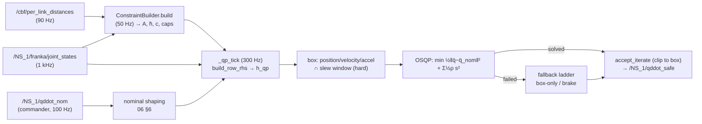

# 08 — Constraints and the quadratic program: from q̈_nom to q̈_safe

> **Source baseline:** `ba68077`. Written in Stage 4 (2026-11-11). Labels as in
> [00_INDEX.md](00_INDEX.md) §2. Line numbers refer to the baseline.
>
> **Reproducible checks.** Every number labelled *numerically verified* or *reproduced* is recomputed
> by [tools/stage4_verification/](tools/stage4_verification/README.md) (`run_all.sh`, read-only,
> 61 of 61 checks on 2026-11-11). The QP scripts build the problem **only from the production
> builders** and solve it with the deployed OSQP (0.6.7 wrapper, core v0.6.3) inside the
> `franka_ros2` container. An independent SciPy SLSQP solve cross-checks the solution.

Chapter 07 built the obstacle rows; chapter 06 §6 the reshaped nominal. This chapter assembles
everything into the quadratic program that `nodes/cbf_safety_filter.py` solves at `qp_rate_hz`
(300 Hz in the hardware default, 100 Hz in `minimal_l1`), and follows what happens when it cannot
be solved.

Code map (package `franka_experiments/franka_experiments/`):

| Role | `file::function` |
|---|---|
| Per-tick orchestration | `nodes/cbf_safety_filter.py::_qp_tick` L1038–1511 |
| Solve and fallback ladder | `cbf_safety_filter::_solve` L1624–1767, `_brake_box` L1603–1622 |
| Objective, bounds, A matrix | `utils/cbf_qp_assembly.py`: `build_qp_objective` L86, `build_osqp_bounds` L117, `build_osqp_A` L38, `pad_rows_to_block` L266 |
| Right-hand sides | `cbf_qp_assembly.build_row_rhs` L151 (07 §3.8) |
| Iterate acceptance, fallbacks | `cbf_qp_assembly`: `accept_iterate` L541, `box_only_solve` L566, `braking_command` L592 |
| Hard joint box | `utils/cbf_hard_limits.py`: `hard_accel_box` L129, `position_velocity_accel_box` L232, `apply_slew_limit` L296, `fr3_velocity_envelope` L106 |
| Row families | `utils/cbf_state_rows.py` (obstacle 07; `joint_limit_rows` L59, `SelfCollisionRowBuilder` L951, rate caps L3110–3127 and L3505–3556, `ShadowRowBuilder` L1193); `utils/cbf_singularity.py::SingularityRowBuilder` |
| QP set-up | `cbf_safety_filter.__init__` L241–283 (objective, slack boxes), `_warmup` L661 |

---

## 1. Intuition

The nominal command q̈_nom says what the task wants. The QP returns the joint acceleration that is
**closest** to it in the Euclidean sense while satisfying two kinds of requirement:

- a **hard box** on each joint's q̈, which encodes what the joint may physically and safely do this
  tick: acceleration limits, a velocity envelope, braking before the position limits, and a
  jerk-like slew limit;
- **soft rows**: barrier inequalities for obstacles, self-collision, joint limits and singularity,
  plus rate caps. Each may be violated, at a quadratic (or, in one mode, linear) price, by a
  **slack** variable.

The design choice to make every barrier soft and only the box hard is what keeps the QP always
feasible (§3.5). It is also why the filter's safety statement is a *penalty* statement, not a
guarantee (§3.2, F-4-1).

---

## 2. The QP actually solved

### 2.1 General form

The textbook acceleration-level CBF-QP is

  (8.1)  min_{q̈, s}  ½(q̈ − q̈_nom)ᵀW(q̈ − q̈_nom) + penalty(s)
          s.t.  aᵢᵀq̈ + mᵢ s_{g(i)} ≥ bᵢ (barrier and rate rows),  q̲̈ ≤ q̈ ≤ q̄̈,  s ≥ 0.

### 2.2 Decision vector and objective (Verified)

  (8.2)  x = [q̈ (7) ; s_obs, s_sc, s_qlim, s_sing, s_cap, s_spd, s_ssb (7 family slacks) ;
              σ₁ … σ_K (K = `obstacle_row_slack_slots` per-row slots, only in `row_l1` mode)].

So n_x = 14 in the shipped `family` mode and 46 in `row_l1` (K = 32). (`cbf_state_rows`:
`N_SLACK = 7`, `NX = 14`; `row_slack_slots`.) OSQP minimises ½xᵀPx + qᵀx with
(`build_qp_objective` L86–114, `_qp_tick` L1440):

  P = blkdiag(I₇, diag(ρ_obs, ρ_sc, ρ_qlim, ρ_sing, ρ_cap, ρ_spd, ρ_ssb), ε·I_K),
  q = [−q̈_nom ; 0₇ ; ρ_l1·1_K].

Expanding:

  (8.3)  ½xᵀPx + qᵀx = ½‖q̈ − q̈_nom‖² + Σ_g ½ρ_g s_g² + Σ_k (½ε σ_k² + ρ_l1 σ_k) − ½‖q̈_nom‖².

The last term is a constant. So the implemented objective is (8.1) with **W = I** (no joint
weighting, no inertia weighting), a **quadratic** penalty per family, and, in `row_l1` mode, an
**L1 + small quadratic** penalty per obstacle row. The identity is verified to 1e-13
(`check_qp_assembly.py` 1).

| ρ (hardware default) | value | ρ | value |
|---|---|---|---|
| ρ_obs (`rho_slack`) | 1000 | ρ_cap (`rho_slack_retreat`) | 100 |
| ρ_sc | 20000 | ρ_spd (`rho_slack_link_speed`) | 500 (raised to `_ISO_RHO_SLACK_SPEED` with ISO speed rows) |
| ρ_qlim | 200 | ρ_ssb | 400 |
| ρ_sing | 2000 | `row_l1`: ρ_l1, ε (`obstacle_row_slack_eps`) | 1000, 1000 |

`qp_smooth_weight` (0.2) has no reader (F-1-14): there is no smoothing term in the objective; the
slew limit (§2.4.4) is a hard bound instead.

### 2.3 Constraint representation (Verified)

Each CBF row i is stored as a row of G = [−A | −M] and enforced as

  (8.4)  −aᵢᵀq̈ − mᵢ s_{col(i)} ≤ h_qp,i   ⇔   aᵢᵀq̈ + mᵢ s_{col(i)} ≥ −h_qp,i.

- `build_osqp_bounds` L146–147 sets l = −∞, u = h_qp on these rows and l = box_lb, u = box_ub on
  the identity rows underneath.
- `build_osqp_A` returns A_osqp = [G_padded ; I_{n_x}]. Its sparsity pattern is **dense and
  independent of the values**: explicit zeros are kept, nnz = n_pad·n_x + n_x
  (`check_qp_assembly.py` 2). That is what makes `update(Ax=…)` legal whenever the padded row
  count is unchanged.
- `col(i)` = NV + family index, or NX + k for the k-th obstacle row in `row_l1` mode (`build` L3707–3722).
- mᵢ = 1, or w_max/wᵢ with weighted slack (OFF), times the zone-ladder multiplier
  (0.5 / 0.25 on the priority / hold rungs, 07 §5) on obstacle rows.
- Slack bounds: every slack lies in [0, 1e6], except `obstacle_slack_max` and `ssb_slack_max` (both
  1e6 shipped; ≤ 0 makes those families hard, with a warning) (`__init__` L267–281).

### 2.4 Constraint families

Configuration column: **hw** = hardware default launch (= `sim:kf`); **l1** = `sim:minimal_l1`
(`tools/stage3_verification/effective_params.py`, `_common4`).

| Family (group) | Row | Hard/soft | hw | l1 |
|---|---|---|---|---|
| Obstacle HOCBF (G_OBS) | (7.7)/(7.10) per valid entry | soft, ρ 1000 (family) / L1 slot | on | on (row_l1) |
| Joint-position HOCBF (G_QLIM) | (8.9), within 0.3 rad of a limit | soft, ρ 200 | on | on |
| Self-collision HOCBF (G_SC) | (8.10), ≤ 8 capsule pairs | soft, ρ 20000 | on | on |
| Singularity HOCBF (G_SING) | (8.11), ≤ 1 row | soft, ρ 2000 | on | on |
| Retreat cap (G_CAP) | (8.15) per obstacle row | soft, ρ 100 | on | off |
| Task-space speed cap (G_SPD) | (8.15) per obstacle control point | soft, ρ 500 | on | off |
| Self-shadow barrier (G_SSB) | 05 §8.2 / `ShadowRowBuilder` | soft, ρ 400 | off | off |
| ISO SSM speed rows (G_SPD) | `ssm_speed_cap` instead of the link-speed cap | soft | off | off |
| Joint acceleration | box (8.7) | **hard** | on | on |
| Joint velocity (flat limit + firmware envelope) | box via (8.5)–(8.7) | **hard** | on | on |
| Joint position braking | box via (8.5) | **hard** | on | on |
| Slew (Δq̈ per tick) | box ∩ (8.8) | **hard** (yields to the state box) | on | on |
| Torque / effort | — **none in the QP** (F-4-11; see 09 §2) | — | — | — |
| Workspace | — **none** (`workspace_face_rows` has no caller) | — | — | — |

#### 2.4.1 Joint acceleration limits (hard)

`__init__` L152–168: q̄̈ = min(`qddot_accel_limits`, `qddot_max_abs`) =
(6, 2.585, 3.5, 4, 6, 5.5, 6) rad/s². The braking authority used by the position terms is
a_brk = min(deceleration limits, `qddot_max_abs`, `qddot_accel_limits`), the same vector here.
(Verified; `check_box_and_brake.py` prints it.)

#### 2.4.2 Velocity and position: the state box (hard)

For each joint, with h_up = max(q_max − m_q − q, 0), h_lo = max(q − m_q − q_min, 0),
m_q = `position_margin_rad` = 0.05 and a_auth = η·a_brk with η = `position_brake_eta` = 0.6:

  (8.5)  v̄ = min(0.7·q̇_max, √(2 a_auth h_up), 0.7·ū_env(q)),
         v̲ = max(−0.7·q̇_max, −√(2 a_auth h_lo), 0.7·l̲_env(q)),
  (8.6)  ū_env(q) = min(L, max(0, −v_off + √(s·(q_ref,up − q)))),  l̲_env symmetric
         (`fr3_velocity_envelope`: Franka's position-dependent velocity limit),
  (8.7)  q̄̈ ← min(q̄̈, (v̄ − q̇)/T₊),  q̲̈ ← max(q̲̈, (v̲ − q̇)/T₋),
         with T = `state_box_relax_s` = 0.1 s while the velocity is inside its bound, and the
         tick Δt = 1/300 s when it is outside (an immediate return).

Then `ub = max(ub, lb)` (never empty), and `clip_to_limits` keeps lb ≤ q̄̈.

**Derivation of the position term.** A joint at distance h from its margin, moving at v toward it
and braking with a constant deceleration a, stops after v²/(2a). Requiring v²/(2a_auth) ≤ h gives
v ≤ √(2 a_auth h), and η = 0.6 leaves 40 % of the braking authority unused by this term. q_min and
q_max are clipped to Franka's envelope references (`cbf_safety_filter` L207–208), so the position
box also keeps the envelope's square root real.

**Verified numerically:**
- `hard_accel_box` equals an independent implementation of (8.5)–(8.7) on 2000 random states,
  inside and outside the limits; the box is never empty.
- A joint always accelerated at the box edge toward q_max ends within 1.9e-5 rad of q_max − m_q
  (discretisation residue at 300 Hz, ideal tracking) (`check_box_and_brake.py` 1–3).

#### 2.4.3 Slew limit (hard, but yields)

  (8.8)  q̈ ∈ [q̈_prev − δ_eff, q̈_prev + δ_eff],  δ_eff = `max_qddot_delta`·min(Δt_tick/Δt_nom, 10),

intersected with the state box (`apply_slew_limit`, `_qp_tick` L1453–1466). When the slew window
and the state box are **disjoint** for a joint, the state box wins for that joint
(`slew_yields_to_state_box`), so a velocity or position emergency is never blocked by the jerk
limit. δ = 0.5 rad/s² per 3.33 ms tick is 150 rad/s³. A late tick stretches the window, up to ×10.
q̈_prev is the last **published** command (`_publish` L1924).

#### 2.4.4 Barrier rows on joint states (soft)

All use the same HOCBF right-hand side as the obstacle rows, h_qp = k₁(aᵀq̇_cbf − v_obs) + k₀h̄ + c,
with v_obs = 0 (07 (7.10)) and the scalar gains (the zone ladder schedules obstacle rows only).

- **Joint limits** (`joint_limit_rows`):

    (8.9)  h = q_max − m − q (a = −e_j) or h = q − m − q_min (a = +e_j), c = 0,

  emitted only while h < `joint_limit_row_horizon` = 0.3 rad (m = `joint_limit_row_margin` = 0).
  Units: h in rad with the same k₀, k₁ as metres, so ḧ + k₁ḣ + k₀h ≥ 0 is the same law in joint
  space. It overlaps the hard position box (§2.4.2). The row acts earlier and softly, the box later
  and hard.
- **Self-collision** (`SelfCollisionRowBuilder.build`): capsules from the URDF built with
  `with_sc:=true` (hand included), 16 excluded pairs. For each remaining pair, take the
  segment-segment closest points p_a, p_b and

    (8.10)  h = ‖p_a − p_b‖ − r_a − r_b − m_sc,  n̂ = (p_a − p_b)/‖·‖,  a = n̂ᵀ(J_a − J_b),
            c = n̂ᵀ(J̇_a − J̇_b)q̇,

  with m_sc = 0.02 m. Rows are emitted for the ≤ 8 closest pairs with h below 0.08 m plus a lead
  term (0.35 s × the EMA'd closing speed), with release hysteresis ×1.6. Both bodies belong to the
  robot, so v_obs = 0 and the row is exact up to the capsule model.
- **Singularity** (`SingularityRowBuilder.build`): σ = σ_min(W J₆(fr3_link8)) with
  W = diag(1, 1, 1, 0.3, 0.3, 0.3), and

    (8.11)  h = σ − 0.05,  a = ∇_q σ (forward differences, ε = 1e-4),  c = min(ȧᵀq̇, 0),

  where ȧ is differenced between rebuilds. The min keeps the drift term one-sided (only tightening).
  One row, only while h < 0.08. Cost: 7 extra Jacobian + SVD evaluations per rebuild.

#### 2.4.5 Rate-cap rows (soft, not barriers)

Stored with a negated a, so G = [−A | −1] turns them into upper bounds. Their RHS is a first-order
approach to a speed cap (`retreat_cap_rhs`):

  (8.15)  ŝᵀJq̈ − s ≤ (v_cap − ŝᵀJq̇)/T,

- **retreat cap:** ŝ = n̂ (separation along the obstacle normal), v_cap from (7.15), T = 0.15 s;
- **task-space speed cap:** ŝ = the control point's direction of travel, v_cap =
  min(obstacle_link_speed_cap(d), link_speed_cap(d_sc)), active once the point moves faster than
  0.5·v_cap, T = 0.1 s.

They exist to stop the barrier from flinging the arm (07 (7.11)) and as an ISO-style speed limit
near obstacles.

### 2.5 Row counts and dimensions

n_c = (#valid obstacle entries within the horizon and leverage) + (#retreat caps, one per obstacle
row) + (#speed rows) + (≤ 14 joint-limit rows) + (≤ 8 self-collision) + (≤ 1 singularity) +
(SSB, off). `pad_rows_to_block` pads to a multiple of `qp_row_block` = 16 with inert rows
(G = [0 … 0 −1] on the last slack column, u = +∞). In the `check_qp_assembly` scenario, 4 rows
became 16 and nnz(A_osqp) = 16·14 + 14 = 238. Padding changes the solution by 0
(`check_qp_assembly.py` 4).

---

## 3. Slack: what it relaxes and what it costs

### 3.1 Why slack exists

A hard CBF row can be infeasible against the hard box (or against another row). OSQP would then
return "infeasible" and the filter would have to fall back to a cruder command. Slack makes the
problem feasible for any data. The price is that a "satisfied" row is now the **relaxed** row.

### 3.2 F-4-1: in `family` mode the barrier is a penalty

Take one barrier row aᵀq̈ + s ≥ b inside the box, with q̈ unconstrained otherwise. The KKT
conditions of min ½‖q̈ − q̈_n‖² + ½ρs² are q̈ = q̈_n + λa, ρs = λ and aᵀq̈ + s = b when binding.
Hence

  (8.12)  λ = (b − aᵀq̈_n)/(‖a‖² + 1/ρ),  s = (b − aᵀq̈_n)/(1 + ρ‖a‖²) > 0.

The unrelaxed HOCBF inequality is violated by s on **every** tick on which it binds; it is never
exactly met. At ρ = 1000 and ‖a‖ = 0.54 that is 0.35 % of the required correction. With a zone
multiplier m the violation becomes m²(b − aᵀq̈_n)/(m² + ρ‖a‖²): the inner rungs' m < 1 shrink it.
**Derived; numerically verified to 1e-16** (`check_slack_and_priority.py` A).

What this means for the guarantee: the forward invariance of (7.6) requires ḧ + k₁ḣ + k₀h ≥ 0
exactly. With the penalty it holds as ḧ + k₁ḣ + k₀h ≥ −m·s(t), a small negative forcing. Through
the positive impulse response of a real-root pair (07 (7.8)) this gives a bounded intrusion
proportional to the integral of s, not zero. **Derived;** the size on the robot is runtime.

### 3.3 F-4-2: one family slack relaxes every row of the family

All obstacle rows share s_obs. If one row cannot be met (it lies outside the box or the slew
window, or conflicts with another row), s_obs grows, and **every** obstacle row is relaxed by that
amount. In the test, a second obstacle row that alone would have been met to 3e-3 was violated by
its whole demand, 0.500 of 0.5 m/s² (`check_slack_and_priority.py` B). Obstacle rows exist per
control point and per obstacle rank (07 §6), so the coupling spans the whole arm. **Numerically
reproduced.**

### 3.4 Priorities between families

- **The box beats every row** (F-4-3). Rows are soft, the box is hard. In
  `check_slack_and_priority.py` D the slew window ±0.5 capped aᵀq̈ at Σ|aᵢ|·δ = 0.415 m/s², so the
  obstacle row was relaxed by exactly the shortfall 0.385. In `check_qp_assembly.py`, where the
  previous command made the slew window exclude the barrier's demand, s_obs = 1.40 m/s².
- **Between rows, the multipliers equalise.** At the optimum ρ_g s_g = λ_g. For an obstacle row
  and a retreat cap on the same normal that conflict (ρ_obs = 1000, ρ_cap = 100), the closed-form
  KKT split

    (8.13)  (1 + ρ_obs‖a‖²) s_obs − ρ_cap‖a‖² s_cap = b_obs − aᵀq̈_n,   s_obs + s_cap = b_obs − b_cap,

  gave s_cap = 0.542 and s_obs = 0.058 (`check_slack_and_priority.py` E, exact to 1e-16): the cap
  gives way, as intended. The ρ ranking sc (20000) > sing (2000) > obs (1000) > spd (500) > ssb
  (400) > qlim (200) > cap (100) is the effective priority order **among rows**, all below the box.

### 3.5 Feasibility

With every row soft (slacks bounded by 1e6) and a non-empty box (§2.4.2), the QP is feasible for
any data. 200 random conflicting snapshots all solved at the production tolerance
(`check_slack_and_priority.py` F). Setting `obstacle_slack_max = 0` (or `ssb_slack_max = 0`)
makes that family hard: an unreachable demand then yields "primal infeasible". The reasons a
solve can still fail are numerical: `max_iter`, or a non-finite iterate.

### 3.6 `row_l1`: exact penalty (only `minimal_l1`)

With a per-row slot σ_k and cost ½εσ² + ρ_l1σ, the row is met **exactly** (σ = 0) whenever the
multiplier of the hard row,

  (8.14)  λ_hard = (b − aᵀq̈_n)/‖a‖²  (unconstrained case),

stays below ρ_l1 = 1000. This is the classical exact-penalty property of an L1 term. In the test,
λ_hard = 2.80 gave σ = 0 (2e-23) and q̈ equal to the hard-constraint solution; a demand that the box
could not meet gave σ > 0 (`check_slack_and_priority.py` C). Rows beyond the 32 slots share the
family column (`diag_slot_overflow`). OSQP's eps_rel is tightened to 1e-5 in this mode.

### 3.7 Feasible QP vs safe command

A solved QP guarantees: the box is met (to OSQP tolerance, then clipped exactly by
`accept_iterate`) and every row is met **in its relaxed form**. It does not guarantee the unrelaxed
barrier inequalities. Always check the family slacks: they are published as the slack diagnostic
on `/cbf_status`, and `family_violations` (L1488–1497) computes raw vs relaxed violations per family.

---

## 4. OSQP and the numerical implementation

| Aspect | Implementation | Label |
|---|---|---|
| Solver | `osqp` Python wrapper 0.6.7.post3, core v0.6.3 (qdldl), in the container; the host has 1.1.1, whose API differs. `qpsolvers` 4.3.3 is pinned (lead in PROGRESS §7) and used by other filters, not by this one. | Runtime environment, observed 2026-11-11 |
| Settings | `warm_start=True`, `max_iter` = 20000; defaults otherwise: eps_abs = eps_rel = 1e-3 (eps_rel 1e-5 with `row_l1`), polish off, adaptive ρ, σ = 1e-6, α = 1.6, termination check every 25 iterations, **time_limit off** | Verified (`_solve`; OSQP banner) |
| Rebuild vs update | a new `osqp.OSQP()` + `setup` (factorisation) whenever the **padded** row count changes, or after a failure; otherwise `update(q, l, u, Ax)` and solve warm | Verified (`_solve` L1684–1701) |
| Fixed pattern | dense G with explicit zeros, so `Ax` has a value-independent pattern | Numerically verified |
| Equivalence | `update` then solve equals a fresh setup to 2e-16 at eps 1e-9; padded equals unpadded; OSQP equals SLSQP to 3e-13 at eps 1e-9 | Numerically verified |
| Production-tolerance spread | warm vs cold 6.4e-3 rad/s² in q̈; vs SLSQP 1.5e-4 rad/s²; relaxed-row residual 7.8e-4 | Numerically reproduced (F-4-10) |
| Warm-up | `_warmup` sets up and solves two throw-away problems in `__init__`, so first-call costs are paid before the loop | Verified |
| Threading | three mutually exclusive callback groups: IO (subscriptions), perception (50 Hz rebuild), control (QP timer) | Verified (`__init__` L421–423, timers L525–528) |
| Rates | QP timer 300 Hz; recorded 299.99 Hz on fake hardware, 99.2 Hz against 100 in one sim cell; rebuild 50 Hz configured, 35.1 Hz recorded in that cell | Runtime (recorded), 02 §6 |

**Complexity (Derived).** Per iteration OSQP solves with a cached LDLᵀ factor of the
(n_x + m)-dimensional KKT matrix, m = n_pad + n_x. With n_x = 14 and n_pad ≤ 32 or so, the work is
on the order of nnz(A) ≈ 500 flops per iteration. A rebuild refactorises, which is why the row
count is padded to blocks of 16. No measured solve times are claimed here.

**Risk (Derived):** with `time_limit` off and `max_iter` = 20000, a hard instance can occupy the
control callback group far beyond the 3.33 ms tick. `_watch_tick_gap` only logs gaps above 3 ticks.

---

## 5. Failure management: the fallback hierarchy

### 5.1 Per-tick decision tree (`_qp_tick`, Verified)

| Order | Condition | Command published | CBF rows |
|---|---|---|---|
| 1 | ISO stop latched (`iso_enabled` ∧ `iso_monitor_enabled`, OFF) | box-only QP toward q̈ = clip(−q̇/τ_stop) | none |
| 2 | joint state older than `joint_state_timeout` = 0.1 s | **clip(−k_brake·q̇_stale, ±q̄̈)**, static box, no QP | none (F-4-5) |
| 3 | nominal older than `nom_timeout` = 0.5 s | QP with nominal −k_brake·q̇ | kept |
| 4 | joint state frozen (identical values, fresh stamps, ‖q̇‖ above a floor) | QP with nominal −k_brake·q̇, fault | **dropped** |
| 5 | empty-frame fault (ISO only) | same as 4 | dropped |
| 6 | snapshot fresh (`now − con.t_dist < 0.5 s`) | full QP | kept |
| 7 | distance data stale (> 0.5 s) | QP with nominal −k_brake·q̇, fault | dropped |
| 8 | no snapshot: either nothing built a row (`build` returned None: nothing in view and no joint/self-collision/singularity row), **or no distance message has ever arrived** | QP with the nominal, box only, **no fault** | none (F-4-12) |

**F-4-12 (Verified).** `_update_constraints` (L958–961) builds a snapshot only once a joint state
**and** a distance message exist. Before perception's first message, `_con` is None and `_obs` is
None, so row 7 cannot fire. Row 8 then applies: the nominal goes through a box-only QP, with no
obstacle, joint-limit, self-collision or singularity rows and fault = 0. A perception node that never
starts is therefore indistinguishable, on `/cbf_status`, from an empty scene. A perception node that
stops after its first message triggers the brake (row 7).

### 5.2 Solver failure (`_solve`, Verified)

- `accept_iterate` rejects an iterate that is non-finite or whose status is neither "solved" nor
  "solved inaccurate" (inaccurate is accepted, `accept_inaccurate_qp: true`). Otherwise it clips q̈
  into the box.
- With OSQP 0.6, an infeasible problem returns `res.x` as an object array of None, and
  `accept_iterate` **raises**. The surrounding `try/except` catches it and the ladder proceeds
  (F-4-4).
- **Ladder:** `qp_failure_policy` = `brake` (default) goes directly to the brake. `box_only` first
  tries `box_only_solve` (the QP without rows, i.e. the projection of q̈_nom onto the box), then
  the brake.
- **Brake:**

    (8.16)  q̈ = clip(−k_brake·q̇, lo, hi),  (lo, hi) = state box ∩ slew window (`_brake_box`,
            `brake_slew_limited`),

  with k_brake = 3 s⁻¹: an exponential velocity decay with τ = 1/3 s, inside the box.
- After any failure the OSQP object is discarded and rebuilt on the next tick.

**Does the brake satisfy the limits?**
- The QP-failure brake (8.16) stays inside the state box, so it respects the position-braking and
  velocity terms. From the box's fastest state 0.10 rad before the margin, joints 1 and 4 stayed
  inside q_max (`check_box_and_brake.py` 4). It ignores obstacle rows by construction ("braking does
  not avoid a lateral obstacle", lead in PROGRESS §7).
- The **stale-joint-state brake** (row 2 above) is different (**F-4-5**).
  - It uses the static acceleration box, and re-publishes the same −k_brake·q̇_stale every tick
    while the state stays stale.
  - Integrated by the controller (09 §3), the commanded velocity reverses at t = 1/k_brake =
    0.333 s and keeps accelerating backward.
  - Derived: a constant deceleration k·v₀ stops after v₀/(2k). So from the box's fastest state it
    overshoots the position margin when v₀ > 2k·h. From h = 0.10 rad this is the case on joints 1,
    5, 6 and 7 (up to 0.040 rad, still inside q_max). Joint 4 is protected by the firmware envelope,
    which caps v₀ first.
  - Numerically reproduced with ideal tracking; the closed-loop effect is Unverified.

---

## 6. From the commander's q̈ to the published q̈_safe: ordering

1. **Reception** (`_on_qddot_nom`): any 7-vector is stored with the receipt time. There is no
   value check (finite, magnitude).
2. **Freshness** (§5.1 rows 2–8): stale nominal → −k_brake q̇.
3. **Shaping** (06 §6, audited order): zone fade → state governor fade (or directional fade) →
   tangential bias → go-around (+ cut) → lateral-evasion bias → [outrun] → livelock bias.
4. **Constraint activation:** the 50 Hz snapshot's rows (A, h̄, c, gains, caps) and
   `build_row_rhs` at the QP rate (refreshes aᵀq̇ and the cap RHS only).
5. **Box:** `position_velocity_accel_box` then `apply_slew_limit`.
6. **QP** (§2–§4).
7. **Post-processing:** only `accept_iterate`'s clip of q̈ into the box. This can move a relaxed row
   by at most the OSQP tolerance (F-4-10). Nothing else changes q̈ before `_publish`;
   `_brake_authority_fault` is diagnostic only.
8. **Fallback** (§5.2) replaces 6–7 on failure.

**Rate scaling** (`utils/rate_scaling.py`): the evidence gates are counts derived from durations at
the measured input rate (07 §4), and the slew window scales with the tick gap (8.8). The k-tick
EMA factors use a^(Δt/0.01 s) (06 §6).

**Consistency of shaping with the constraints (Derived).** The shaping changes only q̈_nom, i.e.
the linear term of the objective; it cannot loosen a row or the box. Two interactions are real:
- a bias that pushes against a binding row raises its multiplier, and with it the family slack
  (§3.2), so a strong nominal costs barrier violation;
- the slew window is centred on the previous **published** command, so when the shaped nominal
  jumps (F-3-16, a bias dropping in one tick), the box limits the step but the barrier rows then
  compete with the slew window (F-4-3).

---

## 7. Practical example (`check_qp_assembly.py`)

Hardware-default parameters, real kinematics. q = q_home with q₇ = 2.90 rad; the fingertip moves
toward an obstacle 0.13 m ahead at 0.15 m/s; the nominal accelerates it at 2 m/s² toward the
obstacle. The previous command equals the nominal.

1. **Rows:** obs 1, sc 1 (link5/hand capsules), qlim 1 (q7+, h = 0.12 rad), cap 1, padded to 16.
2. **Box:** q̈₂ ∈ [−2.585, 2.585]. The slew window [4.08, 5.08] around q̈_prev,2 = 4.58 lies
   outside the acceleration limit, so it yields to the state box.
3. **Solution:** q̈_safe = (0, −2.585, 0, 1.555, 0, 4.447, 0) against
   q̈_nom = (0, 4.579, 0, 2.055, 0, 4.947, 0).
4. **The obstacle row demands** aᵀq̈ ≥ 0.693 m/s² and gets −0.707: s_obs = 1.40, because joints 4
   and 6 are pinned at the bottom of their slew windows and joint 2 at its limit. The QP is
   "solved", but the barrier is violated by 1.40 m/s² along n̂ this tick. It is the box (slew)
   that decided.

---

**Not part of the running QP (Verified by grep):**
- `utils/cbf_qp.py` has no importer in either package, which confirms the F-0-4 candidate;
- `cbf_hard_limits.workspace_face_rows` has no caller;
- `cbf_hard_limits.velocity_accel_box` is superseded by `position_velocity_accel_box`, and its
  docstring says so.

## 8. Consequences of modification

| Change | Effect |
|---|---|
| ρ values | the size of the penalty violation (8.12) and the inter-family priorities (8.13). Raising ρ_obs shrinks the violation ∝ 1/ρ but cannot remove it. |
| `obstacle_slack_mode: row_l1` | exact enforcement below ρ_l1 (8.14); one slot per row removes the coupling F-4-2; tightens eps_rel; changes n_x (46) and the KKT size. |
| `obstacle_slack_max` / `ssb_slack_max` ≤ 0 | hard rows → infeasibility possible → fallback ladder (and F-4-4 path). |
| `max_qddot_delta`, `slew_*` | the jerk bound and how often the box overrules the barrier (F-4-3). |
| `position_brake_eta`, `state_box_relax_s`, `velocity_box_margin` | the state box; also the brake fallback's envelope (8.16) and F-4-5's threshold a_auth/(2k²). |
| `k_brake` | every brake path, the stale-JS reversal time 1/k (F-4-5), the governor's and zone fade's target. |
| `qp_row_block` | rebuild frequency vs problem size. |
| OSQP settings (eps, polish, time_limit) | the accuracy of every relaxed row (F-4-10) and the worst-case tick time. |
| Adding torque rows | would need M(q) in the QP (rows τ_min ≤ Mq̈ + Cq̇ ≤ τ_max); none exist today (F-4-11). |
| Tests pinning this | `test_cbf_qp_fallback`, `test_cbf_row_l1_slack`, `test_cbf_row_padding`, `test_cbf_hard_constraints`, `test_cbf_multi_cp_qp`, `test_brake_slew_limited`, `test_accel_box_decoupling`, `test_cbf_risk_weighted_slack`, `test_safety_failure_policy`, `test_cbf_singularity`, `test_ssb_qp_rows`, `test_state_governor`, `test_rate_scaling`, `test_retreat_excess_speed`, `test_shipped_smoothness_config` (names; contents not read in this stage). |

## 9. Findings from this chapter

| ID | Short title | Section | Reproduced by ([tools/stage4_verification/](tools/stage4_verification/README.md)) | Still needs |
|---|---|---|---|---|
| F-4-1 | family slack makes the barrier a penalty (always violated when binding) | §3.2 | `check_slack_and_priority.py` A | runtime size |
| F-4-2 | one family slack relaxes every obstacle row | §3.3 | `check_slack_and_priority.py` B | — |
| F-4-3 | the hard box, including the slew window, overrules every barrier | §2.4.3, §3.4 | `check_slack_and_priority.py` D, `check_qp_assembly.py` | runtime frequency |
| F-4-4 | `accept_iterate` raises on OSQP 0.6 infeasible output | §5.2 | `check_slack_and_priority.py` F | — |
| F-4-5 | the stale-joint-state brake is open loop: reversal after 1/k, margin overshoot | §5.2 | `check_box_and_brake.py` 5 | closed loop |
| F-4-10 | default OSQP tolerance: residuals ~1e-3; time_limit off | §4 | `check_qp_assembly.py` | timing on target |
| F-4-11 | no torque rows, no workspace rows | §2.4 | grep + `check_torque_realization.py` 5 | — |
| F-4-12 | before the first distance message: no rows at all, no fault | §5.1 | code reading | runtime |
