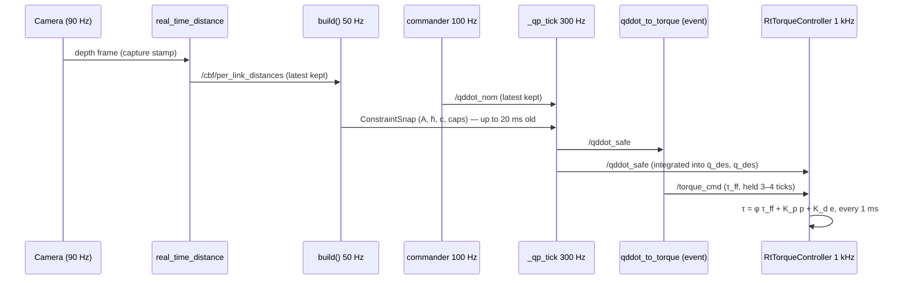

# 09 — Torque realization: from q̈_safe to the joint effort command

> **Source baseline:** `ba68077`. Written in Stage 4 (2026-11-11). Labels as in
> [00_INDEX.md](00_INDEX.md) §2. Line numbers refer to the baseline.
>
> **Reproducible checks.** [tools/stage4_verification/](tools/stage4_verification/README.md):
> `check_torque_realization.py` runs the production `qddot_to_torque` methods against an independent
> Pinocchio RNEA inside the container. `check_controller_sources.py` pins the C++ and launch facts and
> contains a labelled **transcription** of the 1 kHz controller loop. The C++ controllers themselves
> were read, not executed.

Chapter 08 ends with `/NS_1/qddot_safe`. This chapter follows that acceleration through the Python
inverse-dynamics node and the C++ `ros2_control` controller to the effort interface of the FR3, or of
the Gazebo plant. It answers **Q-1-1** (who compensates gravity in Gazebo).

Code map:

| Role | `file::function` |
|---|---|
| q̈ → τ (Python, event-driven) | `franka_experiments/franka_experiments/nodes/qddot_to_torque.py::QddotToTorqueNode` (`_on_qddot_nom` L198, `_compute_tau` L279, `_limit_and_report` L222) |
| 1 kHz torque controller (Pipeline A) | `franka_rt_controllers/src/rt_torque_controller.cpp::RtTorqueController` (`update` L54–202, `on_configure` L362–518) |
| Its YAML | `franka_experiments/utils/launch_support.py::_generate_torque_yaml` L238–360; Gazebo: `franka_simulation_experiments/scripts/simexp/sim_config.py::rt_controllers_yaml` L127–140 |
| Alternative controller | `franka_rt_controllers/src/cbf_torque_controller.cpp::CBFTorqueController` (`minimal.launch.py use_torque_controller:=cbf`) |
| Plugin registration | `rt_velocity_blender_controller.xml` (RtTorqueController, RtVelocityExecutorController), `franka_rt_controllers.xml` (CBFTorqueController) |
| Gazebo hardware | `franka_gazebo/franka_ign_ros2_control/src/ign_system.cpp::IgnitionSystem::write` L638–725; URDF changes in `franka_simulation/scripts/utils/gz_robot_description.py` |

---

## 1. Dynamics and what "acceleration control" means here

### 1.1 Equations of motion

For the 7 arm joints (fingers fixed or ignored),

  (9.1)  M(q) q̈ + C(q, q̇) q̇ + g(q) = τ + τ_ext,

where:
- M(q) ∈ ℝ⁷ˣ⁷ is the joint-space inertia matrix (kg·m², symmetric positive definite);
- C(q, q̇)q̇ are the Coriolis and centrifugal torques (N·m);
- g(q) is gravity (N·m);
- τ is the actuated torque;
- τ_ext covers contacts and unmodelled friction.

Pinocchio computes these terms in `computeAllTerms`: `data.M`, `data.nle` = C q̇ + g, `data.g` (04 §5).

### 1.2 Inverse dynamics for a desired acceleration

To realise a chosen q̈* exactly (perfect model, no τ_ext), the actuator must supply

  (9.2)  τ* = M(q) q̈* + C(q, q̇) q̇ + g(q) = RNEA(q, q̇, q̈*).

The FR3 torque interface, like Gazebo's Franka plugin (§5), expects the command **without gravity**:
the firmware (or the plugin) adds g(q). The commanded torque is therefore

  (9.3)  τ_cmd = M(q) q̈* + C(q, q̇) q̇ = RNEA(q, q̇, q̈*) − g(q).

### 1.3 Acceleration control vs torque control

The filter (chapter 08) chooses q̈. That choice is safe only to the extent that the realised q̈ equals
the chosen one: `cbf_hard_limits.FR3_MAX_JOINT_ACCEL`'s docstring states exactly this assumption, and
reports a measured tracking error of up to 18 rad/s². Torque control realises q̈ only through (9.3)
and a model. The difference is absorbed by the controller's feedback (§3), not by the barrier.

---

## 2. `qddot_to_torque`: acceleration to torque (Verified)

**Interfaces** (`__init__` L60–167):

| | Topic | Type | QoS |
|---|---|---|---|
| sub | `topics.joint_states_fast` = `/NS_1/franka/joint_states` | `sensor_msgs/JointState` | depth 1 |
| sub | `topics.qddot_safe` = `/NS_1/qddot_safe` | `Float64MultiArray` (7) | depth 10 |
| pub | `torque_out_topic` = `topics.torque_cmd` = `/NS_1/torque_cmd` | `Float64MultiArray` (7), N·m | depth 10 |
| pub | `/NS_1/torque_saturation` | `Float64MultiArray` (7 flags) | depth 10 |

**Model.** `generate_urdf_from_xacro` runs `fr3.urdf.xacro hand:=true ee_id:=franka_hand`, giving
nv = 9 (7 arm joints plus 2 fingers at their neutral value). The arm columns are selected by name
(`resolve_arm_joint_ids`), and each incoming joint state is mapped by name (L177–188).

**Computation** (`_compute_tau` L279–306), on **every** `/qddot_safe` message, with the last stored
(q, q̇):

  (9.4)  τ = M_arm(q) q̈_safe + (nle − g)_arm(q, q̇) = M q̈_safe + C(q, q̇) q̇.

**Numerically verified:** this equals RNEA(q, q̇, q̈) − g(q) from an independent Pinocchio call to
4e-14 N·m on 200 random states; τ(q, 0, 0) = 0, i.e. gravity is excluded; the arm block of
`data.M` is exactly symmetric with Pinocchio 4.0.0 (F-2-3) (`check_torque_realization.py` 1–3).

**Limiting** (`_limit_and_report` L222–275). It computes the effort clip at
`effort_max` = (87, 87, 87, 87, 12, 12, 12) N·m and a per-call rate limit of
40·100/`qp_rate_hz` N·m (13.3 at 300 Hz). It publishes the saturation flags, but **returns the
unclipped τ unless `iso_enabled`** (shipped false). With ISO on it returns the clipped and
rate-limited τ (**F-4-6**; `check_torque_realization.py` 4). The rate limit reads `qp_rate_hz` from
the installed YAML, not the filter's effective value (cf. F-1-10).

**Timing and staleness:**
- the node is purely event-driven: one τ per `/qddot_safe`, i.e. at the QP rate;
- it never checks the age of its joint state, and it does not publish without a `/qddot_safe`;
- if `/qddot_safe` stops, the controller's `command_timeout` takes over (§3.2).

**F-4-13 (Verified).** The module docstring says "`rt_torque_controller` adds g(q) internally". It
does not (§3.2); the firmware (hardware) or the Gazebo plugin (§5) does. This is the same
inaccuracy as F-1-3 in the launch file docstring.

---

## 3. The C++ controllers

### 3.1 `ros2_control` integration (Verified)

`RtTorqueController` is a `controller_interface::ControllerInterface` plugin (exported via
`rt_velocity_blender_controller.xml`, library `franka_rt_controllers`). It claims:
- the command interfaces `fr3_joint{1..7}/effort`;
- the state interfaces `fr3_joint{1..7}/position, /velocity`.

The controller manager calls `update()` at `update_rate`: 1000 Hz with thread priority 85 when
`is_real`, 100 Hz on fake hardware (`_generate_torque_yaml`). The torque launch spawns it after
`control_spawner_delay_s` (02 §3). It has two subscriptions, both `SensorDataQoS().keep_last(1)`
(best effort):
- `command_topic` (τ_ff) feeds a `realtime_tools::RealtimeBuffer` (`commandCb`);
- `accel_topic` = `/NS_1/qddot_safe` feeds a second buffer (`accelCb`).

Each callback stamps its sample with `get_node()->now()`. `update()` reads the newest sample with
`readFromRT()`: lock-free, no allocation, no logging.

### 3.2 `RtTorqueController::update` (Verified, L54–202)

Per joint i, with Δt = `period`:

1. **τ stale** (no τ, or age ≥ `command_timeout` = 0.1 s): latch q_hold = q once, then
   τᵢ = K_p,i(q_hold,i − qᵢ) − K_d,i q̇ᵢ (a position hold), and reset q_des = q, q̇_des = q̇.
   A 200 ms wall timer logs the hold.
2. **q̈_safe fresh** (age < `accel_timeout` = 0.1 s): integrate a reference.

     (9.5)  q̇_des ← q̇_des + q̈_safe·Δt,  q̇_des ← clip(q̇_des, q̇_floor(q), q̇_ceil(q)),
            e = sat_{e_max}(q̇_des − q̇) (and q̇_des re-anchored to q̇ + e),
            q_des ← q_des + q̇_des·Δt,  p = sat_{p_max}(q_des − q) (q_des re-anchored).

   Here q̇_ceil/q̇_floor = 0.95 × the firmware velocity envelope (`qdotCeiling`, the same formula as
   (8.6)), e_max = 1 rad/s and p_max = 0.15 rad.
3. **q̈_safe stale but τ fresh:** q̇_des = q̇, q_des = q, e = p = 0 (feedforward only).
4. **Command:**

     (9.6)  τᵢ = φᵢ(τ_ff,i)·τ_ff,i + K_p,i pᵢ + K_d,i eᵢ,

   where φ = smoothstep(margin/0.25 rad/s) fades the feedforward when it would push the joint
   further toward its 0.95·envelope (`ffScale`, `ff_fade_band` 0.25).

**Gains** (`_generate_torque_yaml`; hardware and Gazebo):
- K_p = (120, 120, 120, 100, 40, 40, 20) N·m/rad;
- K_d = (30, 30, 30, 25, 10, 10, 5) N·m·s/rad;
- on fake hardware (`is_real` false) both are **0**, and the update rate is 100 Hz.

**What is not there (F-4-7, Verified, `check_controller_sources.py` 1–3):**
- no clamp of τ (neither effort limits nor a rate limit), no low-pass filter, no gravity term;
- the plugin XML says it "applies an optional low-pass filter, clips to per-joint limits"; the code
  does neither;
- `lpf_alpha`, `tau_max_scale` and `urdf_path` are written to the YAML but never declared (F-1-8).

On hardware, saturation is therefore left to `franka_hardware`, libfranka and the firmware (Q-4-3,
Unverified).

**Configure-time safety (real hardware only):** `on_configure` calls
`service_server/set_full_collision_behavior` with torque thresholds 20–35 N·m and force thresholds
25–40 N (the firmware reflexes). With `gazebo: true` this is skipped.

### 3.3 What the controller adds to the QP's decision (Derived)

- The **feedforward** τ_ff = M q̈_safe + C q̇ (9.4) alone realises q̈_safe only if the model matches.
- The **PD on the integrated reference** makes the arm follow ∫q̈_safe in velocity and position. It
  corrects model error (§5.2) but adds torque the QP never saw.
- e_max and p_max are anti-windup clamps: a blocked arm does not accumulate an unbounded reference.
- The velocity ceiling (0.95 envelope) lies outside the QP's own velocity box (0.7 envelope,
  (8.5)), so in the interior neither the ceiling nor φ binds. Near the position limits, where the
  envelope shrinks, φ can fade the feedforward. This is a **post-QP change** of the realised
  acceleration, in the conservative direction (less push toward the limit).

### 3.4 `CBFTorqueController` (alternative; Verified)

Spawned only by `minimal.launch.py use_torque_controller:=cbf` (F-1-9). Its YAML block registers
only the type, and `franka_rt_controllers/config/cbf_torque_controller.yaml` is referenced by no launch
or code file (grep), so the declared defaults apply: kd = 20, kp_local = kd_local = 0, no LPF. It runs
Pinocchio RNEA **inside** the 1 kHz loop on a model built with plain `xacro fr3.urdf.xacro`.
- **`/q_des_state` fresh** (< 0.1 s): it linearly interpolates the last two setpoints and
  commands τ = RNEA(q, q̇, q̈_sp) − g + K_p,loc(q_d − q) + K_d,loc(q̇_d − q̇), with
  **q̈_sp = `JointState.effort` of `/q_des_state`**.
- **Otherwise, `/qddot_safe` fresh:** τ = RNEA(q, q̇, q̈_safe) − g.
- **Both stale:** τ = kp_local(q_last − q) − kd·q̇, i.e. pure damping with the defaults.

**F-4-8 (Verified).** `pentagon_qddot_commander` publishes **its own nominal q̈** in
`/q_des_state.effort` (`_tick` L1110). Whenever that topic is fresh, this controller therefore
realises the **nominal**, not the filter's output. The filter is bypassed for as long as the
commander runs. The minimal launch starts neither node, so this needs a user-composed pipeline.
Whether that pipeline is used is Q-1-4.

---

## 4. Timing and multi-rate execution

| Stage | Rate (configured) | Evidence of the actual rate | Hold behaviour |
|---|---|---|---|
| Camera / perception | 90 Hz (`848x480x90`) | sim depth 90 Hz (02 §6) | the filter keeps the latest message |
| Constraint rebuild | 50 Hz (`cbf_update_rate_hz`) | **35.1 Hz** recorded in one sim cell (F-1-16) | the QP uses the last snapshot (A, h̄, c, v_obs frozen) |
| Commander | 100 Hz | 99.99 Hz on fake hardware (02 §6) | latest kept; stale after 0.5 s |
| QP | 300 Hz (hardware), 100 Hz (`minimal_l1`) | 299.99 Hz fake hardware; 99.2 Hz in a sim cell | — |
| q̈ → τ | per `/qddot_safe` | = QP rate (Derived) | — |
| RT controller | 1000 Hz (real, Gazebo), 100 Hz (fake) | indirect: the joint-state broadcaster's topic `/NS_1/franka/joint_states` was recorded at 100.0 Hz on fake hardware (02 §6); no direct controller-rate record | τ_ff and q̈_safe zero-order held; timeouts 0.1 s |

**Theoretical latency** (Derived, not measured): obstacle evidence reaches a command after
capture → perception compute → transport. Then up to 1/50 s (20 ms, or 28 ms at the recorded
35 Hz) until a rebuild uses it, up to 3.3 ms until the next QP tick, and ≤ 1 ms until the controller
applies it. The joint-velocity terms are fresher: aᵀq̇ is refreshed every QP tick, and the PD every
1 ms. Measured end-to-end latency is in the latency-budget tool (chapter 13), not reproduced here.

**Multi-rate inconsistencies (Derived):**
1. A, c, κ and v_obs are frozen for up to 20–28 ms, while k₁·aᵀq̇ moves at 300 Hz. c is quadratic in
   q̇, so it goes stale faster than the linear term (the code comment says so, 07 §3.6).
2. τ_ff is computed with the (q, q̇) that `qddot_to_torque` last received, while (9.6) is applied
   with the current state for up to 3–4 controller ticks. With M(q) varying slowly, the error is
   second-order. The PD terms use the fresh state.
3. The controller integrates the held q̈_safe exactly as a zero-order hold. Over one QP period
   q̇_des therefore changes by q̈_safe·(1/300 s), which is what the box (8.7) assumed when it bounded
   q̈ by (v̄ − q̇)/Δt (Derived). The two rates are consistent, provided the published q̈_safe actually
   arrives once per QP period; a late `/qddot_safe` simply extends the hold.
4. **Stamps.** Both buffers are stamped with the controller node's clock, and `update(time)` uses
   the controller manager's time. The two agree when both use the same clock source; in Gazebo that
   requires `use_sim_time` on both (Unverified here; the Gazebo cells in `sim_runs` did run).
5. **Scheduling.** The Python nodes are not real-time. The comment on `pad_rows_to_block` says the
   QP thread starves the IO callback group, and SCHED_FIFO on the QP thread was removed because of
   GIL inversion (lead, PROGRESS §7). A starved joint-state callback is what triggers the open-loop
   brake of F-4-5.

---

## 5. Gazebo vs the real FR3

### 5.1 Gravity (answers Q-1-1, Verified)

`IgnitionSystem::write` (`franka_ign_ros2_control/src/ign_system.cpp` L638–715) computes
`joint_efforts = kdl_model_.gravity(q, {0, 0, −9.8})` every cycle and, for joints in EFFORT mode,
writes JointForceCmd = τ_cmd + g_KDL(q). The KDL chain runs from the root to `fr3_hand_tcp`; the
fingers are made rigid and their mass is lumped into `fr3_hand`, so that the chain sees it
(`gz_robot_description`, hazards H3/H15). The world's gravity is (0, 0, −9.8).

- **Gazebo:** the effort command is gravity-free, and the plugin adds g(q) (Verified).
- **FR3:** the effort command is gravity-free, and the firmware adds g(q) (Franka documentation; the
  `RtTorqueController` XML says so; not verifiable from this repository, Unverified).

So the same τ_cmd has the same meaning in both, **up to the gravity models' differences** (KDL from
the RSP URDF vs Franka's internal model). Neither `qddot_to_torque` nor `rt_torque_controller` adds g.

### 5.2 Inertia (F-4-9)

The Gazebo URDF adds each joint's reflected rotor inertia (ARMATURE = 0.195 kg·m² on joints 1–4,
0.074 on joints 5–7) as a disk on the child link, for numerical stability of the 1 kHz damping
(H19). `qddot_to_torque`'s model has no armature. In a diagonal approximation at q_home, the
feedforward alone realises (M + A)⁻¹M q̈_safe, which is:

| Joint | 1 | 2 | 3 | 4 | 5 | 6 | 7 |
|---|---|---|---|---|---|---|---|
| fraction realised | 0.63 | 0.86 | 0.78 | 0.76 | 0.34 | 0.32 | **0.03** |

(`check_torque_realization.py` 6, illustrative.) The PD on the integrated reference closes the gap:
in the transcribed one-joint loop for joint 7, the realised velocity after 0.3 s rises from 3 % of
∫q̈_safe (feedforward only) to 99 % (shipped K_p = 20, K_d = 5) (`check_controller_sources.py` 8,
illustrative). The real FR3's motors have reflected inertia too; whether Franka's torque interface
compensates it is Unverified.

### 5.3 Other differences

| Aspect | Gazebo | FR3 |
|---|---|---|
| Controller YAML | `is_real=True`, `gazebo: true` (same gains and 1 kHz) | `is_real=True` |
| Collision reflexes | none (the service call is skipped) | `set_full_collision_behavior` thresholds |
| Fingers | rigid, fully open, mass lumped into the hand | actuated by `franka_gripper`; modelled at neutral in `qddot_to_torque` |
| Torque saturation | none in the chain; Gazebo joint effort limits (Unverified) | firmware / libfranka (Unverified, Q-4-3) |
| Friction, joint flexibility | per the SDF/URDF (not read) | real |
| Fake hardware (`use_fake_hardware:=true`) | — | K_p = K_d = 0, 100 Hz: the hold and the feedback are inert |

---

## 6. Do the inverse dynamics and the limits preserve the safe acceleration?

| Step | Preserves q̈_safe? | Label |
|---|---|---|
| `accept_iterate` clip | yes, up to the OSQP tolerance (F-4-10) | Verified |
| `qddot_to_torque` (9.4) | exactly, in the model (4e-14) | Numerically verified |
| ISO clip / rate limit | only when `iso_enabled` (off): a clip would change the realised q̈ | Verified (F-4-6) |
| Torque limits | none in the chain; box-admissible q̈ needs < effort_max at q̇ = 0 (0 of 12 800 cases) | Verified + numerically evaluated (F-4-11) |
| `RtTorqueController` (9.6) | adds PD toward ∫q̈_safe; φ can fade τ_ff near the envelope | Verified + Derived |
| Plant model | Gazebo armature: feedforward realises 3–86 %, PD recovers | Illustrative (F-4-9) |
| `CBFTorqueController` | **no**: realises the nominal while `/q_des_state` is fresh | Verified (F-4-8) |

## 7. Practical example

Using q_home and the `check_qp_assembly` solution q̈_safe = (0, −2.585, 0, 1.555, 0, 4.447, 0) at
q̇ = 0:
- `qddot_to_torque` computes τ_ff = M q̈_safe. The largest components are on joints 2 and 4, well
  inside 87 N·m; the box-vertex check bounds every such τ by (29.9, 24.4, 17.5, 15.9, 2.3, 2.5,
  0.1) N·m over random poses.
- The controller adds K_d(q̇_des − q̇) as the reference integrates: after 1 ms, q̇_des,6 = 0.0044 rad/s,
  so e₆ = 0.0044 and K_d,6 e₆ = 0.044 N·m.
- In Gazebo, the plugin then adds g(q).

## 8. Consequences of modification

| Change | Effect |
|---|---|
| Adding gravity in `qddot_to_torque` or the controller | double gravity on the FR3 and in Gazebo (both already add it) |
| `iso_enabled` | turns on the τ clip and the rate limit in `qddot_to_torque` (changes the realised q̈) |
| K_p, K_d, e_max, p_max | tracking of ∫q̈_safe, model-error rejection, stability with the armature (H19: K_d T/I < 2) |
| `command_timeout` / `accel_timeout` | when the hold engages; the reference reset |
| Switching to `CBFTorqueController` | bypasses the filter while the commander publishes `/q_des_state` (F-4-8) |
| The Gazebo URDF (armature, finger lumping) | the plant–model mismatch (F-4-9) and the gravity chain |
| Model of `qddot_to_torque` (hand, fingers) | τ_ff; the Gazebo plant lumps open fingers, the model has neutral fingers |
| Tests | `test_torque_fake.launch.py` (Pipeline A on fake hardware); the snapshot test of the torque stack; no unit test of `qddot_to_torque` or of the C++ controllers was found in the ledger |

## 9. Findings from this chapter

| ID | Short title | Section | Reproduced by | Still needs |
|---|---|---|---|---|
| Q-1-1 | answered: the Gazebo plugin adds the KDL g(q); the firmware does on the FR3 | §5.1 | `check_controller_sources.py` 5 | hardware doc |
| F-4-6 | `qddot_to_torque` clips only with `iso_enabled`; no state staleness check | §2 | `check_torque_realization.py` 4 | — |
| F-4-7 | `RtTorqueController`: no clamp, no LPF (the XML says otherwise) | §3.2 | `check_controller_sources.py` 1–3 | Q-4-3 |
| F-4-8 | `CBFTorqueController` realises the commander's nominal | §3.4 | `check_controller_sources.py` 6–7 | Q-1-4 |
| F-4-9 | Gazebo armature vs model: the feedforward under-delivers, the PD recovers | §5.2 | `check_torque_realization.py` 6, `check_controller_sources.py` 8 | runtime tracking |
| F-4-13 | `qddot_to_torque` docstring: "rt_torque_controller adds g(q)" is false | §2 | code reading | — |
