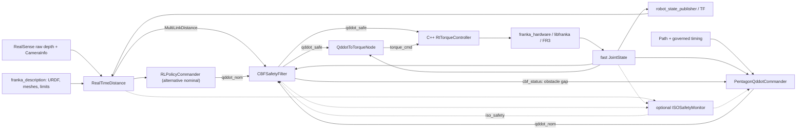
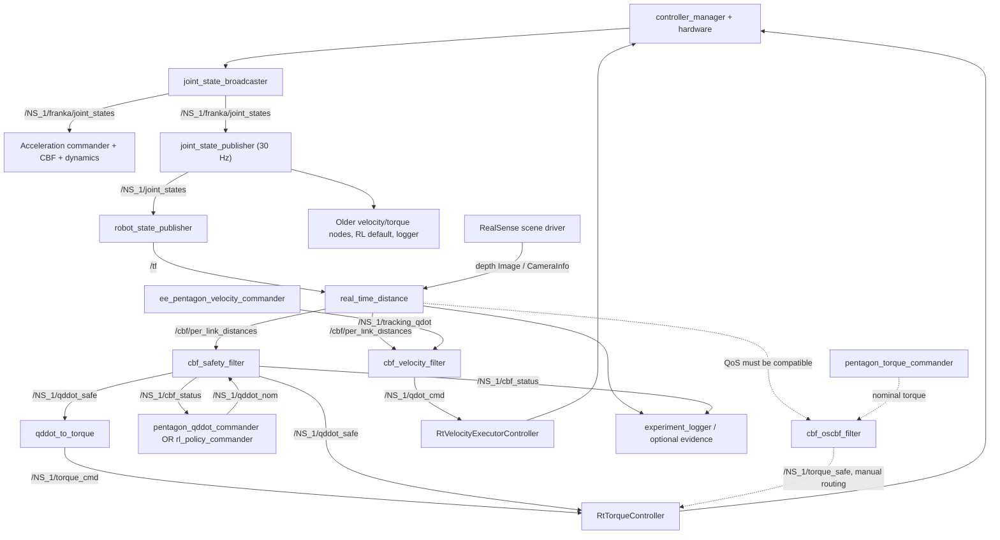
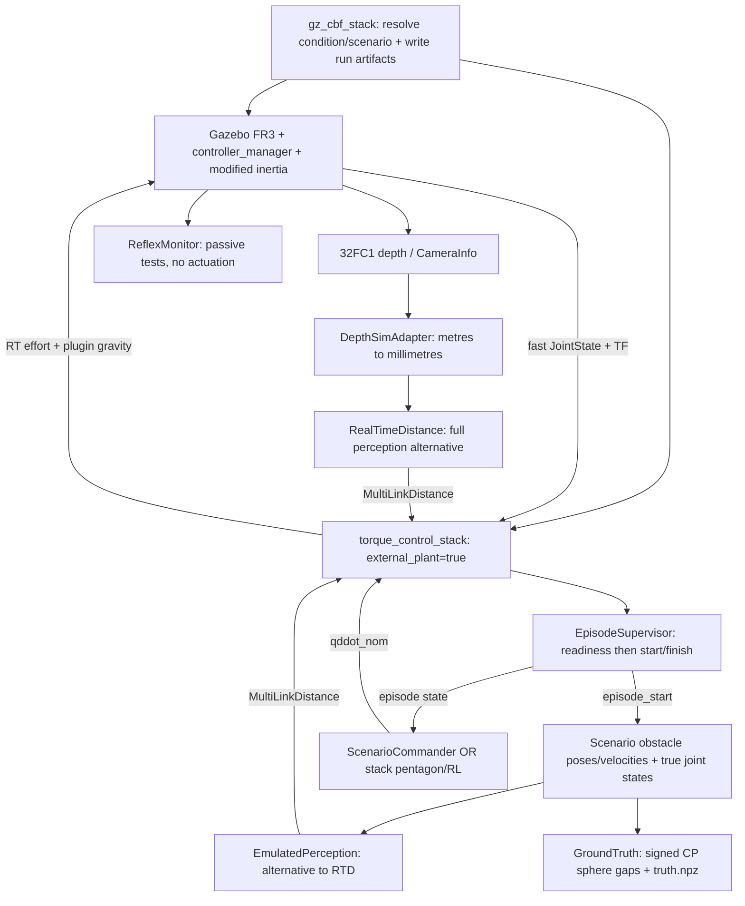
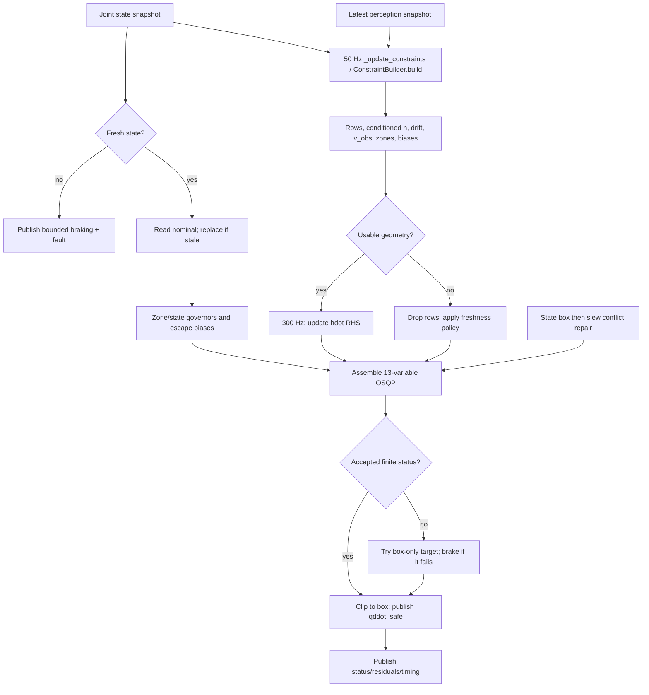
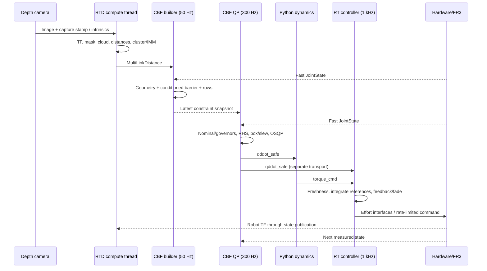

# Complete technical and mathematical guide to franka_experiments

**Source audit date:** 30 October 2026; independently re-audited after commit `bc279b3`, and completed by a continuation audit on the same date whose record is Chapter 15.9. **Scope:** the current working tree and the relevant hardware/simulation dependencies. Git history, the original source fingerprints, and fresh implementation reads were checked together; Chapter 15 records the re-audit identity and verification limits. This is a reconstruction of implemented behavior, with mathematical derivations and a static technical assessment. It is not a claim that the system has been validated on a physical robot.

## Reading map and evidence conventions

The principal configured path is an acceleration-space safety filter followed by a Python dynamics conversion and a C++ effort controller. There are also a velocity-space path, a separate experimental torque-space OSCBF, two calibration systems, simulation/replay tools, and substantial diagnostic infrastructure. These implementations must be understood separately: similar names do not imply identical mathematics or failure policies.

The chapters progress through:

1. Architecture, launch selection, dependencies, and ROS contracts.
2. Frames, robot models, kinematics, and dynamics.
3. Camera calibration.
4. Depth processing and geometric distance.
5. Obstacle tracking, filtering, and prediction.
6. Paths, timing, and nominal motion control.
7. Barrier derivation and the implemented obstacle rows.
8. The other five constraint families.
9. Optimization, hard limits, objective shaping, and failure handling.
10. Torque conversion and real-time execution.
11. Alternative controllers and retained mathematical utilities.
12. Logging, visualization, experiments, and parameter interpretation.
13. Critical assessment and verification.
14. An end-to-end numerical walkthrough.
15. Exhaustive configuration and source indexes.

**Verified** means directly established from executable statements, declarations, or local library source. **Derived** means an algebraic consequence of those statements. **Interpretation** identifies a physical meaning or likely engineering effect; it does not establish the author's historical motivation. **Unverified** marks runtime behavior, calibration accuracy, external package behavior, or normative claims that the available evidence cannot establish. Code comments and existing documentation were used as leads, never as substitutes for executable source.

All package-relative Python paths below are relative to `franka_experiments/franka_experiments/` unless a full repository-relative path is given. For example, [nodes/cbf_safety_filter.py](../franka_experiments/nodes/cbf_safety_filter.py) is the main filter node. Function names accompany source links because line numbers can change in this actively edited tree. The appendices record the source revision and an inventory; a commit identifier alone does not identify this dirty working tree.

---

## 1. Architecture and actual execution paths

### 1.1 The principal architecture

The default `torque_control_stack.launch.py` starts four logically distinct control processes:

- `PentagonQddotCommander`, or optionally `RLPolicyCommander`, supplies a nominal joint acceleration.
- `CBFSafetyFilter` changes that acceleration using perception and robot-state constraints.
- `QddotToTorqueNode` converts the safe acceleration into motion torque.
- `RtTorqueController` runs inside `controller_manager` and applies effort with additional position/velocity feedback.

The distance estimator is a fifth process with a ROS executor, a computation thread, and optional visualization. It does not require a human skeleton: every surviving depth return is a potential obstacle.

A companion figure of the same launch exists in this directory as [ros_node_graph.svg](ros_node_graph.svg) / [ros_node_graph.png](ros_node_graph.png), generated by [make_ros_node_graph.py](make_ros_node_graph.py). It is **hand-laid-out rather than introspected** — the node boxes and edges are literal coordinates in that script — so it cannot detect a launch change and may drift. The Mermaid diagrams in this guide and [torque_control_stack.launch.py](../launch/torque_control_stack.launch.py) are the authority; Chapter 15.5 records the caveat alongside the generator.



The two nominal generators are alternatives, not simultaneous publishers. `motion_source` accepts `pentagon`, `rl`, and `none`; the last leaves publication to an external caller.

The main filter's decision variable is

$$
x=\begin{bmatrix}u\\s\end{bmatrix}\in\mathbb R^{13},
\qquad u=\ddot q\in\mathbb R^7,\quad s\in\mathbb R^6_{\ge0}.
\tag{1.1}
$$

The six slack families are obstacle, self-collision, joint position, singularity, retreat speed, and point speed. “Safe acceleration” is the topic's name; a soft constrained optimization result is not, by itself, a proof that the physical motion is collision-free.

### 1.2 Configuration precedence

Three configuration layers have different roles:

1. [config/launch_defaults.yaml](../config/launch_defaults.yaml) supplies launch arguments.
2. [franka_bringup/config/franka.config.yaml](../../franka_bringup/config/franka.config.yaml), loaded by `load_franka_config_defaults`, overrides the launch defaults for its recognized robot fields.
3. [config/fr3_control.yaml](../config/fr3_control.yaml) supplies control topics, CBF parameters, and limits used by several other nodes. ROS parameter overrides apply only where the receiving node actually declares/reads them.

The launch merges `{**_LAUNCH_DEFAULTS, **_BRINGUP_DEFAULTS}`. Thus the inspected defaults are namespace `NS_1`, IP `192.168.2.10`, real hardware, and `load_gripper=false`, even though the launch-default YAML says empty namespace, a different IP, and gripper enabled. The built/installed package share is resolved by ament; a running installation need not contain the same files as this checkout.

`load_cbf_config` in [utils/config.py](../franka_experiments/utils/config.py) reads every field in `CBF_PARAM_SPEC` from the YAML and validates ROS overrides. Missing required fields fail initialization. Declaring a field does not establish that it changes the algorithm: several declared fields are retained but unused by the current acceleration filter.

The two sets are **not** the same size, and the difference is exactly where the legacy keys live. `CBF_PARAM_SPEC` has **201** entries; `fr3_control.yaml`'s `params:` block has **221** keys. Every one of the 201 is present in the YAML, so `load_cbf_config` cannot fail for a missing field against the shipped file. The **20** surplus keys were traced to their actual readers:

| Surplus `params:` key | Who actually reads it |
|---|---|
| `self_collision_safety_distance`, `self_collision_exclude_pairs`, `qddot_accel_limits` | The **main filter**, through `CBF_RAW_KEYS` in `config.py` — read straight onto the parameter namespace *without* being declared as ROS parameters, because a string list and an optional float are outside what `utils.params` validates and both are consumed once at construction. They are live, and not tunable at runtime. |
| `path_type`, `path_center_xyz`, `path_radius`, `path_cycle_time`, `path_kp_cart`, `path_kd_cart`, `governor_r_full`, `governor_r_stop` | `PentagonQddotCommander`, as its own `declare_parameter` defaults. This is why the torque launch passes no path geometry (Chapter 6.1). |
| `control_rate_hz` | `cbf_OSCBF_filter` and `cbf_velocity_filter`; `rl_policy_commander` reads a key of the same name out of the **sim** config, not this one. |
| `cbf_activation_margin`, `cbf_hysteresis` | `cbf_velocity_filter` only — the activation/hysteresis gate of Chapter 11.1. Chapter 7.3 already warns that these are not the acceleration-row activation rule. |
| `gamma`, `d_safe_default` | **No live reader.** `select_gamma` in `cbf_utils.py` hard-codes `GAMMA_MIN = 2.0`, `GAMMA_MAX = 12.0`, `K = 18.0` and never consults the YAML key; `d_safe_default` exists only as a dataclass default inside `cbf_constraints.py`, which Chapter 11.8 establishes has no active importer. |
| `ema_alpha`, `distance_ema_alpha`, `max_tau_delta`, `qp_smooth_weight` | **No reader at all.** `ema_alpha` in particular is easy to misread: the identifier `ema_alpha_for` occurs in `distance_engine.py`, `cbf_state_rows.py` and `rate_scaling.py`, but that is the time-constant helper of Chapter 7.3, unrelated to this key. The live smoothing knob is `lpf_tau_s`. |

Two consequences follow for reading the configuration. First, presence in `params:` is not evidence that the acceleration filter reads a value, and the table above is the exact list to check before treating one as a live gain — six of the twenty are dead. Second, the three `CBF_RAW_KEYS` entries are the reverse trap: they *are* live in the main filter while being absent from the parameter index in Chapter 15.3, precisely because they are never declared.

The torque launch explicitly overrides these important YAML defaults:

| Feature | Node YAML | Bare torque launch |
|---|---:|---:|
| Tracker publication | `tracking.enabled=false` in fr3_complete | true through a temporary perception YAML |
| Scalar obstacle-velocity source | residual | tracker |
| Zone ladder | false | true |
| Signed tracked velocity in $\dot h$ | false | true |
| Speed-proportional standoff | false | true |
| Velocity covariance margin | false | true |
| Acceleration-authority lateral evasion | false | true |
| Livelock objective bias | false | true |
| Latency compensation | true | true |
| Normal-rotation guard | $0$ rad | $0.15$ rad |
| Obstacle-identity jump guard | $0$ m | $0.10$ m |
| Multi-obstacle count per control point | 1 | 2 |
| Outrun evasion | false | false |
| ISO master, independent monitor, evidence logger | false | false |

The temporary perception override enables tracking only when requested; a false launch flag does not forcibly disable tracking in a user-supplied YAML that already enables it. The configured depth rate is updated from the profile string, then processing-rate estimators can retune measurement-count gates.

### 1.3 Launch-by-launch reconstruction

| Launch source | Actual control path and qualifications |
|---|---|
| [torque_control_stack.launch.py](../launch/torque_control_stack.launch.py), `_launch_all` | Acceleration pipeline above. CBF and dynamics start at 2 s; RTD at 2 s; controller spawner at 10 s; nominal commander at 12 s. The commander's own 3 s warmup follows construction. Camera starts at 0 s, image republisher at 3 s, static transforms at 1 s. Timers are launch-relative, not hardware-readiness proofs. |
| Same launch, `motion_source=rl` | Replaces only the nominal acceleration generator. ONNX inference, CBF, dynamics, and RT execution remain separate. |
| Same launch, `external_plant=true` | Skips `franka.launch.py` only. Still schedules the effort-controller spawner and world TF; the caller must supply a compatible controller manager, states, and plant. |
| [velocity_cbf_control_stack.launch.py](../launch/velocity_cbf_control_stack.launch.py) | `ee_pentagon_velocity_commander → tracking_qdot → cbf_velocity_filter → qdot_cmd → RtVelocityExecutorController`. Also camera, RTD, optional wrist-camera recording, logger. It does not run the acceleration filter. |
| [minimal.launch.py](../launch/minimal.launch.py) | Bringup plus one RT controller, camera(s), RTD, and optional logger. It does not create a nominal commander or a Python CBF. Default selector `use_torque_controller=false` chooses the velocity executor; `true` chooses `RtTorqueController`; literal `cbf` chooses `CBFTorqueController`. RTD waits for a polling process to observe controller activation. |
| [thales.launch.py](../launch/thales.launch.py) | Velocity-executor bringup, optional camera/RTD/logger/rosbag with shared run directory. No nominal generator or Python safety filter. RTD starts at $\max(t_{\rm spawner},t_{\rm camera}+3)+2$ s. |
| [bag_replay.launch.py](../launch/bag_replay.launch.py) | Replays recorded depth, intrinsics, TF, joint state, and nominal acceleration into new RTD/CBF instances using simulation time. Records new perception, safe acceleration and status. Starts no robot or dynamics converter. This is an open-loop replay against recorded states, not a new closed-loop robot experiment. |
| [handeye_calibration_bringup.launch.py](../launch/handeye_calibration_bringup.launch.py) | Includes minimal bringup, AprilTag detection and the fixed external-camera calibration node. |
| [handeye_eye_in_hand_calibration.launch.py](../launch/handeye_eye_in_hand_calibration.launch.py) | Wrist-camera driver, rectification, AprilTag detection/overlay, dedicated velocity bringup and automatic eye-in-hand collection/solve. `preview` changes startup behavior; `solve_only` can process an existing dataset without collecting motion. |
| [test_velocity_fake.launch.py](../test/launch/test_velocity_fake.launch.py) | Minimal fake bringup and a velocity commander; inspect its topic override when reproducing a run. |
| [test_torque_fake.launch.py](../test/launch/test_torque_fake.launch.py) | Minimal fake torque bringup and the **older** `PentagonTorqueCommander` publishing torque directly; it does not test the principal acceleration CBF chain. |
| [test_rl_fake.launch.py](../test/launch/test_rl_fake.launch.py) | Torque stack with RL nominal, fake hardware and selected peripheral processes disabled. Missing perception follows the filter's “never received” branch, which differs from “received then stale.” |

There is no shipped OSCBF integration launch. The external Gazebo integration is a separate, explicitly selected path described in Chapter 1.6; it should not be conflated with bag replay or the acceleration-to-velocity simulation bridge. `cbf_oscbf_filter` and `pentagon_torque_commander` are console entry points, but running them alone does not route `torque_safe` into the RT controller: its command topic must also be changed. Likewise, the installed executable list in [setup.py](../setup.py) omits `distance_visualization_node` despite its source existing.

Two misleading launch messages deserve explicit correction. The current `PentagonQddotCommander` has no MoveIt client; its source imports Pinocchio and constructs analytic paths. `start_move_group=false` therefore does **not** make it wait for MoveIt. The torque launch's “world to fr3_link0” description actually instantiates a `world → base` identity transform; the URDF connects `base` to the arm base. Other launches use different child-frame spellings.

### 1.4 Nodes, dependencies, and component status

The source currently contains 23 executable node modules plus an empty node-package initializer. Their roles are:

| Node/class | Status in this checkout |
|---|---|
| `CBFSafetyFilter` | Main acceleration safety orchestrator; directly launched by torque stack and replay. |
| `PentagonQddotCommander` | Main analytic acceleration nominal; its default path is a **circle**, despite its name. |
| `QddotToTorqueNode` | Main event-driven dynamics conversion. |
| `RealTimeDistance` | Main depth-to-control-point geometry, optional cluster tracking. |
| `RLPolicyCommander` | Selectable nominal alternative; consumes exported ONNX policies; sibling training sources are under `franka_rl`, while automatic discovery still searches `franka_sim`. Training is outside this ROS package. |
| `CbfVelocityFilter` | Separate first-order velocity safety path; different geometry derivatives, QP, and fallback policy. |
| `PentagonTorqueCommander` | Older direct-torque nominal, optionally outputs acceleration with `cbf_mode`; not selected by torque stack. |
| `OSCBFFilterNode` | Experimental torque-space task-metric filter; separately enabled by manual composition. |
| `ISOSafetyMonitor` | Optional independent computational SSM check and software stop latch. Shares perception/model, so independence is logical, not a redundant safety-rated sensing channel. |
| `ISOEvidenceLogger` | Passive optional measurement/evidence recording. |
| `ExperimentLogger` | Passive multi-topic CSV, manifest, and plots; started by several launches. |
| `HandEyeCalibrationNode` | External-camera / tag-on-tool calibration and optional velocity collection. |
| `HandEyeEyeInHandNode` | Wrist-camera / fixed-tag calibration, staged collection and robust solver. |
| `ImageRectifier` | OpenCV rectification for calibration imagery. |
| `TagOverlay` | AprilTag/image overlay; does not affect control. |
| `FrameGrabber` | Saves images under CBF activity/fault gates; standalone utility. |
| `TrajectoryVisualizationNode` | Publishes end-effector traces as RViz markers. |
| `TrajectoryOverlayNode` | Draws traces over RGB; launched by torque stack by default. |
| `DistanceVisualization` | Standalone distance renderer; source exists but lacks console installation entry. |
| `CapsuleOverlayNode` | Older capsule renderer using the simulation utility import bridge. |
| `EEPentagonVelocityCommander` | Nominal source used by velocity launch. |
| `EECircleVelocityCommander` | Standalone velocity trajectory alternative with integrated smooth startup phase. |
| `EERandomWaypointsVelocityCommander` | Standalone minimum-jerk waypoint alternative. |

The table groups node modules by class; `nodes/__init__.py` is an empty package initializer rather than an executable node.

Critical repository dependencies are:

- [franka_description](../../franka_description): xacro structure, inertial parameters, collision meshes, manufacturer joint-limit YAML, and optional `*_sc` capsules.
- [franka_bringup](../../franka_bringup): ROS controller-manager, state broadcasters, joint-state republisher and TF bringup.
- [franka_rt_controllers](../../franka_rt_controllers): all three C++ executor variants.
- [franka_hardware](../../franka_hardware), [franka_semantic_components](../../franka_semantic_components), [franka_robot_state_broadcaster](../../franka_robot_state_broadcaster), and the local [libfranka](../../libfranka): robot I/O, state representation and effort/velocity command transport.
- [franka_msgs](../../franka_msgs): custom geometric and robot-state messages.
- [franka_simulation](../../franka_simulation): RGB republisher and older avoidance/visualization utility bridge; simulation acceleration bridge and camera adapters are used by sibling simulation launch paths.
- [franka_simulation_experiments](../../franka_simulation_experiments): external-plant Gazebo experiments, truth attribution and regression orchestration; its modifications are not part of the main robot launch.
- [franka_rl](../../franka_rl): trained model/config discovery and observation contract. The learned network weights are runtime artifacts; this guide does not infer an analytic policy from training labels.
- [franka_fr3_moveit_config](../../franka_fr3_moveit_config): optional MoveIt service process; not on the current analytic commander's execution dependency path.

External runtime imports include NumPy, SciPy, Pinocchio, OSQP, qpsolvers, OpenCV, trimesh, PyYAML, ROS message/tf/launch libraries, RealSense and AprilTag packages, and ONNX Runtime for RL. The package manifest lists many ROS dependencies but leaves several Python dependencies in comments; `setup.py` itself installs only `setuptools`. Successful package installation alone therefore does not establish a runnable framework.

### 1.5 Communication contracts

Frequencies below are requested timers or configured manager rates, not measured delivery guarantees.

| Topic | Publisher → subscribers | Type | Rate / role |
|---|---|---|---|
| `/NS_1/franka/joint_states` | joint_state_broadcaster → CBF, dynamics, analytic acceleration commander, optional monitor/evidence | `sensor_msgs/JointState` | Manager target 1000 Hz real, 100 Hz generated fake configuration. Fast safety state. |
| `/NS_1/joint_states` | joint_state_publisher, plus explicit finger publisher → TF, several older nodes, RL default, logger | `JointState` | Republisher default 30 Hz; finger-only messages 10 Hz in torque launch. Consumers must match joint names. |
| `/tf`, `/tf_static` | robot/static transform publishers → RTD/calibration/visualizers | `tf2_msgs/TFMessage` | Dynamic/event driven; static transforms use transient-local TF behavior. |
| `/camera/camera/depth/image_rect_raw` | RealSense → RTD | `sensor_msgs/Image` | Requested 848×480×90 profile; actual processing may be slower. Assumed depth units are millimetres. |
| `/camera/camera/depth/camera_info` | RealSense → RTD | `CameraInfo` | Associated raw-depth intrinsics, first accepted matrix cached. |
| `/camera/camera/color/image_raw` and `.../camera_info` | RealSense → RGB republisher, trajectory overlay | `Image` / `CameraInfo` | Image driven; separate optical frame and pixel geometry from raw depth. |
| `/my_camera/image` | `franka_simulation/scripts/image_publisher.py` → optional perception/overlay tools | `Image` | Unmodified RGB republish; not the main distance input. |
| `/cbf/per_link_distances` | RTD → CBF, velocity filter, RL, monitor/evidence, logger | `franka_msgs/MultiLinkDistance` | Per processed depth frame; best effort, depth 1 for main safety consumers. Can be an empty heartbeat. |
| `/human_robot/multi_distance` | RTD → logger/legacy consumers | `franka_msgs/MultiDistance` | One selected result per segment, different validity band from per-CP stream. |
| `/human_robot/distance` | RTD fallback publisher | `HumanRobotDistance` | Published fallback on absent/contact-only scenes; not the main CBF input. YAML `closest_distance` is not the key read by this publisher. |
| `/NS_1/qddot_nom` | analytic or RL commander → CBF | `std_msgs/Float64MultiArray`, seven accelerations | Analytic default 100 Hz; RL from frozen model configuration or explicit rate. No header/timestamp. |
| `/NS_1/qddot_safe` | CBF → Python dynamics and RT acceleration subscription | `Float64MultiArray`, seven accelerations | 300 Hz QP target. Parallel acceleration and torque transports are not synchronized messages. |
| `/NS_1/torque_cmd` | dynamics converter (or older torque commander) → RT effort controller | `Float64MultiArray`, seven torques | On each incoming safe acceleration, subject to executor delay. |
| `/NS_1/torque_safe` | experimental OSCBF → manually configured executor | `Float64MultiArray` | OSCBF timer, default 100 Hz. Unconnected in default torque stack. |
| `/NS_1/tracking_qdot` | velocity commander → velocity CBF | `Float64MultiArray` | Commander default 200 Hz. |
| `/NS_1/qdot_cmd` | velocity CBF or direct velocity source → velocity executor | `Float64MultiArray` | Filter default 100 Hz; do not publish competing commands. |
| `/NS_1/q_des_state` | acceleration commander → optional `CBFTorqueController` | `JointState` | Position/velocity are integrated nominal references; **effort field carries acceleration**, not torque. Unused by default `RtTorqueController`. |
| `/NS_1/ee_desired`, `/NS_1/ee_actual` | analytic commander → trace visualizers | `geometry_msgs/PointStamped` | Same command tick; desired $P(s)$, actual FK of `fr3_hand_tcp` by default. |
| `/NS_1/cbf_status` | CBF → commander, RL, logger, frame grabber, optional monitor | `Float64MultiArray` | QP tick, append-only positional schema; see Chapter 12. |
| `/NS_1/torque_saturation` | dynamics converter → loggers | `Float64MultiArray`, seven flags | Flags the converter's effort/rate calculation, not the actual final RT torque. |
| `/NS_1/iso_safety` | independent monitor → CBF, commander, loggers | `Float64MultiArray`, five values | Monitor target 300 Hz. |
| `/NS_1/rl_status` | RL commander → diagnostics | `Float64MultiArray`, six values | Inference time, tick interval, gap, target error/index, gate. |
| `/real_time_distance/overlay_image` | RTD or standalone distance renderer | `Image` | RTD visualization timer 10 Hz; could repeat an old visualization frame. |
| `/NS_1/trajectory_overlay` / `.../trajectory_markers` | RGB overlay / marker renderer | `Image` / `visualization_msgs/MarkerArray` | Presentation only. |

The independent reset service is `/NS_1/safety_reset`, `std_srvs/Trigger`. It refuses reset while its current condition remains present. Calibration subscribes to AprilTag detections and tag TFs; the exact camera/tag frames are declared parameters, not inferred from the main raw-depth topic.

The following node graph distinguishes mutually alternative command paths and the two robot-state rates. The dashed OSCBF path requires manual routing and is not activated by the ordinary launches.



---

### 1.6 External Gazebo composition: the actual additional execution path

[franka_simulation_experiments/launch/gz_cbf_stack.launch.py](../../franka_simulation_experiments/launch/gz_cbf_stack.launch.py) includes both [gz_fr3_plant.launch.py](../../franka_simulation/launch/gz_fr3_plant.launch.py) and the ordinary torque stack. It does **not** replace the main CBF by the standalone numerical `cbf_scenarios` filter. Its conditions are in [conditions.yaml](../../franka_simulation_experiments/config/conditions.yaml), with per-run resolution/merging in [simexp/conditions.py](../../franka_simulation_experiments/scripts/simexp/conditions.py) and [simexp/sim_config.py](../../franka_simulation_experiments/scripts/simexp/sim_config.py).

The execution sequence is:

1. Resolve the required `condition` (`residual`, `kf`, `imm`, `imm+pred`), optional scenario, scene, motion source, seed and overrides. Write resolved controller, world, perception and simulation-manifest files under the run directory. No scenario is implied by merely selecting a condition.
2. Generate the **real-gain, 1000 Hz** torque-controller YAML with `is_real=True`, `controller_type='torque'`, `gazebo='true'`. This deliberately avoids the fake-hardware gain/rate configuration. Build the modified physics/RSP descriptions explained in Chapter 10.6.
3. Start Gazebo and the clock/selected sensor bridges. Spawn the robot after 2 s and the state broadcaster after 3 s in the plant launch. Its joint-state republisher requests 30 Hz. The included torque stack sets `external_plant=true`, `use_fake_hardware=false`, `enable_camera=false`, `start_move_group=false`, `rt_pin_cpu=''`, and simulation extrinsics/perception configuration. Its own effort-controller spawner remains scheduled at 10 s; its CBF and converter remain the ordinary nodes.
4. Choose exactly one nominal source. `motion=scenario` passes `motion_source=none` to the torque stack and starts `ScenarioCommander`; `pentagon` and `rl` use that stack's normal alternatives. Scenario, truth, emulated-perception, supervisor and reflex nodes are scheduled after 3 s where applicable. Optional bag recording starts after 4 s. Timer expiration is not controller readiness.
5. `EpisodeSupervisor` gates the episode using observed controller/data readiness, then broadcasts its start; the scenario obstacle plugin and commander use that simulation clock. On completion the supervisor's exit triggers launch shutdown. Run artifacts include a simulation manifest and, when enabled, a bag, truth archive and reflex summary. The ordinary `ExperimentLogger` separately writes its current CSV schema.

Global `use_sim_time=true` propagates to delayed actions; `FRANKA_LOGS_DIR` points into the run's logger directory. Thus ROS timers measure simulation time, while host scheduling and real-time factor remain separate quantities. Empty `rt_pin_cpu` suppresses the torque stack's usual affinity request; optional `filter_cpu` uses a separate delayed pinning process for the Python filter.



There are three distinct perception modes:

| `perception` | Publisher of `/cbf/per_link_distances` | What is actually exercised |
|---|---|---|
| `true` (default) | `RealTimeDistance` after simulated depth adaptation | Depth projection, robot masking, cloud selection, configured cluster/KF/IMM/prediction, real message builder and ordinary CBF |
| `emulated` (requires scenario) | `EmulatedPerception` | Delayed analytic sphere geometry and truth-derived noisy track fields; **no** image processing, cluster association, KF, IMM or impact predictor |
| `false` | None supplied by this launch | No obstacle sensing. Main filter's never-received branch applies; internal soft row construction also awaits a first perception message. This is not a collision-avoidance experiment. |

For full perception, `residual` disables tracking/IMM/prediction and selects scalar residual velocity; `kf` enables the existing nine-state constant-acceleration Kalman implementation, disables IMM/prediction and selects tracker velocity; `imm` enables IMM; `imm+pred` also enables impact prediction. The condition YAML's phrase “constant-velocity KalmanTrack” does not change the transition matrix derived in Chapter 5. Scenario and explicit run overrides can further change the resolved values; the manifest identifies them. The common CBF flags enable lateral evasion, livelock escape, latency compensation, zone ladder, uncertainty, signed velocity, velocity standoff, normal/identity guards and `multi_obstacle_k=2`; outrun and ISO remain disabled. `enable_sensor_range_uncertainty` is read from the control YAML, not made a launch switch by these conditions.

| Additional ROS topic | Publisher → subscriber | Message / requested timing |
|---|---|---|
| `/clock` | Gazebo bridge → simulation-time nodes | `rosgraph_msgs/Clock`; clock-driven |
| `/sim/d455/depth/image`, `.../camera_info` | Gazebo camera bridge → `DepthSimAdapter` | `Image` (`32FC1` metres), `CameraInfo`; world sensor requests 90 Hz |
| `/camera/camera/depth/image_rect_raw`, `.../camera_info` | `DepthSimAdapter` → RTD | `Image` (`16UC1` millimetres), `CameraInfo`; surviving camera frames, reliable depth 2 |
| `/sim/episode_start` | supervisor → bridge → scenario obstacle plugin | `std_msgs/Float64`; simulation start time in seconds, repeated during initial ticks |
| `/sim/episode` | supervisor → scenario commander | `Float64MultiArray`: `[state,t_start,now]`; 50 Hz timer; state 0 waiting, 1 running, 2 done |
| `/sim/truth/obstacle_poses`, `.../obstacle_poses_vel` | obstacle plugin → Gazebo/ROS bridge → ground truth/emulator | `geometry_msgs/PoseArray`; velocity is encoded in each pose's **position** fields in the second topic; physics updates |
| `/sim/truth/cp_gaps` | `GroundTruth` → bag/evaluation | `Float64MultiArray`: `[t,n_cp,min_gap_per_cp...,global_min,global_min-d_safe]`; requested 100 Hz |
| `/sim/truth/obstacles` | `GroundTruth` → bag/evaluation | `Float64MultiArray`: `[t,n_obs,(p_x,p_y,p_z,v_x,v_y,v_z,r)_1,...]`; truth timer |
| `/sim/reflex` | `ReflexMonitor` → bag/evaluation | `Float64MultiArray`; passive status, with checks driven by fast joint states |

The plant's optional controller-start path is separate from the included stack's spawner; avoid enabling competing spawners in a custom composition. The standalone `sim_acceleration_bridge` described elsewhere integrates acceleration into velocity commands and is **not** present in this Gazebo effort path. Detailed emulation, truth, obstacle and readiness mathematics are in Chapter 12.7; the difference between simulated and physical actuation is in Chapter 10.6.

---

## 2. Mathematical conventions and robot models

### 2.1 State, units, and frames

Let $q,\dot q,u=\ddot q\in\mathbb R^7$ contain the seven revolute arm joints in `fr3_joint1 … fr3_joint7` order. Units are rad, rad/s, rad/s²; joint torque $\tau\in\mathbb R^7$ is N·m. The mathematical radian is dimensionless, but retaining “rad” in engineering units prevents confusion between joint and Cartesian quantities.

Use $B$ for robot base, $C$ for a specified camera optical frame, $E$ for tool/flange as specified by a caller, and $T$ for calibration tag. A transform

$$
{}^AT_D=\begin{bmatrix}{}^AR_D&{}^At_D\\0&1\end{bmatrix}\in SE(3)
\tag{2.1}
$$

maps coordinates from $D$ into $A$: $p^A={}^AR_Dp^D+{}^At_D$. Rotation is dimensionless, translation is metres. Composition and inversion follow by substitution:

$$
{}^AT_D{}^DT_F=
\begin{bmatrix}R_{AD}R_{DF}&t_{AD}+R_{AD}t_{DF}\\0&1\end{bmatrix},
\qquad
T^{-1}=\begin{bmatrix}R^\top&-R^\top t\\0&1\end{bmatrix}.
\tag{2.2}
$$

`load_extrinsics` returns `R_base,t_base` and uses them as ${}^BR_C,{}^Bt_C$. It does not inspect the YAML frame-name fields, normalize the quaternion, or transform an incoming message into that frame. Consequently, the equality of the configured extrinsic optical frame and the measured depth optical frame is an essential external assumption.

Pinocchio's `LOCAL_WORLD_ALIGNED` Jacobians are expressed with axes aligned to the model world/base, at the frame origin. The package uses the first three rows as translation and the last three as angular velocity:

$$
\begin{bmatrix}v_E\\\omega_E\end{bmatrix}
=J_6(q)\dot q,\qquad J_6=\begin{bmatrix}J_v\\J_\omega\end{bmatrix}\in\mathbb R^{6\times7}.
\tag{2.3}
$$

This is not a spatial Jacobian whose linear part is already referred to the world origin.

### 2.2 More than one robot model

[utils/kinematics.py](../franka_experiments/utils/kinematics.py) has distinct constructors:

| Constructor | Used for | Consequence |
|---|---|---|
| `generate_urdf_from_xacro` then `load_pinocchio_model` | Analytic commanders, RL FK, Python dynamics, OSCBF dynamics | Hand enabled, `ee_id=franka_hand`. Finger coordinates remain at neutral and velocities at zero when only arm states are mapped. |
| `build_urdf_no_hand` | Main obstacle CBF kinematics, monitor/evidence/logger kinematics, OSCBF auxiliary kinematics | Seven-arm-coordinate model, no hand inertia; obstacle rows are geometric, so this model need not provide payload dynamics. |
| `build_urdf_with_sc(hand=True,safety_distance=0.0)` | Main self-collision rows | Extra fixed `*_sc` frames and hand capsules; arm coordinates inserted into a full model. Its capsule inflation is separately configured. |
| `build_reduced_pinocchio_model_from_urdf` in avoidance utilities | Older velocity filter / capsule overlay | Obtains robot description via parameter service and locks non-arm joints at neutral. |

These choices are verified construction calls, not proof that all models match the hardware tool, payload, or calibrated TCP. `fr3_link8` and `fr3_hand_tcp` are different points. The logger's `tcp_link=fr3_link8` therefore does not measure the same point as the main commander's default tool trace.

### 2.3 Forward kinematics and differential kinematics

For a serial chain with fixed joint placement $T_{i,0}$ and a revolute joint motion $T_i(q_i)$, the model computes

$$
{}^BT_k(q)=\prod_{i\in\mathcal A(k)} T_{i,0}T_i(q_i).
\tag{2.4}
$$

$\mathcal A(k)$ is the ancestor sequence of frame $k$; products are ordered from base outward. Pinocchio evaluates this from the generated URDF. The package does not manually implement a DH table.

For a body-fixed offset $r=R_Er_E\in\mathbb R^3$, $p=p_E+r$. Since $\dot r=\omega_E\times r$,

$$
\dot p=J_v\dot q+\omega_E\times r
=\left(J_v-[r]_\times J_\omega\right)\dot q,
\quad
J_p=J_v-[r]_\times J_\omega\in\mathbb R^{3\times7}.
\tag{2.5}
$$

Here $[r]_\times z=r\times z$. Differentiating every factor, rather than treating a world offset as constant, gives

$$
\dot J_p=\dot J_v-[r]_\times\dot J_\omega
-[\omega_E\times r]_\times J_\omega,
\qquad
\ddot p=J_pu+\dot J_p\dot q.
\tag{2.6}
$$

The exact derivative is (2.6), but `CBFKinematics.point_jacobian` actually returns only
$$
\dot J_{p,\rm code}=\dot J_v-[r]_\times\dot J_\omega.
\tag{2.6a}
$$
It omits the rotating-offset term $-[\omega_E\times r]_\times J_\omega$. A body-fixed local offset is generally *not fixed in world axes*, so the source comment “exact for fixed r” does not make this exact for a point on a rotating link. The separate OSCBF obstacle helper has the same omission. `prepare_frame_cache` is a no-op; there is no active per-control-point derivative cache in this snapshot.

Most perception control points are **interpolations of two frame origins**, not fixed offsets on the segment's end link:

$$
p_c=(1-\lambda)p_0+\lambda p_1,\quad
J_c=(1-\lambda)J_0+\lambda J_1,\quad
\dot J_c=(1-\lambda)\dot J_0+\lambda\dot J_1.
\tag{2.7}
$$

$\lambda$ is a fixed dimensionless sampling fraction. This derivative follows by linearity. **The current main filter does not implement (2.7):** it calls `point_jacobian(fid, ob.pr)` and treats the published point as a rigid offset of `ob.link`, the segment's end link. The same rigid-offset assumption is used by the velocity filter and monitor. The re-audit establishes the discrepancy for the current FR3 layout below, rather than leaving it as a generic possibility.

**Verification for the configured FR3 points.** Consider the points between the origins immediately before and after revolute joint $j$. The origin on the joint axis does not translate when only $q_j$ changes. Neither does its parent origin. Therefore (2.7) gives $\partial p_c/\partial q_j=0$. The rigid-end-link construction instead gives the joint-$j$ column

$$
J_{\mathrm{rigid},j}=z_j\times(p_c-p_j)
=(1-\lambda)z_j\times(p_{j-1}-p_j),\qquad
J_{\mathrm{true},j}=0.
\tag{2.7a}
$$

Here $z_j\in\mathbb R^3$ is the unit rotation axis expressed in base axes, and $p_j,p_{j-1}\in\mathbb R^3$ are the relevant frame origins in metres. All ancestor-joint columns agree: both origins undergo that ancestor's rigid motion, and the cross product is linear in position. The erroneous end-joint column has magnitude

$$
\|J_{\mathrm{rigid},j}-J_{\mathrm{true},j}\|
=(1-\lambda)\|z_j\times(p_{j-1}-p_j)\|.
\tag{2.7b}
$$

The transverse origin offsets in [fr3/kinematics.yaml](../../franka_description/robots/fr3/kinematics.yaml) are $0.0825$ m at joints 4 and 5 and $0.088$ m at joint 7. The two sample fractions are $1/3,2/3$. Joint 6's adjacent origins coincide; `fr3_link8` is fixed relative to link 7. Thus this is a present discrepancy for six points, rather than a hypothetical concern about an arbitrary robot.

An independent NumPy FK reconstruction using those YAML placements, local-$z$ joint axes and the **actual executed body of `define_control_points`** gave the following centered-difference comparison at $q=[0,-0.7,0,-2.35,0,1.57,0.7]^\top$ rad, with perturbation $\epsilon=10^{-6}$ rad. The numerical derivative was $J_{\mathrm{FD},:j}=[p_c(q+\epsilon e_j)-p_c(q-\epsilon e_j)]/(2\epsilon)$; $e_j$ is joint-space unit vector $j$.

| Published point | $\|J_{\mathrm{rigid}}-J_{\mathrm{FD}}\|_F$, m/rad | Source of difference |
|---|---:|---|
| `fr3_link4#0`, `fr3_link5#0` | 0.055 each | End-joint column, $\lambda=1/3$ |
| `fr3_link4#1`, `fr3_link5#1` | 0.0275 each | End-joint column, $\lambda=2/3$ |
| `fr3_link7#0` | 0.0586667 | End-joint column, $\lambda=1/3$ |
| `fr3_link7#1` | 0.0293333 | End-joint column, $\lambda=2/3$ |
| `fr3_link6#0`, `fr3_link6#1` | $<8\times10^{-11}$ each | Collocated origins |
| `fr3_link8#0`, `#1`, `#2` | $<7\times10^{-11}$ each | Fixed-link interpolation/tool offset |

This checks the geometry and rigid-point formula independently of Pinocchio; it does not validate a particular installed Pinocchio binding or TF stream. Along a general normal $n$, the barrier's acceleration coefficient error is $n^\top(J_{\mathrm{rigid}}-J_c)$, so its effect can have either sign or vanish for a particular normal. A false end-joint coefficient lets the QP believe that rotating that joint moves an interpolated point which is actually stationary under that joint. Differentiating the wrong point model more accurately would not fix this first-derivative mismatch.

The separate missing term in (2.6a) also matters for genuinely rigid offsets. For a hypothetical one-axis rotation with constant $\omega=[0,0,1]^\top$ rad/s and instantaneous $r=[1,0,0]^\top$ m, the frame origin and axis have zero derivatives. Equation (2.6a) then predicts zero offset drift, whereas $\omega\times(\omega\times r)=[-1,0,0]^\top$ m/s². This example isolates the omitted centripetal contribution; it is not a measured FR3 acceleration.

### 2.4 Coordinate conversion for “front” trajectories

`transform_ee_to_frame` computes

$$
p^F=R_{BF}^\top(p^B-t_{BF}),\qquad J_v^F=R_{BF}^\top J_v^B.
\tag{2.8}
$$

This is valid for a fixed reference frame $F$. A moving reference would require relative translational/angular terms and derivatives of $R_{BF}$; those are not included. The default `plane_frame=fr3_link0` is fixed, so the intended default avoids this complication. The acceleration commander rotates translational $J$ and $\dot J$ in this branch and keeps rotational control in base axes; translation and rotation then have explicitly different reference axes.

### 2.5 Dynamics and the distinction between intended and computed quantities

With rigid-body assumptions and a correctly identified payload, manipulator dynamics are

$$
M(q)u+c(q,\dot q)+g(q)+\tau_f=\tau_{\rm actuator}+\tau_{\rm external},
\quad c=C(q,\dot q)\dot q.
\tag{2.9}
$$

$M\in\mathbb R^{7\times7}$ is symmetric positive definite (units kg·m² for revolute joints), $c,g,\tau_f\in\mathbb R^7$ are N·m. The intended gravity-compensated motion command is

$$
\tau_{\rm ff}=Mu+c.
\tag{2.10}
$$

Gravity is omitted from outgoing Franka motion torque by design; the local hardware wrapper sends a `franka::Torques` command and does not itself add $g$. Gravity compensation is a Franka interface/firmware assumption, not a calculation in `RtTorqueController`. A generic simulator with gravity enabled needs its own compensation behavior; physics alone does not supply a compensating motor torque.

There is a material difference between (2.10) and the actual Python conversion in this checkout. `QddotToTorqueNode._compute_tau` computes `computeAllTerms`, copies `data.M` into `_M_arm`, and uses `data.C @ qdot_full`. The local Pinocchio 3.4.0 headers inspected at `/opt/openrobots/include/pinocchio/algorithm/compute-all-terms.hxx` show that this routine fills the upper mass-matrix blocks, `nle`, `g`, Jacobians and their variation, but does **not** fill `data.C`; `data.hxx` initializes `C` to zero. The converter neither symmetrizes $M$ nor calls a Coriolis-matrix routine.

Thus the verified program is

$$
\tau_{\rm Python}=\widetilde M_{\rm copied}u+
C_{\rm stored}\dot q,
\tag{2.11}
$$

where the tilde emphasizes the storage actually copied, not the mathematically completed mass matrix. In a fresh data object under that local implementation, $C_{\rm stored}=0$, and the lower triangular mass entries are not filled by this call. The same pattern occurs in `PentagonTorqueCommander` and `_RobotDynamics` in OSCBF. By contrast, `PentagonQddotCommander._compute_tau_des` explicitly symmetrizes $M$ and adds `data.nle`, so its logged desired torque includes gravity and is not identical to `torque_cmd`. The C++ alternative `CBFTorqueController` uses RNEA minus generalized gravity, avoiding this particular storage issue.

This finding is based on caller and local library source. It does not identify which Pinocchio build a separate ROS container or installed robot deployment actually loads; that must be checked in the deployment environment.

### 2.6 Reconstructing the loaded rigid-body mathematics

The physical model enters through [fr3.urdf.xacro](../../franka_description/robots/fr3/fr3.urdf.xacro), its common robot macros and the FR3 [kinematics](../../franka_description/robots/fr3/kinematics.yaml), [inertials](../../franka_description/robots/fr3/inertials.yaml), [dynamics](../../franka_description/robots/fr3/dynamics.yaml) and [joint limits](../../franka_description/robots/fr3/joint_limits.yaml). The following fixed placements precede each joint's local-$z$ rotation. Translation is in m; roll in rad, and pitch/yaw are zero:

| Joint | Fixed translation | Fixed roll | Motion |
|---|---|---:|---|
| 1 | $[0,0,0.333]$ | $0$ | $R_z(q_1)$ |
| 2 | $[0,0,0]$ | $-\pi/2$ | $R_z(q_2)$ |
| 3 | $[0,-0.316,0]$ | $+\pi/2$ | $R_z(q_3)$ |
| 4 | $[0.0825,0,0]$ | $+\pi/2$ | $R_z(q_4)$ |
| 5 | $[-0.0825,0.384,0]$ | $-\pi/2$ | $R_z(q_5)$ |
| 6 | $[0,0,0]$ | $+\pi/2$ | $R_z(q_6)$ |
| 7 | $[0.088,0,0]$ | $+\pi/2$ | $R_z(q_7)$ |
| 8 / flange | $[0,0,0.107]$ | $0$ | Fixed |

URDF RPY means $R_z(\text{yaw})R_y(\text{pitch})R_x(\text{roll})$; the chain factor is fixed placement followed by the joint rotation, as in (2.4). The hand, when included, has default flange rotation $R_z(-\pi/4)$, and its TCP is 0.1034 m along hand $z$. Finger prismatic coordinates are present in a hand-enabled full model and held at neutral/zero velocity by the arm-only conversion; their inertial contribution does not vanish merely because they are not commanded.

For an ancestor revolute joint, let $z_j^B$ be its world rotation axis and $o_j^B$ its origin. The geometric Jacobian column of a world point $p$ is
$$
J_{v,j}=z_j^B\times(p-o_j^B),\qquad J_{\omega,j}=z_j^B,
\tag{2.12}
$$
and is zero for non-ancestors. This follows from the instantaneous velocity of a rotation about an axis. It also explains why two different attached-point definitions can have different Jacobians even at the same instantaneous position.

For body $i$, let mass $m_i$, center-of-mass world position $p_{c_i}$, body orientation $R_i$, and center-of-mass inertia $I_{c_i}$ be given by the URDF inertial origin and inertia tensor. With $J_{c_i}\in\mathbb R^{3\times7}$ and $J_{\omega i}\in\mathbb R^{3\times7}$, kinetic energy is
$$
\mathcal T=\frac12\sum_i\left[
m_i\|J_{c_i}\dot q\|^2+
\dot q^\top J_{\omega i}^\top R_iI_{c_i}R_i^\top J_{\omega i}\dot q\right]
=\frac12\dot q^\top M(q)\dot q,
$$
$$
M(q)=\sum_i\left[m_iJ_{c_i}^\top J_{c_i}
+J_{\omega i}^\top R_iI_{c_i}R_i^\top J_{\omega i}\right].
\tag{2.13}
$$
The sum includes fixed attached bodies through their moving ancestors. A fixed base's mass contributes no arm kinetic energy. For gravity vector $g_B$, potential $\mathcal U=-\sum_i m_i g_B^\top p_{c_i}$, so generalized gravity is $g(q)=\partial\mathcal U/\partial q$. Euler–Lagrange differentiation gives
$$
\frac{d}{dt}\frac{\partial\mathcal T}{\partial\dot q_j}
-\frac{\partial\mathcal T}{\partial q_j}
+\frac{\partial\mathcal U}{\partial q_j}
=\sum_k M_{jk}\ddot q_k+
\sum_{k,l}\Gamma_{jkl}\dot q_k\dot q_l+g_j,
$$
$$
\Gamma_{jkl}=\frac12\left(
\frac{\partial M_{jk}}{\partial q_l}
+\frac{\partial M_{jl}}{\partial q_k}
-\frac{\partial M_{kl}}{\partial q_j}\right).
\tag{2.14}
$$
Thus $c_j=\sum_{k,l}\Gamma_{jkl}\dot q_k\dot q_l$. A particular $C$ satisfying $C\dot q=c$ is not unique; a library's `data.C` must actually be populated before that representation is used. None of these identities makes zero stored `C` a valid replacement for the generally nonzero bias.

Pinocchio's recursive algorithms evaluate these same rigid-body quantities efficiently, without numerically differentiating (2.13). To reconstruct RNEA, use body-frame spatial velocity $v_i=[v_{\rm lin};\omega]\in\mathbb R^6$, spatial acceleration $a_i$, motion transform $X_{i\lambda}$ from parent coordinates to child coordinates, joint motion subspace $S_i\in\mathbb R^{6\times1}$, and spatial inertia $\mathcal I_i\in\mathbb R^{6\times6}$. For a revolute local-$z$ joint $S_i=[0_3;e_z]$. With center offset $c_i$ in the body frame and center inertia already rotated into those axes,
$$
\mathcal I_i=
\begin{bmatrix}
m_iI_3&-m_i[c_i]_\times\\
m_i[c_i]_\times&I_{c_i}-m_i[c_i]_\times[c_i]_\times
\end{bmatrix}.
\tag{2.15}
$$
This follows by writing COM velocity $v_c=v_{\rm lin}+\omega\times c_i$, expanding its kinetic energy and grouping the six velocity components.

The forward recursion for these one-DoF constant-subspace joints is
$$
v_i=X_{i\lambda}v_\lambda+S_i\dot q_i,\quad
a_i=X_{i\lambda}a_\lambda+S_i\ddot q_i+
v_i\times(S_i\dot q_i),
\tag{2.16}
$$
with base velocity zero and base spatial acceleration containing $-g_B$. The velocity-product term arises from differentiating a moving coordinate transform. For linear-first ordering, $v\times$ has blocks $\left[\begin{smallmatrix}[\omega]_\times&[v_{\rm lin}]_\times\\0&[\omega]_\times\end{smallmatrix}\right]$; the force dual is $v\times^*=-(v\times)^\top$. Backward recursion sums each body's inertial wrench and descendants:
$$
f_i=\mathcal I_i a_i+v_i\times^*(\mathcal I_i v_i)-f_i^{\rm ext}
+\sum_{k:\lambda(k)=i}X_{ki}^\top f_k,\qquad
\tau_i=S_i^\top f_i.
\tag{2.17}
$$
This is the physical meaning of `rnea(q,v,u)` in the C++ alternative. Setting $v=u=0$ yields gravity; setting $u=0$ yields $c+g$; subtracting gravity gives motion bias. The composite-rigid-body mass calculation accumulates $\mathcal I_i^c=\mathcal I_i+\sum_kX_{ki}^\top\mathcal I_k^cX_{ki}$, then projects and propagates joint-subspace forces to construct mass-matrix blocks. Symmetry is mathematical; storage completion remains the caller's responsibility where the library only fills one triangle.

The numerical inertial parameters below complete the arm/hand model specification used by those formulas. COM coordinates are in each inertial parent link frame (m); tensors are about the COM in its declared axes (kg m²). Every listed inertial-origin RPY is zero. The two finger entries share the same local tensor; their differing joint transforms determine world geometry.

| Body | Mass (kg) | COM $c_x,c_y,c_z$ (m) | $I_{xx},I_{yy},I_{zz},I_{xy},I_{xz},I_{yz}$ (kg m²) |
|---|---:|---|---|
| link0 | 2.3966 | -0.0172 0.0004 0.0745 | 0.009, 0.0115, 0.0085, 0.0, 0.002, 0.0 |
| link1 | 2.9274653454 | 0.0000004128 -0.0181251324 -0.0386035970 | 0.023927316485107913, 0.0224821613275756, 0.006350098258530016, 1.3317903455714081e-05, -0.00011404774918616684, -0.0019950320628240115 |
| link2 | 2.9355370338 | 0.0031828864 -0.0743221644 0.0088146084 | 0.041938946257609425, 0.02514514885014724, 0.06170214472888839, 0.00020257331521090626, 0.004077784227179924, -0.0042252158006570156 |
| link3 | 2.2449013699 | 0.0407015686 -0.0048200565 -0.0289730823 | 0.02410142547240885, 0.01974053266708178, 0.019044494482244823, 0.002404694559042109, -0.002856269270114313, -0.002104212683891874 |
| link4 | 2.6155955791 | -0.0459100965 0.0630492960 -0.0085187868 | 0.03452998321913202, 0.028881621933049058, 0.04125471171146641, 0.01322552265982813, 0.01015142998484113, -0.0009762833870704552 |
| link5 | 2.3271207594 | -0.0016039605 0.0292536262 -0.0972965990 | 0.051610278463662895, 0.04787729713371481, 0.016423625579357254, -0.005715173387783472, -0.0035673167625872135, 0.010673985108535986 |
| link6 | 1.8170376524 | 0.0597131221 -0.0410294666 -0.0101692726 | 0.005412333594383447, 0.014058329545509979, 0.016080817924212554, 0.006193456360285834, 0.0014219289306117652, -0.0013140753741120031 |
| link7 | 0.6271432862 | 0.0045225817 0.0086261921 -0.0161633251 | 0.00021092389150104718, 0.00017718568002411474, 5.993190599659971e-05, -2.433299114461931e-05, 4.564480393778983e-05, 8.744070223226438e-05 |
| hand | 0.6544 | -0.0000376 0.0119128 0.0207260 | 0.00186, 0.0003, 0.00174, 0.0, 0.0, -2e-05 |
| leftfinger | 0.0291 | 0 0.0152850 0.0219675 | 8.49e-06, 8.53e-06, 1.77e-06, 0.0, 0.0, -1.06e-06 |
| rightfinger | 0.0291 | 0 0.0152850 0.0219675 | 8.49e-06, 8.53e-06, 1.77e-06, 0.0, 0.0, -1.06e-06 |

The FR3 arm link masses are, for link0 through link7, $2.3966,\ 2.9274653454,\ 2.9355370338,\ 2.2449013699,\ 2.6155955791,\ 2.3271207594,\ 1.8170376524,\ 0.6271432862$ kg. Full COM/inertia entries and hand contributions are in the linked model files, whose values parameterize (2.13)–(2.17). The inertial YAML has a duplicate `inertia` key for link1; the inspected YAML loader retains the later mapping, but stricter loaders may reject it. The package does not identify these parameters online or estimate an attached payload. Description damping/friction entries are not an implemented friction compensation term in `QddotToTorqueNode`; its outgoing expression remains (2.11).

---

## 3. Camera calibration and transform estimation

### 3.1 Two different calibration equations

The fixed-camera system has a tag mounted on the moving tool. Write

$$
A_i={}^BT_{E,i},\quad B_i={}^CT_{T,i},\quad
X={}^BT_C,\quad Y={}^ET_T.
$$

Every observation should describe the same tag placement through either chain:

$$
XB_i=A_iY.
\tag{3.1}
$$

The eye-in-hand system has the camera mounted on the moving flange and a tag fixed in the room:

$$
A_i={}^BT_{E,i},\quad B_i={}^CT_{T,i},\quad
X={}^ET_C,\quad Y={}^BT_T,\qquad A_iXB_i=Y.
\tag{3.2}
$$

All transforms are $4\times4$; rotations are $3\times3$, translations three-vectors in metres. Swapping these equations changes the unknown transform's physical meaning. The camera YAML consumed by the main distance estimator comes from the fixed-camera formulation, not from the wrist calibration output.

### 3.2 Fixed external-camera implementation

[nodes/handeye_calibration_node.py](../franka_experiments/nodes/handeye_calibration_node.py), `_capture_sample`, looks up latest camera-to-tag TF, then robot base-to-tool TF at the tag timestamp, with fallback to latest robot TF. Samples whose tool translation lies within 0.02 m of an existing sample are rejected. This rejects pure orientation changes at a fixed location as well as duplicate poses; it is a collection heuristic, not an observability theorem.

Initialization is not a classical closed-form hand-eye solve. `_compute_x_init` forms $A_iB_i^{-1}$, implicitly using $Y=I$ as an initial approximation, and selects the candidate whose translation is nearest the componentwise median. Then `_compute_y_init` selects similarly among $A_i^{-1}XB_i$. For at least five samples, initial blended residuals

$$
e_i=\|t(E_i)\|+0.1\,\|\log R(E_i)\|,\qquad
E_i=(XB_i)^{-1}A_iY
\tag{3.3}
$$

are screened using $e_i\le\max(\operatorname{median}e+3\operatorname{MAD}(e),0.020)$. The coefficient $0.1$ converts radians into an engineering metre-equivalent weighting; it is not a statistically calibrated covariance.

`_solve_nonlinear` parameterizes both transforms by **absolute** rotation vectors and translations, twelve scalar unknowns. It minimizes componentwise Huber losses of

$$
r_i=
\begin{bmatrix}
w_R\,\operatorname{Log}(R(E_i))^\vee\\
w_t\,t(E_i)
\end{bmatrix}\in\mathbb R^6.
\tag{3.4}
$$

The rotation-vector operation maps $SO(3)$ to an axis-angle vector in radians. Translation is the translation of the relative transform, not the full $SE(3)$ logarithm with its translation Jacobian. SciPy `least_squares(method='trf',loss='huber')` uses `max_nfev=5000` and tight $f/x$ tolerances. Here no `f_scale` is supplied, so the default scale applies to the weighted residual components.

With validation enabled and at least five remaining samples, the source splits indices using seed 123 and optimizes the training subset. The initial guess and outlier screening already used all samples, so the reported test set is not independent of preprocessing. Acceptance uses mean test errors when available, otherwise train errors: translation below 10 mm and rotation below 5 degrees. An acceptable solution writes `camera_extrinsics.yaml` and `ee_tag_extrinsics.yaml`; the source can also derive camera-link TF using the driver transform. Rejection preserves previous calibration files.

Automatic collection uses minimum-jerk translation, a cosine motion envelope, damped differential IK, and optional rotation excitation $R_{\rm ref}R_z(\delta_y)R_y(\delta_p)R_x(\delta_r)$. Inter-waypoint orientation interpolation uses

$$
R(\alpha)=R_0\exp\!\left(\alpha\operatorname{Log}(R_0^\top R_1)\right).
\tag{3.5}
$$

The caller linearly ramps the interpolation fraction over `orient_slerp_dur_s` (default 0.5 s); `_slerp_so3` itself only clamps that fraction. This makes orientation continuous but does not impose zero angular velocity at both ends. Cartesian regulation supplies $v=v_d+K_p(p_d-p)$, $\omega=K_R\operatorname{Log}(R_dR^\top)^\vee$, followed by angular EMA, DLS, scalar joint clipping, velocity EMA, and a final acceleration-rate limiter. The node checks tag confidence and convergence before capture. This collector is separate from the collision CBF pipeline.

### 3.3 Eye-in-hand solver: derivation of the relative-motion initialization

[utils/handeye_solver.py](../franka_experiments/utils/handeye_solver.py) implements the wrist solver. Eliminate $Y$ from two instances of (3.2):

$$
A_iXB_i=A_jXB_j
\ \Longrightarrow\
\underbrace{A_j^{-1}A_i}_{A_{ji}}X
=X\underbrace{B_jB_i^{-1}}_{B_{ji}}.
\tag{3.6}
$$

For $A_{ji}X=XB_{ji}$, the rotational equations imply

$$
R_A=R_XR_BR_X^\top,\qquad
\alpha=\operatorname{Log}(R_A)^\vee=R_X\beta,\quad
\beta=\operatorname{Log}(R_B)^\vee.
\tag{3.7}
$$

Pair rotations between 2 and 170 degrees are retained. Minimizing
$\sum\|\alpha-R_X\beta\|^2$ is a proper-rotation Procrustes problem. Expanding the squared norms leaves maximization of a trace. With
$H=\sum\beta\alpha^\top=U\Sigma V^\top$,

$$
R_X=V\operatorname{diag}(1,1,\det(VU^\top))U^\top.
\tag{3.8}
$$

The code rejects essentially single-axis relative motion when the second singular value of $H$ is too small. A second independent rotation axis is necessary for this initialization; more observations of the same axis do not repair it.

The translational part of (3.6) is

$$
R_At_X+t_A=R_Xt_B+t_X
\ \Longrightarrow\
(R_A-I)t_X=R_Xt_B-t_A.
\tag{3.9}
$$

Stacking gives a $3N_{\rm pairs}\times3$ linear least-squares system solved by `np.linalg.lstsq`. Then $Y_i=A_iXB_i$; initial $R_Y$ is SciPy's rotation mean and initial $t_Y$ is a componentwise median.

Refinement uses **right-multiplicative perturbations**:

$$
X=X_0\begin{bmatrix}\exp([\delta\theta_X]_\times)&\delta t_X\\0&1\end{bmatrix},
\quad
Y=Y_0\begin{bmatrix}\exp([\delta\theta_Y]_\times)&\delta t_Y\\0&1\end{bmatrix},
\tag{3.10}
$$

and residual $E_i=Y^{-1}A_iXB_i$, with rotation/translation components as in (3.4). `refine` uses Huber scale 0.005 and 2000 function evaluations. For a scalar component $r$ and scale $f$, the corresponding loss is quadratic for $|r|\le f$ and linear outside:

$$
\ell(r)=
\begin{cases}\frac12r^2,&|r|\le f,\\
f|r|-\frac12f^2,&|r|>f.
\end{cases}
\tag{3.11}
$$

This bounds an outlier's influence on the objective gradient. Equal numerical weights on metres and radians do not make their uncertainty equal.

`solve` first fits all observations, computes translation/rotation residuals, and for $n\ge6$ applies separate gates

$$
e\le\max\!\left(\operatorname{median}e+
3(1.4826)\operatorname{median}|e-\operatorname{median}e|,
e_{\rm floor}\right),
\tag{3.12}
$$

with floors 0.005 m and 1 degree. When at least eight inliers and positive validation ratio are available, it uses a seeded 20% test split and refines on training indices. Initialization and screening still saw test data. Reported rotation-axis singular values are normalized by the square root of the number of relative-axis samples.

### 3.4 Wrist collection, pose planning, and control

[nodes/handeye_eye_in_hand_node.py](../franka_experiments/nodes/handeye_eye_in_hand_node.py) uses states warmup, move, settle, capture, plan, and stopping, with bootstrap followed by orbit sampling:

1. Require a recent sufficiently strong tag detection, within 12 degrees of optical axis, continuously centered for 2 s.
2. Bootstrap with $\pm10^\circ$ local rotations about three axes and $\pm0.03$ m translations along two axes, after pose feasibility checks.
3. Solve a provisional $X,Y$, then sample camera locations on a spherical cap around the estimated fixed tag:
   $$
   p_C=p_T+r[\sin\theta\cos\phi,\sin\theta\sin\phi,\cos\theta]^\top,
   \quad \cos\theta=1-U(1-\cos\theta_{\max}).
   \tag{3.13}
   $$
   Uniform sampling of $\cos\theta$ gives uniform area on the cap. $r\in[0.20,0.40]$ m, tilt at most $35^\circ$, azimuth within $60^\circ$, roll within $30^\circ$.
4. `look_at` points the camera $z$-axis at the tag and projects an $x$-axis hint into its orthogonal plane. Camera goals become flange goals through $T_{BE}=T_{BC}X^{-1}$.
5. Reject poses by minimum height, reach, flange tilt, joint margins and iterative DLS IK. Select diverse poses by farthest-point sampling in
   $$
   d(T_1,T_2)=\|t_1-t_2\|+0.2\,\|\operatorname{Log}(R_1^\top R_2)^\vee\|,
   \tag{3.14}
   $$
   then order the chosen poses by a nearest-neighbour traversal.

IK performs at most 100 updates,
$$
q^+=\operatorname{clip}\{q+J_\lambda^\#[e]_{[-0.1,0.1]}
+(I-J_\lambda^\#J)0.2(q_{\rm start}-q)\},
\quad J_\lambda^\#=J^\top(JJ^\top+0.05^2I)^{-1}.
\tag{3.15}
$$

The elementwise error clipping mixes metre and radian components numerically; thresholds are heuristics. Acceptance requires residual translation below $5\times10^{-4}$ m, rotation below $0.3^\circ$, configured joint margin and minimum singular value. It is endpoint IK feasibility, not continuous collision checking along the connecting motion.

During motion, quintic translation and $SO(3)$ interpolation provide feedforward $v,\omega$. The controller adds proportional pose feedback and a nullspace posture pull, tapers outward velocity near joint bounds, uniformly scales commands to a 0.2 rad/s joint ceiling, then applies a 0.5 rad/s² rate limiter and an EMA with old-sample weight 0.8. Reference time slows under saturation and recovers multiplicatively. After settling within 4 mm and $1^\circ$, below 0.003 m/s for 1 s, it averages five fresh tag detections. Capture rejects spread above 2 mm or $0.7^\circ$, or flange drift above 1 mm.

Final acceptance thresholds are 5 mm and $2^\circ$. Output `camera_EE_extrinsic.yaml` contains flange-to-optical-camera $X$, optional flange-to-camera-link transform, metrics, and fixed-tag placement $Y$. These values do not automatically recalibrate the external D455 safety camera.

### 3.5 Intrinsics, rectification, and calibration diagnostics

[nodes/image_rectifier_node.py](../franka_experiments/nodes/image_rectifier_node.py) builds OpenCV undistort/rectify maps from $K,D,R,P$; the $3\times3$ left block of $P$ becomes the new $K$, falling back to $K$ when empty. Output distortion is zero, output rectification is identity, image and CameraInfo retain the original image stamp/frame. Map invalidation keys include image size, $K,D,P$, but not $R$; changing only rectification rotation does not rebuild the maps.

The online `calibration_residual` diagnostic projects sampled model surfaces into depth, retaining the nearest model $z$ per rounded pixel:

$$
r_j=z_{{\rm measured},j}-z_{{\rm model},j},\quad
\widetilde r=\operatorname{median}r,\quad
\operatorname{MAD}=\operatorname{median}|r-\widetilde r|.
\tag{3.16}
$$

It reports coverage and the fraction $r<-g_{\rm gate}$. These are depth-direction residuals, not a full six-dimensional calibration covariance. In the shipped YAML `baseline_m=null`, so `is_suspicious` deliberately gives no drift verdict. Calibration accuracy cannot be established from a plausible overlay alone.

---

## 4. Depth-space geometry and the measurement pipeline

### 4.1 Control points actually used

[utils/distance_utils.py](../franka_experiments/utils/distance_utils.py), `define_control_points`, reads the segment counts in [fr3_complete.yaml](../config/fr3_complete.yaml). Segments ending at links 1, 2 and 3 have **zero** points. The active layout is:

| Segment | End-link label | Fractions / point definition | Radius |
|---|---|---|---:|
| link3 → link4 | `fr3_link4#0,#1` | $1/3,2/3$ | 0.05 m |
| link4 → link5 | `fr3_link5#0,#1` | $1/3,2/3$ | 0.05 m |
| link5 → link6 | `fr3_link6#0,#1` | $1/3,2/3$ | 0.05 m |
| link6 → link7 | `fr3_link7#0,#1` | $1/3,2/3$ | 0.05 m |
| link7 → link8 | `fr3_link8#0,#1,#2` | $1/3,2/3$, then $p_8+0.10R_8e_z$ | 0.05 m |

Thus there are eleven points, with spheres around them for obstacle-distance purposes. This is a sampled approximation to arm volume, not exact continuous capsule distance. Neither mesh masking nor visual capsule rendering adds missing safety constraints for the unsampled proximal links or gaps between spheres.

### 4.2 Image buffering and processing order

`RealTimeDistance.depth_callback` converts the image using `cv_bridge` with passthrough encoding, discards duplicate nonzero consecutive depth timestamps, and enqueues it. The actual default queue depth is **two**, configurable 1–8; the docstring's depth-one statement is stale. On overflow, one old queued frame is removed before adding the new one. The worker processes the oldest frame still in this bounded queue; it does not drain the queue to a single newest frame on every iteration.

For each processed frame, `_process_depth_impl`:

1. Optionally renders a synthetic sphere into a copied depth image.
2. Resets geometry/filter state when image shape changes.
3. Requests link transforms at the depth timestamp.
4. Constructs the eleven control points available from those transforms.
5. Rebuilds the sampled-mesh mask and a robot-centred image ROI.
6. Computes all control-point distances and an optional exported obstacle cloud.
7. Runs calibration diagnostics and rate retuning.
8. Optionally clusters/tracks the same selected cloud and adds predicted hits.
9. Builds current messages, annotates confirmed-track fields, and publishes.
10. Stores a visualization snapshot for the separate 10 Hz renderer.

TF failure can abort this frame; it is not converted into a physical measurement. The lack of strict capture-time synchronization is analyzed in Chapter 13.

### 4.3 Backprojection and frame conversion

For pixel $(u_{\rm pix},v_{\rm pix})$, focal lengths $f_x,f_y$ in pixels, principal point $c_x,c_y$, and depth $Z$ in metres,

$$
p^C=ZK^{-1}[u_{\rm pix},v_{\rm pix},1]^\top
=\begin{bmatrix}(u_{\rm pix}-c_x)Z/f_x\\
(v_{\rm pix}-c_y)Z/f_y\\Z\end{bmatrix}.
\tag{4.1}
$$

`DistanceEngine.compute` multiplies raw values by **0.001** unconditionally. It assumes millimetre depth even though conversion is passthrough; a float image already in metres would be scaled incorrectly.

Only pixels on stride 6 within the ROI, with $0.15\le Z\le4.0$ m, are considered. After camera-to-base conversion, points below base-frame $z=0.05$ m are discarded. The ROI bounds enclose the search mask with 180 pixels of padding and 10-pixel image margins. Anything outside the sampled ROI or hidden behind the front depth surface is absent from the obstacle model.

Euclidean distances can be evaluated in camera coordinates:

$$
\|p_c^B-p_o^B\|
=\|R_{BC}^\top(p_c^B-t_{BC})-p_o^C\|,
\tag{4.2}
$$

because rotations preserve norms. The engine transforms eleven points into camera coordinates, rather than every obstacle pixel into base coordinates for every distance test. Selected obstacle points are transformed back to base for publication.

### 4.4 Robot masking and depth gating

`RealTimeDistance.__init__` samples 3000 points per configured collision mesh using trimesh at startup; [utils/mask_builder.py](../franka_experiments/utils/mask_builder.py) receives those samples. No sampling seed is set by this caller, so projected coverage can vary across process starts. For each link, it transforms these samples by link TF, then by $T_{BC}^{-1}$, and projects them. On a grid downsampled by 4 it makes separate body and end-link8 masks; it also stores the nearest projected model depth per cell using `np.minimum.at`.

Morphological dilation expands each sampled silhouette. With this YAML,

$$
r_b=\max(1,\lfloor2/4\rfloor)=1,\quad
r_e=\max(1,\lfloor18/4\rfloor)=4,\quad
r_x=\lfloor8/4\rfloor=2
\tag{4.3}
$$

in downsampled pixels. Therefore the effective full-resolution margin is $m_b=12$ pixels for body and $m_e=24$ for EE, not the literal sum 2+8 or 18+8. The EE source mask determines which margin a candidate pixel uses. A min-depth morphological expansion fills the sparse depth model across the mask using the largest dilation radius; nearest-neighbour resizing returns full-resolution masks.

The depth gate corrects model depth by $b_z=0.06$ m and, with tolerance $g_z=0.10$ m, re-admits an otherwise masked pixel if

$$
0<Z_{\rm measured}<Z_{\rm model}-b_z-g_z.
\tag{4.4}
$$

It can see foreground objects inside the robot silhouette only when sufficiently in front of the corrected model depth. A separate self-rejection condition removes otherwise retained pixels satisfying

$$
|Z_{\rm measured}-(Z_{\rm model}-b_z)|\le0.04\ {\rm m}.
\tag{4.5}
$$

The choices trade mask leakage against missing a nearby obstacle. These are explicit geometric heuristics; neither is a semantic robot/human classifier. `MaskBuilder.needs_rebuild` exists, but the current RTD calls `rebuild` unconditionally each processed frame.

### 4.5 The actual gap and normal

For control-point center $p_i$, radius $r_i$, candidate obstacle pixel $j$, and its effective mask margin $m_j^{\rm px}$,

$$
\mu_j=m_j^{\rm px}\frac{Z_j}{f_x},\qquad
d_{ij}=\max(\|p_i-p_j\|-r_i-\mu_j,0),
\quad
j^*=\arg\min_jd_{ij}.
\tag{4.6}
$$

$\mu_j$ is metres and approximates the lateral width represented by image dilation. Its use as an isotropic radial subtraction is an approximation, not a recovered three-dimensional obstacle boundary.

The engine publishes

$$
d_i=d_{ij^*},\quad p_{r,i}=p_i,\quad p_{h,i}=p_{j^*},\quad
n_i=\frac{p_i-p_{j^*}}{\|p_i-p_{j^*}\|}.
\tag{4.7}
$$

$n_i$ points from obstacle toward robot; positive $n_i^\top v_i$ means the robot separates. `range_m` is the **raw source pixel $Z$**, distinct from both Euclidean range $\|p^C\|$ and the surface gap. The center remains on the sampled segment axis; a valid zero gap does not reveal penetration depth because (4.6) clips it to zero. If several candidates have zero gap, `argmin` selects the first minimum in array order.

### 4.6 Distance conditioning is asymmetric

`DistanceEngine._lpf_pass` maintains state for each `(seg_idx,cp_idx)` primary result. With valid timestamp spacing,

$$
\alpha=e^{-\Delta t/\tau},\qquad \tau=0.048\ {\rm s}.
\tag{4.8}
$$

At 90 Hz, $\alpha\approx0.793$; at 30 Hz, $\alpha\approx0.499$. When the new gap is larger, it returns $\alpha d_{\rm old}+(1-\alpha)d_{\rm raw}$, delaying a declaration of recovery. Ordinary smaller gaps are accepted immediately.

There is one exception: if $(d_{\rm old}-d_{\rm raw})/\Delta t>2$ m/s, the first decrease is limited to $d_{\rm old}-2\Delta t$, and the suspicious jump is remembered. On the next valid sample, recovery to within $\max(0.1d_{\rm pre},0.03)$ m of the pre-jump gap discards the jump; otherwise the decrease is accepted. This deliberately delays an unexpectedly fast approach by one observation and is not conservative for every genuinely fast obstacle.

Directions are separately EMA-filtered and renormalized, whereas the obstacle coordinate remains the raw winning point. Hence the smoothed scalar gap, smoothed direction, and raw point pair need not describe one exactly consistent Euclidean geometry. The main acceleration filter recomputes its normal from the raw point pair; the velocity filter and independent monitor use the published smoothed `direction`.

On absent primary measurements, the old scalar gap is held, but `closest_obstacle_point=None`. After 0.10 s, the held direction is removed and the row becomes invalid. Before expiry, `build_cp_messages` can publish a valid held result with the default zero obstacle point because no old obstacle coordinate is stored. This matters to consumers that recompute a normal from point coordinates.

### 4.7 Multiple obstacles and message validity

For `multi_obstacle_k>1`, image-grid connected components are computed with eight-neighbour adjacency, requiring adjacent depth differences at most 0.10 m. For each CP, the nearest candidate of each component is ranked; the primary minimum plus up to $k-1$ different-component minima are retained. The global 24-row budget limits **extras** after preserving all primary rows. A fragment with very few pixels can supply a distance row even if the tracker later rejects its cluster for insufficient points.

The publication gate is frame-level. If any finite primary gap is at most 0.7 m (or a predicted row is supplied), `build_cp_messages` emits primary entries for the CP results, including invalid placeholders and other finite results beyond that band. Valid per-CP results need only finite nonnegative distance and a direction; the per-entry validity test does not reapply the upper threshold. If no primary is publishable, RTD normally sends an empty `MultiLinkDistance` heartbeat and a scalar fallback 2.0 m. Contact-only frames below 0.08 m are emitted to the per-CP stream with confidence 0.5 rather than discarded.

The legacy `MultiDistance` instead selects one primary per segment and requires $0.08\le d\le0.7$ m. Its confidence is

$$
c=\operatorname{clip}(N_{\rm pixels}/500,0.2,1)
\begin{cases}1,&d<2,\\
\operatorname{clip}(1-(d-2)/3,0.3,1),&d\ge2,
\end{cases}
\tag{4.9}
$$

where $N_{\rm pixels}$ is the frame's selected cloud size, not local support for this particular CP. The per-CP publisher now uses this score too, except its contact-regime override. The message-definition comment claiming a constant confidence of one is stale.

`labelled_links` reconstructs CP identity by ordered link entries. Consecutive entries with exactly equal robot coordinates and different obstacle coordinates get suffixes `.1`, `.2`, etc.; a new CP increments `#k`. Invalid entries participate in counting. This makes ordering and point equality part of an implicit protocol; the message itself has no explicit CP index.

---

## 5. Obstacle estimation, temporal evidence, and prediction

### 5.1 Clustering the selected cloud

[utils/obstacle_clusters.py](../franka_experiments/utils/obstacle_clusters.py) uses the **same** pixels selected for distances. Connected components use the graph described above. A component must have at least five original points for tracking. Each component is voxelized with side length 0.02 m:

$$
k_j=\left\lfloor p_j/0.02\right\rfloor,\quad
\bar p_k=\frac1{N_k}\sum_{j:k_j=k}p_j,\quad
z=\frac1{N_{\rm occupied}}\sum_k\bar p_k.
\tag{5.1}
$$

The centroid equally weights occupied voxels, not all raw pixels. Cluster radius is the maximum distance of a voxel centroid from $z$, floored at half a voxel. Components above radius 1.2 m are rejected; remaining clusters are sorted by raw point count and capped at 16.

The centroid is transformed to base and passed to the tracker. A centroid of a partially visible or merging component is not a material surface point: its movement may reflect visibility, segmentation, or association changes rather than physical obstacle translation.

### 5.2 Nine-state constant-acceleration Kalman filter

[utils/obstacle_tracker.py](../franka_experiments/utils/obstacle_tracker.py) uses

$$
\xi=[p^\top,v^\top,a^\top]^\top\in\mathbb R^9,
\qquad z=H\xi+\epsilon,\quad H=[I_3\ 0\ 0].
\tag{5.2}
$$

Units of the blocks are m, m/s, m/s². Assume locally constant acceleration disturbed by continuous white jerk $w$, with spectral density $q_j$ in m²/s⁵:

$$
\dot \xi=
\begin{bmatrix}0&I&0\\0&0&I\\0&0&0\end{bmatrix}\xi+
\begin{bmatrix}0\\0\\I\end{bmatrix}w.
\tag{5.3}
$$

Integrating deterministic acceleration gives

$$
F(\Delta)=
\begin{bmatrix}I&\Delta I&\frac12\Delta^2I\\0&I&\Delta I\\0&0&I\end{bmatrix}.
\tag{5.4}
$$

For the stochastic term, noise applied $s$ seconds before the end contributes $[s^2I/2,\ sI,\ I]^\top w$. Therefore

$$
Q=q_j\int_0^\Delta
\begin{bmatrix}s^2I/2\\sI\\I\end{bmatrix}
\begin{bmatrix}s^2I/2&sI&I\end{bmatrix}ds
=q_j
\begin{bmatrix}
\Delta^5I/20&\Delta^4I/8&\Delta^3I/6\\
\Delta^4I/8&\Delta^3I/3&\Delta^2I/2\\
\Delta^3I/6&\Delta^2I/2&\Delta I
\end{bmatrix}.
\tag{5.5}
$$

This exactly matches `process_noise`. The common symbol `q_jerk=2.0` is a covariance intensity, not a deterministic jerk bound or a standard deviation.

Prediction and measurement update are

$$
\xi^-=F\xi,\quad P^-=FPF^\top+Q,\quad
y=z-H\xi^-,\quad S=HP^-H^\top+R,\quad K=P^-H^\top S^{-1},
\tag{5.6}
$$
$$
\xi^+=\xi^-+Ky,\quad
P^+=(I-KH)P^-(I-KH)^\top+KRK^\top.
\tag{5.7}
$$

(5.7) is the Joseph covariance update; the code symmetrizes the result to remove floating-point asymmetry. $R=0.01^2I_3$ m². Initial velocity standard deviation is 2 m/s, acceleration standard deviation 5 m/s² for the ordinary mode, and initial position covariance equals $R$. Covariance is transformed implicitly by tracking directly in base coordinates, not by estimating camera-frame states and rotating fields afterward.

The filter rejects prediction intervals outside $10^{-6}<\Delta<1$ s. The pipeline takes capture-stamp differences when $10^{-4}<\Delta<1$, otherwise substitutes its default period. Neither operation is a continuous-time guarantee through a long dropout.

### 5.3 Two-mode IMM

The shipped perception configuration enables `IMMTrack`. Both modes use the same transition (5.4); one starts with $a=0$, the other with $a=[0,0,-9.81]$ m/s² and acceleration standard deviation 2 m/s². Unless separately supplied, the jerk intensities are equal. **The ballistic mode does not reset acceleration to gravity on each prediction.** It is a different initial acceleration prior and covariance, subsequently mixed and estimated.

Let $\mu_i$ be mode probability and $\pi_{ij}$ the probability of transition $i\to j$. The code uses stay probability 0.99, initial probabilities $[0.5,0.5]$:

$$
c_j=\sum_i\pi_{ij}\mu_i,\qquad
\mu_{i|j}=\pi_{ij}\mu_i/c_j,
\tag{5.8}
$$
$$
\bar\xi_j=\sum_i\mu_{i|j}\xi_i,\quad
\bar P_j=\sum_i\mu_{i|j}\left(P_i+
(\xi_i-\bar\xi_j)(\xi_i-\bar\xi_j)^\top\right).
\tag{5.9}
$$

Each mixed mode is predicted and corrected by (5.6)–(5.7). Its likelihood, with the common Gaussian constant omitted, is

$$
\log L_j=-\tfrac12y_j^\top S_j^{-1}y_j-\tfrac12\log\det S_j,\quad
\mu_j^+=\frac{c_jL_j}{\sum_\ell c_\ell L_\ell}.
\tag{5.10}
$$

Subtracting the maximum log-likelihood avoids underflow. The public mixed state/covariance includes between-mode dispersion:

$$
\hat\xi=\sum_j\mu_j\xi_j,\quad
\hat P=\sum_j\mu_j\left(P_j+(\xi_j-\hat\xi)(\xi_j-\hat\xi)^\top\right).
\tag{5.11}
$$

Mode transitions are per prediction, not per unit time, so changing frame rate changes their continuous-time interpretation even where lifecycle durations have been rescaled.

### 5.4 Association and lifecycle

`TrackManager._associate` first rejects centroid pairs more than 0.5 m apart. It admits pairs with
$$
d_M=\sqrt{(z-\hat p)^\top(P_{pp}+R)^{-1}(z-\hat p)}\le4.
\tag{5.12}
$$

Candidates are sorted by $d_M$, track index, and cluster index, then greedily matched one-to-one. This is not a globally optimal Hungarian assignment. Births start at ID 1; ID 0 means no confirmed association. Updates increment `frames_seen`; predictions increment age/missed counts, not measurement evidence. Confirmation counts hits in a rolling window; deletion occurs when `missed>max_missed`. At capacity 20, a missed tentative track may be evicted, preferring greatest missed count and then oldest ID. Confirmed tracks are not selected by that eviction policy.

Durations are converted using `frames_for= max(minimum,round(duration×rate))`. At nominal 90 Hz:

- Confirmation window $0.056$ s → 5 frames, required hits $round(0.6×5)=3$.
- Coast $0.167$ s → 15 frames.
- Self-detection history $0.667$ s → 60, confirm $0.167$ s → 15, release $0.5$ s → 45.

At 30 Hz the current 0.056 s window is floored to three frames with two hits, not the older five-frame/three-hit tuning described in some tests/comments.

`ObstacleTrackPipeline` annotates only tracks associated to current clusters and confirmed by the manager. Multi-component rows use exact component labels when available; otherwise a surface point is matched to the nearest confirmed cluster centroid whose enclosing sphere plus 0.05 m tolerance contains it. A coasted confirmed track can remain internally alive without annotating a current distance point. Message covariance blocks are flattened row-major $3\times3$ matrices.

### 5.5 Rejecting apparent robot motion

`SelfDetectionMonitor` compares a history of robot points $p_r$ and obstacle offsets $p_h-p_r$. It tests

$$
\|\max p_r-\min p_r\|\ge0.08\ {\rm m},\qquad
\|\max(p_h-p_r)-\min(p_h-p_r)\|\le0.02\ {\rm m}.
\tag{5.13}
$$

Extrema are componentwise over the history. Persistent near-rigid offset flags possible self-detection. RTD then skips **track annotation** for that label; it does not delete the distance row. The main CBF's independent residual estimator can still produce a nonzero apparent obstacle speed. Moreover a true nearby object mechanically moving with the arm could satisfy (5.13); this is a heuristic evidence test.

### 5.6 Scope of static-obstacle handling

Current static-motion rejection consists of the tracker/self-detection and residual/identity/normal guards described here and in Chapter 7. No separate static-track hold, static-voxel classifier or surface-coordinate least-squares speed cap is called by the active path. Self-detection suppresses track annotation, not the geometric obstacle row; residual velocity and margin paths must still be considered separately.

### 5.7 Optional future-impact rows

[utils/ballistic_prediction.py](../franka_experiments/utils/ballistic_prediction.py) is disabled by `tracking.prediction.enabled=false`. When enabled it accepts tracks whose speed minus two directional standard deviations exceeds 1 m/s after at least three measurements. For samples $\tau=0,0.01,\ldots,0.5$ s it predicts

$$
p(\tau)=p+v\tau+
\begin{cases}\tfrac12g\tau^2,&\text{ballistic mode probability}\ge0.5,\\0,&\text{otherwise},\end{cases}
\tag{5.16}
$$
$$
g_{\min,i}=\min_\tau\{\|p(\tau)-p_i({\rm now})\|-r_i-0.035\}.
\tag{5.17}
$$

This holds the robot point fixed during prediction. The argmin must be at least 0.03 s in the future; extra hits are published below gap 0.30 m, clipped nonnegative, with cluster sentinel $-2$ and no raw range. `replace_current` can instead replace current rows of the same track. Predicted hits are deliberately not annotated with the original track velocity, avoiding one obvious double prediction.

Nevertheless these are virtual obstacle points placed at future impact locations, not a space-time CBF differentiating (5.17). Their motion through repeated replanning is not derived in the main barrier. The optional feature is an anticipatory geometry heuristic, not swept-volume verification of future robot and obstacle trajectories.

---

## 6. Motion generation: geometry, time, and nominal control

### 6.1 Geometric paths and the chain rule

[utils/trajectory.py](../franka_experiments/utils/trajectory.py) separates geometry $P(s)\in\mathbb R^3$ from a dimensionless, unwrapped phase $s(t)$. Differentiation gives

$$
v_d=P'(s)\dot s,\qquad
a_d=P''(s)\dot s^2+P'(s)\ddot s.
\tag{6.1}
$$

$P'$ and $P''$ have metre units because phase is dimensionless; $\dot s$ is s$^{-1}$, $\ddot s$ is s$^{-2}$. `GeometricPath.velocity/acceleration` implement both terms explicitly. Dropping $P'\ddot s$ while changing phase speed would give an inconsistent acceleration feedforward.

The circle is

$$
P(s)=c+r[\cos(2\pi s)e_1+\sin(2\pi s)e_2],
\tag{6.2}
$$
$$
P'=2\pi r[-\sin(2\pi s)e_1+\cos(2\pi s)e_2],\quad
P''=-(2\pi)^2r[\cos(2\pi s)e_1+\sin(2\pi s)e_2].
\tag{6.3}
$$

$e_1,e_2$ are fixed orthonormal axes selected by `xy,xz,yz,front`. The default acceleration commander's circle lies in base $yz$, centered at $[0.4,0,0.45]$ m, radius 0.25 m, cycle time 6 s. At full phase speed its tangential speed is $2\pi(0.25)/6\approx0.262$ m/s and centripetal acceleration $0.25(2\pi/6)^2\approx0.274$ m/s².

The Lissajous alternative is

$$
P(s)=c+A\sin(4\pi s)e_1+B\sin(6\pi s)e_2,
\tag{6.4}
$$
$$
P'=4\pi A\cos(4\pi s)e_1+6\pi B\cos(6\pi s)e_2,\quad
P''=-(4\pi)^2A\sin(4\pi s)e_1-(6\pi)^2B\sin(6\pi s)e_2.
\tag{6.5}
$$

Default standalone amplitudes are 0.12 and 0.08 m. Tangent and curvature utilities compute $P'/\|P'\|$ and $\|P'\times P''\|/\|P'\|^3$, with numerical zero guards.

### 6.2 Pentagon smoothing and approximate arc-length parameterization

`PentagonTrajectory` places five vertices

$$
V_k=c+r[\cos(2\pi k/5+\pi/2)e_1+\sin(2\pi k/5+\pi/2)e_2].
\tag{6.6}
$$

Let $e_k=(V_{k+1}-V_k)/\|V_{k+1}-V_k\|$, and $b$ be the shortest side length times smoothness, clamped to a fraction between 0.01 and 0.45. Each corner uses entry $A_k=V_k-be_{k-1}$, exit $B_k=V_k+be_k$, and quadratic Bézier curve

$$
Q_k(t)=(1-t)^2A_k+2t(1-t)V_k+t^2B_k,\quad 0\le t\le1,
\tag{6.7}
$$
$$
Q'_k(t)=2(v_a+t(v_b-v_a)),\quad
v_a=be_{k-1},\quad v_b=be_k.
\tag{6.8}
$$

Arc length is $\int\|Q'_k(t)\|dt$. The source approximates it with five-point Gauss–Legendre quadrature; a 32-cell table accumulates the same quadrature on subintervals, then linear interpolation approximately inverts normalized arc length. Lines connect $B_k$ to $A_{k+1}$. The resulting path has continuous tangent but generally discontinuous curvature at line/corner joins.

`evaluate` sets speed to total approximated length divided by cycle time and normalizes (6.8) for the direction. Its reported velocity is therefore a smooth tangent-speed construction, while the derivative of the table-inverted position has a small numerical mismatch. `evaluate_with_accel` uses

$$
a(t)\approx\frac{v(t+0.01)-v(t)}{0.01}.
\tag{6.9}
$$

This is a forward difference, not an analytic curvature calculation. `PentagonPath` converts time-domain derivatives to phase derivatives using $P'=Tv,\ P''=T^2a$, then (6.1) handles variable phase speed. Circle and Lissajous `GeometricPath` variants use analytic derivatives; the older `CircularTrajectory.evaluate_with_accel` still uses (6.9).

### 6.3 The approach path is linear, not minimum jerk

At trajectory start, `_start_trajectory` captures actual tool position $p_0$, constructs a straight segment to the cyclic path entry, and assigns phase span
$$
S_a=T_{\rm approach}/T_{\rm cycle}=2.5/6.
$$

`LinearSegmentPath` uses

$$
P_a(s)=p_0+\operatorname{clip}(s/S_a,0,1)(p_{\rm entry}-p_0),
\quad P_a'=(p_{\rm entry}-p_0)/S_a,\quad P_a''=0.
\tag{6.10}
$$

`CompositePath` switches to the next path when phase reaches its offset. Position is continuous at the join because endpoints match, but the straight-line tangent generally differs from the cyclic tangent. Thus even a smooth timing law does not make this composite approach-to-circle transition velocity-continuous. The derivative of the clipped linear segment outside its span is also not represented by its constant stored $P_a'$; normal composition uses it only within its assigned span.

### 6.4 Timing laws and governed virtual time

[utils/timing_law.py](../franka_experiments/utils/timing_law.py) implements:

- **LinearTimingLaw:** target phase rate $r=1/T_{\rm cycle}$, with optional soft-start rate $r\,g(t/T_r)$.
- **ExponentialTimingLaw:** $\dot s=k(s_{\rm target}-s)$, integrated exactly as $s^+=s_{\rm target}-(s_{\rm target}-s)e^{-k\Delta}$. This approaches one target and does not cycle indefinitely.
- **TrapezoidalTimingLaw:** increases phase rate with constant acceleration up to $r$, integrating the ramp and constant-rate portions separately. It has no terminal deceleration stage in this cyclic use.

The quintic blend

$$
g(x)=10x^3-15x^4+6x^5,\quad
g'(x)=30x^2-60x^3+30x^4,\quad
\int_0^xg(z)dz=\tfrac52x^4-3x^5+x^6
\tag{6.11}
$$

is obtained by solving six endpoint conditions for a degree-five polynomial: value 0/1 and first/second derivatives zero at 0/1. For `LinearTimingLaw`, at elapsed internal time $\theta$, nominal phase rate $r=1/T_{\rm cycle}$, and ramp duration $T_a$, the returned signals are
$$
\hat s_\theta=r g(\theta/T_a),\qquad
\hat s_{\theta\theta}=r g'(\theta/T_a)/T_a
\tag{6.11a}
$$
inside the ramp, and $r,0$ afterward. **The implementation advances phase with endpoint Euler integration**, `self._s += s_dot * dt`. It does not integrate the polynomial analytically and does not split a step crossing the ramp endpoint. The continuous integral in (6.11) is useful for understanding the ideal profile; it is not the integration routine actually called.

`ExponentialTimingLaw` solves the intended internal-time equation $s_\theta=k(s_*-s)$, whose continuous solution is $s(\theta)=s_*+(s_0-s_*)e^{-k\theta}$. The code returns $\hat s_\theta=k(s_*-s_k)$, $\hat s_{\theta\theta}=-k\hat s_\theta$, then Euler-steps $s$. Thus the error multiplies by $1-k\Delta\theta$ each step; convergence of this discrete approximation requires $|1-k\Delta\theta|<1$, with monotone convergence for $0<k\Delta\theta\le1$. This is a one-shot asymptotic approach, not cyclic tracking.

`TrapezoidalTimingLaw` increases the internal rate by $a_s\Delta\theta$ until the configured cruise rate, then holds it. It returns the configured constant acceleration for a step entering the cruise clamp, not a partial-step average, and advances phase using the new rate. It is a piecewise acceleration ramp without a full symmetric stop/deceleration segment; its name does not imply a complete point-to-point trapezoid.

The current commander calls
$$
(s_{k+1},\hat s_\theta,\hat s_{\theta\theta})
=\texttt{timing.step}(\Delta t_k\,\sigma_k),
\qquad \dot\theta=\sigma(t).
\tag{6.12}
$$
Here $\Delta t_k$ is measured ROS-clock tick time, clamped to $[0.5,2]$ nominal periods. For a genuinely time-reparameterized reference, the chain rule requires
$$
\dot s=\sigma\hat s_\theta,\qquad
\ddot s=\sigma^2\hat s_{\theta\theta}+\dot\sigma\hat s_\theta.
\tag{6.13}
$$
But the implementation passes the **unscaled returns** directly into the geometric path:
$$
v_{d,\rm code}=P'(s)\hat s_\theta,\qquad
a_{d,\rm code}=P''(s)\hat s_\theta^2+P'(s)\hat s_{\theta\theta}.
\tag{6.13a}
$$
The phase position progresses more slowly while feedforward remains at internal-time speed. At steady cruise with $\sigma=0.05$, the actual reference-position derivative is approximately $0.05P'r$, but commanded velocity feedforward is $P'r$, twenty times larger. Acceleration feedforward likewise omits the $\sigma^2$ and $\dot\sigma$ contributions. The code comment claiming that scaling only `dt` keeps all derivatives consistent is mathematically incorrect.

No `GovernedTimingLaw` class or explicit slope limit on $\sigma$ is present in the final snapshot. The distance mapping below changes the target scale directly. The ISO hold instead returns before calling `timing.step`, freezes phase and publishes zero nominal acceleration. On resume it relies on the existing reference-reset behavior, not a separate chain-rule-consistent virtual-time integrator.

The commander's distance governor is

$$
\sigma_{\rm target}(d)=
\begin{cases}
0.05,&d\le0.8d_s,\\
0.05+0.95\frac{d-0.8d_s}{(1.5-0.8)d_s},&
0.8d_s<d<1.5d_s,\\
1,&d\ge1.5d_s\text{ or absent/stale status},
\end{cases}
\tag{6.14}
$$

with $d_s=0.15$ m. It reads the geometric obstacle minimum from `cbf_status[4]`; it does not freeze phase on QP activity or use tracking error. Except for explicit ISO hold, it retains a nonzero phase floor. With stale/missing status it restores full target phase rate, while the downstream CBF can independently brake. This coupling can produce growing reference error during a safety-channel outage.

### 6.5 Six-dimensional resolved-acceleration control

`PentagonQddotCommander._tick` computes FK, $J_6,\dot J_6$, captures the initial tool orientation $R_d$, and uses

$$
e_p=p_d-p,\qquad
e_R=-R_d\operatorname{Log}(R_d^\top R)^\vee.
\tag{6.15}
$$

The latter is equivalent to $\operatorname{Log}(R_dR^\top)^\vee$ away from the branch ambiguity at $\pi$, expressed in base axes. `so3_log` uses the skew part near zero, trace/acos and $\theta/(2\sin\theta)$ normally, and an axis extracted from $(R+I)/2$ near $\pi$. This avoids the older sine-error's vanishing magnitude at $180^\circ$.

Only position error is norm-limited:
$$
\bar e_p=e_p\min(1,0.08/\|e_p\|).
\tag{6.16}
$$

It then asks for twist acceleration

$$
a_6^*=
\begin{bmatrix}
a_d+20\bar e_p+9(v_d-J_v\dot q)\\
5e_R-6J_\omega\dot q
\end{bmatrix}.
\tag{6.17}
$$

For unsaturated translational tracking under exact inverse differential kinematics, $J_vu+\dot J_v\dot q=a_d+K_pe_p+K_d\dot e_p$ implies $\ddot e_p+K_d\dot e_p+K_pe_p=0$. This explains proportional stiffness and derivative damping. It is only a local/ideal interpretation: DLS, saturation, soft safety rows, RT feedback, and dynamics error modify these error dynamics. Rotation-vector derivative is not exactly $-\omega$ at large errors, so the analogous rotational linear ODE is not globally exact.

The adaptive damped inverse is

$$
w=\sqrt{\max(\det(J_6J_6^\top),0)},\qquad
\lambda^2=\lambda_{\min}^2+
(\lambda_{\max}^2-\lambda_{\min}^2)
\left[\max(1-w/0.05,0)\right]^2,
\tag{6.18}
$$
$$
J_\lambda^\#=J_6^\top(J_6J_6^\top+\lambda^2I_6)^{-1},
\quad
u_{\rm task}=J_\lambda^\#(a_6^*-\dot J_6\dot q).
\tag{6.19}
$$

Values are $\lambda_{\min}^2=10^{-4}$, $\lambda_{\max}^2=0.05$. Derive (6.19) by minimizing $\|Ju-b\|^2+\lambda^2\|u\|^2$; normal equations give $(J^\top J+\lambda^2I)u=J^\top b$, equivalent to the expression shown. The singular-value gain is $\sigma/(\sigma^2+\lambda^2)$, so weak task directions are attenuated instead of requiring arbitrarily large joint acceleration.

The posture term is

$$
N_\lambda=I_7-J_\lambda^\#J_6,\qquad
u_{\rm posture}=-5(q-q_{\rm home})-2\dot q,
\tag{6.20}
$$
$$
u_{\rm nom}=\operatorname{clip}_{[-a_{\rm cmd},a_{\rm cmd}]}
(u_{\rm task}+N_\lambda u_{\rm posture}).
\tag{6.21}
$$

The commander's `qddot_max` comes from the fourth entry of each local `fr3_control.yaml` limit: $[6,2.585,3.5,4,17,5.5,17]$ rad/s². This differs from the main safety filter's $[6,2.585,3.5,4,6,5.5,6]$ hard authority. Damping makes $JN_\lambda\ne0$; this is a damped posture bias, not an exact nullspace projector or a dynamically consistent operational-space hierarchy. Unscaled translational/angular Jacobians in (6.18) also mix task units; manipulability's numerical threshold depends on that scaling.

### 6.6 Integrated references and the diagnostic virtual robot

The outgoing seven-array is (6.21). Separately, the commander integrates a `JointState` reference using actual callback interval, clipped to $0.5\ldots2$ times its nominal 0.01 s period:

$$
\begin{aligned}
\dot q_d^*&=\dot q_d+u_{\rm nom}\Delta,\\
\dot q_d^+&=\operatorname{clip}_{[-2,2]}
\{\dot q_d^*+5\Delta(\dot q-\dot q_d^*)\},\\
q_d^*&=q_d+\dot q_d^+\Delta,\\
q_d^+&=\operatorname{clip}_{[q-0.5,q+0.5]}
\{q_d^*+2\Delta(q-q_d^*)\}.
\end{aligned}
\tag{6.22}
$$

The position integration uses the already updated velocity (semi-implicit Euler). Above 0.05 m Cartesian error and with no obstacle within 0.30 m, a hard reset copies the measured references. Above 0.02 m error otherwise, a 0.95-old/0.05-measured blend is used. These corrections affect `q_des_state`, not the direct Cartesian computation (6.17). The default RT torque controller ignores this topic.

`_step_nominal` runs the same resolved-acceleration controller on an independently integrated “virtual robot” initialized at the measured start. It is for CSV comparison, uses no measured-state synchronization, and does not supply `qddot_nom` on the wire. In particular the code variable `_qddot_nom` in that function is not the published acceleration; `_q_ddot` is the published one. The actual velocity EMA `_dq_filt` is diagnostic; the principal tracking feedback reads raw measured $\dot q$.

### 6.7 Singular-stall recovery and isolation trajectories

The main commander also implements an autonomous recovery state machine in [utils/singularity_recovery.py](../franka_experiments/utils/singularity_recovery.py). It considers a stall when the unscaled $6\times7$ task Jacobian has $\sigma_{\min}<0.07$, Cartesian error exceeds 0.02 m, and error has failed to improve by 0.05 m for 3 s. It then returns toward captured `q_home` with joint-space feedforward plus $40(q_d-q)+12(\dot q_d-\dot q)$, clipped to commander acceleration limits, settles 0.5 s, restarts the approach path, and applies a 5 s detector cooldown.

The intended rest-to-rest quintic is based on (6.11), with peak normalized velocity 1.875 and peak normalized acceleration approximately 5.774. `plan_duration` starts with
$$
T\ge\max\left(T_{\min},1.875\frac{\max|\Delta q|}{v_{\max}},
\sqrt{5.78\frac{\max|\Delta q|}{a_{\max}}}\right)
\tag{6.23}
$$
and samples 200 times, increasing duration by 10% up to 60 iterations to seek $v_{\max}=0.5$ rad/s and $a_{\max}=2$ rad/s².

**Actual nonzero-initial-velocity implementation:** `quintic_coeffs` sets
$$
D=q_1-q_0-v_0T,\qquad q(t)=q_0+v_0t+Dg(t/T).
\tag{6.24}
$$
It satisfies $q(T)=q_1$, but $\dot q(T)=v_0$, not zero. At transition into settling the reference velocity becomes zero abruptly. Increasing $T$ cannot remove an initial $|v_0|>v_{\max}$; the function still returns a duration after exhausting its loop. This is a source-level inconsistency, not a standard endpoint-constrained quintic.

`isolation_test` probes one joint per 2 s segment with
$$
q_{d,j}=q_{{\rm home},j}+\tfrac A2(1-\cos\omega t),\
\dot q_{d,j}=\tfrac A2\omega\sin\omega t,\
\ddot q_{d,j}=\tfrac A2\omega^2\cos\omega t,
\tag{6.25}
$$
where $A=0.4$ rad and $\omega=2\pi$ s$^{-1}$. Other joints hold home. Feedforward plus gains 40/12 is sent through the downstream filter. Finite segments imply acceleration changes at segment boundaries. This is an experiment mode, not the ISO monitor despite the reused “iso” variable prefix.

### 6.8 Learned nominal acceleration

[utils/rl_policy.py](../franka_experiments/utils/rl_policy.py) defines the deployment contract:

$$
o=[q(7),\dot q(7),p_{EE}(3),p_{\rm target}(3),
p_{\rm obstacle}(3),d_{\min}(1)]
\in\mathbb R^{24}.
\tag{6.26}
$$

Optional obstacle velocity adds three entries; optional per-link geometry adds four per configured link, $[d_i,n_i^\top]$. Thus $\dim o=24+3I_v+4N_{\rm CP}$. “Per-CP” in this observation helper is actually nearest **per configured link name** across received entries. Distances clip above the configured horizon, default 1.2 m, and nonfinite observation values become zero.

**The width the current sibling config actually asks for.** `franka_rl/config.yaml` sets `obs.obstacle_velocity: true` and `obs.control_point_geometry: true` with six `cbf.control_points`, so

$$
\dim o=24+3(1)+4(6)=51.
\tag{6.26a}
$$

The optional blocks are prefix extensions — slots 0–23 keep their meaning and offsets — so a policy frozen before they existed still deploys, and which blocks a given policy wants is a property of the artifact's frozen `config.yaml`, not of this file. A model and a config that disagree on $I_v$ or $N_{\rm CP}$ produce a width mismatch, which the node does check.

That control-point list is **not** the robot-side geometry of Chapter 4.1, and the difference is worth stating because the two are easy to conflate:

| | Robot (`define_control_points`, `fr3_complete.yaml`) | Policy observation (`franka_rl/config.yaml`) |
|---|---|---|
| Count | 11 | 6 |
| Placement | Interpolated along segment **axes** between consecutive frame origins, plus a tool tip at $0.1$ m along $z$ of `fr3_link8` | One per body: `fr3_link3`…`fr3_link7` and `fr3_hand` (mapped to `robot_link: fr3_link8`) |
| Radius | $0.05$ m for every segment | $0.09,0.09,0.09,0.08,0.07,0.13$ m |

The barrier the robot enforces and the geometry the policy observes therefore sample the arm differently and inflate it differently, while both use $d_{\rm safe}=0.15$ m. This is a property of the training interface, not a defect in either file; it does mean that "trained behind the same barrier" is a statement about the gains and $d_{\rm safe}$, not about identical sphere geometry.

The nearest surface is converted into an assumed sphere center by
$$
p_{\rm obstacle}=p_h-r_{\rm obs}n,\qquad
u_{\rm nom}=\beta\,a_{\max}\odot\operatorname{clip}(\pi_\theta(o),-1,1),
\quad0\le\beta\le1.
\tag{6.27}
$$

The policy function is executed by ONNX Runtime CPU with one intra/inter-operation thread. This node does not reconstruct a full obstacle shape; assuming a sphere center from one surface and normal is a training-interface convention. If velocity is in the observation, it is estimated by differences of these selected centers at command-tick receipt time, not by taking the Kalman vector on the wire.

An explicit model is preferred for reproducibility; otherwise `find_sim_root` searches upward for a directory literally named `franka_sim` containing `config.yaml`, then `find_latest_model` selects its newest `.onnx` below `models` by modification time. The actual sibling here is named `franka_rl`; the helper does not search that name. Automatic discovery can therefore fail unless an explicit `sim_root`/model path supplies the missing location. Configuration is taken from an explicit path, then the model's adjacent frozen `config.yaml`, then sibling defaults. The input/output widths are checked. Joint-limit mismatches are warned about, not rejected. The node takes acceleration scaling from the robot YAML, so a warned mismatch can change the deployed policy's authority.

Missing states or a perception stream that was received and then goes stale cause zero nominal acceleration. Perception **never received** instead uses a parked synthetic obstacle at $[1.5,0,0.5]$ m. These zeros are not an independent braking law. CBF feedback is logged; the RL commander does not directly incorporate the main filter's task governor or the analytic commander's ISO phase hold. Safety modifications remain downstream.

---

## 7. From distance to the implemented obstacle HOCBF

### 7.1 Exact derivatives for a fixed smooth point correspondence

To expose every approximation, begin with a smooth robot point $p_r(q)$, obstacle point $p_h(t)$, **constant** radius/margin $r$, and

$$
\Delta=p_r-p_h,\quad \ell=\|\Delta\|>0,\quad
n=\Delta/\ell,\quad h=\ell-r-d_s.
\tag{7.1}
$$

$h$ is metres, $n\in\mathbb R^3$ dimensionless, $J_p\in\mathbb R^{3\times7}$ m/rad, and $d_s$ is required surface separation. For a static obstacle,

$$
\nabla_qh=J_p^\top n,\qquad
\dot h=n^\top J_p\dot q.
\tag{7.2}
$$

For obstacle velocity $v_h=\dot p_h$, set $v_{\rm rel}=J_p\dot q-v_h$:

$$
\dot\ell=\frac{\Delta^\top\dot\Delta}{\|\Delta\|}
=n^\top v_{\rm rel},\qquad
\dot n=\frac{(I-nn^\top)v_{\rm rel}}{\ell}.
\tag{7.3}
$$

Differentiate $\dot h$, using $\ddot p_r=J_pu+\dot J_p\dot q$:

$$
\ddot h=n^\top J_pu+
n^\top(\dot J_p\dot q-a_h)
+\frac{v_{\rm rel}^\top(I-nn^\top)v_{\rm rel}}{\ell}.
\tag{7.4}
$$

The last term is $\|v_{{\rm rel},\perp}\|^2/\ell\ge0$: tangential relative motion rotates the line of sight and increases the Euclidean-distance second derivative. Omitting it for an otherwise exact static point model is conservative for the instantaneous acceleration inequality. Omitting obstacle acceleration has no universally conservative sign.

For minimum distance over changing obstacle pixels, $h$ is only piecewise smooth. At a unique smooth minimizer, first derivatives can often use an envelope argument; discontinuous pixel/cluster switches, clipped distance, visibility changes, and time-varying image margins break a naive smooth point interpretation. If $r$ or $d_s$ becomes a time/state-dependent margin $m$, then $\dot h$ and $\ddot h$ also need $-\dot m,-\ddot m$, and $\nabla_qm$ where applicable.

### 7.2 Relative degree and the higher-order inequality

For acceleration input,
$$
\frac d{dt}\begin{bmatrix}q\\\dot q\end{bmatrix}
=\begin{bmatrix}\dot q\\0\end{bmatrix}
+\begin{bmatrix}0\\I_7\end{bmatrix}u.
\tag{7.5}
$$
Position-only $h(q,t)$ has relative degree two when $n^\top J_p\ne0$: $u$ first appears in $\ddot h$. A relative-degree-one condition $\dot h+\gamma h\ge0$ cannot directly constrain $u$ without an additional approximation.

Choose $\psi_0=h$, $\psi_1=\dot h+\alpha_1h$, then require
$$
\dot\psi_1+\alpha_2\psi_1\ge0.
$$
For constant positive $\alpha_1,\alpha_2$,
$$
\ddot h+(\alpha_1+\alpha_2)\dot h+\alpha_1\alpha_2h\ge0.
\tag{7.6}
$$
The package parameterizes this as $k_1=\alpha_1+\alpha_2$, $k_0=\alpha_1\alpha_2$, with units s$^{-1}$ and s$^{-2}$. For $k_0=25,\ k_1=10.5$, $\alpha_{1,2}=(10.5\pm\sqrt{10.5^2-100})/2\approx3.649,6.851$ s$^{-1}$. The equality ODE has those negative real poles; this is an interpretation of the nominal constant-gain barrier dynamics, not a closed-loop robot stability proof.

The standard invariance argument additionally requires an admissible initial extended set $h\ge0,\ \psi_1\ge0$, appropriate regularity, and an input satisfying the inequality continuously. Merely starting with positive distance does not ensure that a fast closing state is recoverable under finite acceleration. Slacks, sampled updates, estimated motion, and downstream torque changes further limit the guarantee.

### 7.3 The main source implementation

`ConstraintBuilder.build` in [utils/cbf_state_rows.py](../franka_experiments/utils/cbf_state_rows.py) constructs, for accepted obstacle $i$,

$$
a_i=n_i^\top J_{p,i}\in\mathbb R^{1\times7},\qquad
c_i=n_i^\top\dot J_{p,i}\dot q.
\tag{7.7}
$$

It uses $d_i=$ `LinkDistance.distance`, not the norm of the point pair, and starts with $h_i^{\rm raw}=d_i-d_s$. The normal is recomputed from `ob.pr-ob.ph`. Rows are dropped if $d_i>1.2$ m, confidence below 0.2, the frame is unresolved, point separation below $10^{-8}$ m, or leverage $\|a_i\|<0.05$ m/rad. Nonfinite row values are dropped. The 0.10 m activation margin and 0.05 m hysteresis parameters are **not** the main acceleration-row activation rule; that gate belongs to the velocity alternative.

The main drift $c_i$ uses the approximate rigid-offset Jacobian derivative (2.6a), and omits both $\dot n^\top v_{\rm rel}$ and $-n^\top a_h$. Tracked acceleration is used in one margin prediction, not subtracted in (7.7). At the faster QP tick, the implemented bound is

$$
b_{{\rm rhs},i}=
k_{1,i}(a_i\dot q_{\rm filt}-v_{h,i}^{\rm used})
+k_{0,i}h_{i}^{k_0}+c_i+b_{{\rm ff},i},
\tag{7.8}
$$
$$
-a_iu-m_is_{g(i)}\le b_{{\rm rhs},i}
\quad\Longleftrightarrow\quad
a_iu+m_is_{g(i)}\ge-b_{{\rm rhs},i}.
\tag{7.9}
$$

Here `con.A` stacks $a_i$, `con.jdot_qdot` stores $c_i$, `con.h_bar` stores the conditioned margin, `con.v_obs` stores the selected scalar velocity, and `build_row_rhs` computes (7.8). The signs in (7.9) are crucial: a negative barrier and negative closing derivative make the upper bound more negative and demand positive separating acceleration.

$\dot q_{\rm filt}$ is an old-weight EMA used only in the barrier velocity term and tangential-direction fallback; the hard box and fallback braking use raw measured velocity. Its reference coefficient is 0.6 per 100 Hz tick, rescaled to $0.6^{100/300}\approx0.843$ per 300 Hz tick. The drift and geometry remain from the 50 Hz rebuild. No normal or margin derivative is recomputed at the 300 Hz rate.

### 7.4 Barrier conditioning and all implemented margins

The source first applies a recovery-only barrier EMA, indexed by CP/obstacle label:

$$
h_{\rm geom}=
\begin{cases}
h_{\rm raw},&\text{new or }h_{\rm raw}\le h_{\rm prev},\\
0.8h_{\rm prev}+0.2h_{\rm raw},&h_{\rm raw}>h_{\rm prev}.
\end{cases}
\tag{7.10}
$$

State is not a new measured surface. A retained low gap can keep a barrier active after its obstacle changes identity, because the identity reset does not clear `_h_smooth`.

The final stored barrier is

$$
\bar h=h_{\rm geom}-m_{\rm brake}-m_{\rm velcov}
-m_{\rm latency}-m_{\rm range}-m_{\rm standoff}.
\tag{7.11}
$$

Only enabled/gated terms are present:

**Velocity braking/feedforward, off by default.** For conditioned positive obstacle approach $v_o$,
$$
m_{\rm brake}=\min\left(\frac{v_o^2}{2a_o},0.25\right),\quad
b_{\rm ff}=-k_{\rm ff}v_o,\quad a_o=4\ {\rm m/s^2}.
\tag{7.12}
$$
The first formula integrates $\dot v=-a_o$ from $v_o$ to zero, giving stopping time $v_o/a_o$ and travel $v_o^2/(2a_o)$. It assumes an obstacle deceleration; it is not a robot braking-distance calculation. Since $b_{\rm ff}$ enters an acceleration bound, its gain must have units s$^{-1}$ to make (7.12) dimensionally consistent, despite source descriptions suggesting a dimensionless gain. When the signed-track $\dot h$ branch is used, the extra $b_{\rm ff}$ is set to zero to avoid another velocity push, while the distance tightening remains.

**Velocity covariance margin, on in torque launch.**
$$
m_{\rm velcov}=\min\left(
2\sqrt{n^\top P_{vv}n}\,(0.20),\ 0.25\right)\ {\rm m}.
\tag{7.13}
$$
Variance of a projection follows from $\operatorname{Var}(n^\top v)=n^\top P_{vv}n$. Multiplying its standard deviation by a latency yields distance uncertainty. The code then applies an old-weight 0.8 EMA. The horizon used is `link_speed_reaction_s`, not `latency_t_blind`. This margin is a Gaussian-inspired engineering tightening; a two-sigma scalar is not a probability guarantee for all rows, all future times, non-Gaussian centroid errors, and association switches.

**Latency compensation, on.** With $T_b=0.085$ s,
$$
\delta p=v_hT_b+\tfrac12a_hT_b^2,\quad
P_p(T_b)=P_{pp}+T_b(P_{pv}+P_{pv}^\top)+T_b^2P_{vv},
\tag{7.14}
$$
$$
m_{\rm latency}=\min\{\max(n^\top\delta p,0)
+\min(2\sqrt{\max(n^\top P_p(T_b)n,0)},0.25),0.25\}.
\tag{7.15}
$$
Equation (7.14) is covariance propagation for $p+T_bv$; it omits acceleration covariance/cross-covariances and process noise even though the mean prediction includes acceleration. `latency_t_blind` is a configured constant, **not** the current capture-to-command age. The raw track vector is used; the scalar deadband and median do not rescale that vector.

**Raw stereo range margin, off.** Stereo disparity $\delta=fb/Z$ implies $Z=fb/\delta$, so first-order uncertainty propagation gives
$$
\left|\frac{\partial Z}{\partial\delta}\right|=Z^2/(fb),
\quad \sigma_Z\approx Z^2\sigma_\delta/(fb),\quad
m_{\rm range}=\min(2\sigma_Z,0.25).
\tag{7.16}
$$
Configuration is $f=428.8$ pixels, $b=0.095$ m, $\sigma_\delta=0.2$ pixels. This uses `range_m`, not robot clearance. It adds no margin when range is absent/zero. `range_noise_calibration.fit_sigma_d` fits the no-intercept relation $y_i=\sigma_\delta x_i$, $x_i=Z_i^2/(f_i b)$, giving $\hat\sigma_\delta=(\sum x_iy_i)/(\sum x_i^2)$; it also reports $R^2$.

**Speed standoff, on in torque launch.**
$$
m_{\rm standoff}^{\rm raw}=\min(0.25v_o,0.35)\ {\rm m}.
\tag{7.17}
$$
Increase is immediate; decrease uses old-weight 0.8 smoothing. These are the actual YAML values; launch comments mentioning 0.20 s / 0.20 m are stale.

The source applies different maturity gates: tracked normal velocity uses a rate-derived minimum count, while (7.13), (7.15), and ordinary (7.17) use `obstacle_velocity_min_frames=8` directly. At 90 Hz the ordinary tracked-velocity gate is `round(0.265×90)=24` measurements. Thus covariance/prediction margins may be active before the signed tracked-velocity branch is trusted.

Margins are summed, potentially counting correlated effects more than once. The code does not differentiate their changes when constructing (7.8). Consequently (7.8) is a scheduled surrogate inequality on $\bar h$, not the exact HOCBF of every dynamic margin in (7.11).

### 7.5 Scalar residual velocity and identity guards

From $\dot d\approx a\dot q-n^\top v_h$, solve for obstacle approach:
$$
\hat v_{o,\rm raw}=a\dot q-\frac{d(t)-d(t_{\rm prev})}{t-t_{\rm prev}}.
\tag{7.18}
$$
`_obstacle_speed` clips this to $\pm2$ m/s, then applies
$$
\hat v_o=\alpha\hat v_{o,\rm prev}+(1-\alpha)\hat v_{o,\rm raw},
\quad \alpha=e^{-\Delta/0.075}.
\tag{7.19}
$$
It waits at least 0.033 s between derivative updates, holding the old result without advancing its derivative baseline on shorter gaps. Its frame counter nevertheless increments on calls, including repeated geometry rebuilds.

Normal rotation can identify a changed nearest surface. When consecutive stored normals differ by more than 0.15 rad, the source holds the previous velocity and advances the distance baseline, for at most 0.10 s of rotation hold. The obstacle-identity guard resets selected velocity histories if two nonzero track IDs change, or
$$
\|p_h-p_{h,\rm prev}\|>
\max(0.10,\ 2\min(\Delta,0.2))\ {\rm m}.
\tag{7.20}
$$

The guard is not a full association solution: it does not clear every margin state, and a changed spatial point below threshold can still change the meaning of the differentiated gap.

### 7.6 Two distinct velocity channels

For `obstacle_velocity_source=tracker`, ordinary conditioned approach comes from $n^\top v_h$, gated by 24 measurements at nominal 90 Hz. It is clipped to $\pm2$ m/s and reduced by a 0.15 m/s deadband. A residual floor can replace a smaller tracked value within the configured gap region; there is no additional persistence counter in this final implementation. The resulting nonnegative value passes through a time-window median (0.30 s, at most 64 samples; the fallback legacy tap count is five). It drives retreat caps, evasion, standoff, and selected margins.

The fast-trust branch permits a track after three measurements when
$$
n^\top v_h-2\sqrt{n^\top P_{vv}n}\ge1\ {\rm m/s}.
\tag{7.21}
$$
It raises the limit to at least 6 m/s and uses $\max(v_{\rm median},v_{\rm current})$, avoiding a long median's delay on a fast approach.

With `enable_vobs_in_hdot=true` and a mature or fast track, however, the actual scalar in (7.8) is **signed raw projection**:
$$
v_h^{\rm used}=\operatorname{clip}(n^\top v_h,-2,2)
\tag{7.22}
$$
(extended to the fast limit when fast-trusted). It bypasses the ordinary median and deadband. A negative obstacle projection loosens the derivative term because the obstacle recedes. Without this branch, $v_h^{\rm used}$ is the nonnegative conditioned scalar.

The two paths are reflected in `cbf_status[9]` and `[10]`, with an additional diagnostic caveat: the current code updates `diag_v_obs` **before** the median, so index 9 is not necessarily the post-median value consumed by retreat/standoff. Index 10 is updated for signed tracked rows; zero there does not mean every row had zero `con.v_obs`. A single raw tracker spike may be removed from standoff/evasion while still entering $\dot h$. Statements that the median removes all tracker artifacts from the barrier are therefore incorrect.

### 7.7 Penetration-depth saturation and scheduled gains

After margins, the code limits only the $k_0$ push:
$$
h_i^{k_0}=\max(\bar h_i,h_{{\rm pen},i}),
\qquad
h_{{\rm pen},i}=-\Delta v_{\max}\frac{k_{1,i}}{k_{0,i}},
\quad\Delta v_{\max}=0.25\ {\rm m/s}.
\tag{7.23}
$$
At zero commanded separating acceleration and negligible drift, equality of the unclipped barrier would ask for $a\dot q=v_o-(k_0/k_1)\bar h$. Capping the negative $k_0$ argument bounds its extra equilibrium separating speed above obstacle speed by 0.25 m/s. In the base gains, $h_{\rm pen}=-0.105$ m. This moderates aggressive retreat inside a heavily inflated barrier, but weakens the original distance inequality; it is not exact recovery enforcement for $\bar h$.

The zone ladder schedules gains from **geometric** $d_i$, not $\bar h_i+d_s$. With $d_s=0.15$ m, boundaries hold/priority/active/notice are 0.0375/0.075/0.15/0.225 m, blend width 0.03 m. For the first three boundaries $b_j$, define smoothstep $S_j=S((d-b_j+w/2)/w)$, where $S(z)=3z^2-2z^3$ clipped to $[0,1]$. The partition is
$$
[w_h,w_p,w_a,w_n]=[1-S_0,\ S_0-S_1,\ S_1-S_2,\ S_2].
\tag{7.24}
$$
Rows use the convex combinations of
$$
k_0=[50,50,25,12],\quad
k_1=[14,14,10.5,7],\quad
m_{\rm zone}=[0.25,0.5,1,1].
\tag{7.25}
$$
The notice boundary itself is reported and used as a scale reference; it does not remove rows beyond 0.225 m. Beyond the last transition, notice gains persist until the separate row horizon. Decreasing the slack coefficient $m_{\rm zone}$ makes the same physical violation require a larger family slack and thus cost more, as derived in Chapter 9.

## 8. Other safety rows, speed caps, and the admissible acceleration box

### 8.1 Joint-position HOCBF rows

`joint_limit_rows` in [cbf_state_rows.py](../franka_experiments/utils/cbf_state_rows.py) builds, for joint $j$,
$$
h_j^+=q_j^{\max}-m_q-q_j,\quad a_j^+=-e_j^\top,
\qquad
h_j^-=q_j-m_q-q_j^{\min},\quad a_j^-=e_j^\top.
\tag{8.1}
$$
Here $e_j\in\mathbb R^7$ is a coordinate vector, $m_q$ is the soft-row position margin in radians, $a_j^\pm\in\mathbb R^{1\times7}$, and the drift is exactly zero: $\dot h=a\dot q,\ \ddot h=au$. Substitution into (7.6)'s second-order inequality gives
$$
a u\ge-k_1a\dot q-k_0h.
\tag{8.2}
$$
The main filter uses the effective position bounds obtained from the robot-description limits and the FR3 reference bounds in `cbf_hard_limits.py`, taking the more restrictive bound on each side. Default soft-row margin is zero; activation horizon is $0.3$ rad. A row is emitted when its own $h$ is below that horizon, including negative $h$. It is not necessarily emitted for every joint every cycle.

The optional velocity-aware horizon replaces the fixed horizon with
$$
H_j^+=\max\!\left(H_q,\ell\,\frac{\max(\dot q_j,0)^2}{2a_j^{\rm auth}}\right),
\quad
H_j^-=\max\!\left(H_q,\ell\,\frac{\max(-\dot q_j,0)^2}{2a_j^{\rm auth}}\right).
\tag{8.3}
$$
This follows from constant-deceleration stopping distance, $\dot q\,d\dot q/dq=-a$, integrated to $0-\dot q_0^2=-2a\Delta q$. It changes **when** the same linear row is included; it does not insert a stopping-distance barrier into that row. `joint_limit_row_velocity_horizon` is false in the inspected configuration; `joint_limit_row_horizon_lead` is $1.5$.

### 8.2 Capsule self-collision geometry and derivatives

The active builder is `SelfCollisionRowBuilder` in `cbf_state_rows.py`, using [self_collision.py](../franka_experiments/utils/self_collision.py). It parses the dedicated `*_sc` collision cylinders from a separately generated URDF, rather than deriving capsules from perception's eleven spheres or using a general mesh-distance library. For a cylinder with collision-origin translation $t_c$, rotation $R_c$, length $L$, and radius $r$, the local capsule-axis endpoints are
$$
b_1=t_c-\tfrac L2R_ce_z,\qquad b_2=t_c+\tfrac L2R_ce_z.
\tag{8.4}
$$
Frame placement transforms them into the base/world coordinates. A capsule consists of this line segment swept by a radius-$r$ ball. The cylinder's length is therefore the distance between hemisphere centers, not the full capsule length.

For two world segments $p(s)=p_1+s\,d_p$, $z(t)=z_1+t\,d_z$, $s,t\in[0,1]$, closest-axis points minimize
$$
f(s,t)=\|w+s\,d_p-t\,d_z\|^2,\qquad w=p_1-z_1.
\tag{8.5}
$$
The unconstrained stationary system is
$$
\begin{bmatrix}d_p^\top d_p&-d_p^\top d_z\\
-d_p^\top d_z&d_z^\top d_z\end{bmatrix}
\begin{bmatrix}s\\t\end{bmatrix}
=\begin{bmatrix}-d_p^\top w\\d_z^\top w\end{bmatrix}.
\tag{8.6}
$$
`segment_segment_closest` handles degenerate/parallel cases and clamps to segment boundaries, recomputing the other coordinate when an endpoint becomes active. This is essential: independently clipping the unconstrained $s,t$ need not minimize (8.5). An older segment helper elsewhere in the package should not be substituted for this active routine.

Let closest points be $p_a,p_b$, centerline distance $\ell=\|p_a-p_b\|$, and surface gap
$$
d_{\rm sc}=\ell-r_a-r_b,\quad h_{\rm sc}=d_{\rm sc}-m_{\rm sc},
\qquad n=(p_a-p_b)/\ell.
\tag{8.7}
$$
The configured margin is $m_{\rm sc}=0.02$ m; the URDF is generated with the separately requested self-collision safety-distance inflation, configured as zero. At a differentiable closest-point branch, the envelope theorem removes derivatives of the minimizing segment coordinates from the **first** distance derivative. Thus
$$
\dot h_{\rm sc}=n^\top(J_a-J_b)\dot q,\qquad
a_{\rm sc}=n^\top(J_a-J_b).
\tag{8.8}
$$
The code evaluates point Jacobians at the currently selected closest points. Its second-order drift is
$$
c_{\rm sc}=n^\top(\dot J_a-\dot J_b)\dot q.
\tag{8.9}
$$
An exact second derivative would additionally account for the rotating-offset Jacobian term in (2.6), the moving closest-point branch and normal. As with obstacle rows, (8.9) is the implemented local approximation, not the complete Hessian contraction $\dot q^\top\nabla^2h_{\rm sc}\dot q$. At coincident axis points ($\ell<10^{-9}$ m), the builder skips the row because the normal is undefined. This can omit precisely a severely intersecting pair.

Pair construction excludes the same body, adjacent arm bodies, special hand/near-wrist combinations, and the explicit configured exclusion list. These exclusions define the coverage of the model; “self-collision enabled” does not mean every URDF collision pair is checked. `last_min_gap` considers the tested pairs even when their rows are outside the active horizon.

For each pair, approach velocity is estimated from consecutive gaps:
$$
\tilde v_{c,k}=(d_{k-1}-d_k)/\Delta t,\qquad
v_{c,k}=0.6v_{c,k-1}+0.4\tilde v_{c,k}.
\tag{8.10}
$$
Invalid or duplicate time intervals do not create a derivative. A pair activates if $h_{\rm sc}<0.08+0.35\max(v_c,0)$ m; an already engaged pair uses $1.6$ times this horizon. Among eligible pairs, only the eight smallest raw gaps produce rows. The lead $0.35$ s anticipates approaching links, whereas the release factor reduces switching. Row priority is by gap, not by predicted time to collision. Initialization errors disable the optional builder with a warning; runtime failures can skip that builder's contribution. These are loss-of-coverage behaviors.

### 8.3 Singularity avoidance

`SingularityRowBuilder` in [cbf_singularity.py](../franka_experiments/utils/cbf_singularity.py) constrains
$$
\tilde J(q)=WJ_6(q),\quad
W=\operatorname{diag}(1,1,1,\ell_\omega,\ell_\omega,\ell_\omega),
\quad
h_\sigma(q)=\sigma_{\min}(\tilde J(q))-\sigma_{\rm floor}.
\tag{8.11}
$$
Here $J_6\in\mathbb R^{6\times7}$ is the `LOCAL_WORLD_ALIGNED` Jacobian at `fr3_link8`, $\ell_\omega=0.3$ is a characteristic length scaling angular velocity into translational velocity units, and $\sigma_{\rm floor}=0.05$. Radians are treated dimensionlessly in numerical linear algebra; the resulting singular values have the corresponding scaled Jacobian units. Changing $\ell_\omega$ changes the metric and therefore what counts as singular. A singular value threshold without this metric is not an invariant robot property.

For a simple, nonzero singular value with left/right vectors $u_\sigma,v_\sigma$, the theoretical differential is $d\sigma=u_\sigma^\top(d\tilde J)v_\sigma$. The implementation instead computes seven forward finite differences:
$$
g_j(q)=\frac{\sigma(q+\epsilon e_j)-\sigma(q)}{\epsilon},
\qquad \epsilon=10^{-4}\ {\rm rad}.
\tag{8.12}
$$
It sets $a_\sigma=g^\top$, estimates
$$
c_{\sigma,k}=
\left(\frac{g_k-g_{k-1}}{t_k-t_{k-1}}\right)^\top\dot q_k,
\qquad c_{\sigma,k}\leftarrow\min(c_{\sigma,k},0)
\tag{8.13}
$$
under the default `drift_relaxes=false`, and inserts the same second-order row (8.2), now with this drift. The sign clamp deliberately allows the estimated drift only to tighten the constraint. It is not an exact Hessian estimate or a proof that the estimate bounds the true drift.

The builder emits a row only when $h_\sigma<0.08$, the computed gradient is finite, and $\|g\|\ge0.001$. History resets outside this region or with insufficient leverage; accepted derivative intervals are $10^{-4}<\Delta t<0.5$ s. Finite differences, repeated smallest singular values, and gradient clipping/activation can all make the effective row nonsmooth. Near a flat minimum, insufficient leverage can remove the row. A private Pinocchio data object avoids corrupting the main geometry while evaluating perturbed configurations.

### 8.4 Retreat cap: limit excessive separation speed

Avoidance can demand a rapid retreat when a negative barrier is heavily penalized. The additional cap limits the robot's velocity **away from** an obstacle. Let $a=n^\top J_p$, so $v_r=a\dot q>0$ means increasing separation. With horizon $T_r=0.15$ s, a frozen-Jacobian prediction imposes
$$
v_r+T_r a u\le v_{\rm cap}
\quad\Longleftrightarrow\quad
a u\le(v_{\rm cap}-a\dot q)/T_r.
\tag{8.14}
$$
The stored cap row is $A_{\rm cap}=-a$; `retreat_cap_rhs` returns $(v_{\rm cap}+A_{\rm cap}\dot q)/T_r$. This reversal is intentional. In the common QP convention $G=-A$, it yields the upper bound on $a u$.

`retreat_cap_speed` implements
$$
\begin{split}
\chi_v&=\min(\max(v_o,0)/0.3,1),\\
\chi_h&=\operatorname{clip}(h/0.15,0,1),\\
v_{\rm cap}&=\min\{1.1,\ 0.05+v_o+2\max(-h,0)\chi_v+1.1\chi_h\}.
\end{split}
\tag{8.15}
$$
Speeds are in m/s, $h$ in m, and the numerical depth gain $2$ therefore has units s$^{-1}$. Far from danger, the last term releases the cap; close to the boundary, the base cap is small unless obstacle approach or penetration permits a faster retreat. `h` here is the builder's conditioned barrier; this cap is a heuristic comfort/performance constraint with its own slack, not an independent collision-avoidance guarantee.

### 8.5 Link-speed caps

At a monitored point, $v=J_p\dot q\in\mathbb R^3$. The self-collision clearance produces
$$
V_{\rm sc}=\min(V_{\max},\max(d_{\rm sc},0)/T_{\rm react}),
\quad V_{\max}=1.3\ {\rm m/s},\quad T_{\rm react}=0.2\ {\rm s}.
\tag{8.16}
$$
The obstacle version uses the same linear clearance law with
$$
T_{\rm obs}=d_{\rm safe}/V_{d_{\rm safe}}
=0.15/1.0=0.15\ {\rm s},\quad
V_{\rm obs}=\min(1.3,\max(d_{\rm obs},0)/0.15).
\tag{8.17}
$$
The builder takes the restrictive applicable cap. Its global minimum self-collision gap is applied to candidate points; it does not identify a separate self-collision gap for each monitored point.

The exact future constraint $\|J_p(\dot q+Tu)\|\le V$ would be a second-order cone under frozen $J_p$. The code instead fixes $\hat v=v/\|v\|$ and constrains the current direction:
$$
\hat v^\top J_p u\le (V-\|v\|)/T_s,\qquad T_s=0.1\ {\rm s}.
\tag{8.18}
$$
It emits a row only if $\|v\|\ge0.5V$ and $\|v\|\ge10^{-9}$. This is the first directional derivative of the speed norm; it does not bound a newly generated transverse velocity over the horizon and omits $\dot J_p\dot q$. The stored row is $-\hat v^\top J_p$. The cap rows carry a large positive `CAP_H_SENTINEL` for bookkeeping, and their RHS is overwritten in `build_row_rhs`; applying ordinary HOCBF gains to that sentinel would be incorrect.

Crucially, `spd_pts` is populated from accepted obstacle-point rows. Without such points, the builder emits no link-speed rows, including the optional reduced-mode TCP row. Enabling link-speed or reduced-mode limiting therefore does not by itself create a perception-independent global speed constraint.

### 8.6 Hard acceleration bounds and position-dependent velocity envelopes

The main QP's non-slack box comes from [cbf_hard_limits.py](../franka_experiments/utils/cbf_hard_limits.py), not the older local `joint_limits` table in `fr3_control.yaml`. Static command limits start from the description's limits, are capped at $10$ rad/s², and are restricted by `qddot_accel_limits`:
$$
\bar u=[6,\ 2.585,\ 3.5,\ 4,\ 6,\ 5.5,\ 6]\ {\rm rad/s^2},
\qquad -\bar u\le u\le\bar u.
\tag{8.19}
$$
`_brake_acc` is retained separately to form a stopping curve, using the restrictive available/configured authority. It should not be confused with the physical, experimentally measured deceleration.

The implemented FR3 velocity envelope is
$$
\begin{split}
E_j^+(q)&=\min\!\left(V_j,\max\{0,-b_j+\sqrt{\max(0,c_j(Q_j^+-q_j))}\}\right),\\
E_j^-(q)&=\max\!\left(-V_j,\min\{0,b_j-\sqrt{\max(0,c_j(q_j-Q_j^-))}\}\right).
\end{split}
\tag{8.20}
$$
The code constants are

| Quantity | Seven-joint values | Units |
|---|---|---|
| $V$ | `[2.62,2.62,2.62,2.62,5.26,4.18,5.26]` | rad/s |
| $b$ | `[0.30,0.20,0.20,0.30,0.35,0.35,0.35]` | rad/s |
| $c$ | `[12,5.17,7,8,34,11,34]` | rad/s² in the radian-as-dimensionless convention |
| $Q^+$ | `[2.75010,1.79180,2.90650,-0.14580,2.81010,4.52050,3.01960]` | rad |
| $Q^-$ | `[-2.75010,-1.79180,-2.90650,-3.04810,-2.81010,0.54092,-3.01960]` | rad |

The offset $b$ is **subtracted** from the square root; it reduces permitted speed. Reference positions $Q^\pm$ are not simply the mechanical URDF limits.

The additional position braking envelope follows from the integrated stopping-distance calculation above:
$$
\begin{split}
\delta_j^+&=\max(q_j^{\max}-0.05-q_j,0),&
\delta_j^-&=\max(q_j-0.05-q_j^{\min},0),\\
a_j^{\rm auth}&=0.6a_j^{\rm brake},\\
v_j^+&=\min(0.7V_j,\sqrt{2a_j^{\rm auth}\delta_j^+},0.7E_j^+),\\
v_j^-&=\max(-0.7V_j,-\sqrt{2a_j^{\rm auth}\delta_j^-},0.7E_j^-).
\end{split}
\tag{8.21}
$$
All minima/maxima are componentwise. `position_margin_rad=0.05`, `position_brake_eta=0.6`, and `velocity_box_margin=0.7` make the box conservative relative to those nominal envelopes. The braking authority $a^{\rm brake}$ is the node's `_brake_acc`, passed explicitly, so it is the restricted $\bar u$ of (8.19) rather than the function's own `min(|acc_lb|,|acc_ub|)` default. The margin enters the envelope term as `margin * up, margin * lo` inside `fr3_velocity_envelope`, which is why (8.21) carries $0.7E_j^\pm$ and not $E_j^\pm$.

The firmware-envelope intersection itself is **not configurable from the robot YAML**. `hard_accel_box` takes `firmware_envelope: bool = True`, the main filter never passes it, and `fr3_control.yaml` has no such key, so the intersection is unconditional on the robot. The sibling training config does carry a `cbf.firmware_envelope` key (currently `true`), so that one ablation is reachable in simulation and not on hardware — a small asymmetry to keep in mind when a sim result is attributed to the box. The slew box of Chapter 8.7, by contrast, *is* gated, by `slew_box_enabled` (currently `true`).

Using $\dot q^+=\dot q+T u$, each velocity bound gives an acceleration bound. The implementation uses different horizons depending on whether measured velocity already violates the bound:
$$
\begin{split}
T_j^+&=\begin{cases}0.1&\dot q_j\le v_j^+\\1/300&\dot q_j>v_j^+\end{cases},
&
T_j^-&=\begin{cases}0.1&\dot q_j\ge v_j^-\\1/300&\dot q_j<v_j^-\end{cases},\\
u_j^{\rm hi}&=\min(\bar u_j,(v_j^+-\dot q_j)/T_j^+),&
u_j^{\rm lo}&=\max(-\bar u_j,(v_j^--\dot q_j)/T_j^-).
\end{split}
\tag{8.22}
$$
Thus inside the envelope, the box limits the *approach over 0.1 s*, rather than enforcing an exact one-tick boundary approach. Outside it, the nominal QP period requests an urgent return. This period is configured time, not the measured callback interval.

If the interval becomes inverted, `hard_accel_box` prioritizes the computed lower bound by setting upper $=\max(\text{upper},\text{lower})$. With `accel_box_clip_to_limits=true`, both are then prevented from exceeding the static upper limit and reordered. This is a feasibility repair, not a derivation of a feasible exact state constraint. When already too fast or too near a bound, no finite available acceleration may restore the desired state in one tick.

### 8.7 Slew box: an important exception to “hard state bounds”

After (8.22), `apply_slew_limit` intersects the interval with
$$
u_{k-1}-\Delta u\le u_k\le u_{k-1}+\Delta u,\qquad
\Delta u=0.5\ {\rm rad/s^2\ per\ QP\ tick}.
\tag{8.23}
$$
At exactly 300 Hz this corresponds to a command jerk bound of $150$ rad/s³. It is an acceleration increment bound, so the physical jerk bound changes if callback timing changes.

The actual conflict rule deserves particular attention. If the state interval lies wholly **above** the slew interval, the returned lower and upper bounds both equal $u_{k-1}+\Delta u$. If it lies wholly **below**, both equal $u_{k-1}-\Delta u$. The selected value is the nearest **slew edge**, which can lie outside the state interval. Therefore, although state rows have no slack variables, state-envelope protection can be sacrificed by this subsequent continuity repair. Comments describing the underlying state box as unrelaxable do not establish that the *final* box still satisfies it.

For example, a required state interval $[-6,-5]$ and previous acceleration $0$ return $[-0.5,-0.5]$, not $[-5,-5]$. This trades immediate braking authority for trackable continuity. The guide reports this behavior without endorsing its safety. All solver and fallback references to “the box” below mean this final, potentially repaired interval. Workspace-face helpers also exist in this utility, but the active main builder does not call them; there is no main-QP Cartesian workspace-box constraint.

## 9. The acceleration QP, escape biases, and failure policy

### 9.1 Exact optimization variables and objective

`CBFSafetyFilter` in [cbf_safety_filter.py](../franka_experiments/nodes/cbf_safety_filter.py) uses seven acceleration variables and **six family slacks**:
$$
x=\begin{bmatrix}u\\s\end{bmatrix}\in\mathbb R^{13},
\quad s=[s_{\rm obs},s_{\rm sc},s_{\rm qlim},s_{\rm sing},s_{\rm cap},s_{\rm spd}]^\top.
\tag{9.1}
$$
Their enumerations are `G_OBS=0`, `G_SC=1`, `G_QLIM=2`, `G_SING=3`, `G_CAP=4`, `G_SPD=5` in `cbf_state_rows.py`. The solved objective is
$$
\min_x\ \tfrac12 x^\top P x+q_{\rm qp}^\top x,\qquad
P=\operatorname{diag}(I_7,1000,20000,200,2000,100,500),\quad
q_{\rm qp}=\begin{bmatrix}-u_{\rm target}\\0_6\end{bmatrix}.
\tag{9.2}
$$
Completing the square gives
$$
\tfrac12\|u-u_{\rm target}\|^2+
\tfrac12\sum_g\rho_gs_g^2-\tfrac12\|u_{\rm target}\|^2.
\tag{9.3}
$$
The last term is constant in the decision variables. Thus the QP projects a modified nominal acceleration toward the feasible softened rows in the Euclidean joint-acceleration metric. It does not minimize actuator effort or operational-space acceleration error. `qp_smooth_weight` does not add a $\|u-u_{k-1}\|^2$ term in this implementation; continuity comes from the box and bias filters.

The speed-family penalty is raised only when **both** `iso_enabled` and `iso_ssm_speed_rows` are true: `CBFSafetyFilter.__init__` then applies $\rho_{\rm spd}\leftarrow\max(\rho_{\rm spd},2000)$, using the module constant `_ISO_RHO_SLACK_SPEED = 2000.0`, which is deliberately not a YAML parameter because its only requirement is to sit above `rho_slack`. Enabling the ISO master alone does not change (9.2), and (9.2) lists the ordinary configuration in which both flags are false.

Family sharing is consequential: ten obstacle inequalities use one $s_{\rm obs}$, not ten independent slacks. For fixed $u$, an inequality $a_i u+m_i s_{g(i)}\ge-r_i$ requires
$$
s_g\ge\max_{i:g(i)=g}\left[\,0,\frac{-r_i-a_i u}{m_i}\right].
\tag{9.4}
$$
Consequently the penalty is the square of a scaled **worst** family violation. Violations in that family are coupled and do not incur additive per-row costs. Slack units are those of each family's row acceleration: m/s² for distance rows, rad/s² for joint rows, and scaled-singular-value/s² for singularity rows. A global maximum across these six numbers has no coordinate-independent physical meaning. The numerical $\rho_g$ absorb heterogeneous units; their relative sizes are tuning choices, not a lexicographic safety hierarchy.

### 9.2 Exact row assembly and signs

For a usual barrier row, define
$$
r_i=k_{1,i}(a_i\dot q_{\rm cbf}-v_{o,i})
+k_{0,i}\max(\bar h_i,h_{{\rm pen},i})+c_i+b_{{\rm ff},i}.
\tag{9.5}
$$
`ConstraintSnap.A` stores the $a_i$ rows, `h_bar` the conditioned barriers, `jdot_qdot` the $c_i$, and `v_obs` the velocity terms. `build_row_rhs` in [cbf_qp_assembly.py](../franka_experiments/utils/cbf_qp_assembly.py) implements (9.5). The gain vectors are present when the zone ladder is active; otherwise scalar gains apply. For non-obstacle families, the penetration floor is $-\infty$. Cap rows replace (9.5) with (8.14)/(8.18).

Each upper-bound QP row is
$$
G_{i,:}=[-a_i,\ 0,\ldots,-m_i,\ldots,0],
\qquad G_{i,:}x\le r_i,
\tag{9.6}
$$
where $-m_i$ occurs at column $7+g(i)$. Multiplying by minus one gives $a_i u+m_i s_g\ge-r_i$, confirming that positive slack relaxes the safety demand.

Default $m_i=1$; zone scaling and optional risk scaling multiply it. `risk_slack_weight` computes a sigmoid of the form
$$
w(h)=1+\frac{w_{\max}-1}{1+\exp[\alpha(2h/\rho_h-1)]},
\quad m_i=\frac{w_{\max}}{w(h_i)}m_{{\rm zone},i}.
\tag{9.7}
$$
For joint risk it can replace $h$ by $h-v_{\rm closing}^2/(2a_{\rm auth})$. With smaller $m_i$, (9.4) requires larger slack for the same physical violation, increasing its cost. This is not equivalent to directly multiplying each row's own quadratic penalty when slacks are shared. Risk weighting is disabled in the current YAML; zone scaling is enabled by the torque launch.

The final matrix and bounds passed to OSQP are
$$
\mathcal A=\begin{bmatrix}G\\I_{13}\end{bmatrix},\quad
l=\begin{bmatrix}-\infty_{n_c}\\u^{\rm lo}\\0_6\end{bmatrix},\quad
b=\begin{bmatrix}r\\u^{\rm hi}\\10^6\,1_6\end{bmatrix},
\qquad l\le\mathcal A x\le b.
\tag{9.8}
$$
Here $u^{\rm lo},u^{\rm hi}\in\mathbb R^7$ are final box bounds, not OSQP's complete lower/upper vectors. The slacks have a finite upper bound $10^6$, so “slack makes the QP always feasible” is not strictly true. Nonfinite data, box repairs, numerical conditioning, or demands beyond this slack bound can still cause failures.

`build_osqp_A` deliberately stores structural zeros for the dense CBF block in CSC form. `pad_rows_to_block` rounds the number of CBF rows up to a multiple of 16; padding rows have only a negative last-slack coefficient and infinite RHS. They are inert. The node reuses OSQP and updates vectors/matrix values when the padded row count is unchanged; it rebuilds the problem when the structure changes. This is an allocation/setup optimization, not a mathematical constraint.

### 9.3 What the target acceleration actually contains

The target is not always the received `qddot_nom`. Before solving, the node can apply a state governor, a zone task governor, tangential encouragement, lateral evasion, outrun evasion, and a livelock escape bias. These alter the objective's center; they do not create additional hard safety constraints. Their effects survive only to the extent permitted by the QP, the soft-row penalties, and the command executor.

#### State and zone governors

[state_governor.py](../franka_experiments/utils/state_governor.py) computes normalized proximity weights from velocity-envelope margin, $h_\sigma$, and self-collision margin. With $S(x)=\operatorname{clip}(x,0,1)^2[3-2\operatorname{clip}(x,0,1)]$, the target is the minimum of smoothstep weights on bands $0.3$ rad/s, $0.04$ scaled singular value, and $0.04$ m. The envelope governor uses its own margin factor $0.65$. A decreasing weight takes effect immediately; recovery increases at most $1/0.5$ per second.

In scalar mode the result blends tracking with braking:
$$
u_{\rm gov}=w\,u_{\rm nom}+(1-w)(-3\dot q).
\tag{9.9}
$$
Directional mode instead processes binding singularity/self-collision normals. For row $a$, if $c=a u<0$, it removes a weighted approaching component $u\leftarrow u-fc\,a^\top/\|a\|^2$; if $a\dot q<0$, it adds the corresponding braking correction $-f\,3(a\dot q)a^\top/\|a\|^2$. Successive projections need not commute and are not a joint projection onto the intersection of all halfspaces.

The zone task governor sets a target weight $1-0.5w_{\rm priority}-w_{\rm hold}$, with the same immediate reduction/0.5 s recovery principle, and blends nominal activity toward braking. It uses zone memberships based on the wire surface gap. Escape biases are added after these governors and can therefore generate motion even when the nominal task is strongly suppressed.

#### Tangential encouragement

For obstacle/self-collision rows with $\bar h_i<0.3$ m, `tangential_bias` forms $Q_i=I-\hat a_i^\top\hat a_i$, $\hat a_i=a_i/\|a_i\|$. It combines $Q_i u_{\rm nom}$ with a fallback along $Q_i\dot q$. The interpolation coefficient is
$$
\eta_i=S\!\left(\frac{\|Q_i u_{\rm nom}\|}{0.15\|u_{\rm nom}\|}\right),
\quad
b_i=\frac{0.3-\bar h_i}{0.3}\Big|_{[0,1]}
\left[\eta_i Q_i u_{\rm nom}+
(1-\eta_i)\frac{Q_i\dot q}{\|Q_i\dot q\|}
\min\!\left(\frac{\|Q_i\dot q\|}{0.05},1\right)\|u_{\rm nom}\|\right].
\tag{9.10}
$$
The fallback is zero if its denominator vanishes, and the whole bias is zero for zero nominal norm. Sum, multiply by configured gain $0.5$, and cap its norm at $2$ rad/s². Each individual contribution is tangent to its own row, but their sum need not be tangent to every row. This is an encouragement to move along constraints rather than remain directly opposed to them.

The symbols map to source constants as $0.15=$ `_TB_BLEND_FRAC`, $0.05=$ `_TB_DRIFT_REF` (both module-private, deliberately not ROS parameters because they set the *width* of a smoothing transition rather than a gain), $0.3=$ `cbf_tangential_engage_margin`, gain $=$ `cbf_tangential_gain`, cap $=$ `cbf_tangential_max_bias`. $S(x)=x^2(3-2x)$ is the smoothstep. The function is **stateless**; the tick-to-tick EMA with `cbf_tangential_filter_alpha` $=0.9$ (rescaled by $k_{\rm tick}$ exactly as in Chapter 7.3, so $0.9^{1/3}\approx0.9655$ per 300 Hz tick) lives in the caller, and what is actually added to $u_{\rm nom}$ is that smoothed copy, not (9.10) itself.

**What $\eta_i$ means physically, and the structural weakness it exposes.** $Q_iu_{\rm nom}$ is the sideways component the *nominal command already has*. The bias amplifies it; it does not synthesise one. Heading straight at an obstacle makes $Q_iu_{\rm nom}\to0$, hence $\eta_i\to0$, so the steering is weakest exactly in the geometry where going around matters most, and it then falls back to the direction of the orthogonal joint **drift** $Q_i\dot q$ — a normalized derivative of a measured signal, which is why the filtered $\dot q_{\rm cbf}$ is passed and why the fallback carries its own confidence ramp. A low $\eta_i$ with an obstacle dead ahead is this mechanism operating in its weakest regime, not a malfunction, but it is the regime to look for in a log.

**Instrumentation (added 30 October 2026).** `tangential_bias` now takes an optional `diag` dict out-parameter, filled through a single `_tb_diag` helper on **every** exit path including the three early returns, so a disengaged tick reports zeros rather than leaving stale values for `logging_utils`' `getattr(..., 0.0)` reads to misreport as "the steering never fired". It records the number of rows whose contribution was nonzero, the pre-cap and post-cap bias norms, $\eta$ and $w$ of the **largest contributor** (which need not be the closest row: a near row whose tangent plane holds no sideways command contributes nothing), and that row's link label. The out-parameter form was chosen over a second return value because the published contract — exactly `np.zeros_like(qddot_nom)` when nothing is engaged — is what lets the caller EMA the result.

The computation is unchanged by this: the added `n_rows`/`best` bookkeeping never feeds `bias`, and the cap still divides by the same norm, now named `raw_norm` and reused. The filter reports $\lVert$ post-EMA bias $\rVert$ as `diag_tan` rather than the function's return, because with $\alpha=0.9$ the two differ by roughly 100 ms of history and the arm is moved by the former. `ConstraintBuilder` declares and resets the `diag_tan*` fields in **both** `__init__` and `build()`, so a value surviving from a previous rebuild cannot be read as this tick's. The mathematics of (9.10) is untouched; only its observability changed. 23 unit tests in `test_cbf_tangential_bias.py` cover it and pass in this environment.

#### Lateral evasion

[cbf_evasion.py](../franka_experiments/utils/cbf_evasion.py) estimates available normal braking acceleration from a box support function:
$$
a_n^{\rm avail}=\eta_a\sum_j\max(a_j u_j^{\rm lo},a_j u_j^{\rm hi}),
\quad \eta_a=0.5.
\tag{9.11}
$$
For approaching relative motion $\dot h<0$, stopping distance $d_{\rm stop}=\dot h^2/(2a_n^{\rm avail})$ is compared with $\max(h,0.01)$. A smooth urgency rises from zero at ratio $0.7$ to one at ratio $1$. Given obstacle velocity $v_o$, the escape direction is the component of relative position perpendicular to $v_o$, normalized. If this component is smaller than $0.02$ m, the code chooses an attainable direction in the plane orthogonal to $v_o$ from a two-dimensional eigenproblem on the projected Jacobian. It then maps the Cartesian direction $e$ to the normalized joint direction $g=(e^\top J_p)^\top/\|e^\top J_p\|$, sums urgency-weighted contributions, applies gain $1.5$, and caps the bias norm at $3$ rad/s².

This construction uses a conditioned scalar velocity for urgency and the raw tracked vector for direction. The escape helper itself does not impose the full mature-track gate used by the signed HOCBF velocity path. It is heuristic acceleration steering, not an optimization over predicted obstacle trajectories.

#### Outrun evasion, available but disabled

[evasion_direction.py](../franka_experiments/utils/evasion_direction.py) estimates normal velocity support $v_{\rm avail}=\sum_j|a_j|\bar v_j$ for a symmetric joint-velocity box. Urgency uses
$$
r=\frac{v_{\rm close}}{0.8\max(v_{\rm avail},0.3)},\qquad
w=S\!\left(\frac{r-0.6}{1-0.6}\right).
\tag{9.12}
$$
It samples 72 lateral directions in the plane perpendicular to obstacle velocity, maximizing joint-box Cartesian velocity support; sign is selected using relative position. A blend of normal/lateral directions is mapped through damped least squares,
$$
b_{\rm outrun}=
J_p^\top(J_pJ_p^\top+0.05^2I)^{-1}
\left[1.5\,w\,\min(v_{\rm close}/0.5,1)\,e\right],
\tag{9.13}
$$
with a gap gate at $h=0.3$ m, taper across the outer 33%, gain and norm caps from YAML. The input velocity box is a fixed allowed joint-speed box, not the full current acceleration/position feasible set. The option is false in the inspected launch defaults.

#### Livelock escape state machine

[livelock.py](../franka_experiments/utils/livelock.py) detects a strong requested motion ($\|u_{\rm nom}\|>1$) that is substantially modified by filtering ($\|u_{\rm safe,prev}-u_{\rm target,prev}\|>1.5$), with active geometry and insufficient joint-space displacement ($<0.05$ rad over a $0.5$ s window). After a $1$ s stall, it ramps an escape magnitude over $0.3$ s. The chosen direction derives from the nearest eligible obstacle, a lateral attainable direction, and a projection
$$
g_\perp=\left[I-A_L^\top(A_LA_L^\top)^\dagger A_L\right]g,
\tag{9.14}
$$
where $A_L$ contains the selected normal and up to three additional nearby obstacle rows. It normalizes nonzero $g_\perp$, applies gain $2$, limits escape duration to $2$ s, releases over $0.3$ s, and uses a $2$ s cooldown. It is not a guarantee of reaching a feasible path around an obstacle; task topology is not modeled. The code does not terminate an ongoing escape solely because progress resumes; loss of blocking or the duration condition drives that transition.

The tangential/lateral/livelock biases use exponential smoothing; rate scaling transforms a nominal 100 Hz retention $a$ to $a^{100/f}$, preserving approximate time constants. Outrun has its own smoother. Bias addition is gated off when usable rows are dropped on a braking path; decay can continue. Soft constraints mean that even a direction projected onto selected row nullspaces does not imply global collision avoidance.

### 9.4 Solver acceptance and actual fallback

The main node directly uses native `osqp.OSQP`. The nominal `qp_solver` string is not a runtime selection of another native solver in this path. The configured maximum is 20,000 iterations; there is no demonstrated hard solve-time deadline. Warm starting and structural reuse reduce average overhead but do not make the Python QP hard real time.

A finite solution with status “solved” is accepted. “Solved inaccurate” is also accepted when `accept_inaccurate_qp` is true. `accept_iterate` clips the returned acceleration into the final box but does **not** re-solve or revalidate every barrier inequality after clipping. Diagnostic residuals report violations; they are not an acceptance gate. Clipping can modify a row residual.

The current `_solve` uses a three-level fallback ladder. If the full QP has no accepted solution, it discards all barrier rows and invokes a **fresh box-only QP with the same objective**, whose exact acceleration minimizer is
$$
u_{\rm box}=\operatorname{clip}(u_{\rm target},u^{\rm lo},u^{\rm hi}).
\tag{9.15}
$$
The helper actually calls OSQP rather than this closed form. If that also fails, it uses
$$
u_{\rm brake}=\operatorname{clip}(-k_{\rm brake}\dot q,u^{\rm lo},u^{\rm hi}),
\qquad k_{\rm brake}=3\ {\rm s^{-1}}.
\tag{9.16}
$$
Any non-full level sets fault, reports zero family slacks and resets the persistent full-QP solver. **The first fallback can continue toward the objective's nominal/escape target with no obstacle rows.** It is not necessarily braking. Zero fallback slack does not mean the dropped rows were satisfied. Solver setup/update/helper exceptions are not all enclosed by a common safe-command exception handler, so “never returns None” is not a guarantee against callback exceptions.

### 9.5 Receipt time, capture time, and freshness behavior

The filter separates I/O callbacks, constraint construction (50 Hz), and QP solving (300 Hz) into callback groups. Snapshots let the fast loop reuse the latest built geometry. Most supervision is receipt-clock based; obstacle velocity estimation uses capture timestamps. These are different guarantees.

| Condition | Actual action in the main acceleration filter |
|---|---|
| No joint state yet | Return without publishing acceleration |
| Joint-state receipt age $>0.1$ s | Publish static-bound $-3\dot q$ braking from the last state, set fault; return |
| Identical $q,\dot q$ for $>0.1$ s while $\max|\dot q|>0.05$ rad/s | Replace target with braking and drop geometry rows for that tick |
| Nominal receipt age $>0.5$ s | Replace nominal target with braking; usable geometry can remain; this condition alone does not set the fault flag |
| Received distance data becomes $>0.5$ s old | Replace target with braking, drop rows, set fault |
| Distance data has **never** arrived | No geometry snapshot; nominal motion can pass through the hard-box QP; internal self-collision/joint/singularity builders are also not executed |
| Constraint snapshot is old but perception receipt is fresh | Do not use the old rows; this branch is not necessarily flagged as a perception fault |
| Fresh empty obstacle message | Treat as an empty scene; still build internal rows once a message exists; optional ISO empty-scene supervision is separate |
| QP failure | Box-only nominal-target solve, then bounded braking if that also fails; fault and solver reset |

The builder callback requires both `JointSnap` and `ObstacleSnap`. This explains the otherwise surprising coupling between internal safety coverage and the first perception message. A fake stack without perception is therefore not a test of all enabled internal barriers.

An observer can continue to see old geometry-derived diagnostics even after those rows are dropped; inspect freshness and fault fields, not just plotted minimum gap. A replayed image can have a recent receipt time and an old capture time. Receipt freshness alone does not establish low sensor-to-command latency.

The three callback groups run through the node's multithreaded executor. Pinocchio objects and arrays are not automatically made immutable by a named-tuple snapshot. Runtime rate adaptation can mutate builder settings from another callback group. Static inspection does not prove absence of every interleaving issue, deadline miss, queue delay, or clock discontinuity.

### 9.6 Main algorithm flow

`_update_constraints` performs FK/derivatives and row construction; `_qp_tick` updates the measured-velocity smoother, target, RHS and boxes before solving; `_publish` publishes and stores the last acceleration.



## 10. Torque realization, real-time control, and optional separation monitoring

### 10.1 Acceleration-to-torque conversion is an event-driven second process

[qddot_to_torque.py](../franka_experiments/nodes/qddot_to_torque.py), `QddotToTorqueNode._on_qddot_nom`, subscribes to **safe** acceleration despite its retained callback name. Every received seven-element acceleration triggers a dynamics calculation using the latest stored fast joint state. It has no independent fixed-rate torque timer and no local joint-state age check. Consequently its model state need not be exactly the state used to build the CBF rows or solve the QP.

For a gravity-compensated effort interface, the intended command is
$$
\tau_{\rm motion}=M(q)u+c(q,\dot q),\qquad c=C(q,\dot q)\dot q,
\tag{10.1}
$$
with gravity omitted because the lower-level Franka interface is treated as compensating gravity. Under exact modeling/execution, substituting into $M\ddot q+c=\tau_{\rm motion}$ yields $\ddot q=u$. This cancellation is the reason an acceleration-space barrier can be translated into effort at all. Friction, unmodeled payload, rate limiting, actuator limits, and downstream feedback break that equality.

The implementation instead copies `data.M` after `pin.computeAllTerms` and multiplies `data.C @ qdot_full`. As established in Chapter 2 from the locally installed Pinocchio 3.4.0 headers, `computeAllTerms` fills the mass matrix's upper triangular storage and `nle` but does not compute `data.C`; a new data object's `C` is initialized to zero. This function neither symmetrizes `M` nor calls `computeCoriolisMatrix`. For that implementation, its actual algebra is
$$
\tau_{\rm py}=M_{\rm stored,arm}u+C_{\rm stored,arm}\dot q
\quad\text{with potentially triangular }M_{\rm stored},\ C_{\rm stored}=0.
\tag{10.2}
$$
Do not silently replace (10.2) with (10.1) when interpreting this code. The exact deployed Python binding/library version remains a runtime verification item. The commander's diagnostic torque separately symmetrizes $M$ and adds `nle`, so a plot of that nominal diagnostic is not a measurement of (10.2).

`_limit_and_report` always computes an effort-clipped candidate and a torque-increment-limited candidate, but applies them **only if its own** `iso_enabled` is true. Otherwise it publishes the original torque and only reports saturation flags. Effort bounds come from `franka_description`; the rate increment is
$$
\Delta\tau_{\max}=\texttt{iso\_tau\_rate\_max}\frac{100}{f_{\rm qp}}
=40\frac{100}{300}=13.333\ {\rm N\,m/callback}
\tag{10.3}
$$
at the current YAML rate. This is not a measured-time rate limiter. The emitted warning's claim that `rt_torque_controller` clips the command is stale: the inspected C++ controller explicitly performs no software effort clipping.

The torque launch passes ISO overrides to the filter but does not automatically pass the same master override to this converter. If the YAML retains `iso_enabled=false`, enabling only the launch filter flag does not enable the converter's limits. Its `torque_saturation` flags describe candidate Python feedforward limiting, not saturation of the final PD-plus-feedforward torque or firmware torque.

### 10.2 The actual C++ effort controller

[RtTorqueController::update](../../franka_rt_controllers/src/rt_torque_controller.cpp) reads hardware $q,\dot q$ and realtime buffers for $\tau_{\rm py}$ and $u_{\rm safe}$. It runs at the controller manager's update rate: configured 1000 Hz on real hardware and 100 Hz on fake hardware. Its period argument, rather than the Python QP period, drives reference integration.

If torque receipt age exceeds `command_timeout=0.1` s, it captures a hold position once and commands
$$
\tau=K_p(q_{\rm hold}-q)-K_d\dot q.
\tag{10.4}
$$
It also resets the integrated references to the measured state. Before the first command, the same branch is ordinary initialization. With fake-hardware gains set to zero, it cannot represent a physical hold controller.

If torque is fresh and acceleration receipt age is below `accel_timeout=0.1` s, the controller performs:
$$
\begin{split}
v_d&\leftarrow v_d+u_{\rm safe}\Delta t_{\rm RT},\\
v_d&\leftarrow \operatorname{clip}(v_d,0.95E^-(q),0.95E^+(q)),\\
e_v&=\operatorname{clip}(v_d-\dot q,-1,1),\qquad v_d\leftarrow\dot q+e_v
\quad\text{when the error clamp is active},\\
q_d&\leftarrow q_d+v_d\Delta t_{\rm RT},\\
e_q&=\operatorname{clip}(q_d-q,-0.15,0.15),\qquad q_d\leftarrow q+e_q
\quad\text{when the error clamp is active}.
\end{split}
\tag{10.5}
$$
The velocity and position anti-windup bounds are in rad/s and rad. The second clamp can put $v_d$ outside its preceding envelope if the **measured** velocity already lies more than $1$ rad/s outside that envelope; the code's general comment that the clamp cannot undo the envelope is conditional on the measured state. There is a $\Delta t_{\rm RT}>0$ check, but no explicit upper bound on a large positive period.

The real-hardware default gains are
$$
K_p=\operatorname{diag}(120,120,120,100,40,40,20)\ {\rm N\,m/rad},
\quad
K_d=\operatorname{diag}(30,30,30,25,10,10,5)\ {\rm N\,m\,s/rad}.
\tag{10.6}
$$
The final command is
$$
\tau_{{\rm out},j}=s_j\tau_{{\rm py},j}+K_{p,j}e_{q,j}+K_{d,j}e_{v,j}.
\tag{10.7}
$$
For positive feedforward torque, margin $m_j=0.95E_j^+(q)-\dot q_j$; for negative torque, $m_j=\dot q_j-0.95E_j^-(q)$. With fade band $B=0.25$ rad/s,
$$
s_j=S(m_j/B),\qquad S(x)=3\bar x^2-2\bar x^3,\quad
\bar x=\operatorname{clip}(x,0,1).
\tag{10.8}
$$
`ffScale` uses torque sign as a proxy for acceleration direction. Since $M^{-1}$ is coupled, reducing one joint's torque magnitude is not mathematically guaranteed to improve every Cartesian barrier or every joint-speed constraint. The source comment asserting “never safety” consequences from imperfect attribution is stronger than what this algebra establishes.

If torque is fresh but acceleration is stale, the integrated errors are reset to zero and (10.7) retains only the gated feedforward. This is not the hold branch. Two independent streams with independent receipt ages can therefore create different transitions. Neither input array has a capture timestamp in its message type.

Putting model error and execution together, the actual gravity-compensated plant approximately obeys
$$
\ddot q_{\rm actual}
=M_{\rm true}^{-1}\left[
D_s\tau_{\rm py}+K_pe_q+K_de_v-c_{\rm true}
+\tau_{\rm ext}+\tau_{\rm other}\right],
\tag{10.9}
$$
where $D_s=\operatorname{diag}(s_j)$, $\tau_{\rm other}$ includes friction/model/interface effects, and signs of those effects must be fixed by the chosen plant convention. Equality with $u_{\rm safe}$ is an assumption to test, not a property of the QP. Integrating the **safe** acceleration for feedback is a sound way to avoid directly tracking the unfiltered nominal path downstream, but it does not preserve each acceleration inequality automatically.

The controller writes effort interfaces to `franka_hardware`. In [franka_hardware/src/robot.cpp](../../franka_hardware/src/robot.cpp), `Robot::writeOnceJointEfforts` applies libfranka torque rate limiting when enabled before `active_control_->writeOnce`. The local stack's default enables that limiter. Thus even without C++ software effort saturation, the physical command can differ from (10.7). No code-only analysis can establish firmware acceptance, actual payload compensation, network deadlines, or achieved stopping distance.

Launch arguments `lpf_alpha`, `tau_max_scale`, and `urdf_path` are still passed through generated controller configuration but are not read as active parameters by this `RtTorqueController` implementation. They must not be credited with smoothing, effort limiting, or dynamics computation here.

### 10.3 Scheduling and real-time limits

Python process timers specify desired frequencies, not deadlines. The main filter attempts a `SCHED_FIFO` priority of 50 for the QP thread; controller manager requests a higher real-time priority (85 in bringup). `pin_rt_thread.sh` attempts CPU affinity on CPU 3 after the controller launch delay. Permissions, kernel configuration, process/thread selection and hardware availability determine whether those requests succeed. A callback can migrate between executor worker threads, so a one-time thread-priority request does not prove all later QP calls execute with the same scheduling policy.

Single-thread BLAS environment variables reduce oversubscription. They do not eliminate Python's GIL, NumPy/SciPy allocations, ROS serialization, DDS queueing, perception load, garbage collection, solver tail latency or logging overhead. `RealtimeBuffer` and preallocated C++ state improve separation of ROS callbacks from `update`; they do not make the entire sensor-to-command pipeline hard real time. Static inspection cannot establish worst-case latency.

### 10.4 Optional ISO-named separation calculations

[iso_ssm.py](../franka_experiments/utils/iso_ssm.py) contains useful explicit calculations. The code's names refer to ISO-related modes, but the repository's own monitor states it is non-safety-rated. No normative standard text or certified protective-stop implementation was available for this audit. The following derives the **implemented model**, not a certification claim.

Assume robot closing speed $v_r\ge0$, constant human/obstacle approach speed $v_h\ge0$, reaction delay $T_r$, and constant robot deceleration $a_s>0$. During reaction the robot travels $v_rT_r$. During braking, $T_s=v_r/a_s$ and robot distance is $v_r^2/(2a_s)$. The human travels $v_h(T_r+T_s)$. Add intrusion/uncertainty floor $D_0=C+Z_d+Z_r$:
$$
S_p=v_h\!\left(T_r+\frac{v_r}{a_s}\right)+v_rT_r+
\frac{v_r^2}{2a_s}+D_0.
\tag{10.10}
$$
Every term is a distance. This assumes the reaction/deceleration constants upper/lower-bound the real behavior, straight closing motion, and valid distance estimates.

To solve for allowed $v_r$, require $d\ge S_p$, multiply by $2a_s$, and collect:
$$
v_r^2+2(a_sT_r+v_h)v_r
-2a_s(d-D_0-v_hT_r)\le0.
\tag{10.11}
$$
The positive root gives
$$
v_{\rm cap}=\operatorname{clip}\left(
\sqrt{(a_sT_r+v_h)^2+2a_s(d-D_0-v_hT_r)}
-(a_sT_r+v_h),\,0,V_{\max}\right),
\tag{10.12}
$$
with nonpositive/invalid cases handled as zero in the helper. In particular, nonfinite $d$, including $+\infty$, is not interpreted as unlimited safe distance by this helper.

Configured defaults are $T_r=0.1$ s, $a_s=1$ m/s², $v_h=2$ m/s, $C=0.85$ m, $Z_d=0.06$ m, $Z_r=0.01$ m, hence $D_0=0.92$ m. The ordinary $d_{\rm safe}=0.15$ m and link-speed $1.3$ m/s are incompatible with the ISO master initialization checks. Simply enabling the master with the untouched defaults raises an error; it is not an alternative safety certificate for the ordinary 15 cm mode.

The PFL helper uses a linear spring contact model: $F_{\max}$ is force in N, $k$ is contact stiffness in N/m, and $m_r,m_h$ are robot/human effective masses in kg. Let reduced mass $\mu=(m_r^{-1}+m_h^{-1})^{-1}$; equate kinetic energy and spring energy, $\tfrac12\mu v^2=\tfrac12kx^2$, with $F=kx$. Then
$$
v_{\rm PFL}=F_{\max}/\sqrt{\mu k}.
\tag{10.13}
$$
The configured speed $0.68$ m/s is a parameter; the active filter does not identify actual human tissue stiffness or reflected robot inertia from runtime data.

### 10.5 Optional master, monitor, stop, and reset

`CBFSafetyFilter._iso_configure` validates the configured separation floor, PFL ceiling, retreat ceiling and related mode relationships. It enables a standoff time $T_r+v_h/a_s=2.1$ s under default constants; a requested maximum standoff $v_h(2.1)=4.2$ m is capped by the allowed 2 m and warned about. This is a conservative configured heuristic, distinct from using the current robot stopping time in (10.10).

Optional SSM rows use the builder's conditioned estimated obstacle speed, not automatically the constant $2$ m/s human bound. They constrain current-direction point-speed approximations. `ISOSafetyMonitor` independently recomputes closing speed
$$
v_{\rm closing}=\max(-n^\top J_p\dot q,0)
\tag{10.14}
$$
and obstacle approach $v_{\rm app}=\max(n^\top v_{\rm obstacle,raw},0)$ from received messages, with no full mature-track velocity conditioning. It evaluates (10.10)–(10.12), monitors speed excess beyond $0.05$ m/s, inside-floor distance, stale inputs and upstream fault.

At 300 Hz, the configured three 100 Hz reference ticks scale to nine consecutive ticks before a trip. The monitor publishes `iso_safety=[latched,reason,S_p,v_cap_min,v_closing_max]` and exposes a `std_srvs/Trigger` reset. A reset is refused while a live condition remains. Priority among sustained reasons is inside-floor, speed, chain fault, then stale. The last upstream fault value has no independent timeout, so loss of its publisher does not clear an old fault.

When the filter receives a latched stop under its master mode, it drops ordinary rows and requests bounded $-\dot q/0.05$ braking through a box-only solve, with fault set. That creates a potential **reset feedback loop**: a latched monitor causes the filter to publish fault; the monitor treats that fault as a continuing live reason and refuses reset even after geometry/speed recover. This follows from `_on_iso_safety`/`_qp_tick` and `ISOSafetyMonitor._tick/_on_reset`; recovery of the composed system requires runtime examination.

The master also supervises an empty-scene run after recently observing a near obstacle and monitors low achieved braking authority. The latter is estimated by projecting measured acceleration onto the commanded braking direction; sustained insufficient projection can set a fault. It does not identify a formal lower bound on Cartesian deceleration. The optional reduced TCP mode selects a link8 candidate from `spd_pts`; as explained above, no accepted obstacle points can mean no reduced-speed row.

The monitor is a separate process, but shares non-safety-rated camera measurements, model assumptions, ROS transport, host scheduling and power. Its point-Jacobian path, like the main filter, treats published points as rigid link offsets; their velocity conditioning and constraint evaluations still differ. These channels are neither equivalent numerical implementations nor a demonstrated independent safety architecture.

### 10.6 Gazebo effort realization and the modified plant model

The external plant is constructed by `build_descriptions` in [gz_robot_description.py](../../franka_simulation/scripts/utils/gz_robot_description.py), not by using the unmodified hardware xacro verbatim. It inserts `world → base → fr3_link0` for physics, then removes `world` and `world_to_base` from the RSP copy; the torque stack supplies the world-to-base TF. Both descriptions retain the physical arm geometry. The hand is enabled; fingers are fixed at their fully open $0.04$ m displacement, their inertias are merged into the hand, and their effort interfaces are removed. This also avoids indexing additional actuated fingers into the plugin's seven-element arm gravity vector.

**Rigid inertia merging.** `lump_inertials` applies the center-of-mass and parallel-axis rules. For bodies $i$ transformed into a common hand frame, let $m_i$ be kg, $c_i\in\mathbb R^3$ their centers in metres, $I_i\in\mathbb R^{3\times3}$ their COM inertia tensors in their own axes in kg·m², and $R_i\in SO(3)$ those axes expressed in the common frame. Total first moment gives

$$
m=\sum_i m_i,\qquad c=\frac{\sum_i m_i c_i}{m}.
\tag{10.15}
$$

To derive the inertia shift, write a mass element's offset about the combined center as $x-c=(x-c_i)+(c_i-c)$. In $I=\int[\|x-c\|^2I_3-(x-c)(x-c)^\top]dm$, cross terms integrate to zero since $\int(x-c_i)dm=0$. Thus, with $r_i=c_i-c$,

$$
I=\sum_i\left[R_iI_iR_i^\top+m_i(\|r_i\|^2I_3-r_ir_i^\top)\right].
\tag{10.16}
$$

The helper first expresses input tensors in common axes; its summation implements this formula. This preserves the rigid open-hand assembly's mass properties, not the dynamics of moving fingers. The ordinary Python dynamics converter instead generates its own hand-enabled xacro and inserts neutral finger coordinates. Its model is not automatically this modified physics description.

**Added rotational inertia.** `_add_armature` uses the configured per-joint constants

$$
(I_{a,1},\ldots,I_{a,7})=(0.195,0.195,0.195,0.195,0.074,0.074,0.074)
\quad\mathrm{kg\,m^2}.
\tag{10.17}
$$

For unit joint axis $z_i$ in the child-link axes it adds a massless COM-coincident disk tensor

$$
D_i=I_{a,i}\left[\tfrac12(I_3-z_iz_i^\top)+z_iz_i^\top\right]
=\tfrac12 I_{a,i}(I_3+z_iz_i^\top).
\tag{10.18}
$$

This has axial eigenvalue $I_{a,i}$ and transverse eigenvalues $I_{a,i}/2$. Because its added mass is zero, (10.15) leaves link mass/COM unchanged and (10.16) adds just $D_i$ to the rotational tensor; gravitational potential is unchanged by **this** operation. Kinetic energy is changed. If $J_{\omega,i}$ is that child's world angular Jacobian and $R_i$ its orientation, then

$$
\Delta T=\tfrac12\sum_i\dot q^\top J_{\omega,i}^\top R_iD_iR_i^\top J_{\omega,i}\dot q,
\qquad
\Delta M(q)=\sum_iJ_{\omega,i}^\top R_iD_iR_i^\top J_{\omega,i}.
\tag{10.19}
$$

Consequently this is not simply the independent joint-space rotor term $\operatorname{diag}(I_a)$: child disks also affect ancestor/cross-joint inertia and generally Coriolis terms. The coefficients are copied in code from the training asset's armature values; that does not establish equivalence to its MuJoCo armature operator or to physical FR3 inertia. They are present only in the generated simulation description, not in the converter's fresh xacro.

The source comment motivates the change by sampled damping of a light wrist. The elementary model $I\dot v=-K_dv$ with zero-order explicit stepping gives $v_{k+1}=(1-K_d\Delta t/I)v_k$; scalar asymptotic stability requires $|1-K_d\Delta t/I|<1$, or $0<K_d\Delta t/I<2$. This explains why increasing inertia can reduce sampled damping oscillations. It is an illustrative scalar analysis, not a stability proof for Gazebo's coupled integrator, effort feedback, transport delays or the modified seven-joint robot. The comment's reported experimental values were not reproduced in this audit.

**Gravity and effort application.** `IgnitionSystem::write` in [ign_system.cpp](../../franka_gazebo/franka_ign_ros2_control/src/ign_system.cpp) computes a KDL gravity vector from the first seven joint positions using $g_{\rm world}=[0,0,-9.8]^\top$ m/s². After initial creation of the force-command component, its effort branch writes

$$
\tau_{\rm physics}=\tau_{\rm RT}+g_{\rm KDL}(q).
\tag{10.20}
$$

On the component-creation iteration it creates `{0}`; the subsequent branch replaces that component and adds gravity. For the idealized simulated equation $M_Gu+C_G\dot q+g_G=\tau_{\rm physics}$, substitution yields

$$
u_{\rm actual}=M_G^{-1}\left[\tau_{\rm RT}-C_G\dot q+(g_{\rm KDL}-g_G)\right].
\tag{10.21}
$$

Here $u_{\rm actual}\in\mathbb R^7$ denotes joint acceleration, not the nominal QP variable. Cancellation requires matching gravity, model geometry/masses and conventions; the plugin addition alone does not prove it. Even with exact cancellation and ideal inverse dynamics, a converter using a different $M$ and $C$ does not realize the QP acceleration. The RT position/velocity feedback in Chapter 10.2 is still active and further changes realized acceleration.

This plugin effort branch does not implement libfranka's firmware rate limiter or physical protective reflexes. The passive monitor in Chapter 12.7 reports some violations but does not alter efforts. Therefore successfully completing a Gazebo episode, or obtaining a small command-space CBF residual, is not proof that the same effort/state sequence can execute on hardware.

## 11. Alternative implementations and retained mathematical utilities

### 11.1 Velocity-space CBF: a different relative degree and failure policy

[CbfVelocityFilter](../franka_experiments/nodes/cbf_velocity_filter.py) treats joint velocity $v_c\in\mathbb R^7$ as the directly commanded input. For a static obstacle and frozen nearest point,
$$
h=d-d_{\rm safe},\quad \dot h=a v_c,\quad
a=n^\top J_p,\quad \dot h+\gamma h\ge0
\ \Longrightarrow\ a v_c\ge-\gamma h.
\tag{11.1}
$$
The node uses the **published** normalized direction, the published robot point as a rigid offset of its named link, and no obstacle velocity term. It shares the rigid-offset assumption of the current main filter, without reconstructing interpolation derivatives. A moving obstacle would require $a v_c-n^\top v_o\ge-\gamma h$; that contribution is absent here.

`select_gamma` in [cbf_utils.py](../franka_experiments/utils/cbf_utils.py) implements
$$
\gamma=\operatorname{clip}(\text{confidence},0.5,1)
\left[2+10\exp(-18\max(d-d_{\rm safe},0))\right]\ {\rm s^{-1}}.
\tag{11.2}
$$
The exponential coefficient has reciprocal-distance units. The function's old prose should not replace this expression. Inside the boundary $\gamma$ reaches its confidence-scaled maximum; beyond it the required correction decays. For $h>0$, larger $\gamma$ permits a more negative $\dot h$, so “larger gain” is not synonymous with “more conservative approach speed.”

Activation is below $d_{\rm safe}+0.10=0.25$ m; deactivation is above $0.30$ m. Active state is keyed by link name, so multiple entries for one link share this activation state. The QP is
$$
\min_{v_c,s\ge0}\tfrac12\|v_c-v_{\rm nom}\|^2+\tfrac12\rho s^2,\quad
a_i v_c+s\ge-\gamma_i h_i,\quad
-v_{\max}\le v_c\le v_{\max},\quad s\le10^6.
\tag{11.3}
$$
There is a single shared slack. `qpsolvers.solve_qp` selects the configured backend. A solver exception, infeasibility or nonfinite solution produces $0.5\operatorname{clip}(v_{\rm nom})$, **not braking**. Stale distance data produces clipped nominal passthrough. The node does not impose the main filter's joint-state and nominal-command freshness policy.

After the QP, the node rate-limits the velocity:
$$
v_{k,\rm sent}=v_{k-1,\rm sent}+
\operatorname{clip}(v_{k,\rm qp}-v_{k-1,\rm sent},
-a_{\max}\Delta t,a_{\max}\Delta t).
\tag{11.4}
$$
The acceleration ceiling uses $a_{\max,j}\le0.8\,j_{\max,j}(0.001)/2$, yielding
$[3,1.5,2,2.5,3,4,4]$ rad/s² before any tighter YAML limit. This comes from the heuristic worst-case acceleration reversal $j\approx2a/0.001$. It does not model the actual whole interpolation/firmware transient exactly. Since (11.4) occurs **after** optimization, the transmitted velocity can violate a row satisfied by $v_{\rm qp}$.

### 11.2 C++ velocity execution

The plugin class `RtVelocityExecutorController` is implemented in the historically named [rt_velocity_blender_controller.cpp](../../franka_rt_controllers/src/rt_velocity_blender_controller.cpp). It can interpolate incoming low-rate velocity streams. Upon a new sample, it evaluates the old ramp at the current time to obtain a continuous new start; the target becomes the new sample, and duration is the observed interval between messages. The first sample starts at its own value; the initial duration field is 5 ms. For normalized elapsed time $\alpha$,
$$
v_{\rm interp}=(1-\alpha)v_{\rm start}+\alpha v_{\rm target},
\quad\alpha=\operatorname{clip}((t-t_{\rm arrival})/T_{\rm sample},0,1).
\tag{11.5}
$$
Configured streams/weights are combined, then per-joint velocity and acceleration limits are applied in `update`. The stack commonly uses $1.5$ rad/s and $1.5$ rad/s² executor limits; these are distinct from the upstream CBF's local limits. Firmware velocity-mode acceleration/jerk processing adds another transformation.

`timeout_threshold_s` and `timeout_ramp_s` are declared and read but **unused in the RT path**. After interpolation reaches its last target, a silent source can leave that velocity held indefinitely. Controller deactivation sends zero, but that is different from a missing-message watchdog. A dying upstream velocity node is consequently materially different from a dying torque source.

The velocity nominal generators use translational damped least squares,
$$
v_{\rm task}=\dot p_d+K_p(p_d-p),\quad
v_{\rm nom}=J_p^\top(J_pJ_p^\top+\lambda^2I)^{-1}v_{\rm task}.
\tag{11.6}
$$
They clamp joint speed, smooth commands and limit acceleration. A condition-number schedule can raise $\lambda$ from its input floor toward $0.1$ as $\operatorname{cond}(J_p)$ goes from 50 to 300; inversion failure uses a pseudoinverse fallback. Circle/pentagon/random-waypoint implementations differ in their timing: the pentagon velocity command ramp scales the command while its path clock runs, whereas the circle generator integrates the ramp into phase; neither should be assumed identical to the main governed acceleration commander.

The random waypoint node draws points within its configured box, tries up to 50 samples to satisfy minimum spacing, and can return the last sample when no sample passed. Its minimum-jerk transitions use the quintic smoothstep already derived in Chapter 6. It retries infeasible/ill-conditioned motion with reduced command/raised damping and can resample. The circle shutdown path ramps a frozen velocity down over one second and then publishes zero for another 0.5 s. These are implementation-specific shutdown behaviors, not a shared global stop mechanism.

### 11.3 Experimental operational-space torque CBF

[cbf_OSCBF_filter.py](../franka_experiments/nodes/cbf_OSCBF_filter.py) is a separately executable experimental torque filter. No available integration launch selects it. It reads joint bounds from `fr3_control.yaml` and declares its own ROS defaults. [oscbf_params.yaml](../config/oscbf_params.yaml) is a retained parameter template, not a file loaded by this module. Passing it explicitly as a ROS parameter file can alter values, but its mere presence does not do so.

Let $\delta\tau=\tau-\tau_{\rm nom}$. The intended dynamics are $\ddot q=M^{-1}(\tau-c)$, with $\tau$ understood as gravity-compensated motion torque. With end-effector $J\in\mathbb R^{6\times7}$, it computes
$$
\Lambda=(JM^{-1}J^\top+10^{-6}I_6)^{-1},\quad
N^\top=I_7-J^\top\Lambda JM^{-1},
\tag{11.7}
$$
$$
A_j=w_jM^{-1}N^\top,\quad A_o=w_oJM^{-1},\quad
P_\tau=A_j^\top A_j+A_o^\top A_o.
\tag{11.8}
$$
The corresponding objective is
$$
\tfrac12\|A_j\delta\tau\|^2+
\tfrac12\|A_o\delta\tau\|^2+\tfrac12\rho s^2.
\tag{11.9}
$$
Expansion gives $P=\operatorname{diag}(P_\tau,\rho)$ and $q=[-P_\tau\tau_{\rm nom};0]$, exactly `_OSCBFQPBuilder.build_cost`. The weights $w_j,w_o$ are **squared** in this objective because they multiply the maps before $A^\top A$. Defaults are both 1, $\rho=1000$. The regularized $N^\top$ is not an exact nullspace projector; operational inertia and all subsequent identities also require a correct symmetric mass matrix, which this implementation's stored-$M$/stored-$C$ path does not establish (Chapter 2).

The QP uses one shared slack $0\le s\le10^8$, $A_{\rm cbf}\tau+s\ge b_{\rm cbf}$, and hard effort limits $[87,87,87,87,12,12,12]$ N m. It does not enforce the main filter's acceleration box, position-dependent firmware velocity envelope, or torque slew box.

For a lower joint-position bound, let $h=q_j-q_j^{\min}$, $\psi=\dot q_j+\alpha_1h$. Then
$$
\dot\psi+\alpha_2\psi
=e_j^\top M^{-1}(\tau-c)+\alpha_1\dot q_j+\alpha_2\psi\ge0,
$$
$$
e_j^\top M^{-1}\tau\ge e_j^\top M^{-1}c-\alpha_1\dot q_j-\alpha_2\psi.
\tag{11.10}
$$
This matches the lower row. For the upper bound $h=q_j^{\max}-q_j,\ \psi=-\dot q_j+\alpha_1h$, the correct analogous row is
$$
-e_j^\top M^{-1}\tau\ge
-e_j^\top M^{-1}c+\alpha_1\dot q_j-\alpha_2\psi.
\tag{11.11}
$$
The code uses **minus** $\alpha_1\dot q_j$ on this upper RHS. With $\alpha_1=\alpha_2=10$, the intended combined velocity coefficient is $+20\dot q_j$; the code's coefficient cancels to zero. The upper workspace-face rows have the same sign discrepancy. Lower workspace rows include the correct $-\dot J\dot q-\alpha_1\dot p$ terms.

Velocity bounds have relative degree one in torque:
$$
\begin{array}{ll}
h^-=\dot q_j-\dot q_j^{\min}:&
e_j^\top M^{-1}\tau\ge e_j^\top M^{-1}c-\alpha_vh^-,\\
h^+=\dot q_j^{\max}-\dot q_j:&
-e_j^\top M^{-1}\tau\ge-e_j^\top M^{-1}c-\alpha_vh^+.
\end{array}
\tag{11.12}
$$
Those signs match the implementation. They are disabled by default, as are workspace and obstacle constraints.

Its optional obstacle builder recomputes $\ell=\|p_r-p_o\|$, sets $h=\ell-0.15$, assumes stationary obstacles, and includes
$$
\dot n=\frac{(I-nn^\top)J_p\dot q}{\ell},\quad
c_h=n^\top\dot J_p\dot q+\dot n^\top J_p\dot q.
\tag{11.13}
$$
Unlike the main filter, it therefore retains a normal-derivative term. However, its $\dot J_p=\dot J_v-[r]_\times\dot J_\omega$ omits $-[\omega\times r]_\times J_\omega$; it treats published points as rigid link offsets; it ignores the wire's sphere-surface gap; and its RHS is
$$
b_{\rm implemented}=n^\top J_pM^{-1}c-c_h-\alpha_2(\dot h+\alpha_1h),
\tag{11.14}
$$
missing $-\alpha_1\dot h$ from differentiating $\psi=\dot h+\alpha_1h$. Thus it is not the exact second-order formulation described by its comments or by (11.10). `d_safe` is passed as a hard-coded 0.15 m in this path.

The obstacle subscription requests reliable QoS, while RTD publishes best effort. Under normal DDS requested/offered reliability compatibility, that pairing does not deliver messages. This must be corrected/configured to evaluate the optional obstacle path in practice; source availability alone does not mean it runs.

Nominal staleness selects zero nominal torque; stale obstacle data drops obstacle rows. Recorded joint-state receipt time is not used as an equivalent state watchdog. A missing/nonfinite QP solution falls back to clipped nominal torque, not the main filter's braking. Uncaught backend exceptions can interrupt computation. These distinctions preclude transferring the main filter's failure analysis to this alternative.

### 11.4 Older torque commander

[PentagonTorqueCommander](../franka_experiments/nodes/pentagon_torque_commander.py), used by the direct fake-hardware torque test, computes a six-dimensional task PD acceleration, subtracts $\dot J\dot q$, and applies damped pseudoinverse. Its position term is $K_p(p_d-p)+K_d(v_d-J_v\dot q)$, without the desired path acceleration feedforward used in the newer commander.

Its orientation term is
$$
e_R^{\rm old}=\tfrac12(R_d^\top R-R^\top R_d)^\vee,\quad
a_\omega=+K_{pR}e_R^{\rm old}-K_{dR}\omega.
\tag{11.15}
$$
For $R=R_d\exp([\delta\theta]_\times)$, $e_R^{\rm old}\simeq\delta\theta$. A restoring action should oppose this perturbation in a consistently transformed frame; the implemented positive proportional sign and absence of the corresponding world-frame rotation differ from that requirement. The newer exact-log controller must be assessed separately.

The old torque calculation has the same unsymmetrized-$M$/uncomputed-$C$ concern. A cosine startup envelope multiplies the **entire** calculated torque, or the acceleration in its `cbf_mode` branch. Joint states older than 0.1 s cause zero publication. It is not the default acceleration-stack commander and should not be used as evidence of that commander's behavior.

### 11.5 The misleadingly named C++ CBFTorqueController

[CBFTorqueController](../../franka_rt_controllers/src/cbf_torque_controller.cpp) implements no barrier QP. It has three ordered paths:

1. A fresh `q_des_state` setpoint wins. Position/velocity/acceleration fields are interpolated between samples; `JointState.effort` carries nominal acceleration, not torque. Command is $\operatorname{rnea}(q,\dot q,\ddot q_{\rm sp})-g(q)+K_{p,\rm local}(q_{\rm sp}-q)+K_{d,\rm local}(\dot q_{\rm sp}-\dot q)$.
2. If the setpoint is stale but `qddot_safe` is fresh, command is $\operatorname{rnea}(q,\dot q,u_{\rm safe})-g(q)$.
3. If both are stale, use a last-position hold/damping expression.

The first path has priority even when a fresh safe acceleration exists. A commander publishing nominal `q_des_state` can therefore **bypass the Python safety result** if connected to this alternative plugin. Default local PD gains are zero, the damping fallback defaults to `[20,20,20,20,10,10,10]`, and timeout is 0.1 s. An optional acceleration LPF is applied only when its configured retention is positive. The sample-period estimator uses a $0.85/0.15$ EMA on accepted 5 ms–0.5 s intervals. This executor does use RNEA, avoiding the Python stored-$M$/stored-$C$ conversion issue, but it is not selected by the default torque stack.

### 11.6 Generic older acceleration QP

[utils/cbf_qp.py](../franka_experiments/utils/cbf_qp.py), `CBFQP`, has no active main-node caller. It uses $u$ and one shared slack, the Euclidean acceleration objective, and explicit rows from
$$
\dot q_{\min}\le\dot q+\Delta t u\le\dot q_{\max},\quad
q_{\min}\le q+\dot q\Delta t+\tfrac12\Delta t^2u\le q_{\max}.
\tag{11.16}
$$
However, its position RHS concatenation is clamped below at zero. If the uncontrolled prediction is already beyond a bound, the code prevents a negative RHS rather than requiring the corresponding corrective acceleration. Hence its actual position rows differ from exact enforcement of (11.16) in violated states. This class must not be cited as the main filter's hard-box implementation.

### 11.7 Retained collision/projection utilities

[avoidance_math.py](../franka_experiments/utils/avoidance_math.py) is imported through simulation/setup helpers and retains several earlier algorithm families. They are not the main native-OSQP obstacle builder:

| Routine | Implemented mathematical operation and qualification |
|---|---|
| `clip_aabb` / `outward_normal_aabb` | Componentwise projection onto an axis-aligned box; for an inside point choose the axis minimizing distance to a face. |
| `closest_points_segment_aabb` | Alternate $p=a+td$, $z=\operatorname{clip}(p,-b,b)$, $t\leftarrow\operatorname{clip}((z-a)^\top d/\|d\|^2,0,1)$ for eight iterations. This is an iterative approximation, not an exact closed-form global segment/box distance solver. |
| `capsule_segment_distance_to_obb` | Transform segment endpoints to box coordinates with $R^\top(p-c)$, apply the preceding method, transform closest points back, subtract capsule radius. Inside-axis cases use a nearest-face normal but centerline-box distance remains zero, so signed penetration is not a general exact signed distance. Optional spread samples nearby segment coordinates and weights them by $\exp[-\Delta t^2/(2\sigma^2)]$. |
| `closest_points_on_segments` | Solve the two-line stationary system and independently clamp both coordinates. This older routine can disagree with the active self-collision routine when one endpoint clamp requires recomputing the other parameter. |
| `enforce_halfspace_with_box` | Iterate $v\leftarrow\operatorname{clip}(v+\lambda a)$, $\lambda=(b-a^\top v)/(\|a\|^2+10^{-8})$ when $a^\top v<b$; optionally cap correction norm; return a final feasibility flag. |
| `solve_cbf_qp_1constraint_box` | Calls that alternating projection. If it fails, tries $v=V\operatorname{sign}(a)$, which maximizes $a^\top v$ over a symmetric box. This is a feasibility fallback; despite the name, it is not generally the Euclidean QP minimizer. |
| `pocs_project_halfspaces_with_box` | A fixed number of cyclic halfspace projections followed by box clipping. For finitely many passes, no simultaneous feasibility or nearest-point guarantee is established. |
| `check_all_halfspaces_feasible` | Tests $Gv\ge b-\epsilon$; its `G` convention is the opposite inequality from OSQP's $Gx\le h$. |
| `point_jacobian_world` / `compute_closest_constraint_jacobian` | Rigid-point Jacobian and normal projection used by the retained capsule/planning-scene path. |
| Planning-scene helpers | Construct capsules from configured link/joint pairs, transform collision-object boxes, filter object names, evaluate capsule/box distances, and publish markers. The active depth stack does not obtain its obstacles from these MoveIt collision objects. |

The projection formula follows by minimizing $\tfrac12\|v-v_0\|^2$ subject to one active plane $a^\top v=b$: Lagrange stationarity gives $v=v_0+\lambda a$, then $\lambda=(b-a^\top v_0)/\|a\|^2$. Adding box clipping can destroy that plane constraint, which explains iteration and the lack of an exact one-step QP equivalence.

[avoidance.py](../franka_experiments/utils/avoidance.py) is currently exercised by tests, not imported into the active main commander. Its influence is a cubic smoothstep over distance; `tangential_redirect` removes a fraction $\gamma$ of inward Cartesian acceleration and re-injects capped magnitude along a preferred/history/fallback tangent:
$$
a_{\rm out}=a+\gamma\,\max(-a^\top n,0)n+
\gamma\min(\max(-a^\top n,0),A_{\rm redir})t.
\tag{11.17}
$$
Its `feasibility_beta_target` takes the minimum of linear slack/error/manipulability activity factors, and `rate_limited` bounds a scalar's asymmetric rise/fall increment. These explain retained tests and design alternatives; they are not the newer phase governor's complete implementation.

`workspace_face_rows`, velocity-box helpers and reachability helpers in `cbf_state_rows.py`/`cbf_hard_limits.py` also remain callable. For constant acceleration authority $a>0$ and velocity cap $V$, reachable speed is $\min(V,v_0+at)$, and displacement is the integral: $v_0t+\tfrac12at^2$ before cap, then the capped-speed continuation. The helper implementations handle their piecewise regimes; their existence does not mean the active QP performs trajectory reachability optimization.

### 11.8 Other retained barrier builders and delay prediction

[cbf_constraints.py](../franka_experiments/utils/cbf_constraints.py) has no active importer in the inspected package. Its two builders implement distinct alternatives:

**Lift a velocity inequality through one acceleration step.** `build_simple_accel_cbf_constraints` computes center-to-point distance $\ell=\|p_r-p_h\|$, $h=\ell-d_s$, rigid-point $a=n^\top J_p$, then requires the *predicted velocity* to satisfy a first-order barrier:
$$
a(\dot q+\Delta t\,u)\ge-\gamma h
\quad\Longrightarrow\quad
(\Delta t\,a)u\ge-\gamma h-a\dot q.
\tag{11.18}
$$
This is not a relative-degree-two HOCBF derivation. It freezes $h,a$ over the step, ignores moving obstacles and drift, uses center distance rather than the wire surface gap, and skips rows when $\operatorname{cond}(J_p)>10^5$. Its returned `A_row` includes $\Delta t$, unlike the main acceleration builder's row.

**A fuller but still modified HOCBF helper.** `build_hocbf_constraints` uses
$$
h=\ell-D_s-\delta,\qquad
\delta=\delta_{\rm base}+k_{\delta v}\|\dot q\|,\qquad
v_{\rm rel}=J_p\dot q-\hat v_h,
\tag{11.19}
$$
$$
\dot h_{\rm code}=n^\top v_{\rm rel},\qquad
\dot n_{\rm code}=
\frac{(I-nn^\top)v_{\rm rel}}{\max(\ell,0.05)},
\tag{11.20}
$$
$$
c_{\rm code}=\operatorname{clip}
\left[n^\top(\dot J_{p,\rm code}\dot q-\hat a_h)+
\dot n_{\rm code}^\top v_{\rm rel},-5,5\right],\quad
a u\ge-c_{\rm code}-k_1\dot h_{\rm code}-k_0h.
\tag{11.21}
$$
$D_s$ can be per-link; obstacle velocity/acceleration dictionaries are keyed by link. The speed-dependent margin has no differentiated $-\dot\delta,-\ddot\delta$ contribution, normal denominator is floored at 5 cm, drift clips to ±5 m/s², and `Jpd` has the same rotating-offset omission as the shared kinematics. Therefore this helper's “full HOCBF” description needs those qualifications. It uses confidence 0.2, the same condition-number rejection, and a barrier activation threshold (default 0.5 m). `CBFParams` defaults are $k_0=25,k_1=10,d_s=0.15,\delta_{\rm base}=k_{\delta v}=0$. The `dynamic_human` field does not itself gate use of the supplied motion dictionaries.

`predict_state` is the constant-acceleration delay approximation
$$
\hat q(t+\Delta)=q+\dot q\Delta+\tfrac12u_{\rm last}\Delta^2,\qquad
\hat{\dot q}(t+\Delta)=\dot q+u_{\rm last}\Delta,
\quad \Delta_{\rm default}=0.04\ {\rm s}.
\tag{11.22}
$$
It follows by integrating a constant acceleration twice and assumes the last command is realized and held. The main row-builder latency compensation predicts **obstacle position uncertainty**, a different operation; this retained helper does not imply that main robot state is delay-predicted by (11.22).

## 12. Observability, experiment utilities, and parameter interpretation

### 12.1 What is logged, and what is not

[ExperimentLogger](../franka_experiments/nodes/experiment_logger.py) samples the latest received values into CSV at its configured rate (default 100 Hz). Subscription callbacks do not perform a single synchronized capture of robot state, perception, nominal command, QP result and torque. Repeated cached state samples are possible, especially when using the default slower `joint_states_topic` instead of the 1 kHz broadcaster. It computes additional FK quantities with a handless model at link8; that is not necessarily the commander's hand TCP.

Its finite-difference acceleration uses consecutive joint-state header times and a low-pass filter; the logger's smoothing convention weights the *new* measurement by its configured coefficient (default 0.35), unlike helpers whose `alpha` weights the old value. Numerical derivatives amplify quantization/noise and depend on actual state update intervals. They are acceleration estimates, not joint acceleration sensors.

CSV writes, plots and retained sample arrays belong to the logger process. Stored data can grow through an experiment; final plotting and filesystem operations can be expensive. They do not block the C++ RT callback directly, but compete for host resources. A `torque_cmd` CSV column is Python feedforward; it is not `RtTorqueController`'s final (10.7), and `torque_saturation` is not a measured hardware saturation channel.

The main status message is the positional array
$$
\texttt{cbf\_status}=[n_c,\max_gs_g,fault,n_{\bar h<0},d_{\rm obs,min},
S_p,v_{\rm cap,min},v_{\rm closing,max},stop_{\rm latched},
v_{\rm obs,conditioned},v_{\rm obs,signed}].
\tag{12.1}
$$
Its publisher is `CBFSafetyFilter._publish_status`. Index 4, not index 0, is the obstacle minimum read by the commander's phase governor. Index 3 counts negative barriers across families; it is not literally a unique control-point count. Indices 5–8 prefer a fresh monitor message; otherwise they derive from the filter's own builder/geometry. Indices 9–10 are per-rebuild maxima from different conditioning paths, not necessarily the velocity at the closest obstacle. In this snapshot `diag_v_obs` is assigned before the median, despite its post-conditioning description; index 9 can differ from the scalar actually used for caps/margins. Index 10 records signed tracked branches only. Index 1 compares heterogeneous family slack units.

The physical violation for row $i$ is $\max(0,-r_i-a_i u)$; the relaxed violation is $\max(0,-r_i-a_i u-m_i s_{g(i)})$. Small relaxed residual can coexist with large physical violation. The active numerical status publisher uses (12.1); the rich per-row diagnostics are primarily text emitted by `logging_utils.format_cbf_diag`: geometry, gains, margins, filtering, velocity, slack, timing and execution estimates. Since 30 October 2026 that line also carries the tangential steering, which until then was computed, EMA'd onto $u_{\rm nom}$ and never reported at all: `tan=<applied>/<raw>` (post-EMA norm over the same tick's pre-cap norm, so `raw > applied` is `cbf_tangential_max_bias` biting and needs no separate flag), `ntan` (rows contributing a nonzero term), `tanrow` (largest contributor's link) and `tanmix` ($\eta$ of that row — see Chapter 9.3). These are a bias on the QP's **cost**, never a row, so none of them can weaken a barrier. They remain text, not CSV columns: the `ExperimentLogger` schema is unchanged by this addition. `rtd_debug.py` contains wall-time stage statistics, frame traces, heartbeat/freeze checks, queue/memory monitoring and thread dumps; these are not formal timing bounds.

`ExperimentLogger._write_manifest` writes an `experiment_log/2` schema manifest with git revision/dirty flag, sampled topics, rate and TCP identity. It does not freeze all source contents and all live ROS parameter overrides. A bag/manifest alone can therefore be insufficient to reconstruct a dirty experimental run; the logger does not take a complete per-node source/parameter snapshot.

### 12.2 Visualization mathematics and limitations

`trajectory_visualization_node` and `trajectory_overlay_node` share [trajectory_trace.py](../franka_experiments/utils/trajectory_trace.py). `TraceBuffer` decimates stored vertices at approximately 0.002 m spacing, limits history to 4000 points, and resets a trace on a jump above 0.10 m. It separately updates the latest tip, so vertex decimation does not freeze the displayed endpoint.

For camera overlay, [trajectory_overlay.py](../franka_experiments/utils/trajectory_overlay.py) transforms a base point to camera coordinates $p_C=R_{BC}^\top(p_B-t_{BC})$, rejects points behind the camera, then projects with intrinsic parameters. For nonrectified plumb-bob images,
$$
\begin{split}
x&=X/Z,\ y=Y/Z,\ r^2=x^2+y^2,\ L=1+k_1r^2+k_2r^4+k_3r^6,\\
x_d&=xL+2p_1xy+p_2(r^2+2x^2),\\
y_d&=yL+p_1(r^2+2y^2)+2p_2xy,\\
u&=f_xx_d+c_x,\qquad v=f_yy_d+c_y.
\end{split}
\tag{12.2}
$$
It groups line runs into alpha levels, clips pixel runs and composites $I_{\rm out}=(1-\alpha)I+\alpha C$. Default trail duration is 2 s; opacity is full through the initial quarter of normalized age, then decreases toward expiry. Time-based fading is not spatial accuracy.

The overlay uses current/cached geometry and arrival-time history rather than reconstructing every trajectory point at an image's exposure time. It also does not transform arbitrary incoming `PointStamped.header.frame_id` values into the expected base frame. The default commander publishes the expected frame, but another producer can silently create an invalid overlay. A plausible overlay does not validate the full sensor/control synchronization.

`capsule_overlay_node` renders sampled capsule silhouettes/convex hulls from the self-collision model; those are different geometry from the eleven perception control spheres. `tag_overlay_node` draws detections, `frame_grabber` selects/saves frames using state/status gates, and `distance_visualization_node` renders distance information but is not registered as a console entry point in `setup.py`. Its nonpositive-distance skip can hide contact-regime entries that the safety path intentionally publishes as valid.

### 12.3 Evidence and offline model calculations

`ISOEvidenceLogger` is passive, normally samples at 100 Hz, recomputes modeled separation/closing quantities, and writes CSV/summary evidence. Its latest-value sampling and rigid-point Jacobian assumptions differ from the main builder. Its data are useful for auditing coverage and measured behavior, not for treating the model constants as certified limits.

`iso_evidence_report.py` evaluates recorded coverage/freshness, envelope exceedances, time under conditions, stops, braking and saturation/monitor availability. `iso_preflight_check.py` checks configuration and optionally topic presence; with raw YAML `iso_enabled=false` it exits successfully without activating the ISO checks. The launch's ROS overrides do not rewrite that raw YAML. It is launched as a concurrent process, not a completed prerequisite that mathematically gates all bringup steps.

`iso_constants_measure.py` includes measurement workflows, some of which deliberately move the robot. They were **not executed for this audit**. Its stop estimate $a_s=v_{\rm trip}/T_{\rm stop}$ is an average deceleration under that particular experiment, not a proven minimum over all configurations/payloads. Euclidean displacement need not equal total traveled path length. Its uncertainty workflow also has interface inconsistencies: the TF helper returns $(R,t)$, while a consumer treats it as a homogeneous matrix; result-field names differ between a produced median statistic and the reader. Those paths require repair/validation before their output can support safety constants.

`range_noise_calibration.fit_sigma_d` implements a zero-intercept least-squares fit. Given measured standard deviations $y_i$ and $x_i=z_i^2/(f_i b)$, minimize $\sum_i(y_i-\sigma_dx_i)^2$. Differentiating gives
$$
\hat\sigma_d=\frac{\sum_i x_i y_i}{\sum_i x_i^2}.
\tag{12.3}
$$
It reports residual fit quality; its displayed $R^2$ is clipped below at zero. The quadratic depth-noise law is an empirical stereo model to check, not guaranteed by the fit.

`latency_budget.py` measures receipt/capture offsets and compute/transport hops, then adds analytical sampling waits. Treating independent sampling waits as uniform on one period is a modeling assumption; synchronized schedules or queue stalls need not have that distribution. `pipeline_rate_monitor.py` measures subscriber interarrival intervals and quantiles, not camera exposure frequency or command application deadlines. Extra high-rate subscriptions add host/DDS work, particularly without shared memory.

`smoothness_report.py` estimates command jerk from differences and median timing, high-frequency chatter against a short moving average, sign reversals, measured acceleration/jerk on a resampled time grid, firmware-envelope ratios, and end-effector tracking error. Its thresholds and filtered derivative windows define the reported metrics. They cannot be interpreted as unfiltered actuator jerk measurements. `analyze_isolation_ab.py` segments the commander's known excitation cadence and compares realized acceleration to **safe**, rather than nominal, acceleration; this avoids blaming CBF modifications on actuator tracking.

`ball_throw_eval.py` obtains a colored-ball reference from RGB thresholds plus aligned depth, then scores when distance rows, tracks, trust gates and CBF modifications appear relative to a closest approach. This reference is independent of the tracker implementation but **shares the camera and extrinsic calibration**; it is not independent metrological ground truth. `throw_lead.py` and `throw_actuation.py` quantify lead and acceleration realization. `throw_clearance.py` double-integrates a local $J(u_{\rm safe}-u_{\rm nom})$ deviation as a counterfactual approximation; it is not a measured alternative closed-loop clearance.

`cbf_scenarios.py` simulates a joint double integrator with real FK/constraint utilities and emulated perception latency. `approach_envelope.py` patches its delivery mechanism to a FIFO, sweeps speed/release distance and relaxes individual bottlenecks. `ball_closed_loop.py` can instantiate the actual filter with a simulated double-integrator plant, reconstruct a reference from local cubic least-squares fits, and use replayed obstacle data. Its reconstructed commander and recorded obstacle world are approximations. None models the full (10.9), camera occlusion changes caused by altered motion, firmware limits, or real torque dynamics. Legacy explanatory strings in these scripts can name old 100 Hz rates, old trust counts or old fallback ladders; current imported code/configuration and the script's own overrides determine an actual run.

### 12.4 Parameter effects: how to reason about tuning

The exact YAML snapshots and key inventory are in Chapter 15. The table below supplies the mathematical interpretation, use site, and effects for related parameters; units of unused choices describe their intended quantity, not an active influence. All gains/thresholds in this guide are from the inspected working tree, not a recommendation to change a physical system.

| Parameter family / keys | Meaning, units, use and established or expected effect |
|---|---|
| `d_safe` | m; subtracted from wire surface gap in `ConstraintBuilder.build`. Increasing it shifts every obstacle barrier inward by that amount and changes zone boundaries and obstacle speed-cap scale. Larger demand may increase slack or conflict with comfort/state rows. |
| `k0_cbf,k1_cbf` | s$^{-2}$, s$^{-1}$; coefficients of $h,\dot h$ in the acceleration row. Their polynomial is $\lambda^2+k_1\lambda+k_0$. Positive coefficients stabilize the associated equality, but do not alone prove invariance with soft rows, sampling, uncertain dynamics or invalid initial HOCBF state. |
| `rho_slack*` | Six positive numerical penalties in (9.2); larger penalty discourages that family's shared worst violation and can worsen conditioning. Finite penalties allow violations and do not establish strict priorities. |
| `cbf_obstacle_horizon,min_confidence,cbf_min_leverage` | m, dimensionless score, point-Jacobian row norm; filters in `ConstraintBuilder`. Raising horizon includes earlier/farther rows; raising confidence/leverage thresholds removes rows. Leverage depends on units and geometry. Removal reduces computation but also coverage. |
| `qp_rate_hz,cbf_update_rate_hz,control_rate_hz` | Hz; main solve, main geometry rebuild, and older velocity filter respectively. Faster solving reuses frozen geometry; it is not equivalent to faster sensing. Count-scaled filters and fixed per-tick increments must be considered separately. |
| `distance_timeout,nom_timeout,joint_state_timeout` | s; receipt-age thresholds. Shorter thresholds react sooner to silence but increase nuisance braking under jitter. The policies differ as described in Chapter 9.5. |
| `joint_state_freeze_timeout,joint_state_freeze_min_speed` | s and rad/s; identical-state detector. It ignores stationary identical states below the speed threshold and cannot detect every stale-but-changing estimate. |
| `distance_capture_age_max,distance_capture_skew_tol` | s; capture timestamp plausibility window, $ -0.05<age<1.0$ by default. **Outside the window, timestamp is replaced with receipt time**, not rejected; velocity estimation then includes transport jitter. Raw capture age remains diagnostic. |
| `cbf_hdot_filter_alpha` | Old-state retention, reference 100 Hz, rate-scaled; smooths $\dot q$ entering barrier damping. Higher retention suppresses noise and increases lag. Other uses keep raw $\dot q$. |
| `cbf_h_recovery_alpha` | Old-state retention on barrier recovery only; decreases take effect immediately. Higher retention keeps a past dangerous barrier longer; this filtered barrier's derivatives are not derived as a continuous state function. |
| `velocity_box_margin,qddot_max_abs,qddot_accel_limits` | Dimensionless fraction; rad/s² scalar/list; final static state/command authority, Chapter 8. Reducing authority may improve realization yet reduce feasible avoidance. |
| `position_margin_rad,position_brake_eta,state_box_relax_s,accel_box_clip_to_limits` | rad, fraction, s, boolean; (8.21)–(8.22). Greater position margin/less authority reduces speed allowance. Relaxation horizon limits approach inside the envelope. The repair rules can abandon an impossible state demand. |
| `slew_box_enabled,max_qddot_delta` | Boolean and rad/s² per tick; `apply_slew_limit`. Smaller increment improves continuity but can postpone urgent braking and, on conflict, selects a slew edge outside the state interval. |
| `joint_limit_rows_enabled,joint_limit_row_margin,joint_limit_row_horizon,joint_limit_row_velocity_horizon,joint_limit_row_horizon_lead` | Boolean, rad, rad, boolean, dimensionless; `joint_limit_rows`, (8.1)–(8.3). Horizon controls inclusion, margin moves barrier zero, velocity option anticipates stopping distance. All these rows remain soft. |
| `singularity_rows_enabled,singularity_frame,singularity_sigma_floor,singularity_row_horizon,singularity_rot_scale,singularity_grad_eps,singularity_min_leverage` | Gate/frame, scaled Jacobian threshold/horizon, characteristic length, rad perturbation, gradient norm gate; `SingularityRowBuilder`. Smaller finite-difference step reduces truncation but can amplify numerical error; larger floor asks the optimizer to stay farther from the selected metric's singularity. |
| `self_collision_rows_enabled,self_collision_safety_distance,self_collision_row_margin,self_collision_row_horizon,self_collision_max_rows,self_collision_exclude_pairs` | Gate; m URDF inflation/margin/horizon; integer row cap; body-name exclusions. They separately alter geometry, barrier zero, selection and modeled coverage. Increasing row cap reduces gap-based omission but costs computation. |
| `self_collision_row_lead_s,self_collision_row_release,self_collision_gap_vel_alpha` | s, dimensionless factor, old-weight coefficient; anticipatory activation and hysteresis, (8.10). Faster motion expands the activation horizon. Alpha here runs at geometry/state update timing, not camera rate. |
| `obstacle_velocity_enabled,obstacle_velocity_source` | Gate and `residual`/`tracker` selector for conditioned approach estimates; signed-HOCBF path has its separate enable. Source changes affect margins and escapes, not just one RHS variable. |
| `obstacle_velocity_max,obstacle_velocity_track_deadband,vobs_hdot_max` | m/s; clipping/deadband and signed-row cap. A smaller cap can underrepresent faster obstacles; deadband reduces apparent static motion but suppresses real slow approach. |
| `obstacle_velocity_min_frames,obstacle_velocity_min_span_s,obstacle_input_rate_hz` | Count, s, Hz; mature gate derived from minimum evidence span. At 90 Hz, the 0.265 s span requires 24 observations, exceeding eight. The input rate estimator can retune counts. |
| `obstacle_velocity_dt_min_s,obstacle_velocity_tau_s,obstacle_velocity_alpha` | s, s, old-weight fallback; residual difference baseline, physical-time EMA, legacy EMA when tau is disabled. Larger baseline/noise smoothing trades response speed for noise rejection. |
| `obstacle_velocity_median_s,obstacle_velocity_median` | s and legacy tap count; time-window median takes precedence when configured. Larger windows can delay moving-obstacle onset. Fast-trust path takes a max with the current value to avoid suppressing a fast onset. |
| `obstacle_velocity_normal_rot_max,obstacle_velocity_rot_hold_s,obstacle_velocity_identity_jump` | rad, s, m; reject/hold ill-conditioned residual changes and reset selected histories on identity switches. These mitigate nearest-pixel switching but do not make a nearest-pixel identity a material point. |
| `obstacle_velocity_residual_floor,obstacle_velocity_residual_floor_gap` | Boolean and m barrier gate; admit persistent residual approach as a floor to a tracked estimate. Can rescue slow confirmation or reintroduce apparent motion from geometry noise. |
| `obstacle_velocity_fast_trust,obstacle_velocity_fast_min_frames,obstacle_velocity_fast_speed,obstacle_velocity_fast_k_sigma,obstacle_velocity_fast_max` | Gate, count, m/s, sigma multiplier, m/s; lower-confidence-bound fast gate and enlarged clipping. Increasing sigma multiplier demands stronger evidence; lowering frame count acts earlier but risks false velocity. |
| `enable_vobs_in_hdot` | Boolean; includes signed tracked normal velocity in (9.5). Uses a different conditioning branch from the nonnegative scalar margins; do not equate their diagnostic channels. |
| `enable_velocity_feedforward,obstacle_decel_assumed,velocity_feedforward_gain,velocity_braking_margin_max,velocity_feedforward_min_frames,velocity_feedforward_min_span_s` | Gate; m/s² assumed deceleration; s$^{-1}$ acceleration-RHS gain; m cap; count/s trust gate. Braking margin $v_o^2/(2a_o)$ grows quadratically; raw gain units cannot be dimensionless if multiplying m/s into m/s². Disabled currently. |
| `enable_velocity_standoff,velocity_standoff_time_s,velocity_standoff_max,velocity_standoff_alpha` | Gate, s, m, old retention; $v_ot$ margin with cap and asymmetric recovery smoothing. Bigger time anticipates approach but can saturate or create infeasibility. Launch enables it. |
| `enable_uncertainty_margin,uncertainty_k_sigma,uncertainty_margin_alpha` | Gate, sigma multiplier, retention; projected velocity covariance over reaction time, Chapter 7. Uses the braking-margin cap/reaction settings, not a complete chance-constrained probability model. |
| `enable_latency_compensation,latency_t_blind,latency_k_sigma,latency_margin_max` | Gate, s, sigma multiplier, m cap; projected mean/covariance prediction at fixed blind time. Larger blind time subtracts more clearance. This is a heuristic deterministic tightening using raw tracker fields, not actual message-age integration or a formal probabilistic safety bound. |
| `enable_sensor_range_uncertainty,sensor_range_f_px,sensor_range_baseline_m,sensor_range_sigma_d_px,sensor_range_k_sigma,sensor_range_margin_max` | Gate, px, m, px, sigma multiplier, m cap; stereo model $kz^2\sigma_d/(fb)$. Accurate calibration/noise fitting is needed; cap can understate uncertainty beyond its design range. |
| `retreat_cap_*` / `retreat_excess_speed_max` | Speeds m/s, depth gain s$^{-1}$, obstacle gain dimensionless, gap m, horizon s. (8.14)–(8.15) cap retreat; excess-speed setting floors the negative barrier in only the $k_0h$ term. That floor weakens recovery at deep penetration rather than preserving the original HOCBF. |
| `link_speed_rows_enabled,link_speed_max,link_speed_reaction_s,link_speed_v_at_d_safe,link_speed_horizon_s,link_speed_activate_frac` | Gate; m/s; s; m/s; s; fraction. Clearance-to-speed slope and directional future-speed approximation, (8.16)–(8.18). Tightening these can conflict with rapid collision escape. |
| `state_governor_enabled,state_governor_directional,governor_qdot_band,governor_sigma_band,governor_sc_band,governor_resume_s,governor_envelope_margin` | Gates; rad/s, scaled singular value, m, s, fraction. Objective governor in `state_governor.py`, not new hard constraints. Larger bands suppress activity earlier; longer resume delays task recovery. |
| `cbf_tangential_gain,cbf_tangential_engage_margin,cbf_tangential_filter_alpha,cbf_tangential_max_bias` | Dimensionless amplification, m, reference-rate old retention, rad/s² norm cap. `tangential_bias` changes objective direction; it can increase excursions around an obstacle. The gain carries its own source caveat — `0.5`, “halved from the v1 default … still UNTUNED, re-validate” — and until 30 October 2026 there was no log field to tune it against; the `tan`/`ntan`/`tanrow`/`tanmix` fields of Chapter 12.1 are now that evidence. Note that raising the gain cannot make the mechanism act where $Q_iu_{\rm nom}$ has vanished (Chapter 9.3); in that regime it amplifies the drift fallback instead. |
| `enable_lateral_evasion,lateral_evasion_gain,lateral_evasion_max_bias,lateral_evasion_authority,lateral_evasion_engage_ratio,lateral_evasion_v_min` | Gate; rad/s² amplitude and cap; authority fraction; stopping-distance ratio; m/s direction threshold. Larger urgency/gain favors sideways acceleration, with no independent trajectory/constraint proof. |
| `enable_outrun_evasion,outrun_evasion_margin,outrun_evasion_ramp_start,outrun_evasion_accel,outrun_evasion_gain,outrun_evasion_v_ref,outrun_evasion_v_min,outrun_evasion_max_bias,outrun_evasion_filter_alpha,outrun_evasion_engage_gap,outrun_evasion_v_avail_floor` | Gate; fractions; m/s² task acceleration; gain; m/s scales; rad/s² joint norm cap; retention; m gap; m/s support floor. Equations (9.12)–(9.13). Disabled in bare launch. |
| `enable_livelock_escape,livelock_stall_s,livelock_ramp_s,livelock_max_s,livelock_cooldown_s,livelock_progress_window_s,livelock_progress_thr,livelock_dnorm_thr,livelock_gain,livelock_engage_gap,livelock_nominal_min` | Gate; five durations s; joint displacement norm rad; acceleration norm rad/s²; acceleration amplitude rad/s²; gap m; acceleration threshold rad/s². Detector/state-machine logic, not a global path planner. |
| `enable_zone_ladder,zone_r_*,zone_blend_r,zone_k0_*,zone_k1_*,zone_slack_m_*,zone_task_priority_cut,zone_resume_s` | Gate; distances normalized by $d_{\rm safe}$; gains s$^{-2}$/s$^{-1}$; slack scaling; task reduction fraction; s. Equations (7.24)–(7.25). Gain/slack/nominal changes occur together, so isolated tuning interpretations are insufficient. |
| `enable_weighted_slack,slack_weight_max,slack_weight_rho,slack_weight_rho_qlim,slack_weight_alpha` | Gate; dimensionless range; m obstacle scale; rad joint scale; sigmoid sharpness. (9.7). Greater sharpness increases spatial variation of priorities; penalties still share family slack. |
| `osqp_max_iter,qp_row_block,accept_inaccurate_qp,qp_solver` | Iteration count, structural row block, acceptance gate, backend name. Main path uses native OSQP. More iterations can improve convergence at higher latency; inaccurate acceptance trades residual accuracy for availability. |
| `k_brake` | s$^{-1}$, produces $-k_{\rm brake}\dot q$. Larger gain asks for faster exponential velocity decay until bounds saturate. It does not select obstacle-aware braking direction. |
| `diag_period_s,diag_disable_gc,diag_qddot_alpha,tick_gap_warn_factor,diag_vel_ratio_thr` | s, boolean, derivative old retention, dimensionless warning factor/ratio. Affect diagnostics/host behavior, not barrier mathematics; GC disabling can change memory/latency behavior. |
| `path_center_xyz,path_type,path_radius,path_cycle_time,path_kp_cart,path_kd_cart,governor_r_full,governor_r_stop` | m, selector, m, s, s$^{-2}$, s$^{-1}$, ratios. Shared nominal defaults for Chapter 6; overrides declared by the actual commander determine runtime values. Faster/larger paths demand higher speed/acceleration. |
| `d_safe_default,ema_alpha,gamma,qp_smooth_weight,max_tau_delta,distance_ema_alpha` | Retained fields do not implement their apparently suggested operation in the main acceleration QP. `cbf_activation_margin/cbf_hysteresis/control_rate_hz` chiefly belong to the older velocity path. Search actual reads before crediting a tuning change with an effect. |

ISO parameters have the units and roles of (10.10)–(10.14): distances `iso_c_intrusion,iso_z_depth,iso_z_robot`; speeds `iso_v_human,iso_v_pfl,iso_tcp_reduced_speed,iso_speed_tol`; deceleration `iso_a_stop`; reaction/stop/hold/empty durations `iso_t_reaction,iso_stop_tau,iso_distance_hold_max_s,iso_empty_frame_max_s`; reference-rate counts `iso_monitor_ticks,iso_brake_frac_ticks`; authority fraction `iso_brake_frac_min`; torque increment `iso_tau_rate_max`; master/mode/row/monitor/reset gates. Their values and overrides must be consistent across filter, monitor, converter, logger and preflight; no central launch flag guarantees that consistency.

### 12.5 Perception parameter effects

All following keys are under [fr3_complete.yaml](../config/fr3_complete.yaml); values are listed exhaustively in Chapter 15. They enter `RealTimeDistance`, `MaskBuilder`, `DistanceEngine` and `ObstacleTrackPipeline`, not the native QP directly.

| Keys / location | Meaning, units, and effect |
|---|---|
| `robot.base_frame,segment_links,segments` | TF frame names; segment endpoints, number of samples and radius in m. These define the actual perception approximation and which links receive distance rows. Zero point count means no distance control point on that segment; masking can still include it. |
| `meshes.package,files,sample_points_per_link` | Model paths and sample count (3000/link). More surface samples improve projected coverage at greater startup/mask cost. They mask the robot; they are not exact collision meshes in the QP. |
| `distance.min_depth_m,max_depth_m,pixel_step` | m, m, integer pixels. Range/stride gating trades observable small-object coverage against compute. Larger stride can miss thin/fast objects entirely. |
| `distance.image_margin_px,roi_pad_px` | Pixels; crop image edges and pad the model-based ROI. More padding sees farther from the robot at greater cloud size. |
| `distance.thresholds.min_thresh,max_thresh,publish_contact_regime,publish_empty_per_link,fallback_distance` | m/m, booleans, m. They govern frame publication/contact handling, not $d_{\rm safe}$. The current contact flag avoids suppressing all near/contact entries; scalar fallback is not a measured free-space distance. |
| `distance.ee_tip_offset,ee_tip_axis` | m and axis index; extends the final point along the chosen link8 local axis. It changes perception geometry and should be consistent with the controlled TCP. |
| `distance.lpf_tau_s,lpf_alpha,depth_rate_hz` | s, retention, Hz; physical-time distance smoothing and legacy fallback. Larger tau holds conservative low gaps longer on recovery. It cannot reconstruct a missing foreground point. Rate is measured/retuned as described in Chapter 5. |
| `distance.tf_cache_max_age_s` | s; permits cached TF on lookup failure. Larger value tolerates outages while increasing possible geometric error on a moving robot. |
| `distance.log_throttle_s,vis_rate_hz` | s and Hz; logging/display scheduling, not sensor/control deadlines. |
| `mask.depth_gate_tol_m,depth_gate_bias_m` | m; corrected model-depth band for robot exclusion. Changes foreground re-admission and self-return rejection, not only cosmetic silhouette size. Poor bias can admit robot points or hide obstacles. |
| `mask.robot_mask_dilate_px,ee_mask_dilate_px,search_exclusion_extra_px,mask_downsample` | Pixel radii and integer downsample. Rounding makes effective full-resolution dilation different from the literal sum. Larger masks reduce self-detection but hide more nearby foreground; distance compensation subtracts an approximate metric margin rather than restoring discarded measurements. |
| `zones.warning,danger,critical` | m; message/display labels at 0.3/0.2/0.1. Separate from `zone_r_*` in the acceleration filter. |
| `booleans.visualize,raw_video,visual_ROI,publish_overlay_image,exclusion_mask` | Display/recording flags. In RTD, `exclusion_mask` controls the drawn exclusion overlay; it does **not** disable geometric masking in `DistanceEngine`. More presentation work can increase compute load. |
| `booleans.use_segment_distance` | Not read by the active `RealTimeDistance` distance computation: its control-point mode is unconditional. The standalone `DistanceVisualization` reads this flag for rendering. Retained `distance_utils` segment routines use $\lambda=\operatorname{clip}((p-a)^\top(b-a)/\|b-a\|^2,0,1)$, but changing this YAML flag does not select that algorithm in the main safety pipeline. |
| `tracking.enabled` | Enables cluster-track annotation. Bare YAML false, torque launch true. Distances can exist without tracks. |
| `tracking.cluster_voxel_m,cluster_min_points,cluster_depth_jump_m,cluster_max_radius_m,max_clusters,cluster_contains_tol_m` | m, count, m, m, count, m; downsampling, connectivity, shape rejection and surface-to-cluster matching, Chapters 5.1 and 5.4. More aggressive rejection removes track evidence without necessarily removing geometry rows. |
| `tracking.q_jerk,sigma_meas_m,sigma_v0` | White-jerk covariance intensity (state process model; m²/s⁵), measurement standard deviation m, initial velocity standard deviation m/s. Greater process intensity increases responsiveness/covariance; greater measurement noise reduces trust in each position update. Covariance is a model estimate, not automatically calibrated uncertainty. |
| `tracking.gate_mahalanobis,gate_max_m` | Dimensionless innovation-distance gate and m Euclidean cap. Wider gates reduce track fragmentation but increase wrong associations. The implemented sorted-greedy assignment remains one-to-one; it is not Hungarian optimization. |
| `tracking.max_tracks,evict_stale_tentative,confirm_window_s,confirm_hits_frac,max_coast_s` | Count, gate, s, fraction, s. Capacity/birth/death policies; longer confirmation delays motion evidence, longer coasting preserves identity but can retain stale hypotheses. |
| `tracking.imm_enabled,imm_ballistic_sigma_a0,imm_gravity_mps2,imm_mode_transition_stay_prob,imm_initial_mode_prob` | Gate; m/s² initial sigma; gravity vector m/s²; probabilities. They specify model priors/mixing, not a hard ballistic acceleration during all predictions. Stay probability close to one resists rapid mode changes. |
| `tracking.self_detection.enabled,window_s,motion_min_m,offset_tol_m,confirm_s,release_s` | Gate, s, m, m, s, s; near-rigid robot/track offset evidence. Motion threshold avoids inferring attachment from a stationary robot; annotation rejection does not delete the safety distance row. |
| `tracking.calibration_check.enabled,period_s,baseline_m,tolerance_m` | Gate, s, m or null, m; depth-vs-model residual diagnostic. Null baseline does not supply a calibrated correction. This check warns, rather than fitting a new extrinsic transform inside the safety loop. |
| `tracking.prediction.enabled,horizon_s,step_s,min_speed,k_sigma,min_frames,object_radius_m,publish_gap_m,min_time_s,assume_ballistic,replace_current` | Gate; s/s; m/s; sigma multiplier; count; m/m; s; model/replacement gates. Future-impact search is discretized prediction against current CPs, not coupled robot-obstacle trajectory optimization. Disabled by default. |
| `sim_obstacle.enabled,start_cam,velocity_cam,amplitude_m,period_s,radius_m` | Gate; camera-frame m/m/s vectors; m; s; m. Synthetic image injection for testing, derived below; it is not a real sensor measurement. |

`InjectedSphere` in [obstacle_sim.py](../franka_experiments/utils/obstacle_sim.py) uses a triangular shuttle phase $s=((t-t_0)\bmod T)/T$, $b(s)=2s$ for $s<1/2$, otherwise $2(1-s)$, and center $c(t)=c_0+A b(s)\hat v$. Thus speed is $2A/T$, with a discontinuous sign reversal twice per period. The magnitude of `velocity_cam` selects the direction after normalization; amplitude/period determine speed, so that vector is not used as an independently enforced translational speed. With $A=0.5$ m, $T=2$ s, speed is 0.5 m/s. For ray $r(z)=z[(u-c_x)/f_x,(v-c_y)/f_y,1]^\top=z d$, intersection solves
$$
(d^\top d)z^2-2(d^\top c)z+(c^\top c-R^2)=0.
\tag{12.4}
$$
The nearest positive root is painted in integer-mm depth when it is nearer than the existing return or the old pixel has no return. This reproduces a simple front-surface occlusion rule; it does not synthesize stereo noise, exposure blur or real tracking identity.

### 12.6 Launch, calibration and output parameters

The full launch-default table in Chapter 15 is interpreted as follows. Robot/address/namespace/gripper/fake flags select bringup; camera serial/profile/alignment/wrist keys select driver processes and recording streams. Scene-camera serial is forwarded by some launches, but the torque path's actual driver arguments must be inspected rather than inferred from the shared YAML. Driver profile is a request, not proof of delivered FPS. `start_human_pose` is retained in defaults but does not imply skeleton estimation on the active depth path.

`*_delay_s` keys schedule launch actions relative to launch, except where a launch explicitly computes another dependency. They cannot establish controller or sensor readiness. `controllers_yaml=__auto__` requests generated manager configuration. `command_topic,torque_command_topic` and RT gain/limit fields route/configure executors; the timeout and unused torque fields have the qualifications in Chapter 10/11. `external_plant` and `depth_bag` change process composition; replay uses recorded state and simulation time. `start_move_group` adds an independent optional planning process.

`motion_source` selects the nominal generator, `rl_onnx_model/rl_sim_config` identify the learned observation/action contract, `rl_target_xyz/rl_target_sequence` set the task, and `rl_action_scale` changes deployed action amplitude in addition to the policy's own normalization. Safety parameter overrides are explicitly enumerated in `_cbf_parameters`. `multi_obstacle_k` changes perception selection, while `perception.multi_obstacle_max_rows` bounds extras. `start_*logger`, directories/run names, plotting windows/trail duration, and rosbag options affect observability/storage; they do not add constraints.

Calibration nodes declare many collection/control parameters separately from these YAMLs. Their exact declaration expressions are indexed in Chapter 15. Translational/rotational gains have the units of the commanded velocity/acceleration laws in Chapter 3; DLS damping depends on the Jacobian metric; sample spacing and pose-box limits are geometric collection constraints; tag size rescales PnP-derived translations; transform frame names define multiplication order. Image reprojection thresholds are pixels and pose acceptance thresholds are m/rad or converted mm/degrees as stated by each function. They are calibration acceptance heuristics, not a proof that all poses/extrinsics are observable or accurate.

### 12.7 External simulation: measurement fidelity, scenario laws and evidence

This subsection describes the additional processes composed by Chapter 1.6. They are experiment infrastructure around the ordinary CBF, not replacement derivations of that controller.

**Depth adaptation and optional sensor degradation.** [depth_sim_adapter.py](../../franka_simulation/scripts/depth_sim_adapter.py), `DepthSimAdapter._on_image/_flush`, uses [depth_conversion.py](../../franka_simulation/scripts/utils/depth_conversion.py), `FidelityStages`, to turn Gazebo `32FC1` metres into the millimetres assumed by the distance engine. It reads row stride `msg.step`, keeps the original capture stamp, and changes the output frame to the configured depth optical frame. Latest cached `CameraInfo` is republished with that stamp before the image. This is not exact-time synchronization of separately captured intrinsics/images. By default, output is withheld until the latest TF from `base` to `fr3_link8` resolves; this tests availability, not that a transform exists at each image's capture time.

For each finite input depth $z>0$ m, optional independent pixel noise is

$$
\tilde z=z+\epsilon_z,\quad \epsilon_z\sim\mathcal N(0,\sigma_z(z)^2),\qquad
\sigma_z(z)=\frac{z^2}{f_{\rm px}b}\sigma_{d,\rm px}.
\tag{12.9}
$$

The stereo relation is $z=f_{\rm px}b/d_{\rm px}$. Its derivative $\partial z/\partial d=-f_{\rm px}b/d^2=-z^2/(f_{\rm px}b)$ gives this first-order propagated standard deviation. Here $f_{\rm px}$ is the cached horizontal focal length in pixels, $b=0.095$ m, and $\sigma_{d,\rm px}=0.20$ pixel by default. Independent Gaussian range errors do not model correlated disparity errors, occlusion, multipath or missing-edge behavior. Invalid input pixels retain their invalid status until conversion.

With $\operatorname{rint}$ denoting NumPy's nearest-integer rounding, define $m=\operatorname{rint}(1000\tilde z)$ in millimetres. The actual output is

$$
D=\begin{cases}\operatorname{uint16}(m),&m\text{ finite and }0<m\le65535,\\0,&\text{otherwise}.\end{cases}
\tag{12.10}
$$

Thus too-far values are invalidated rather than saturated, and noise can turn a near-zero measurement into a no-return value. Entire frames independently survive Bernoulli dropout with probability $1-p_{\rm drop}$. `push` performs dropout, then optional noise/conversion and enqueues a capture timestamp $t_c$ with release deadline $t_c+T_d$; `pop_due(now)` drains due frames in FIFO order. Capture stamps are not replaced by release times. Default `delay_s=0`, `dropout_p=0`, `range_noise=false` mean that none of these degradations is enabled. A 90 Hz profile alone does not reproduce measured camera latency or noise. The downstream uncertainty margin remains a separate configured calculation even if this simulated sensor has zero added noise.

**Scenario nominal controller.** [scenario_commander.py](../../franka_simulation_experiments/scripts/scenario_commander.py), `ScenarioCommander`, publishes acceleration at a requested 300 Hz using [scenario_laws.py](../../franka_simulation_experiments/scripts/simexp/scenario_laws.py), `NominalLaw`. Before the episode it regulates the configured initial arm posture $q_0$. A joint-goal scenario uses

$$
u_{\rm nom}=-12(q-q_g)-2\sqrt{12}\,\dot q.
\tag{12.11}
$$

Here $q_g\in\mathbb R^7$ is `goal_q` (default $q_0$), stiffness is $12$ s$^{-2}$ and damping $2\sqrt{12}$ s$^{-1}$. In the ideal direct-acceleration model, $e=q-q_g$ obeys $\ddot e+2\sqrt{12}\dot e+12e=0$ for a stationary goal, a repeated pole at $-\sqrt{12}$ s$^{-1}$. Safety filtering and effort realization change that ideal error equation.

The Cartesian law regulates the **flange origin** `fr3_link8`, not the main commander's hand TCP or orientation. Let $p_0$ be its first position after episode start, $v_r=$ `cart_ref` $\in\mathbb R^3$ in m/s and $t_e=t-t_{\rm start}\ge0$ in seconds. Then

$$
p_r=p_0+v_rt_e,\quad e=p_r-p,\quad v=J\dot q,\qquad
a_*=25e+10(v_r-v),\quad J\in\mathbb R^{3\times7}.
\tag{12.12}
$$

Since $\ddot p_r=0$, ideal exact acceleration tracking gives $\ddot e+10\dot e+25e=0$, with repeated pole $-5$ s$^{-1}$. `cartesian` forms $J^\#=J^\top(JJ^\top+0.05^2I_3)^{-1}$ and

$$
u_{\rm nom}=J^\#(a_*-\dot J\dot q)-6(I_7-J^\#J)\dot q.
\tag{12.13}
$$

To obtain the DLS solution, minimize $\tfrac12\|Ju-(a_*-\dot J\dot q)\|^2+\tfrac12\lambda^2\|u\|^2$; its stationary equation $(J^\top J+\lambda^2I_7)u=J^\top(a_*-\dot J\dot q)$ yields the equivalent $J^\#$ form. With translational $J$ in m/rad, $\lambda=0.05$ has the same numerical length-per-angle scale; this is a regularized task least-squares construction, not a dimensionless physical stiffness. Null damping coefficient 6 has units s$^{-1}$. For nonzero damping $I-J^\#J$ is not an exact nullspace projector, so the damping can affect task acceleration. `FlangeKinematics` passes the frame origin itself to `point_jacobian`; its offset $r=0$ avoids the rotating-offset omission for this **nominal flange** task. That does not fix interpolated obstacle rows.

There is no commander's local stale-state rejection or local acceleration clipping in this scenario law: it can continue republishing a command computed from its cached state. The ordinary CBF's independent state/nominal freshness checks and acceleration box remain downstream. Cartesian traces are published only for Cartesian scenarios. This law must not be confused with the six-dimensional path tracking of Chapter 6.

**Obstacle motion.** [scenario_obstacles_system.cpp](../../franka_simulation/src/scenario_obstacles_system.cpp), `ScenarioObstacles::PreUpdate/PostUpdate`, moves visual sphere models generated by [gz_world.py](../../franka_simulation/scripts/utils/gz_world.py), `obstacle_models`. The models have **no collision geometry**. Interpenetration does not physically push the arm or trigger a contact reflex; it is evaluated geometrically. Unless parking is disabled, centers remain at their configured park positions (default $z=-20$ m) until the announced start. With episode time $t_e\ge0$, the implemented analytic laws are

$$
\begin{array}{c|c|c}
\text{law}&c(t_e)\ \mathrm{[m]}&v(t_e)\ \mathrm{[m/s]}\\\hline
\mathrm{static}&c_0&0\\
\mathrm{linear}&c_0+v_0t_e&v_0\\
\mathrm{ballistic}&c_0+v_0t_e+\tfrac12g_ot_e^2&v_0+g_ot_e\\
\mathrm{oscillate}&c_0+A a\sin(\omega t_e)&A\omega a\cos(\omega t_e)
\end{array},\qquad\omega=2\pi/T.
\tag{12.14}
$$

$c_0,v_0,g_o\in\mathbb R^3$ have units m, m/s, m/s², $A$ is metres, $a$ a normalized direction and $T>0$ seconds. The default ballistic gravity is $[0,0,-9.81]^\top$ m/s², a **scenario** value distinct from the effort plugin's $-9.8$ gravity. Ballistic expressions follow by integrating constant acceleration twice; oscillatory velocity follows by differentiating the sine. The plugin rejects a zero axis/nonpositive period for oscillation and unknown laws.

Pursuit uses a different, discrete law. Read the target flange position $p_f$ from Gazebo's entity/component model, form $d=p_f-c_k$, and choose $v_k=Vd/\|d\|$ for $\|d\|>10^{-9}$ m, otherwise zero. Its explicit update is

$$
c_{k+1}=c_k+h v_k,\qquad h=\min(\Delta t,t_e).
\tag{12.15}
$$

The partial first step $h$ prevents advancing a full step before a start that lies inside a physics interval. Missing target gives zero velocity. There is no remaining-distance cap, so the rule can overshoot a target closer than $Vh$. Analytic laws use the current simulation step's end time; `SetWorldPoseCmd` applies the pose. `PostUpdate` reports actual world poses and the law velocities with the simulation timestamp, nominal truth period $0.001$ s. Truth publication does not numerically differentiate the reported poses to infer velocity. The bridged velocity topic stores a vector in `Pose.position`, not an orientation or physical position.

**What emulated perception really publishes.** [emulated_perception.py](../../franka_simulation_experiments/scripts/emulated_perception.py), `EmulatedPerception._tick/_frame/_at`, replaces the entire depth/estimator chain when selected. It buffers up to 200 samples of true joints and obstacle poses/velocities. At publish time $t$ it requests $t_c=t-T_{\rm cam}$, with $T_{\rm cam}=0.013$ s. `_at` selects the newest buffered sample no later than $t_c$; if no such sample exists it uses the oldest available, without interpolation or a bound on sample age. Joints, poses and velocities are selected independently. These details make the effective delay/sample alignment different from an exact continuously sampled delayed scene.

`TruthGeometry.control_points` invokes the ordinary `define_control_points` using FK. For point $p_i$ and radius $r_i$, [simexp/emulation.py](../../franka_simulation_experiments/scripts/simexp/emulation.py), `nearest/frame_results`, selects the obstacle sphere with smallest signed surface gap:

$$
g_{ij}=\|p_i-c_j\|-r_i-R_j,\quad j_i=\arg\min_j g_{ij},\qquad
n_i=\frac{p_i-c_{j_i}}{\|p_i-c_{j_i}\|},\quad
p_{h,i}=c_{j_i}+R_{j_i}n_i,\quad d_i=\max(g_{i,j_i},0).
\tag{12.16}
$$

All positions are base/world coordinates in metres; $r_i,R_j$ are sphere radii. A near-zero center distance uses the helper's normal fallback rather than dividing by zero. This gap has no image dilation, field of view, occlusion, robot mask or observed-pixel error. Spheres below the parking cutoff are excluded. If no active spheres exist, or none of the CP gaps meets `max_thresh`, an empty heartbeat is sent. Otherwise the ordinary `build_cp_messages` is called with `n_pts=500` and the configured thresholds/zones. It constructs the normal wire format rather than a second QP interface. Only one nearest sphere per CP is generated; `multi_obstacle_k=2` cannot recover a second obstacle absent from these inputs.

`fill_track_fields` then supplies **synthetic** motion evidence. Default velocity noise is drawn per published entry as

$$
\hat v_i=v_{j_i}+\epsilon_i,\quad\epsilon_i\sim\mathcal N(0,0.02^2I_3),\qquad
P_{vv}=0.05^2I_3,\quad P_{pp}=0.01^2I_3,\quad P_{pv}=0,\quad\hat a_i=0.
\tag{12.17}
$$

Velocity and covariance units are m/s and m²/s²; position covariance is m². `cam_noise=true` selects `cbf_scenarios.camera_velocity_noise` instead of the simple $0.02$ Gaussian. Fixed reported covariance is not estimated by a filter and does not equal the default injected noise variance. `frames_seen` is $1+\lfloor(t_c-t_{\rm first})/T_{\rm frame}\rfloor$, measured from first selection of that obstacle, rather than a counter of distinct associated observations. It can grow across unobserved intervals. Every obstacle is assigned **`track_id=1`**; row identity changes are therefore hidden from track-ID guards. `range_m` is not filled. Acceleration is zero even for ballistic truth.

These fields are filled irrespective of whether the selected condition enables real tracking. Consequently `condition=kf/imm/imm+pred` in `perception=emulated` does not execute or compare those estimators/predictors. In particular common signed-velocity CBF flags can consume the synthetic track fields even with the scalar source set to residual. This mode can isolate the controller's response to prescribed noisy geometry/velocity, but cannot establish depth or estimator performance, association robustness, or the benefit of IMM versus KF. The synthetic use of one track ID also understates identity-transition stress.

**Truth and safety scoring are geometric approximations.** [ground_truth_node.py](../../franka_simulation_experiments/scripts/ground_truth_node.py), `GroundTruth._on_js/_publish/save`, and [truth_geometry.py](../../franka_simulation_experiments/scripts/simexp/truth_geometry.py), `surface_gaps`, compute all $g_{ij}$ in (12.16) without zero clipping. A negative value means intersection of those two approximate spheres. `truth.npz` stores $q$, flange, CP centers/radii, all sphere gaps, obstacle poses/velocities and separate pose timestamps. At each joint sample it uses the latest cached obstacle pose, not a joint/obstacle exact-time synchronizer. The 100 Hz truth publisher may repeat the last available sample. Parked spheres remain part of the raw truth geometry; their large gaps ordinarily cannot be minima near active obstacles.

This is stronger evidence of sphere intersection than the clipped perception distance, but not the minimum mesh-to-mesh whole-body distance or a physical-contact measurement. Perception margins and dilation are intentionally absent from truth, so plotted truth gap should be compared with the relevant physical/desired clearance, not mistaken for the internal conditioned $\bar h$.

**Episode readiness and passive limit monitoring.** [episode_supervisor.py](../../franka_simulation_experiments/scripts/episode_supervisor.py), `EpisodeSupervisor._ready/_tick`, requests a 50 Hz timer. It latches observation of an active controller and requires receipt of nominal acceleration, safe acceleration and torque command within $0.5$ s; perception receipt is additionally required when enabled. Continuous readiness for `warmup_s=2` s sets $t_{\rm start}=t+0.25+\texttt{start_offset_s}$. The start is republished for 50 supervisor ticks. This is a message/controller gate: it does not verify that the robot is at rest, that CP geometry is correct or nonempty, or that a conditioned command is physically realized. An empty perception heartbeat can satisfy receipt readiness. Later controller deactivation is not continuously revalidated once `controller_active` is latched. Positive `duration_s` ends the episode after that much simulation time; zero leaves it running. Shutdown/finalization is not a physical protective stop.

[reflex_monitor.py](../../franka_simulation_experiments/scripts/reflex_monitor.py), `ReflexMonitor`, and [reflex_checks.py](../../franka_simulation_experiments/scripts/simexp/reflex_checks.py), `ReflexChecker.check`, inspect measured joint state. Mechanical position/effort limits come from the same manufacturer configuration as the controller; the position-dependent velocity envelope is evaluated at margin 1, with $0.001$ rad/s tolerance. It uses the effort **as reported in `JointState`**, reconstructs gravity from the run description, and forms $\tau_{\rm user}=\tau_{\rm measured}-g(q)$. For consecutive samples separated by $0<\Delta t\le0.0025$ s it tests

$$
r_j=\frac{|\tau_{{\rm user},j}(t_k)-\tau_{{\rm user},j}(t_{k-1})|}{\Delta t}
>999.999\ \mathrm{N\,m/s}.
\tag{12.18}
$$

Longer gaps are excluded from rate checks. The label `torque_rate_clipped` records a rate excess; **the monitor does not clip the command**. Position, velocity and effort violations count as trips; rate events do not. A `PASS` summary requires zero trips, more than 0.5 s of observed state span and at least $0.9\times1000\times\mathrm{span}$ samples. It may coexist with torque-rate excesses. `NO_DATA` distinguishes insufficient sampling; no communication or force-contact reflex is implemented by this monitor.

`RtfMeter` reports $\mathrm{RTF}=\Delta t_{\rm sim}/\Delta t_{\rm wall}$ over approximately one-second wall windows and over the run, with a default run-average flag threshold 0.9. Small RTF means slower-than-wall-time simulation, not necessarily an incorrect simulation-time QP interval; RTF near one does not establish a hardware deadline or sensor-to-effort latency bound. Logged rates, measured state span and callback gaps must be assessed separately.

**Remaining logger/harness incompatibility.** The launch still sets global `truth_topic=/sim/truth/cp_gaps` and `truth_n_cp=11` for scenarios, but the current [ExperimentLogger](../franka_experiments/nodes/experiment_logger.py) no longer declares/reads those parameters, subscribes to truth or appends truth CSV columns. Its ordinary run manifest remains implemented. The truth node/bag/NPZ provide separate truth artifacts; a single logger row does not now contain that proposed alignment. `test_experiment_logger_truth_off_identical.py` still calls deleted `_truth_fields`/`truth_cb` and expects truth columns, so that test describes an obsolete API. Runtime handling of undeclared launch overrides depends on ROS parameter construction, but there is no executable truth logging path in this logger. No source or test was changed to conceal the mismatch.

The newly audited simulation parameters with direct mathematical effects are summarized here; scene/scenario values are resolved per run rather than universal hardware defaults:

| Parameter/source | Default or configured value | Units and effect |
|---|---|---|
| `condition` / conditions YAML | Required selection | Chooses real tracking/source/prediction toggles only when that processing chain runs |
| `motion`, `perception` | Scenario-defined or pentagon; `true` | Select nominal architecture and full/absent/emulated sensing |
| `emulated_fps`, `t_cam` | 90; 0.013 | Hz and s; publication period and requested age of sampled truth |
| Emulator `cam_noise`, seed | false; launch seed 0 | Selects synthetic velocity-noise model and reproducible RNG stream, not KF noise estimation |
| Adapter `delay_s`, `dropout_p`, `range_noise` | 0, 0, false | Seconds, probability, flag; disabled degradation by default |
| Adapter `baseline_m`, `sigma_d_px` | 0.095, 0.20 | m and pixels; multiplicative range-noise scale when enabled |
| Scenario-law gains $K_q,K_p,K_d,K_n,\lambda$ | 12, 25, 10, 6, 0.05 | Units and ideal error effects as in (12.11)–(12.13); distinct from RT effort gains |
| Added inertias `ARMATURE` | (10.17) | kg·m²; change simulated $M,C$ while preserving mass/COM/gravity under the disk addition |
| Supervisor `warmup_s,start_lead_s` | 2, 0.25 | s of simulation time; continuous message readiness and start announcement lead |
| Supervisor `duration_s,start_offset_s` | Scenario/launch value; seeded offset | s; episode duration and phase offset, not dynamics gains |
| Reflex `rate_max,vel_tol,max_gap_s` | 999.999, 0.001, 0.0025 | N·m/s, rad/s, s; passive event classification and admissible differencing interval |
| `filter_cpu`, `rt_pin_cpu` in this composition | Empty | Host affinity requests disabled unless explicitly selected; not a mathematical clock rate |

## 13. Technical assessment and verification limits

### 13.1 Consequential implementation findings

These findings follow from current executable source. “Potential” identifies a discrepancy whose magnitude or manifestation depends on real configurations/versions, not an assertion that a specific hardware incident was caused by it.

| Finding | Evidence | Mathematical/practical consequence |
|---|---|---|
| Python dynamics conversion does not establish full $M$ or $C\dot q$ | `QddotToTorqueNode._compute_tau`; local Pinocchio `compute-all-terms.hxx` / `data.hxx` | Stored upper-triangular mass data and uncomputed `C` can invalidate $\ddot q=u$. Same issue affects old torque nominal and OSCBF's model inverse. |
| Incomplete rigid-offset Jacobian derivative | `CBFKinematics.point_jacobian` and OSCBF obstacle helper | Missing $-[\omega\times r]_\times J_\omega$; angular motion of an offset can create unmodeled drift. |
| Six configured control points have an incorrect end-joint Jacobian column | `define_control_points` versus `ConstraintBuilder.build → point_jacobian(fid,ob.pr)`; (2.7a)–(2.7b) and finite differences | Interpolated origins are treated as a point fixed to the end link. Measured formula errors are 0.0275–0.0587 m/rad, so the QP can assign separating authority to a joint that does not move that point. |
| Barrier is not the exact smooth distance function differentiated by the row | `DistanceEngine`, h recovery/margins, `build_row_rhs` | Radius/image dilation, zero clipping, nearest-pixel switches and dynamic margins have omitted derivatives. Standard smooth HOCBF invariance cannot be invoked wholesale. |
| HOCBF omits normal and obstacle-acceleration drift | `ConstraintBuilder.build`, (7.7) | Missing normal term is locally nonnegative for a fixed exact point pair; missing obstacle acceleration and other geometry terms have no generally conservative sign. |
| State envelope can lose to slew continuity | `apply_slew_limit` after `position_velocity_accel_box` | In a disjoint case final box leaves the state-derived interval, postponing required braking. |
| Ordinary failed QP first drops barriers and continues toward target | `CBFSafetyFilter._solve` | Box-only fallback can retain inward nominal/escape acceleration. Fault flag signals loss; it does not enforce collision avoidance. |
| Accepted inaccurate/clipped iterate is not residual-gated | `accept_iterate` | Returned command may violate relaxed rows beyond tolerance; numerical diagnostics alone do not prevent publication. |
| Invalid numeric inputs are not comprehensively rejected at ingress | `_on_qddot_nom` checks shape; solver setup/update lacks a common exception fallback | Nonfinite nominal/state values can create invalid QP data and callback exceptions rather than the documented ordinary status-based fallback. |
| No first perception message also gates internal barriers | `_update_constraints` requires `js` and `obs` | Self-collision, joint-limit and singularity builders do not run merely because they are enabled. Hard state box still runs. |
| Empty scenes and absent geometry are not equivalent to verified free space | RTD heartbeat, `_empty_frame_fault` gated by ISO master | Mask/occlusion/no-return errors can remove obstacles while the ordinary control path continues. |
| Nominal phase governor omits derivative rescaling | `PentagonQddotCommander._tick`, (6.12)–(6.13a) | Position advances at scaled virtual time while velocity/acceleration feedforward remain at internal-time scale; tracking feedback can oppose the slowed reference. |
| Geometry is frozen between rebuilds | 90 Hz requested images, 50 Hz builder, 300 Hz solve | Fast QP updates refresh only selected velocity/RHS terms; moving closest points and normals remain delayed. |
| Point-speed coverage depends on accepted obstacle rows | `spd_pts` construction | Link-speed/reduced-mode flags alone do not constrain every moving robot part in empty/invalid scenes. |
| Soft constraints allow physical violations | Six shared finite slacks, (9.4) | Solver success and small relaxed residual are not a maintained distance guarantee. |
| Negative barrier floor weakens recovery | `h_pen_row` / `build_row_rhs` | Deeply violated margins no longer use the original $k_0h$; bounded retreat is prioritized over exact recovery inequality. |
| Limited self-collision coverage | Exclusion list, nearest-eight cap, undefined normal skip | Excluded/nonselected/coincident pairs may have no corrective row. Capsule geometry is an approximation to physical surfaces. |
| Numerical singularity row can disappear near flat/nonsmooth minima | Finite differences and leverage gate | Threshold is metric-dependent; derivative/noise behavior needs runtime validation. |
| Raw tracker velocity can bypass ordinary denoising | Signed `v_hdot` branch and latency prediction | Median/deadband protection of one scalar does not imply every barrier tightening is filtered. |
| Kalman covariance is not an empirical coverage guarantee | Isotropic measurement model, jerk prior, association/IMM | $k\sigma$ margins are model-based; occlusion, wrong association, self returns and changing visible surfaces can be strongly non-Gaussian. |
| Velocity diagnostic is updated before its advertised final filtering | `ConstraintBuilder.build`, `diag_v_obs` assignment before `_obs_vmed` | Status index 9 is not a reliable exact log of the post-median scalar consumed by every margin/cap. |
| Policy auto-discovery retains an old directory name, and the parity tests skip because of it | `find_sim_root` searches `franka_sim`; current source directory is `franka_rl`; `test_rl_policy.py` skip guards all route through the same helper | Empty model defaults can fail to find the existing sibling training checkout; use explicit paths to identify a policy. The quieter consequence is that **9 of 44 tests in `test_rl_policy.py` skip rather than run** — the observation-layout mirror, the `ObsSpec`-from-config check, three `franka_sim`↔`fr3_control.yaml` configuration-mirror tests, the shield-parity classification and the commander smoke test. The checks meant to catch training/deployment contract drift report `skipped`, not `failed`. `franka_rl/` already holds `config.yaml`, `envs/obs_layout.py`, `export_onnx.py` and `models/` at the expected relative paths, so only the directory name differs; the parity it would assert currently holds by hand (`d_safe: 0.15` and identical `joint_limits` rows on both sides) but is machine-unverified. |
| Recovery quintic does not enforce zero terminal velocity for nonzero initial velocity | `singularity_recovery.quintic_coeffs`, (6.24) | Settling can introduce a reference velocity discontinuity; increasing duration cannot repair the endpoint condition. |
| Older torque orientation error has sign/frame discrepancy | `PentagonTorqueCommander._tick`, (11.15) | Positive local sine-error feedback differs from restoring world-frame angular feedback. |
| Runtime feedback changes QP acceleration | `RtTorqueController::update`, (10.7) | A valid $u$ row need not hold for actual joint/Cartesian acceleration. Torque fading is coupled through $M^{-1}$. |
| Converter's saturation log overstates downstream clipping | `_limit_and_report` versus C++ update | With its ISO flag false, clipping is diagnostic only; final PD torque is not measured by that channel. |
| Independent torque/acceleration ages and stale-state conversion | Converter callback and RT buffers | Inconsistent samples can produce model torque/reference feedback from different times. |
| Velocity-path post-filtering invalidates a direct CBF guarantee | `CbfVelocityFilter._control_loop` and C++ interpolation | QP velocity, transmitted velocity and hardware-applied velocity differ. |
| Velocity executor lacks active missing-command watchdog | Unused `timeout_threshold_s/timeout_ramp_s` | Silent upstream source can leave last nonzero velocity held. |
| OSCBF upper-bound and obstacle derivative discrepancies | (11.11), (11.14), helper source | Wrong upper velocity coefficient and missing $\alpha_1\dot h$ alter the intended HOCBF. |
| Optional OSCBF obstacle QoS mismatch | Reliable subscriber / best-effort RTD publisher | Optional obstacle messages may never arrive under normal DDS compatibility. |
| Alternative C++ setpoint path takes priority over safe acceleration | `CBFTorqueController::update` | A fresh nominal setpoint bypasses the Python CBF branch. |
| ISO mode is internally inconsistent with ordinary defaults | `_iso_configure`, preflight and converter overrides | Master enable may fail; enabling one component does not enable all other checks/limits. |
| Stop-reset feedback can sustain chain fault | Filter stop publishes fault; monitor reset refuses live fault | Composed latch may require additional recovery sequencing; static source does not establish recoverability. |
| Capture timestamp plausibility fallback does not reject old data | `_on_distances` substitutes receipt timestamp | A measurement beyond the age/skew window can be treated as newly captured for differencing/rate gates. |
| Sampling/logging/visualization are not synchronized metrology | Latest-value loggers, cached TF, current-clock overlays | Apparent tracking/latency errors need source/timestamp analysis before causal conclusions. |
| Frame fallback is permissive | Exact then substring frame resolution; fixed-frame transform helper | Ambiguous names or a moving “plane frame” can silently invalidate coordinate assumptions. |
| Rectifier map cache omits rectification $R$ | `ImageRectifier` map key | A runtime change only to $R$ can leave stale maps. |
| Measurement tools have unverified/broken paths | TF/result interfaces in `iso_constants_measure.py` | Claimed measured uncertainty/stopping constants cannot be accepted without validating that workflow. |
| Perception display switches are not control-mode switches | `RealTimeDistance` versus standalone renderer; Chapter 12.5 | `booleans.exclusion_mask` controls display; `use_segment_distance` is not read by active RTD. Toggling them does not disable masking or select segment-based CBF geometry. |
| Simulation and converter use different inertia descriptions | `gz_robot_description._add_armature/_rigid_open_fingers` versus fresh xacro in converter | Added child tensors/fixed-open hand change the plant dynamics; simulated command realization is not automatically exact even with perfect gravity cancellation. |
| Emulated perception bypasses the claimed estimator ablations | `EmulatedPerception`, `TrackEmulator`, condition selection | Truth-derived fields with one shared track ID and fixed covariance do not exercise KF/IMM, association, depth masks or prediction; missing `range_m` also changes sensor-margin input. |
| Simulation logger integration still targets a deleted API | Gazebo `truth_topic/truth_n_cp` overrides versus `ExperimentLogger`; stale truth-off test | Truth must be analyzed from separate NPZ/bag streams; expected CSV truth columns are absent. |
| Simulation limit monitor is passive | `ReflexChecker`, effort plugin | Rate events do not clip commands or fail the trip verdict; `PASS` can hide an effort sequence that firmware would smooth. Visual obstacles provide no physical contact response. |
| Startup timers and scheduling requests are not readiness/deadline evidence | Launch timers, FIFO/affinity attempts, Python solver | First valid data time and worst-case sensor-to-effort latency require observation. |
| Calibration node now reads a private rclpy attribute, and the repository's own guard fails | `HandEyeEyeInHandNode.__init__` line 200 uses `self._parameters`; `test_node_self_references` fails on it | `rclpy.node.Node._parameters` is private, so the parameter-snapshot expression is coupled to the installed rclpy build rather than to a public API. This is the **only** non-environmental failure in the whole test suite and is reproducible in one command. The previous form, `get_parameters_by_prefix('')`, was public. |
| `motion_source:=none` is accepted but undocumented, and does not gate MoveIt | `torque_control_stack.launch.py`: validator accepts three values, `DeclareLaunchArgument` help text lists two; `start_move_group` evaluated independently of `motion_source` | Behaviour is correct — the `else` branch builds a `pentagon_qddot_commander` description for `none` as well, and it is simply never appended to `actions`, so the discarded object is inert. But the argument is discoverable only from the source, and with `motion_source:=none` plus default arguments `move_group` still starts while the "does not use move_group" advisory fires only for `rl`. The Gazebo composition is unaffected: `gz_cbf_stack.launch.py` passes `start_move_group:='false'`. |
| Retained joint-limit table's effort column contradicts the robot description | `fr3_control.yaml` `joint_limits:` column 5 is `500.0` for all seven joints; `franka_description/robots/fr3/joint_limits.yaml` gives 87 N·m (joints 1–4) and 12 N·m (joints 5–7) | No active consumer enforces the column — `cbf_OSCBF_filter` takes `tau_max` from `oscbf_params.yaml`, which carries the correct `[87,87,87,87,12,12,12]` — so nothing commands 500 N·m. It is still a number in a safety-adjacent table that is roughly 5.7× and 42× the physical limits, and `rl_policy.joint_limits_mismatch` *compares* it: `franka_rl/config.yaml` carries the same `500.0`, so the two agree with each other while both disagree with the robot, and a sim config corrected to the physical limits would be reported as the mismatch. |

The first three findings are especially relevant to a PhD defense: they distinguish the mathematical robot used in the derivation from the actual quantities computed in code. A defensible statement is that the framework implements a useful sampled, softened acceleration safety heuristic with substantial perception/actuation safeguards; the source alone does not establish exact whole-body forward invariance for the physical FR3.

### 13.2 What static analysis cannot determine

The checkout cannot establish actual extrinsic accuracy, depth noise distribution, USB/driver FPS, installed-model equivalence, payload/inertia correctness, network/RT scheduling reliability, physical collision clearance between samples, or achieved acceleration/stopping authority. It also cannot establish that a ROS installation launches the same dirty source as this checkout. Existing experimental numbers in reports/papers are historical claims unless reproduced against identified logs and configuration; they were not silently promoted to verified runtime facts here.

The local library inspection is deliberately version-qualified. The Python environment used for this audit has no Pinocchio binding and no ROS installation, while local C++ Pinocchio headers exist. An actual deployed binding may differ; identifying that version is necessary to resolve the dynamics-storage issue conclusively for a particular run.

Two dependency versions in the audit environment are worth recording because they bear on code paths rather than only on test collection. OSQP here is **1.1.1**; `accept_iterate` and `box_only_solve` still work under it (verified by calling the latter directly) but reach `osqp.constant(...)` and `res.info.status_val`, which 1.x reports as `PendingDeprecationWarning: Direct access to osqp status values will be deprecated`, so a release completing that deprecation would break the acceptance ladder of Chapter 9.4. NumPy here is **2.4.2**, in which `np.trapz` was removed; one repository test still calls it. Separately, `qpsolvers` is absent, and the velocity and OSCBF filters need a `qpsolvers`/`osqp` pair that resolves a non-empty `available_solvers`, so neither alternative path was exercised. Chapter 15.9 carries the full environment of record.

### 13.3 Appropriate evidence for validating the implementation

Chapter 2.3 performs this first-derivative comparison for every configured control point using independent NumPy FK. Further validation should repeat it against the installed Pinocchio/TF stream and compare $J_p\dot q$ with the time derivative of the **same** `define_control_points` geometry. Compare $\dot J_p\dot q$ with the derivative along $q(t)=q_0+t\dot q$. At a stable nearest-point correspondence, compare finite-difference gap derivatives to the complete chain-rule expression, then separately quantify nearest-pixel/mask switching. These checks separate geometry mismatch from sensor noise.

For dynamics, compare the converter's torque with `rnea(q,v,u)-g(q)`, check mass symmetry explicitly, and compare $C v$ with `nonLinearEffects(q,v)-g(q)` under the exact installed version/model. For execution, record actual final effort/state and verify (10.9), including command/measurement time alignment; software feedforward logs alone are insufficient.

For the QP, independently reconstruct $(P,q,\mathcal A,l,b)$, check family ordering/signs, inspect physical and relaxed residuals at the **published** acceleration, and exercise infeasible/exception/stale/never-received branches. A double-integrator scenario validates the algebra under that plant; it does not validate torque realization. No physical controller or robot was started during this documentation task.

## 14. End-to-end collision-avoidance walkthrough

### 14.1 Scenario and evidence boundary

Consider the ordinary torque launch: analytic nominal, tracker, signed obstacle velocity, standoff, covariance/latency margins, zone ladder, lateral evasion and livelock enabled; ISO master disabled. Real-hardware controller manager targets 1000 Hz, main QP 300 Hz, geometry builder 50 Hz, and camera requests 90 Hz. The path defaults to a circle centered at $[0.4,0,0.45]$ m, radius $0.25$ m, cycle $6$ s.

**All measured states, image pixels, covariances, Jacobians and scalar command values below are hypothetical.** Only the configuration values are repository values. The example reduces the QP to one effective obstacle row and one nonbinding retreat row to make the optimization exactly reconstructible. It is not a real recorded trial or a numerical verification of an actual FR3 configuration.

### 14.2 Nominal motion

`PentagonQddotCommander._tick` evaluates the current geometric path $P(s)$ and timing-law returns, using
$$
p_d=P(s),\quad v_d=P'(s)\dot s,\quad
a_d=P''(s)\dot s^2+P'(s)\ddot s.
\tag{14.1}
$$
At full governor scale $\sigma=1$, these are consistent with the unscaled timing signals apart from discrete integration. For $\sigma<1$, use the implementation discrepancy in Chapter 6.4 rather than interpreting them as exact derivatives of the reference position. FK supplies $p,R,J,\dot J$; equations (6.15)–(6.21) form the nominal seven-joint acceleration. Suppose its effective target after startup/governors/biases is $u_{\rm target}=[0.4,0,\ldots,0]$ rad/s² for this tick. Hypothesize state margins are comfortable, no self-collision/joint/singularity row is activated, lateral directions have no effective bias, and no livelock has accumulated. These assumptions isolate the obstacle calculation; normally the target has all the terms in Chapter 9.

At the eventual 0.30 m obstacle gap, the phase governor is outside its full-speed threshold $1.5d_{\rm safe}=0.225$ m, so it requests full nominal phase speed. This does not prevent the derivative-based barrier from activating for a sufficiently fast approach.

### 14.3 Depth image, geometry, and tracking

`RealTimeDistance.depth_callback` replaces the queued image when busy. `_compute_loop` retrieves it, obtains TF/intrinsics, projects sampled meshes for exclusion, depth-gates robot returns, samples surviving pixels, and invokes `DistanceEngine.compute`. Suppose a control sphere has radius $0.05$ m, a candidate pixel has $Z=1$ m, effective body dilation 12 pixels, and $f_x=f_y=428.8$ px. Its metric dilation is
$$
m_{\rm dil}=12(1/428.8)=0.0279851\ {\rm m}.
\tag{14.2}
$$
For a selected center-to-pixel distance $\ell=0.3779851$ m, the published surface gap is $\max(0,\ell-0.05-m_{\rm dil})=0.3000000$ m. The point pair defines obstacle-to-robot unit normal $n$. Assume at least 500 selected pixels so noncontact confidence is 1, and that other components do not produce tighter rows.

`ObstacleTrackPipeline` clusters the same selected cloud, associates it, predicts/corrects the IMM filter, and annotates the distance entry. Suppose a confirmed track has 30 observations, $n^\top v_o=0.4$ m/s, $n^\top a_o=0$, $n^\top P_{vv}n=0.05^2$ (m/s)², $n^\top P_{pp}n=0.005^2$ m², and $n^\top P_{pv}n=0$. Thirty exceeds the nominal mature threshold 24. It is not a fast-trust case because $0.4-2(0.05)=0.3<1$ m/s.

With stable history, no residual-floor increase, and no identity/rotation reset, the ordinary tracker scalar is $v_o^{\rm cond}=0.4-0.15=0.25$ m/s. Its median remains 0.25. The signed HOCBF branch instead retains 0.4 m/s. This is a concrete example of why the two channels differ.

### 14.4 Barrier and derivative quantities at rebuild

`CBFSafetyFilter._on_distances` receives the stamped message, parses points/covariances, and checks timestamp plausibility. Assume it is 20 ms old, safely within the plausibility window. `_update_constraints → ConstraintBuilder.build` resolves the frame and computes its **implemented rigid-offset** $J_p,\dot J_{p,\rm code}$.

Suppose
$$
a=n^\top J_p=[0.5,0,\ldots,0]\ {\rm m/rad},\quad
a\dot q=a\dot q_{\rm cbf}=0.1\ {\rm m/s},\quad
c=n^\top\dot J_{p,\rm code}\dot q=0.02\ {\rm m/s^2}.
\tag{14.3}
$$
This row passes the leverage floor $0.05$. All smoothers are assumed settled to the stated values.

The raw barrier is $h_{\rm geom}=0.30-0.15=0.15$ m. Velocity standoff is $0.25\ {\rm s}\times0.25\ {\rm m/s}=0.0625$ m. Velocity covariance margin is $2(0.05)(0.2)=0.0200$ m. The fixed 85 ms latency prediction gives
$$
\begin{split}
\Delta p_n&=0.4(0.085)=0.0340\ {\rm m},\\
\sigma_{\rm pred}&=\sqrt{0.005^2+0.085^2(0.05)^2}
=0.00656220\ {\rm m},\\
m_{\rm latency}&=0.0340+2(0.00656220)=0.0471244\ {\rm m}.
\end{split}
\tag{14.4}
$$
Neither margin reaches its own cap, and the two caps are different numbers: the standoff is bounded by `velocity_standoff_max` $=0.35$ m and the latency prediction by `latency_margin_max` $=0.25$ m. Range-noise and braking/feedforward margins are disabled. Therefore
$$
\bar h=0.15-0.0625-0.0200-0.0471244
=0.0203756\ {\rm m},\qquad
\dot h_{\rm used}=0.1-0.4=-0.3\ {\rm m/s}.
\tag{14.5}
$$
The positive raw gap alone would look comfortable; velocity and latency substantially reduce the conditioned margin. The moving obstacle closes faster than the robot separates.

At $d=0.30>0.225$ m the zone ladder retains notice gains $k_0=12\ {\rm s^{-2}},k_1=7\ {\rm s^{-1}}$, slack multiplier $m=1$. The penetration floor does not apply because $\bar h>0$.

### 14.5 QP construction and exact reduced solution

`build_row_rhs` computes
$$
r=7(-0.3)+12(0.0203756)+0.02
=-1.8354929\ {\rm m/s^2}.
\tag{14.6}
$$
Thus the obstacle inequality in the 13-variable problem is
$$
-0.5u_1-s_{\rm obs}\le-1.8354929
\quad\Longleftrightarrow\quad
0.5u_1+s_{\rm obs}\ge1.8354929.
\tag{14.7}
$$
The hard static joint-1 acceleration ceiling is 6 rad/s². Suppose the current state envelope does not tighten it and the preceding acceleration was 3.5 rad/s². Slew bounds give $3.0\le u_1\le4.0$. This demonstrates a settled avoidance tick, not its first onset from zero.

The retreat cap is
$$
V_r=\min(1.1,0.05+0.25+1.1\,\bar h/0.15)
=0.4494210\ {\rm m/s}.
\tag{14.8}
$$
It imposes $0.5u_1\le(V_r-0.1)/0.15=2.3294735$ m/s², up to its family slack. The solution below satisfies it without slack. Suppose the point's complete measured speed is only 0.1 m/s; its obstacle speed allowance is capped at 1.3 m/s, so the 50% activation condition creates no point-speed row.

The effective nonconstant objective is
$$
\min_{u_1,s\ge0}\tfrac12(u_1-0.4)^2+\tfrac{1000}{2}s^2,
\quad 0.5u_1+s\ge B,\quad B=1.8354929.
\tag{14.9}
$$
Without a box-active solution, stationarity on the active row gives
$$
u_1-0.4=1000(0.5)s,\quad s=B-0.5u_1,
$$
$$
u_1^*=\frac{0.4+1000(0.5)B}{1+1000(0.5)^2}
=3.6579539\ {\rm rad/s^2},\qquad
s^*=\frac{B-0.5(0.4)}{251}=0.00651591\ {\rm m/s^2}.
\tag{14.10}
$$
This lies in the slew/static box and below the retreat acceleration upper bound $4.658947$ rad/s², so the assumed inactive bounds are consistent. Other joints/slacks remain zero under the stated decoupling assumptions.

The raw barrier inequality misses its no-slack requirement by $0.00651591$ m/s² even though the QP is solved exactly. This is the intended consequence of a finite slack penalty. If the previous acceleration were zero, the initial slew interval would instead cap $u_1$ at 0.5 and require much larger obstacle slack; a real avoidance onset cannot instantly jump to the settled solution above.

### 14.6 Publication, torque conversion, and physical execution

`_solve` accepts a finite solved iterate, `_publish` emits the seven accelerations and stores them for the next slew interval, and `_publish_status` reports rows/slack/fault/minimum and velocity diagnostics. A solved tick has no solver fault merely because its positive slack relaxes a barrier.

`QddotToTorqueNode._on_qddot_nom` takes the latest state and computes (10.2), then publishes `torque_cmd`. Numerical torque cannot be supplied without an actual $q,\dot q,M$ and installed library. Hypothesizing an arbitrary diagonal mass would hide the important stored-matrix issue, so this walkthrough leaves that operation symbolic.

At the next 1 ms RT period, `RtTorqueController::update` integrates the safe acceleration. With unconstrained references, joint 1's desired speed increment is $3.6579539(0.001)=0.00365795$ rad/s. The C++ controller clamps speed/error/position references, gates the feedforward near the velocity envelope, and adds PD torque. Hardware then applies its own rate-limited effort path. The actual acceleration is governed by (10.9), **not guaranteed equal to** 3.6579539. If realization is weaker than requested, actual clearance can decrease faster than the model predicts.

### 14.7 Next cycle and possible failures

At the next nominal 3.333 ms QP tick, the filter reads a fresher fast state and refreshes $a\dot q_{\rm cbf}$, objective and hard/slew box while reusing the current geometry. At the next nominal 20 ms rebuild, it recomputes normal, point Jacobian/drift, margins, active internal rows and escape directions from the latest image-derived snapshot. At 90 Hz, not every processed image necessarily triggers a distinct rebuild.

If the obstacle moves closer, gap decreases immediately through the conservative distance conditioning; recovery smoothing delays increases. New obstacle identity/normal changes can reset/hold velocity history. If constraints conflict, family slack rises; if the solver fails, the first fallback drops barriers and follows the boxed target; if data that previously arrived becomes stale, the separate freshness policy requests braking. If `torque_cmd` disappears for 0.1 s, the C++ torque watchdog enters hold.

This is the complete causal chain: camera returns determine a sampled surface gap; estimation determines motion evidence; heuristic margins and approximate derivatives determine linear rows; a soft QP chooses an acceleration; asynchronous model conversion and RT feedback determine effort; the physical plant determines the next measured state.



## 15. Configuration, implementation, and evidence indexes

### 15.1 Mathematical-to-code reference

The following complements the inline derivations. Dimensions refer to the seven-arm-joint reduction unless a full Pinocchio model is explicitly used.

| Mathematical quantity | Meaning / dimensions | Actual variables | Implementation |
|---|---|---|---|
| $q,\dot q$ | Measured arm state, $7+7$ | `JointSnap.q,qdot`; `_q_full,_qdot_full` | `CBFSafetyFilter._on_joint_state`; `JointStateManager` in `kinematics.py` |
| $T,R,t$ | Frame pose, $SE(3)$ | `data.oMf`, `oMf.translation/rotation` | `CBFKinematics.update`; Pinocchio FK |
| $J_p,\dot J_{p,\rm code}$ | Rigid-point maps, $3\times7$ | `Jp,Jpd,r_cross,Jv,Jw,Jvd,Jwd` | `CBFKinematics.point_jacobian`, `kinematics.py` |
| $p_c$ | Sampled perception control point, $3$ | `cp_positions` / control-point records | `distance_utils.define_control_points` |
| $d,n,p_r,p_h$ | Gap and selected point geometry, $1,3,3,3$ | `ControlPointResult`, `ld.distance,direction,closest_point_robot,closest_point_human` | `DistanceEngine.compute`; `build_cp_messages` |
| $m_{\rm dil}$ | Pixel dilation in m | Effective mask margins and selected depth | `MaskBuilder` / `DistanceEngine` |
| $K,R_{BC},t_{BC}$ | Intrinsics/extrinsics | `K`, TF rotation/translation | `TFManager`; `cam_to_base`; `load_extrinsics` |
| $\xi,P,F,Q,H,R_z$ | Nine-state filter and covariance | `x,P,F,Q` and measurement matrices | `KalmanTrack.predict/update` in `obstacle_tracker.py` |
| $\mu_i,\pi_{ij}$ | IMM mode/transition probabilities | Mode probabilities and transition matrix in `IMMTrack` | `IMMTrack.predict/update`, `obstacle_tracker.py` |
| $h_{\rm raw}$ | Wire gap minus safety distance | `h_raw = ob.d - self._P.d_safe` | `ConstraintBuilder.build` |
| $h_{\rm geom}$ | Asymmetrically recovered barrier | `h,_h_smooth` | `ConstraintBuilder.build` |
| $a_i$ | Normal Jacobian row, $1\times7$ | `a = n_w @ Jp`; `ConstraintSnap.A` | `ConstraintBuilder.build` |
| $c_i$ | Approximate drift, scalar | `jdq`; `jdot_qdot` | `ConstraintBuilder.build` / `CBFKinematics` |
| $\hat v_o$ | Residual normal obstacle speed | `v_raw,v_prev,_obs_vel` | `ConstraintBuilder._obstacle_speed` |
| $v_o^{\rm cond}$ | Tracker/residual/median approach scalar | `v_o,_obs_vmed` | `ConstraintBuilder.build/_obstacle_speed_tracked` |
| $v_o^{\dot h}$ | Selected signed/conditioned derivative scalar | `v_hdot,rows_vobs,con.v_obs` | `ConstraintBuilder.build` |
| $m_{\rm brake},b_{\rm ff}$ | Optional braking margin/RHS term | `h_brake,b_ff_i` | `velocity_feedforward_terms` |
| $m_{\rm velcov}$ | Projected velocity uncertainty | `h_unc,_unc_ema` | `uncertainty_margin` |
| $m_{\rm latency}$ | Fixed-horizon motion/covariance margin | `h_lat` and latency helper outputs | `latency_compensation_terms` |
| $m_{\rm range}$ | Stereo range-noise margin | `h_rng` | `sensor_range_uncertainty` |
| $m_{\rm standoff}$ | Speed-proportional distance | `h_std,_stand_ema` | `velocity_standoff` / `ConstraintBuilder.build` |
| $h_{\rm sc},a_{\rm sc}$ | Self-collision barrier/row | `gap,h,a,jdq` | `SelfCollisionRowBuilder.build` |
| $h_\sigma,g$ | Singularity barrier/gradient | `sigma,h,a` | `SingularityRowBuilder.sigma/grad_sigma/build` |
| $h_q^\pm$ | Joint-position barriers | `h_up,h_lo` | `joint_limit_rows` |
| $V_r$ | Retreat cap, m/s | `cap_val,cap_v` | `retreat_cap_speed/_retreat_cap` |
| $V_p$ | Point speed allowance, m/s | `v_allow` | `obstacle_link_speed_cap/link_speed_cap/link_speed_row` |
| $k_{0,i},k_{1,i},m_i$ | Scheduled row gains/slack scale | `k0_row,k1_row,m_row,m_zone` | `ZoneLadder.gains_array`; `ConstraintBuilder.build` |
| $u_{\rm target}$ | Modified nominal, $7$ | `qddot_nom` after governors/biases | `CBFSafetyFilter._qp_tick` |
| $P,q_{\rm qp}$ | QP objective, $13\times13,13$ | `_P_csc,_qvec` | `CBFSafetyFilter.__init__/_qp_tick` |
| $G,r$ | Soft-row matrix/vector | `con.G,h_qp` | `ConstraintBuilder.build`; `build_row_rhs` |
| $u^{\rm lo},u^{\rm hi}$ | Final acceleration box, $7+7$ | `_box_lb[:NV],_box_ub[:NV]` | `position_velocity_accel_box` then `apply_slew_limit` |
| $\mathcal A,l,b$ | Native OSQP data | `build_osqp_A`, local `l,u` | `CBFSafetyFilter._solve` |
| $s_g$ | Family slacks, $6$ | `x[NV:],_diag_slack` | `_solve` |
| $u_{\rm safe}$ | Published QP/fallback acceleration | `qddot_safe,_qddot_prev` | `_publish` |
| $S_p,V_{\rm SSM}$ | Separation model and inverse cap | `s_p,cap` | `protective_separation/ssm_speed_cap` |
| $P(s),P',P''$ | Path and parameter derivatives | Path objects' evaluations | `trajectory.py` |
| $\dot s,\ddot s$ | Phase rate/acceleration | Timing-law/phase-governor state | `timing_law.py`; `PentagonQddotCommander._tick` |
| $a_6^*,J^\#_\lambda,N_\lambda$ | Nominal resolved acceleration | `_xddot6,_J_pinv,_qddot_task,_qddot_null` | `PentagonQddotCommander._tick` |
| $\tau_{\rm py}$ | Published model motion torque, $7$ | `_M_arm,_C_qdot_arm,tau` | `QddotToTorqueNode._compute_tau` |
| $q_d,v_d,e_q,e_v,s_j$ | RT reference/feedback/fading | `q_des_,qdot_des_,p,e,ffScale` | `RtTorqueController::update` |
| $\Lambda,N^\top,P_\tau$ | Experimental OSCBF metric | `Lam,NT,A_j,A_o,P_arm` | `_OSCBFQPBuilder.build_cost` |
| $X,Y$ | Camera/tag hand-eye transforms | Solver transform matrices | `handeye_solver.py` and calibration nodes |

Some node-local buffer names are shared across older/newer commanders; the surrounding class identifies the actual formulation. The complete declaration/source indexes below make configuration provenance explicit.

### 15.2 Complete configuration values

The following are normalized YAML values read from the final audited files; comments are omitted and numerical precision is retained. They are **file values**, not a claim that every launch forwards every value or that all are active. Chapters 1 and 12 explain precedence, units, use sites and effects. In particular, the launch-default robot fields differ from the bringup-derived effective defaults, and the torque launch enables several CBF features whose raw YAML value is false.

#### fr3_control.yaml

[Source](../config/fr3_control.yaml).

```yaml
topics:
  joint_states_topic: /NS_1/joint_states
  joint_states_fast: /NS_1/franka/joint_states
  qddot_nom: /NS_1/qddot_nom
  velocity_topic: /NS_1/qdot_cmd
  qdot_nom: /NS_1/tracking_qdot
  qddot_safe: /NS_1/qddot_safe
  torque_cmd: /NS_1/torque_cmd
  cbf_status: /NS_1/cbf_status
  ee_desired: /NS_1/ee_desired
  ee_actual: /NS_1/ee_actual
  trajectory_markers: /NS_1/trajectory_markers
  color_image: /camera/camera/color/image_raw
  color_camera_info: /camera/camera/color/camera_info
  trajectory_overlay: /NS_1/trajectory_overlay
  multi_distance: /human_robot/multi_distance
  per_link_distances: /cbf/per_link_distances
  torque_saturation: /NS_1/torque_saturation
  iso_safety: /NS_1/iso_safety
  safety_reset: /NS_1/safety_reset
params:
  d_safe: 0.15
  d_safe_default: 0.15
  iso_enabled: false
  iso_mode: automatic
  iso_t_reaction: 0.1
  iso_a_stop: 1.0
  iso_v_human: 2.0
  iso_c_intrusion: 0.85
  iso_z_depth: 0.06
  iso_z_robot: 0.01
  iso_v_pfl: 0.68
  iso_tcp_reduced_speed: 0.25
  iso_ssm_speed_rows: false
  iso_monitor_enabled: false
  iso_speed_tol: 0.05
  iso_monitor_ticks: 3
  iso_stop_tau: 0.05
  iso_stop_requires_reset: true
  iso_distance_hold_max_s: 0.1
  iso_empty_frame_max_s: 0.2
  iso_brake_frac_min: 0.5
  iso_brake_frac_ticks: 10
  iso_tau_rate_max: 40.0
  rho_slack: 1000.0
  rho_slack_self_collision: 20000.0
  rho_slack_joint_limit: 200.0
  rho_slack_singularity: 2000.0
  rho_slack_retreat: 100.0
  rho_slack_link_speed: 500.0
  qp_solver: osqp
  control_rate_hz: 100.0
  distance_timeout: 0.5
  qp_rate_hz: 300.0
  cbf_update_rate_hz: 50.0
  nom_timeout: 0.5
  joint_state_timeout: 0.1
  joint_state_freeze_timeout: 0.1
  joint_state_freeze_min_speed: 0.05
  min_confidence: 0.2
  ema_alpha: 0.4
  gamma: 1.0
  k0_cbf: 25.0
  k1_cbf: 10.5
  enable_zone_ladder: false
  zone_r_notice: 1.5
  zone_r_active: 1.0
  zone_r_priority: 0.5
  zone_r_hold: 0.25
  zone_blend_r: 0.2
  zone_k0_notice: 12.0
  zone_k1_notice: 7.0
  zone_k0_priority: 50.0
  zone_k1_priority: 14.0
  zone_slack_m_priority: 0.5
  zone_slack_m_hold: 0.25
  zone_task_priority_cut: 0.5
  zone_resume_s: 0.5
  cbf_activation_margin: 0.1
  cbf_hysteresis: 0.05
  cbf_obstacle_horizon: 1.2
  cbf_min_leverage: 0.05
  cbf_tangential_gain: 0.5
  cbf_tangential_engage_margin: 0.3
  cbf_tangential_filter_alpha: 0.9
  cbf_tangential_max_bias: 2.0
  qp_smooth_weight: 0.2
  slew_box_enabled: true
  max_qddot_delta: 0.5
  max_tau_delta: 15.0
  k_brake: 3.0
  joint_limit_rows_enabled: true
  joint_limit_row_margin: 0.0
  joint_limit_row_horizon: 0.3
  joint_limit_row_velocity_horizon: false
  joint_limit_row_horizon_lead: 1.5
  singularity_rows_enabled: true
  singularity_sigma_floor: 0.05
  singularity_row_horizon: 0.08
  singularity_rot_scale: 0.3
  singularity_grad_eps: 0.0001
  singularity_min_leverage: 0.001
  singularity_frame: fr3_link8
  retreat_cap_enabled: true
  retreat_cap_base_speed: 0.05
  retreat_cap_obstacle_gain: 1.0
  retreat_cap_depth_gain: 2.0
  retreat_cap_depth_speed_ref: 0.3
  retreat_cap_engage_gap: 0.15
  retreat_cap_max_speed: 1.1
  retreat_cap_horizon_s: 0.15
  retreat_excess_speed_max: 0.25
  link_speed_rows_enabled: true
  link_speed_max: 1.3
  link_speed_reaction_s: 0.2
  link_speed_v_at_d_safe: 1.0
  link_speed_horizon_s: 0.1
  link_speed_activate_frac: 0.5
  self_collision_rows_enabled: true
  self_collision_safety_distance: 0.0
  self_collision_row_margin: 0.02
  self_collision_row_horizon: 0.08
  self_collision_max_rows: 8
  self_collision_row_lead_s: 0.35
  self_collision_row_release: 1.6
  self_collision_gap_vel_alpha: 0.6
  self_collision_exclude_pairs:
  - link0-link2
  - link0-link3
  - link0-link4
  - link1-link3
  - link1-link4
  - link2-link4
  - link2-link6
  - link3-link5
  - link3-link6
  - link3-link7
  - link4-link6
  - link4-link7
  - link5-link7
  - hand-link3
  - hand-link4
  - hand-link6
  velocity_box_margin: 0.7
  qddot_max_abs: 10.0
  qddot_accel_limits:
  - 6.0
  - 2.585
  - 3.5
  - 4.0
  - 6.0
  - 5.5
  - 6.0
  state_governor_enabled: true
  state_governor_directional: true
  governor_qdot_band: 0.3
  governor_sigma_band: 0.04
  governor_sc_band: 0.04
  governor_resume_s: 0.5
  governor_envelope_margin: 0.65
  state_box_relax_s: 0.1
  cbf_hdot_filter_alpha: 0.6
  cbf_h_recovery_alpha: 0.8
  obstacle_velocity_enabled: true
  obstacle_velocity_alpha: 0.7
  obstacle_velocity_max: 2.0
  obstacle_velocity_source: residual
  obstacle_velocity_min_frames: 8
  obstacle_velocity_dt_min_s: 0.033
  obstacle_velocity_tau_s: 0.075
  obstacle_velocity_median_s: 0.3
  obstacle_velocity_rot_hold_s: 0.1
  obstacle_velocity_min_span_s: 0.265
  obstacle_velocity_fast_trust: true
  obstacle_velocity_fast_min_frames: 3
  obstacle_velocity_fast_speed: 1.0
  obstacle_velocity_fast_k_sigma: 2.0
  obstacle_velocity_fast_max: 6.0
  obstacle_input_rate_hz: 90.0
  obstacle_velocity_residual_floor: true
  obstacle_velocity_median: 5
  obstacle_velocity_normal_rot_max: 0.0
  obstacle_velocity_identity_jump: 0.0
  obstacle_velocity_track_deadband: 0.15
  obstacle_velocity_residual_floor_gap: 0.7
  enable_velocity_feedforward: false
  obstacle_decel_assumed: 4.0
  velocity_feedforward_gain: 1.0
  velocity_braking_margin_max: 0.25
  velocity_feedforward_min_frames: 3
  velocity_feedforward_min_span_s: 0.1
  enable_vobs_in_hdot: false
  vobs_hdot_max: 2.0
  enable_velocity_standoff: false
  velocity_standoff_time_s: 0.25
  velocity_standoff_max: 0.35
  velocity_standoff_alpha: 0.8
  enable_uncertainty_margin: false
  uncertainty_k_sigma: 2.0
  uncertainty_margin_alpha: 0.8
  enable_lateral_evasion: false
  lateral_evasion_gain: 1.5
  lateral_evasion_max_bias: 3.0
  lateral_evasion_authority: 0.5
  lateral_evasion_engage_ratio: 0.7
  lateral_evasion_v_min: 0.15
  enable_outrun_evasion: false
  outrun_evasion_margin: 0.8
  outrun_evasion_ramp_start: 0.6
  outrun_evasion_accel: 1.5
  outrun_evasion_gain: 1.0
  outrun_evasion_v_ref: 0.5
  outrun_evasion_v_min: 0.15
  outrun_evasion_max_bias: 3.0
  outrun_evasion_filter_alpha: 0.8
  outrun_evasion_engage_gap: 0.3
  outrun_evasion_v_avail_floor: 0.3
  enable_livelock_escape: false
  livelock_stall_s: 1.0
  livelock_ramp_s: 0.3
  livelock_max_s: 2.0
  livelock_cooldown_s: 2.0
  livelock_progress_window_s: 0.5
  livelock_progress_thr: 0.05
  livelock_dnorm_thr: 1.5
  livelock_gain: 2.0
  livelock_engage_gap: 0.25
  livelock_nominal_min: 1.0
  accept_inaccurate_qp: true
  accel_box_clip_to_limits: true
  enable_latency_compensation: true
  latency_t_blind: 0.085
  latency_k_sigma: 2.0
  latency_margin_max: 0.25
  enable_sensor_range_uncertainty: false
  sensor_range_f_px: 428.8
  sensor_range_baseline_m: 0.095
  sensor_range_sigma_d_px: 0.2
  sensor_range_k_sigma: 2.0
  sensor_range_margin_max: 0.25
  enable_weighted_slack: false
  slack_weight_max: 5.0
  slack_weight_rho: 0.3
  slack_weight_rho_qlim: 0.4
  slack_weight_alpha: 6.0
  distance_capture_age_max: 1.0
  distance_capture_skew_tol: 0.05
  position_margin_rad: 0.05
  position_brake_eta: 0.6
  osqp_max_iter: 20000
  qp_row_block: 16
  diag_period_s: 0.05
  diag_disable_gc: false
  diag_qddot_alpha: 0.7
  tick_gap_warn_factor: 3.0
  diag_vel_ratio_thr: 0.85
  governor_r_full: 1.5
  governor_r_stop: 0.8
  path_center_xyz:
  - 0.4
  - 0.0
  - 0.45
  path_type: circle
  path_radius: 0.25
  path_cycle_time: 6.0
  path_kp_cart: 20.0
  path_kd_cart: 9.0
  distance_ema_alpha: 0.5
perception:
  multi_obstacle_k: 1
  multi_obstacle_max_rows: 24
joint_limits:
  joint1:
  - -2.9007
  - 2.9007
  - 2.62
  - 6.0
  - 500.0
  joint2:
  - -1.8361
  - 1.8361
  - 2.62
  - 2.585
  - 500.0
  joint3:
  - -2.9007
  - 2.9007
  - 2.62
  - 3.5
  - 500.0
  joint4:
  - -3.077
  - -0.1169
  - 2.62
  - 4.0
  - 500.0
  joint5:
  - -2.8763
  - 2.8763
  - 5.26
  - 17.0
  - 500.0
  joint6:
  - 0.4398
  - 4.6216
  - 4.18
  - 5.5
  - 500.0
  joint7:
  - -3.0508
  - 3.0508
  - 5.26
  - 17.0
  - 500.0
```

#### fr3_complete.yaml

[Source](../config/fr3_complete.yaml).

```yaml
robot:
  base_frame: fr3_link0
  segment_links:
  - fr3_link0
  - fr3_link1
  - fr3_link2
  - fr3_link3
  - fr3_link4
  - fr3_link5
  - fr3_link6
  - fr3_link7
  - fr3_link8
  segments:
  - seg_idx: 0
    start_link: fr3_link0
    end_link: fr3_link1
    control_points: 0
    radius: 0.05
  - seg_idx: 1
    start_link: fr3_link1
    end_link: fr3_link2
    control_points: 0
    radius: 0.05
  - seg_idx: 2
    start_link: fr3_link2
    end_link: fr3_link3
    control_points: 0
    radius: 0.05
  - seg_idx: 3
    start_link: fr3_link3
    end_link: fr3_link4
    control_points: 2
    radius: 0.05
  - seg_idx: 4
    start_link: fr3_link4
    end_link: fr3_link5
    control_points: 2
    radius: 0.05
  - seg_idx: 5
    start_link: fr3_link5
    end_link: fr3_link6
    control_points: 2
    radius: 0.05
  - seg_idx: 6
    start_link: fr3_link6
    end_link: fr3_link7
    control_points: 2
    radius: 0.05
  - seg_idx: 7
    start_link: fr3_link7
    end_link: fr3_link8
    control_points: 3
    radius: 0.05
meshes:
  package: franka_description
  sample_points_per_link: 3000
  files:
    fr3_link0: meshes/robot_arms/fr3/collision/link0.stl
    fr3_link1: meshes/robot_arms/fr3/collision/link1.stl
    fr3_link2: meshes/robot_arms/fr3/collision/link2.stl
    fr3_link3: meshes/robot_arms/fr3/collision/link3.stl
    fr3_link4: meshes/robot_arms/fr3/collision/link4.stl
    fr3_link5: meshes/robot_arms/fr3/collision/link5.stl
    fr3_link6: meshes/robot_arms/fr3/collision/link6.stl
    fr3_link7: meshes/robot_arms/fr3/collision/link7.stl
    fr3_link8: meshes/robot_ee/franka_hand_white/collision/hand.stl
topics:
  depth_image: /camera/camera/depth/image_rect_raw
  depth_camera_info: /camera/camera/depth/camera_info
  closest_distance: /human_robot/closest_distance
  per_link_distances: /cbf/per_link_distances
  overlay_image: /real_time_distance/overlay_image
  depth_optical_frame: camera_depth_optical_frame
distance:
  min_depth_m: 0.15
  max_depth_m: 4.0
  pixel_step: 6
  image_margin_px: 10
  roi_pad_px: 180
  thresholds:
    min_thresh: 0.08
    max_thresh: 0.7
  fallback_distance: 2.0
  publish_empty_per_link: true
  publish_contact_regime: true
  ee_tip_offset: 0.1
  ee_tip_axis: 2
  lpf_tau_s: 0.048
  lpf_alpha: 0.5
  depth_rate_hz: 90.0
  log_throttle_s: 2.0
  tf_cache_max_age_s: 0.5
  vis_rate_hz: 10.0
mask:
  depth_gate_tol_m: 0.1
  depth_gate_bias_m: 0.06
  robot_mask_dilate_px: 2
  ee_mask_dilate_px: 18
  search_exclusion_extra_px: 8
  mask_downsample: 4
zones:
  warning: 0.3
  danger: 0.2
  critical: 0.1
booleans:
  visualize: true
  exclusion_mask: true
  raw_video: false
  use_segment_distance: false
  visual_ROI: true
  publish_overlay_image: false
tracking:
  enabled: false
  cluster_voxel_m: 0.02
  cluster_min_points: 5
  cluster_depth_jump_m: 0.1
  cluster_max_radius_m: 1.2
  max_clusters: 16
  max_tracks: 20
  evict_stale_tentative: true
  prediction:
    enabled: false
    horizon_s: 0.5
    step_s: 0.01
    min_speed: 1.0
    k_sigma: 2.0
    min_frames: 3
    object_radius_m: 0.035
    publish_gap_m: 0.3
    min_time_s: 0.03
    assume_ballistic: true
    replace_current: false
  cluster_contains_tol_m: 0.05
  q_jerk: 2.0
  sigma_meas_m: 0.01
  sigma_v0: 2.0
  gate_mahalanobis: 4.0
  gate_max_m: 0.5
  confirm_window_s: 0.056
  confirm_hits_frac: 0.6
  imm_enabled: true
  imm_ballistic_sigma_a0: 2.0
  imm_gravity_mps2:
  - 0.0
  - 0.0
  - -9.81
  imm_mode_transition_stay_prob: 0.99
  imm_initial_mode_prob:
  - 0.5
  - 0.5
  self_detection:
    enabled: true
    window_s: 0.667
    motion_min_m: 0.08
    offset_tol_m: 0.02
    confirm_s: 0.167
    release_s: 0.5
  calibration_check:
    enabled: true
    period_s: 10.0
    baseline_m: null
    tolerance_m: 0.03
  max_coast_s: 0.167
sim_obstacle:
  enabled: false
  start_cam:
  - 0.0
  - 0.0
  - 1.6
  velocity_cam:
  - 0.0
  - 0.0
  - -0.5
  amplitude_m: 0.5
  period_s: 2.0
  radius_m: 0.15
```

#### launch_defaults.yaml

[Source](../config/launch_defaults.yaml).

```yaml
robot_ip: 192.168.1.10
arm_id: fr3
namespace: ''
use_fake_hardware: false
fake_sensor_commands: false
load_gripper: true
controllers_yaml: __auto__
enable_camera: true
camera_depth_profile: 848x480x90
camera_align_depth: true
camera_serial: _318122300288
start_wrist_camera: true
wrist_camera_serial: _126122270738
wrist_camera_name: d405
wrist_color_profile: 640x480x30
wrist_depth_profile: 640x480x30
wrist_enable_depth: true
show_wrist_image: true
use_torque_controller: 'false'
qdot_max: 1.5
command_topic: qdot_cmd
max_accel: 1.5
timeout_threshold_s: 0.5
timeout_ramp_s: 1.0
gazebo: false
enable_interpolation: true
lpf_alpha: 0.3
tau_max_scale: 1.0
control_spawner_delay_s: 10.0
camera_delay_s: 0.0
start_human_pose: true
human_pose_delay_s: 0.0
start_real_time_distance: true
real_time_distance_delay_s: 8.0
publish_overlay_image: true
torque_command_topic: torque_cmd
controller_spawner_timeout_s: 30.0
torque_dynamics_delay_s: 2.0
torque_rtd_delay_s: 2.0
torque_commander_extra_delay_s: 2.0
torque_world_tf_delay_s: 1.0
torque_camera_tf_delay_s: 1.0
torque_image_republisher_extra_delay_s: 3.0
torque_finger_pub_delay_s: 2.0
torque_finger_pub_rate_hz: 10.0
start_move_group: true
start_experiment_logger: true
experiment_logger_delay_s: 2.0
start_trajectory_viz: true
trajectory_overlay_window: true
trajectory_trail_seconds: 2.0
start_trajectory_markers: false
start_rviz: false
trajectory_viz_delay_s: 3.0
motion_source: pentagon
rl_onnx_model: ''
rl_sim_config: ''
rl_target_xyz: '[0.45, 0.0, 0.45]'
rl_target_sequence: ''
rl_action_scale: 1.0
obstacle_tracking: true
obstacle_velocity_source: tracker
uncertainty_margin: true
lateral_evasion: true
outrun_evasion: false
livelock_escape: true
zone_ladder: true
obstacle_velocity_normal_guard: true
obstacle_identity_guard: true
latency_compensation: true
multi_obstacle_k: 2
vobs_in_hdot: true
iso_enabled: false
iso_mode: automatic
iso_ssm_speed_rows: false
iso_monitor_enabled: false
torque_iso_monitor_delay_s: 3.0
start_iso_evidence_logger: false
torque_iso_evidence_delay_s: 3.0
iso_evidence_dir: ~/franka_iso_evidence
iso_evidence_run_name: run
link_speed_max: ''
retreat_cap_max_speed: ''
velocity_standoff: true
sim_obstacle: false
depth_bag: ''
start_rosbag: false
rosbag_output_dir: ''
rosbag_delay_s: 3.0
```

#### fr3_distance.yaml

[Source](../config/fr3_distance.yaml).

```yaml
robot:
  joint_names:
  - fr3_joint1
  - fr3_joint2
  - fr3_joint3
  - fr3_joint4
  - fr3_joint5
  - fr3_joint6
  - fr3_joint7
  segment_links:
  - fr3_link1
  - fr3_link2
  - fr3_link3
  - fr3_link4
  - fr3_link5
  - fr3_link6
  - fr3_link7
  - fr3_link8
topics:
  multi_distance: /human_robot/multi_distance
```

#### fake_hw_controller_params.yaml

[Source](../config/fake_hw_controller_params.yaml).

```yaml
joint_velocity_example_controller:
  ros__parameters:
    gazebo: true
```

#### oscbf_params.yaml

[Source](../config/oscbf_params.yaml).

```yaml
oscbf_filter:
  ros__parameters:
    tau_nom_topic: /NS_1/torque_cmd
    tau_safe_topic: /NS_1/torque_safe
    control_rate_hz: 100.0
    bypass_filter: false
    qp_solver: osqp
    rho_slack: 1000.0
    w_j: 1.0
    w_o: 1.0
    alpha1: 10.0
    alpha2: 10.0
    tau_max:
    - 87.0
    - 87.0
    - 87.0
    - 87.0
    - 12.0
    - 12.0
    - 12.0
    joint_limit_margin: 0.05
    enable_vel_cbf: false
    alpha_vel: 5.0
    enable_ws_cbf: false
    workspace_min:
    - -0.8
    - -0.8
    - 0.05
    workspace_max:
    - 0.8
    - 0.8
    - 1.2
    ee_frame: fr3_hand_tcp
    enable_obstacle_cbf: false
    dist_timeout_s: 0.5
    nom_timeout_s: 0.5
```

#### camera_extrinsics.yaml

[Source](../config/camera_extrinsics.yaml).

```yaml
parent_frame: base
child_frame: camera_color_optical_frame
translation:
  x: 1.754113
  y: 0.154097
  z: 1.059057
rotation:
  x: 0.550892
  y: 0.58674
  z: -0.429626
  w: -0.409481
```

#### camera_link_extrinsics.yaml

[Source](../config/camera_link_extrinsics.yaml).

```yaml
parent_frame: base
child_frame: camera_link
translation:
  x: 1.993009
  y: 0.032024
  z: 1.080394
rotation:
  x: -0.157767
  y: -0.007306
  z: 0.98732
  w: 0.016008
```

#### ee_tag_extrinsics.yaml

[Source](../config/ee_tag_extrinsics.yaml).

```yaml
parent_frame: fr3_link8
child_frame: tag36h11:0
translation:
  x: 0.040006
  y: -0.038619
  z: 0.014919
rotation:
  x: 0.330532
  y: -0.595333
  z: 0.678713
  w: -0.275092
```

#### camera_EE_extrinsic.yaml

[Source](../config/camera_EE_extrinsic.yaml).

```yaml
parent_frame: fr3_link8
child_frame: d405_color_optical_frame
translation:
  x: 0.034203
  y: -0.049547
  z: 0.061205
rotation:
  x: 0.000446
  y: -0.003273
  z: 0.370363
  w: 0.928881
camera_link:
  parent_frame: fr3_link8
  child_frame: d405_link
  translation:
    x: 0.034245
    y: -0.04955
    z: 0.061251
  rotation:
    x: 0.647378
    y: -0.283658
    z: 0.651689
    w: 0.275211
calibration:
  stamp: '2026-09-15T13:36:49'
  method: eye-in-hand, T_BE·X·T_CT = Y (handeye_eye_in_hand_node)
  samples_collected: 27
  samples_used: 27
  error_source: test
  translation_error_mm: 0.565
  rotation_error_deg: 0.2243
  train_translation_error_mm: 0.504
  train_rotation_error_deg: 0.191
  rotation_axis_sigmas:
  - 0.777
  - 0.488
  - 0.398
  tag_in_base:
    parent_frame: fr3_link0
    child_frame: tag36h11:0
    translation:
      x: 0.359737
      y: -0.006008
      z: 0.025268
    rotation:
      x: 0.002563
      y: 0.016722
      z: -0.703393
      w: 0.7106
```

#### Other configuration artifacts

| File | Actual role / qualification |
|---|---|
| [camera_intrinsics.yaml](../config/camera_intrinsics.yaml) | Saved camera calibration; consumers use the camera-info schema loader when explicitly selected. Live RTD normally uses CameraInfo. |
| [depth_intrinsics.yaml](../config/depth_intrinsics.yaml) | Saved raw-depth CameraInfo stream; first usable document supplies K/dimensions to offline tools. It is not automatically a replacement for live intrinsics. |
| [rgb_intrinsics.yaml](../config/rgb_intrinsics.yaml) | Saved RGB CameraInfo, distinct from raw-depth geometry. |
| [dataset_handeye_eye_in_hand.yaml](../config/dataset_handeye_eye_in_hand.yaml) | Recorded collection poses/detections for the eye-in-hand solver, including train/test evaluation. A data set, not live robot commands unless explicitly used by a collection/replay routine. |
| [handeye_eye_in_hand_rviz.rviz](../config/handeye_eye_in_hand_rviz.rviz) | Presentation frame/display configuration for wrist calibration. |
| [handeye_rviz.rviz](../config/handeye_rviz.rviz) | Presentation configuration for external-camera calibration. |
| [trajectory_rviz.rviz](../config/trajectory_rviz.rviz) | Marker/robot visualization configuration. |
| [safety/watchman_profile.md](../config/safety/watchman_profile.md) | Research operating guidance; not parsed into QP coefficients or a safety-rated device configuration. |

The RT controller YAML files under `franka_rt_controllers/config` are separate templates. The principal stack generates temporary manager/controller YAML through `utils/launch_support.py`; generated real/fake values and actual C++ reads determine runtime behavior. The seventh-column idea of “torque bound” must not be transferred from one YAML to another: the local control limit rows end in 500 N m, while description/OSCBF effort limits are 87/12 N m and the main acceleration QP has no torque decision variable.

Saved intrinsics, `camera_intrinsics.yaml`, first dictionary document:
```yaml
height: 480
width: 640
distortion_model: plumb_bob
d:
- 0.0
- 0.0
- 0.0
- 0.0
- 0.0
k:
- 605.0819091796875
- 0.0
- 309.1789245605469
- 0.0
- 605.305419921875
- 248.92733764648438
- 0.0
- 0.0
- 1.0
r:
- 1.0
- 0.0
- 0.0
- 0.0
- 1.0
- 0.0
- 0.0
- 0.0
- 1.0
p:
- 605.0819091796875
- 0.0
- 309.1789245605469
- 0.0
- 0.0
- 605.305419921875
- 248.92733764648438
- 0.0
- 0.0
- 0.0
- 1.0
- 0.0
```

Saved intrinsics, `depth_intrinsics.yaml`, first dictionary document:
```yaml
height: 480
width: 848
distortion_model: plumb_bob
d:
- 0.0
- 0.0
- 0.0
- 0.0
- 0.0
k:
- 428.8443603515625
- 0.0
- 426.0633850097656
- 0.0
- 428.8443603515625
- 235.1672821044922
- 0.0
- 0.0
- 1.0
r:
- 1.0
- 0.0
- 0.0
- 0.0
- 1.0
- 0.0
- 0.0
- 0.0
- 1.0
p:
- 428.8443603515625
- 0.0
- 426.0633850097656
- 0.0
- 0.0
- 428.8443603515625
- 235.1672821044922
- 0.0
- 0.0
- 0.0
- 1.0
- 0.0
```

Saved intrinsics, `rgb_intrinsics.yaml`, first dictionary document:
```yaml
height: 480
width: 640
distortion_model: plumb_bob
d:
- 0.0
- 0.0
- 0.0
- 0.0
- 0.0
k:
- 605.0819091796875
- 0.0
- 309.1789245605469
- 0.0
- 605.305419921875
- 248.92733764648438
- 0.0
- 0.0
- 1.0
r:
- 1.0
- 0.0
- 0.0
- 0.0
- 1.0
- 0.0
- 0.0
- 0.0
- 1.0
p:
- 605.0819091796875
- 0.0
- 309.1789245605469
- 0.0
- 0.0
- 605.305419921875
- 248.92733764648438
- 0.0
- 0.0
- 0.0
- 1.0
- 0.0
```

### 15.3 Node-local ROS parameter declaration index

This index is extracted from the actual AST of node modules and the named declaration helpers. A value such as `self._defaults[...]`, a constant name or a helper expression is the **source default expression**, not an evaluated runtime value. YAML-driven main-CBF declarations come from `CBF_PARAM_SPEC`/`load_cbf_config` and are listed in Chapter 15.2 instead of being falsely duplicated as literal constructor defaults. A parameter can be declared yet inactive; the derivation and active-read discussion remain authoritative. Names constructed dynamically are covered by their configuration loader or source function rather than guessed here.

#### capsule_overlay_node

[Source](../franka_experiments/nodes/capsule_overlay_node.py). Defaults and validation are declared at the indicated source lines.

| Parameter | Default expression | Validation / declaration options | Line |
|---|---|---|---|
| `joint_state_topic` | `"/NS_1/joint_states"` | — | 84 |
| `image_topic` | `"/human_pose/image"` | — | 85 |
| `output_topic` | `"/human_pose/capsule_overlay"` | — | 86 |

#### cbf_OSCBF_filter

[Source](../franka_experiments/nodes/cbf_OSCBF_filter.py). Defaults and validation are declared at the indicated source lines.

| Parameter | Default expression | Validation / declaration options | Line |
|---|---|---|---|
| `bypass_filter` | `False` | — | 598 |
| `tau_nom_topic` | `'/NS_1/torque_cmd'` | — | 599 |
| `tau_safe_topic` | `'/NS_1/torque_safe'` | — | 600 |
| `control_rate_hz` | `100.0` | — | 601 |
| `w_j` | `1.0` | — | 602 |
| `w_o` | `1.0` | — | 603 |
| `alpha1` | `10.0` | — | 604 |
| `alpha2` | `10.0` | — | 605 |
| `rho_slack` | `1000.0` | — | 606 |
| `qp_solver` | `'osqp'` | — | 607 |
| `tau_max` | `[87.0, 87.0, 87.0, 87.0, 12.0, 12.0, 12.0]` | — | 608 |
| `joint_limit_margin` | `0.05` | — | 609 |
| `enable_vel_cbf` | `False` | — | 610 |
| `alpha_vel` | `5.0` | — | 611 |
| `enable_ws_cbf` | `False` | — | 612 |
| `workspace_min` | `[-0.8, -0.8, 0.0]` | — | 613 |
| `workspace_max` | `[ 0.8, 0.8, 1.2]` | — | 614 |
| `ee_frame` | `'fr3_hand_tcp'` | — | 615 |
| `enable_obstacle_cbf` | `False` | — | 616 |
| `dist_timeout_s` | `0.5` | — | 617 |
| `nom_timeout_s` | `0.5` | — | 618 |

#### cbf_velocity_filter

[Source](../franka_experiments/nodes/cbf_velocity_filter.py). Defaults and validation are declared at the indicated source lines.

| Parameter | Default expression | Validation / declaration options | Line |
|---|---|---|---|
| `bypass_cbf` | `False` | — | 76 |

#### distance_visualization_node

[Source](../franka_experiments/nodes/distance_visualization_node.py). Defaults and validation are declared at the indicated source lines.

| Parameter | Default expression | Validation / declaration options | Line |
|---|---|---|---|
| `robot_config_path` | `''` | — | 77 |
| `camera_extrinsics_path` | `''` | — | 78 |
| `publish_overlay_image` | `False` | — | 79 |

#### ee_circle_velocity_commander

[Source](../franka_experiments/nodes/ee_circle_velocity_commander.py). Defaults and validation are declared at the indicated source lines.

| Parameter | Default expression | Validation / declaration options | Line |
|---|---|---|---|
| `tracking_topic` | `DEFAULT_TOPIC` | — | 116 |
| `command_topic` | `''` | — | 117 |
| `joint_state_topic` | `AUTO_SENTINEL` | — | 118 |
| `ee_frame` | `'fr3_hand_tcp'` | — | 119 |
| `rate_hz` | `200.0` | — | 120 |
| `warmup_s` | `2.0` | — | 121 |
| `ramp_s` | `3.0` | — | 122 |
| `center_xyz` | `[0.4, 0.0, 0.4]` | — | 123 |
| `radius` | `0.15` | — | 124 |
| `plane` | `'front'` | — | 125 |
| `plane_frame` | `'fr3_link0'` | — | 126 |
| `cycle_time` | `10.0` | — | 127 |
| `kp_cart` | `1.5` | — | 128 |
| `damping` | `0.05` | — | 129 |
| `qdot_max` | `0.2` | — | 130 |
| `lpf_alpha` | `0.85` | — | 131 |
| `max_accel_local` | `1.5` | — | 132 |

#### ee_pentagon_velocity_commander

[Source](../franka_experiments/nodes/ee_pentagon_velocity_commander.py). Defaults and validation are declared at the indicated source lines.

| Parameter | Default expression | Validation / declaration options | Line |
|---|---|---|---|
| `tracking_topic` | `DEFAULT_TOPIC` | — | 81 |
| `command_topic` | `''` | — | 82 |
| `joint_state_topic` | `AUTO_SENTINEL` | — | 83 |
| `ee_frame` | `'fr3_hand_tcp'` | — | 84 |
| `rate_hz` | `200.0` | — | 85 |
| `warmup_s` | `2.0` | — | 86 |
| `ramp_s` | `2.0` | — | 87 |
| `center_xyz` | `[0.4, 0.0, 0.4]` | — | 88 |
| `radius` | `0.2` | — | 89 |
| `plane` | `'front'` | — | 90 |
| `plane_frame` | `'fr3_link0'` | — | 91 |
| `cycle_time` | `15.0` | — | 92 |
| `kp_cart` | `1.5` | — | 93 |
| `damping` | `0.05` | — | 94 |
| `qdot_max` | `0.3` | — | 95 |
| `lpf_alpha` | `0.85` | — | 96 |
| `max_accel_local` | `3.0` | — | 97 |

#### ee_random_waypoints_velocity_commander

[Source](../franka_experiments/nodes/ee_random_waypoints_velocity_commander.py). Defaults and validation are declared at the indicated source lines.

| Parameter | Default expression | Validation / declaration options | Line |
|---|---|---|---|
| `tracking_topic` | `DEFAULT_TOPIC` | — | 86 |
| `command_topic` | `''` | — | 87 |
| `joint_state_topic` | `AUTO_SENTINEL` | — | 88 |
| `ee_frame` | `'fr3_hand_tcp'` | — | 89 |
| `rate_hz` | `200.0` | — | 90 |
| `warmup_s` | `2.0` | — | 91 |
| `ramp_s` | `2.0` | — | 92 |
| `num_waypoints` | `20` | — | 94 |
| `workspace_bounds` | `DEFAULT_WORKSPACE_BOUNDS` | — | 95 |
| `min_distance` | `0.05` | — | 96 |
| `segment_duration_s` | `2.0` | — | 97 |
| `hold_time_s` | `0.3` | — | 98 |
| `loop` | `False` | — | 99 |
| `kp_cart` | `2.0` | — | 101 |
| `damping` | `0.02` | — | 102 |
| `qdot_max` | `0.3` | — | 103 |
| `lpf_alpha` | `0.8` | — | 104 |

#### experiment_logger

[Source](../franka_experiments/nodes/experiment_logger.py). Defaults and validation are declared at the indicated source lines.

| Parameter | Default expression | Validation / declaration options | Line |
|---|---|---|---|
| `output_dir` | `DEFAULT_OUTPUT_DIR` | — | 125 |
| `run_dir_override` | `""` | — | 126 |
| `experiment_name` | `DEFAULT_EXPERIMENT_NAME` | — | 127 |
| `sample_rate_hz` | `100.0` | `positive=True, maximum=10000.0` | 132 |
| `d_safe` | `0.20 if cfg_dsafe is None else cfg_dsafe` | `minimum=0.0, maximum=2.0` | 134 |
| `max_cbf_entries` | `12` | `positive=True` | 136 |
| `accel_lpf_alpha` | `0.35` | `minimum=0.0, maximum=1.0` | 137 |
| `joint_names` | `DEFAULT_JOINT_NAMES` | — | 138 |
| `joint_state_topic` | `DEFAULT_JOINT_STATE_TOPIC` | — | 140 |
| `multi_distance_topic` | `DEFAULT_MULTI_DISTANCE_TOPIC` | — | 141 |
| `qdot_nom_topic` | `DEFAULT_QDOT_NOM_TOPIC` | — | 142 |
| `qdot_cmd_topic` | `DEFAULT_QDOT_CMD_TOPIC` | — | 143 |
| `torque_cmd_topic` | `DEFAULT_TORQUE_CMD_TOPIC` | — | 144 |
| `robot_state_topic` | `DEFAULT_ROBOT_STATE_TOPIC` | — | 145 |
| `cbf_status_topic` | `DEFAULT_CBF_STATUS_TOPIC` | — | 146 |
| `iso_safety_topic` | `DEFAULT_ISO_SAFETY_TOPIC` | — | 147 |
| `torque_saturation_topic` | `DEFAULT_TORQUE_SAT_TOPIC` | — | 148 |
| `qddot_nom_topic` | `DEFAULT_QDDOT_NOM_TOPIC` | — | 149 |
| `qddot_safe_topic` | `DEFAULT_QDDOT_SAFE_TOPIC` | — | 150 |
| `per_link_distances_topic` | `DEFAULT_PER_LINK_TOPIC` | — | 151 |
| `tcp_link` | `DEFAULT_TCP_LINK` | — | 152 |

#### frame_grabber

[Source](../franka_experiments/nodes/frame_grabber.py). Defaults and validation are declared at the indicated source lines.

| Parameter | Default expression | Validation / declaration options | Line |
|---|---|---|---|
| `image_topic` | `'/camera/camera/color/image_raw'` | — | 46 |
| `cbf_status_topic` | `'/NS_1/cbf_status'` | — | 47 |
| `output_dir` | `'/ros2_ws/src/franka_experiments/franka_logs/poster_frames'` | — | 48 |
| `save_rate_hz` | `5.0` | — | 50 |
| `only_when_cbf_active` | `False` | — | 51 |
| `annotate` | `False` | — | 52 |

#### handeye_calibration_node

[Source](../franka_experiments/nodes/handeye_calibration_node.py). Defaults and validation are declared at the indicated source lines.

| Parameter | Default expression | Validation / declaration options | Line |
|---|---|---|---|
| `robot_base_frame` | `'fr3_link0'` | — | 345 |
| `robot_tool_frame` | `'fr3_link8'` | — | 346 |
| `camera_frame` | `'camera_color_optical_frame'` | — | 347 |
| `tag_frame` | `'tag36h11:0'` | — | 348 |
| `output_parent` | `'base'` | — | 349 |
| `output_child` | `'camera_color_optical_frame'` | — | 350 |
| `tf_timeout_s` | `2.0` | — | 351 |
| `visualize` | `False` | — | 352 |
| `yaml_style` | `'dict'` | — | 353 |
| `auto_motion` | `True` | — | 356 |
| `dataset_file` | `'dataset_handeye.yaml'` | — | 357 |
| `num_samples` | `30` | — | 358 |
| `settle_time_s` | `3.0` | — | 359 |
| `tag_stability_samples` | `2` | — | 360 |
| `tag_stability_max_spread_m` | `0.01` | — | 361 |
| `tag_stability_max_spread_deg` | `3.0` | — | 362 |
| `validation_ratio` | `0.2` | — | 363 |
| `rotation_weight` | `1.0` | — | 364 |
| `translation_weight` | `1.0` | — | 365 |
| `refine` | `True` | — | 366 |
| `velocity_scaling` | `0.1` | — | 367 |
| `workspace_center_x` | `0.4` | — | 368 |
| `workspace_center_y` | `0.0` | — | 369 |
| `workspace_center_z` | `0.35` | — | 370 |
| `workspace_extent` | `0.15` | — | 371 |
| `max_tilt_deg` | `35.0` | — | 372 |
| `tracking_topic` | `''` | — | 375 |
| `joint_state_topic` | `'__auto__'` | — | 376 |
| `ee_frame` | `'fr3_link8'` | — | 377 |
| `rate_hz` | `200.0` | — | 378 |
| `workspace_bounds` | `[0.30, 0.55, -0.15, 0.15, 0.10, 0.50]` | — | 379 |
| `num_waypoints` | `80` | — | 381 |
| `min_distance` | `0.05` | — | 382 |
| `segment_duration_s` | `5.0` | — | 383 |
| `hold_time_s` | `3.0` | — | 384 |
| `kp_cart` | `2.0` | — | 385 |
| `damping` | `0.02` | — | 386 |
| `qdot_max` | `0.15` | — | 387 |
| `lpf_alpha` | `0.8` | — | 388 |
| `qdot_acc_max` | `5.0` | — | 389 |
| `orient_slerp_dur_s` | `0.5` | — | 390 |
| `warmup_s` | `2.0` | — | 391 |
| `ramp_s` | `2.0` | — | 392 |
| `capture_pos_tol_m` | `0.02` | — | 393 |
| `min_safe_z_m` | `0.30` | — | 394 |
| `orientation_excitation_enabled` | `True` | — | 395 |
| `orientation_kp` | `1.0` | — | 396 |
| `capture_rot_tol_deg` | `5.0` | — | 397 |
| `orientation_roll_deg_max` | `8.0` | — | 398 |
| `orientation_pitch_deg_max` | `8.0` | — | 399 |
| `orientation_yaw_deg_max` | `12.0` | — | 400 |
| `orientation_confidence_threshold` | `0.5` | — | 401 |

#### handeye_eye_in_hand_node

[Source](../franka_experiments/nodes/handeye_eye_in_hand_node.py). Defaults and validation are declared at the indicated source lines.

| Parameter | Default expression | Validation / declaration options | Line |
|---|---|---|---|
| `base_frame` | `'fr3_link0'` | — | 129 |
| `tool_frame` | `'fr3_link8'` | — | 130 |
| `camera_frame` | `'d405_color_optical_frame'` | — | 131 |
| `camera_link_frame` | `'d405_link'` | — | 132 |
| `tag_frame` | `'tag36h11:0'` | — | 133 |
| `tag_id` | `0` | — | 134 |
| `overlay_topic` | `'/d405/d405/color_rect/image_overlay'` | — | 135 |
| `output_file` | `'camera_EE_extrinsic.yaml'` | — | 137 |
| `dataset_file` | `'dataset_handeye_eye_in_hand.yaml'` | — | 138 |
| `output_dir` | `''` | — | 139 |
| `solve_only` | `False` | — | 140 |
| `tracking_topic` | `''` | — | 142 |
| `joint_state_topic` | `AUTO_SENTINEL` | — | 143 |
| `rate_hz` | `200.0` | — | 144 |
| `kp_pos` | `2.0` | — | 145 |
| `kp_rot` | `1.5` | — | 146 |
| `damping` | `0.02` | — | 147 |
| `qdot_max` | `0.2` | — | 148 |
| `qdot_acc_max` | `0.5` | — | 149 |
| `lpf_alpha` | `0.8` | — | 150 |
| `lin_speed` | `0.05` | — | 151 |
| `ang_speed` | `0.25` | — | 152 |
| `min_segment_s` | `2.0` | — | 153 |
| `warmup_s` | `2.0` | — | 154 |
| `ramp_s` | `1.0` | — | 155 |
| `joint_limit_margin_rad` | `0.15` | — | 156 |
| `max_tracking_error_m` | `0.03` | — | 157 |
| `max_tracking_error_deg` | `6.0` | — | 158 |
| `null_space_gain` | `0.5` | — | 159 |
| `feasibility_margin_rad` | `0.30` | — | 160 |
| `min_jacobian_sigma` | `0.05` | — | 161 |
| `pos_tol_m` | `0.004` | — | 163 |
| `rot_tol_deg` | `1.0` | — | 164 |
| `still_speed_m_s` | `0.003` | — | 165 |
| `settle_s` | `1.0` | — | 166 |
| `settle_timeout_s` | `8.0` | — | 167 |
| `capture_detections` | `5` | — | 168 |
| `capture_max_spread_m` | `0.002` | — | 169 |
| `capture_max_spread_deg` | `0.7` | — | 170 |
| `detection_timeout_s` | `4.0` | — | 171 |
| `min_decision_margin` | `20.0` | — | 172 |
| `start_tag_timeout_s` | `300.0` | — | 174 |
| `max_start_offaxis_deg` | `12.0` | — | 175 |
| `start_centred_s` | `2.0` | — | 176 |
| `bootstrap_rot_deg` | `10.0` | — | 178 |
| `bootstrap_trans_m` | `0.03` | — | 179 |
| `min_bootstrap_samples` | `6` | — | 180 |
| `bootstrap_max_error_mm` | `15.0` | — | 181 |
| `orbit_samples` | `25` | — | 183 |
| `orbit_candidates` | `300` | — | 184 |
| `orbit_radius_min` | `0.20` | — | 185 |
| `orbit_radius_max` | `0.40` | — | 186 |
| `orbit_max_tilt_deg` | `35.0` | — | 187 |
| `orbit_azimuth_half_range_deg` | `60.0` | — | 188 |
| `orbit_max_roll_deg` | `30.0` | — | 189 |
| `min_ee_z_m` | `0.20` | — | 191 |
| `reach_min_m` | `0.25` | — | 192 |
| `reach_max_m` | `0.80` | — | 193 |
| `max_flange_tilt_deg` | `75.0` | — | 194 |
| `validation_ratio` | `0.2` | — | 196 |
| `accept_translation_mm` | `5.0` | — | 197 |
| `accept_rotation_deg` | `2.0` | — | 198 |

#### iso_evidence_logger

[Source](../franka_experiments/nodes/iso_evidence_logger.py). Defaults and validation are declared at the indicated source lines.

| Parameter | Default expression | Validation / declaration options | Line |
|---|---|---|---|
| `output_dir` | `resolve_log_dir()` | — | 146 |
| `run_name` | `'run'` | `allow_empty=True` | 147 |
| `sample_rate_hz` | `100.0` | `positive=True, maximum=1000.0` | 148 |
| `tcp_link` | `FR3_TCP_LINK` | — | 150 |

#### iso_safety_monitor

[Source](../franka_experiments/nodes/iso_safety_monitor.py). Defaults and validation are declared at the indicated source lines.

| Parameter | Default expression | Validation / declaration options | Line |
|---|---|---|---|
| `iso_tcp_link` | `'fr3_link8'` | — | 137 |

#### pentagon_qddot_commander

[Source](../franka_experiments/nodes/pentagon_qddot_commander.py). Defaults and validation are declared at the indicated source lines.

| Parameter | Default expression | Validation / declaration options | Line |
|---|---|---|---|
| `qddot_safe_topic` | `_topics.get('qddot_nom', '/NS_1/qddot_nom')` | — | 106 |
| `q_des_topic` | `'/NS_1/q_des_state'` | — | 107 |
| `ee_desired_topic` | `'/NS_1/ee_desired'` | — | 121 |
| `ee_actual_topic` | `'/NS_1/ee_actual'` | — | 122 |
| `ee_track_frame` | `'fr3_link0'` | — | 127 |
| `reset_thr_m` | `0.10` | — | 129 |
| `joint_state_topic` | `AUTO_SENTINEL` | — | 130 |
| `ee_frame` | `'fr3_hand_tcp'` | — | 131 |
| `rate_hz` | `100.0` | — | 132 |
| `warmup_s` | `3.0` | — | 133 |
| `approach_time` | `2.5` | — | 140 |
| `timing_law` | `'linear'` | — | 141 |
| `center_xyz` | `[float(v) for v in _params.get('path_center_xyz', [0.4, 0.0, 0.4])]` | — | 145 |
| `radius` | `float(_params.get('path_radius', 0.30))` | — | 148 |
| `path_type` | `str(_params.get('path_type', 'circle'))` | — | 153 |
| `plane` | `'yz'` | — | 155 |
| `plane_frame` | `'fr3_link0'` | — | 156 |
| `cycle_time` | `float(_params.get('path_cycle_time', 10.0))` | — | 157 |
| `smoothness` | `0.20` | — | 159 |
| `lissajous_a` | `0.12` | — | 161 |
| `lissajous_b` | `0.08` | — | 162 |
| `kp_cart` | `float(_params.get('path_kp_cart', 20.0))` | — | 166 |
| `kd_cart` | `float(_params.get('path_kd_cart', 9.0))` | — | 168 |
| `kp_rot` | `5.0` | — | 177 |
| `kd_rot` | `6.0` | — | 178 |
| `log_dir` | `resolve_log_dir()` | — | 184 |
| `joint_effort_topic` | `'/NS_1/joint_states'` | — | 185 |
| `k_sync_pos` | `2.0` | — | 190 |
| `k_sync_vel` | `5.0` | — | 191 |
| `soft_reset_thr` | `0.02` | — | 193 |
| `hard_reset_thr` | `0.05` | — | 194 |
| `avoid_near_m` | `0.30` | — | 207 |
| `soft_reset_alpha` | `0.95` | — | 208 |
| `k_null` | `5.0` | — | 210 |
| `d_null` | `2.0` | — | 211 |
| `lambda_sq_min` | `1e-4` | — | 213 |
| `lambda_sq_max` | `5e-2` | — | 214 |
| `manip_thr` | `0.05` | — | 215 |
| `governor_enabled` | `True` | — | 237 |
| `governor_r_full` | `float(_params.get('governor_r_full', 0.25))` | — | 238 |
| `governor_r_stop` | `float(_params.get('governor_r_stop', 0.10))` | — | 240 |
| `governor_sigma_min` | `0.05` | — | 242 |
| `governor_timeout` | `0.5` | — | 243 |
| `cbf_status_topic` | `'/NS_1/cbf_status'` | — | 244 |
| `iso_safety_topic` | `'/NS_1/iso_safety'` | — | 255 |
| `cart_err_max` | `0.08` | — | 266 |
| `q_des_max_error` | `0.5` | — | 268 |
| `dq_des_max` | `2.0` | — | 269 |
| `dq_filter_alpha` | `0.2` | — | 272 |
| `isolation_test` | `False` | — | 292 |
| `isolation_amp` | `0.4` | — | 293 |
| `isolation_seg_s` | `2.0` | — | 294 |
| `isolation_freq_hz` | `1.0` | — | 295 |
| `isolation_kp` | `40.0` | — | 296 |
| `isolation_kd` | `12.0` | — | 297 |
| `singularity_recovery_enabled` | `True` | — | 305 |
| `recovery_sigma_thr` | `0.07` | — | 306 |
| `recovery_progress_eps` | `0.05` | — | 307 |
| `recovery_err_thr` | `0.02` | — | 308 |
| `recovery_stall_s` | `3.0` | — | 309 |
| `recovery_vmax` | `0.5` | — | 310 |
| `recovery_amax` | `2.0` | — | 311 |
| `recovery_min_s` | `1.0` | — | 312 |
| `recovery_settle_s` | `0.5` | — | 313 |
| `recovery_cooldown_s` | `5.0` | — | 314 |
| `recovery_kp` | `40.0` | — | 315 |
| `recovery_kd` | `12.0` | — | 316 |

#### pentagon_torque_commander

[Source](../franka_experiments/nodes/pentagon_torque_commander.py). Defaults and validation are declared at the indicated source lines.

| Parameter | Default expression | Validation / declaration options | Line |
|---|---|---|---|
| `cbf_mode` | `False` | — | 68 |
| `qddot_nom_topic` | `'/NS_1/qddot_nom'` | — | 69 |
| `torque_topic` | `'/NS_1/torque_cmd'` | — | 70 |
| `joint_state_topic` | `AUTO_SENTINEL` | — | 71 |
| `ee_frame` | `'fr3_hand_tcp'` | — | 72 |
| `rate_hz` | `100.0` | — | 73 |
| `warmup_s` | `3.0` | — | 74 |
| `ramp_s` | `3.0` | — | 75 |
| `center_xyz` | `[0.4, 0.0, 0.4]` | — | 76 |
| `radius` | `0.4` | — | 77 |
| `plane` | `'front'` | — | 78 |
| `plane_frame` | `'fr3_link0'` | — | 79 |
| `cycle_time` | `10.0` | — | 80 |
| `kp_cart` | `80.0` | — | 81 |
| `kd_cart` | `15.0` | — | 82 |
| `kp_rot` | `20.0` | — | 83 |
| `kd_rot` | `5.0` | — | 84 |
| `smoothness` | `0.15` | — | 85 |

#### qddot_to_torque

[Source](../franka_experiments/nodes/qddot_to_torque.py). Defaults and validation are declared at the indicated source lines.

| Parameter | Default expression | Validation / declaration options | Line |
|---|---|---|---|
| `torque_out_topic` | `topics.get('torque_cmd', '/NS_1/torque_cmd')` | — | 68 |
| `iso_enabled` | `bool(params.get('iso_enabled', False))` | — | 90 |
| `iso_tau_rate_max` | `float(params.get('iso_tau_rate_max', 40.0))` | `positive=True, maximum=1000.0` | 92 |

#### real_time_distance

[Source](../franka_experiments/nodes/real_time_distance.py). Defaults and validation are declared at the indicated source lines.

| Parameter | Default expression | Validation / declaration options | Line |
|---|---|---|---|
| `robot_config_path` | `''` | — | 102 |
| `camera_extrinsics_path` | `''` | — | 103 |
| `publish_overlay_image` | `False` | — | 104 |
| `publish_empty_per_link` | `self.distance_cfg.get('publish_empty_per_link', True)` | — | 132 |
| `publish_contact_regime` | `self.distance_cfg.get('publish_contact_regime', True)` | — | 139 |
| `frame_queue_depth` | `2` | `minimum=1, maximum=8` | 165 |
| `control_config_path` | `''` | — | 245 |
| `multi_obstacle_k` | `0` | — | 257 |

#### rl_policy_commander

[Source](../franka_experiments/nodes/rl_policy_commander.py). Defaults and validation are declared at the indicated source lines.

| Parameter | Default expression | Validation / declaration options | Line |
|---|---|---|---|
| `onnx_model` | `''` | — | 125 |
| `sim_root` | `''` | — | 126 |
| `sim_config` | `''` | — | 127 |
| `qddot_nom_topic` | `_topics.get('qddot_nom', '/NS_1/qddot_nom')` | — | 129 |
| `joint_state_topic` | `AUTO_SENTINEL` | — | 131 |
| `per_link_distances_topic` | `_topics.get('per_link_distances', '/cbf/per_link_distances')` | — | 132 |
| `cbf_status_topic` | `_topics.get('cbf_status', '/NS_1/cbf_status')` | — | 135 |
| `status_topic` | `'/NS_1/rl_status'` | — | 137 |
| `target_topic` | `''` | — | 138 |
| `ee_frame` | `'fr3_hand_tcp'` | — | 145 |
| `rate_hz` | `0.0` | — | 147 |
| `warmup_s` | `3.0` | — | 148 |
| `joint_state_timeout` | `float(_params.get('joint_state_timeout', 0.1))` | — | 149 |
| `distance_timeout` | `float(_params.get('distance_timeout', 0.5))` | — | 151 |
| `target_xyz` | `[0.45, 0.0, 0.45]` | — | 154 |
| `target_sequence` | `[]` | — | 155 |
| `target_tol` | `0.0` | — | 156 |
| `dwell_s` | `1.0` | — | 157 |
| `stop_on_success` | `False` | — | 158 |
| `obstacle_radius` | `0.0` | — | 160 |
| `no_obstacle_xyz` | `[1.5, 0.0, 0.5]` | — | 161 |
| `distance_links` | `[]` | — | 162 |
| `action_scale` | `1.0` | — | 164 |
| `log_csv` | `True` | — | 166 |
| `log_dir` | `''` | — | 167 |

#### tag_overlay_node

[Source](../franka_experiments/nodes/tag_overlay_node.py). Defaults and validation are declared at the indicated source lines.

| Parameter | Default expression | Validation / declaration options | Line |
|---|---|---|---|
| `tag_id` | `0` | — | 53 |
| `tag_size` | `0.10` | — | 54 |
| `max_offaxis_deg` | `12.0` | — | 55 |
| `min_decision_margin` | `20.0` | — | 56 |
| `distance_min` | `0.20` | — | 57 |
| `distance_max` | `0.40` | — | 58 |

#### trajectory_overlay_node

[Source](../franka_experiments/nodes/trajectory_overlay_node.py). Defaults and validation are declared at the indicated source lines.

| Parameter | Default expression | Validation / declaration options | Line |
|---|---|---|---|
| `ee_desired_topic` | `topics.get('ee_desired', '/NS_1/ee_desired')` | — | 117 |
| `ee_actual_topic` | `topics.get('ee_actual', '/NS_1/ee_actual')` | — | 119 |
| `image_topic` | `topics.get('color_image', '/camera/camera/color/image_raw')` | — | 121 |
| `camera_info_topic` | `topics.get('color_camera_info', '/camera/camera/color/camera_info')` | — | 124 |
| `output_topic` | `topics.get('trajectory_overlay', '/NS_1/trajectory_overlay')` | — | 127 |
| `camera_extrinsics_path` | `''` | `allow_empty=True` | 130 |
| `trail_seconds` | `2.0` | `minimum=0.0, maximum=120.0` | 134 |
| `trail_head_hold` | `0.40` | `minimum=0.0, maximum=0.99` | 136 |
| `fade_levels` | `8` | `minimum=1, maximum=64` | 138 |
| `line_width_px` | `4` | `minimum=1, maximum=20` | 143 |
| `tip_radius_px` | `11` | `minimum=1, maximum=50` | 145 |
| `draw_deviation` | `True` | — | 147 |
| `label_min_error_m` | `0.002` | `minimum=0.0, maximum=1.0` | 148 |
| `draw_hud` | `True` | — | 150 |
| `max_points` | `2000` | `minimum=2, maximum=200000` | 151 |
| `min_point_spacing_m` | `0.002` | `minimum=0.0, maximum=1.0` | 153 |
| `jump_reset_m` | `0.10` | `minimum=0.0, maximum=10.0` | 155 |
| `show_window` | `True` | — | 158 |
| `window_name` | `'EE trajectory overlay'` | — | 159 |
| `window_width` | `0` | `minimum=0, maximum=8000` | 165 |
| `window_height` | `0` | `minimum=0, maximum=8000` | 166 |
| `publish_overlay` | `True` | — | 167 |

#### trajectory_visualization_node

[Source](../franka_experiments/nodes/trajectory_visualization_node.py). Defaults and validation are declared at the indicated source lines.

| Parameter | Default expression | Validation / declaration options | Line |
|---|---|---|---|
| `ee_desired_topic` | `topics.get('ee_desired', '/NS_1/ee_desired')` | — | 70 |
| `ee_actual_topic` | `topics.get('ee_actual', '/NS_1/ee_actual')` | — | 72 |
| `marker_topic` | `topics.get('trajectory_markers', '/NS_1/trajectory_markers')` | — | 74 |
| `publish_rate_hz` | `20.0` | `positive=True, maximum=200.0` | 78 |
| `desired_line_width` | `0.005` | `positive=True, maximum=0.05` | 84 |
| `actual_line_width` | `0.005` | `positive=True, maximum=0.05` | 86 |
| `label_min_error_m` | `0.002` | `minimum=0.0, maximum=1.0` | 88 |
| `max_points` | `4000` | `minimum=2, maximum=200000` | 90 |
| `min_point_spacing_m` | `0.002` | `minimum=0.0, maximum=1.0` | 92 |
| `jump_reset_m` | `0.10` | `minimum=0.0, maximum=10.0` | 94 |

### 15.4 Utility source inventory

| Module | Role and implementation entry points |
|---|---|
| [avoidance.py](../franka_experiments/utils/avoidance.py) | Retained Cartesian redirection/activity functions; test-only main-package consumers, §11.7. Entry points: `influence_weight`, `tangential_redirect`, `feasibility_beta_target`, `rate_limited`. |
| [avoidance_math.py](../franka_experiments/utils/avoidance_math.py) | Retained capsule/box geometry, halfspace projection and marker/model helpers; §11.7. Entry points: `clip_aabb`, `outward_normal_aabb`, `closest_points_segment_aabb`, `closest_points_on_segments`, `tangential_dir`, `capsule_segment_distance_to_obb`, `quat_from_z_axis_to_direction`, `enforce_halfspace_with_box`, `check_halfspace_feasible`, `check_all_halfspaces_feasible`, `capsule_risk_weight`, `solve_cbf_qp_1constraint_box`, `pocs_project_halfspaces_with_box`, `point_jacobian_world`, `compute_closest_constraint_jacobian`, `build_reduced_pinocchio_model_from_urdf`, `build_capsules_for_link_pairs`, `build_joint_to_joint_capsules`, `ordered_joint_positions_from_joint_state`, `filtered_collision_objects_from_planning_scene`, `quat_to_rot_matrix`, `stable_sign_from_id`, `smooth_alpha`, `smoothstep01`, `ramp_smooth`, `distance_capsule_to_collision_object_boxes`, `make_capsule_markers`, `make_distance_markers`. |
| [ballistic_prediction.py](../franka_experiments/utils/ballistic_prediction.py) | Discretized future-impact/risk query from obstacle state/covariance; §5.7. Entry points: `PredictionConfig`, `predict_trajectory`, `add_predicted_hits`. |
| [calibration_check.py](../franka_experiments/utils/calibration_check.py) | Depth-minus-model residual diagnostic; §3.5. Entry points: `CalibrationResidual`, `calibration_residual`. |
| [camera_yaml.py](../franka_experiments/utils/camera_yaml.py) | CameraInfo YAML extraction/writing/schema support, not a second calibration estimator. Entry points: . |
| [cbf_constraints.py](../franka_experiments/utils/cbf_constraints.py) | Older constraint helpers; compare caller graph before assuming use by native main builder. Entry points: `build_simple_accel_cbf_constraints`, `CBFParams`, `build_hocbf_constraints`, `predict_state`. |
| [cbf_evasion.py](../franka_experiments/utils/cbf_evasion.py) | Normal stopping authority/urgency and lateral objective bias; §9.3. Entry points: `normal_brake_authority`, `evasion_urgency`, `escape_direction`, `evasion_bias`. |
| [cbf_hard_limits.py](../franka_experiments/utils/cbf_hard_limits.py) | FR3 envelope, state/slew boxes and retained workspace helpers; §8.6–8.7. Entry points: `fr3_velocity_envelope`, `hard_accel_box`, `position_velocity_accel_box`, `apply_slew_limit`, `workspace_face_rows`, `velocity_accel_box`. |
| [cbf_kinematics.py](../franka_experiments/utils/cbf_kinematics.py) | Compatibility re-export of CBFKinematics from kinematics.py; it is not a separate implementation. Entry points: . |
| [cbf_qp.py](../franka_experiments/utils/cbf_qp.py) | Older single-slack acceleration QP with predicted state rows; no main caller, §11.6. Entry points: `CBFQP`. |
| [cbf_qp_assembly.py](../franka_experiments/utils/cbf_qp_assembly.py) | Native matrix layout, row RHS, padding, tangential target and fallback helpers; §9. Entry points: `build_osqp_A`, `build_osqp_bounds`, `build_row_rhs`, `pad_rows_to_block`, `tangential_bias`, `accept_iterate`, `box_only_solve`, `braking_command`. |
| [cbf_singularity.py](../franka_experiments/utils/cbf_singularity.py) | Smallest scaled-singular-value finite-difference row; §8.3. Entry points: `SingularityRowBuilder`. |
| [cbf_state_rows.py](../franka_experiments/utils/cbf_state_rows.py) | Snapshots, obstacle velocity/margins, six-family row construction and self-collision adapter; §7–9. Entry points: `joint_limit_rows`, `retreat_cap_speed`, `retreat_cap_rhs`, `link_speed_cap`, `obstacle_link_speed_cap`, `link_speed_row`, `retreat_speed_available`, `retreat_accel_available`, `retreat_speed_reachable`, `retreat_displacement_reachable`, `velocity_feedforward_terms`, `velocity_standoff`, `uncertainty_margin`, `latency_compensation_terms`, `sensor_range_uncertainty`, `joint_limit_risk_margin`, `risk_slack_weight`, `SelfCollisionRowBuilder`, `build_self_collision_builder`, `JointSnap`, `NomSnap`, `Obstacle`, `ObstacleSnap`, `ConstraintSnap`, `build_optional_row_builders`, `ConstraintBuilder`. |
| [cbf_utils.py](../franka_experiments/utils/cbf_utils.py) | Compatibility configuration/skew imports and velocity-filter gamma; §11.1. Entry points: `select_gamma`. |
| [cbf_zones.py](../franka_experiments/utils/cbf_zones.py) | Smooth zone membership, gain/slack schedule, task suppression/recovery; §7.7/9.3. Entry points: `smoothstep`, `ZoneGains`, `ZoneLadder`, `ladder_from_params`. |
| [config.py](../franka_experiments/utils/config.py) | Package/path YAML resolution, CBF parameter schema, bringup defaults, transforms/log directory. Entry points: `resolve_log_dir`, `load_package_config`, `load_config_file`, `load_extrinsics`, `load_camera_info_yaml`, `load_franka_config_defaults`, `load_launch_defaults`, `load_package_yaml`, `load_franka_joint_limits`, `load_cbf_config`. |
| [constants.py](../franka_experiments/utils/constants.py) | Robot/frame/joint naming constants; no independent control algorithm. Entry points: . |
| [distance_engine.py](../franka_experiments/utils/distance_engine.py) | Depth candidate selection, CP/segment distances, asymmetric distance filtering; §4. Entry points: `ObstacleHit`, `ControlPointResult`, `ObstacleCloud`, `DistanceEngine`. |
| [distance_utils.py](../franka_experiments/utils/distance_utils.py) | Projection/ROI, frame transforms, segment and CP construction; §4. Entry points: `point_to_segment_distance_with_projection`, `define_robot_segments`, `compute_closest_distance_from_segments`, `get_robot_segments_from_transforms`, `get_rotation_from_quaternion`, `compute_direction_vector`, `cam_to_base`, `base_to_cam_z`, `compute_roi`, `define_control_points`. |
| [evasion_direction.py](../franka_experiments/utils/evasion_direction.py) | Joint-box support and sampled lateral outrun direction; §9.3. Entry points: `outrun_ratio`, `blend_weight`, `lateral_direction`, `escape_direction`, `evasion_bias`. |
| [handeye_solver.py](../franka_experiments/utils/handeye_solver.py) | SO(3)/SE(3) support, relative-motion initialization, robust nonlinear solve and evaluation; §3. Entry points: `make_T`, `inv_T`, `rotvec`, `from_rotvec`, `angle_deg`, `rotation_distance_deg`, `loop_closure_errors`, `initial_guess`, `refine`, `mad_inlier_mask`, `rotation_axis_sigmas`, `HandEyeResult`, `solve`, `look_at`, `bootstrap_ee_poses`, `orbit_camera_poses`, `sample_orbit_candidates`, `select_diverse_poses`. |
| [iso_ssm.py](../franka_experiments/utils/iso_ssm.py) | Reaction/braking separation, inverse speed cap, PFL spring-energy calculation; §10.4. Entry points: `stopping_distance`, `protective_separation`, `ssm_speed_cap`, `pfl_speed`. |
| [kinematics.py](../franka_experiments/utils/kinematics.py) | Xacro/model/indices, joint state manager, frame/point Jacobians, SO(3) logarithm; §2. Entry points: `generate_urdf_from_xacro`, `load_pinocchio_model`, `load_pinocchio_model_from_urdf_path`, `resolve_frame_id`, `resolve_arm_joint_ids`, `compute_ee_fk`, `compute_arm_jacobian`, `transform_ee_to_frame`, `so3_log`, `dls_solve`, `JointStateManager`, `CBFKinematics`, `build_urdf_with_sc`, `build_urdf_no_hand`. |
| [launch_support.py](../franka_experiments/utils/launch_support.py) | Generated controller YAML, bringup parameter routing and launch helpers; §1/10/11. Entry points: `resolve_controller_manager_name`, `generate_rt_controllers_yaml`, `write_temp_yaml`, `rviz_config_for_namespace`, `pick_controllers_yaml`, `declare_robot_args`, `declare_rt_blender_args`, `declare_rt_torque_args`, `build_wrapper_log_actions`. |
| [livelock.py](../franka_experiments/utils/livelock.py) | Joint progress history and stalled-motion escape state machine; §9.3. Entry points: `ProgressWindow`, `LivelockDetector`. |
| [logging_utils.py](../franka_experiments/utils/logging_utils.py) | Throttling, wall timers and formatted CBF diagnostics; §12. Entry points: `ThrottledLogger`, `vec_to_str`, `PerfTimer`, `format_velocity_summary`, `format_cbf_diag`. |
| [mask_builder.py](../franka_experiments/utils/mask_builder.py) | Sampled-mesh projection, depth gating and robot exclusion; §4.4. Entry points: `MaskBuilder`. |
| [math_utils.py](../franka_experiments/utils/math_utils.py) | Skew/rotation/quaternion numeric utilities and compatibility math. Entry points: `min_jerk`, `cosine_ramp`, `clamp_joints`, `lpf`, `rate_limit`, `skew`. |
| [node_runtime.py](../franka_experiments/utils/node_runtime.py) | Shared initialization/spin/shutdown lifecycle, not a new robot control law. Entry points: `get_namespace_from_config`, `build_namespaced_topic`, `resolve_tracking_topic`, `resolve_avoidance_topic`, `resolve_topic_with_deprecated_alias`, `run_node_main`, `teardown`. |
| [node_utils.py](../franka_experiments/utils/node_utils.py) | Node utility/re-export surface; inspect underlying implementation for semantics. Entry points: . |
| [obstacle_clusters.py](../franka_experiments/utils/obstacle_clusters.py) | Image connected components, voxel-balanced cluster measurements; §5.1. Entry points: `Cluster`, `voxel_downsample`, `label_points`, `cluster_obstacles`. |
| [obstacle_sim.py](../franka_experiments/utils/obstacle_sim.py) | Synthetic triangular-motion sphere ray rendering; §12.5. Entry points: `InjectedSphere`. |
| [obstacle_track_pipeline.py](../franka_experiments/utils/obstacle_track_pipeline.py) | Distance-to-cluster/track annotation and self-detection integration; §5. Entry points: `TrackInfo`, `ObstacleTrackPipeline`. |
| [obstacle_tracker.py](../franka_experiments/utils/obstacle_tracker.py) | Kalman/IMM tracks, assignment, birth/coast/death/capacity lifecycle; §5. Entry points: `transition`, `process_noise`, `KalmanTrack`, `IMMTrack`, `TrackManager`. |
| [params.py](../franka_experiments/utils/params.py) | Typed/range-validated ROS parameter declarations; initialization failure on invalid values. Entry points: `declare_float`, `declare_int`, `declare_bool`, `declare_str`, `declare_vec`, `declare_from_spec`. |
| [perception_msgs.py](../franka_experiments/utils/perception_msgs.py) | Per-CP/segment publication, confidence/zone labels and track-field serialization; §4.7. Entry points: `find_pt_confidence`, `get_safety_zone`, `build_cp_messages`, `labelled_links`, `annotate_track_fields`, `no_obs_warn`. |
| [rate_scaling.py](../franka_experiments/utils/rate_scaling.py) | Duration-to-count conversion, time-constant/EMA mapping and measured-rate estimator; §5/9. Entry points: `frames_for`, `ema_alpha_for`, `tau_for_alpha`, `FrameRateEstimator`. |
| [rl_policy.py](../franka_experiments/utils/rl_policy.py) | Model/config discovery, observation contract, ONNX inference and task target handling; §6.8. Entry points: `ObsSpec`, `obs_spec_from_config`, `build_observation`, `control_point_geometry`, `obstacle_velocity`, `action_to_qddot`, `obstacle_centre`, `nearest_obstacle`, `synthetic_obstacle`, `qddot_max_from_limits`, `joint_limits_mismatch`, `load_yaml`, `find_sim_root`, `resolve_model_path`, `find_latest_model`, `resolve_sim_config_path`. |
| [ros.py](../franka_experiments/utils/ros.py) | Compatibility launch/node helper exports; the re-export is not independent behavior. Entry points: `selfcheck_run`. |
| [ros_setup.py](../franka_experiments/utils/ros_setup.py) | Legacy model/capsule/joint-state setup helpers used by the velocity/older geometry path. Entry points: `fetch_robot_description`, `init_pinocchio_and_capsules`, `init_pinocchio_only`, `make_joint_state_callback`, `make_planning_scene_callback`. |
| [rtd_debug.py](../franka_experiments/utils/rtd_debug.py) | Profiler/trace/freeze/heartbeat/queue/memory diagnostics; §12. Entry points: `rtd_tag`, `StageStats`, `RtdProfiler`, `FrameTrace`, `ThreadHeartbeat`, `FreezeDetector`, `dump_all_threads`, `dump_faulthandler`, `install_faulthandler`, `MemoryTracker`, `QueueMonitor`. |
| [self_collision.py](../franka_experiments/utils/self_collision.py) | URDF capsule parsing, pair exclusion, robust segment closest points; §8.2. Entry points: `Capsule`, `rpy_to_matrix`, `parse_sc_capsules`, `body_chain_index`, `build_capsule_pairs`, `segment_segment_closest`. |
| [self_detection.py](../franka_experiments/utils/self_detection.py) | Track/robot offset consistency heuristic and time-based hysteresis; §5.5. Entry points: `SelfDetectionMonitor`. |
| [simulation_imports.py](../franka_experiments/utils/simulation_imports.py) | Imports sibling simulation utilities by installed package prefix; capsule overlay dependency. Entry points: . |
| [singularity_recovery.py](../franka_experiments/utils/singularity_recovery.py) | Quintic joint recovery planning, duration search and state machine; §6.7. Entry points: `quintic_coeffs`, `quintic_eval`, `plan_duration`, `SingularityRecovery`. |
| [state_governor.py](../franka_experiments/utils/state_governor.py) | State-envelope activity governor and sequential directional fading; §9.3. Entry points: `GovernorState`, `StateGovernor`, `governor_from_params`, `directional_fade`. |
| [tf_manager.py](../franka_experiments/utils/tf_manager.py) | Capture-time/latest/cached TF fallback and critical-frame validation; §4.2. Entry points: `TFManager`. |
| [timing_law.py](../franka_experiments/utils/timing_law.py) | Euler-integrated quintic rate soft-start, exponential ease and leading trapezoidal ramp; §6.4. Entry points: `TimingLaw`, `LinearTimingLaw`, `ExponentialTimingLaw`, `TrapezoidalTimingLaw`. |
| [trajectory.py](../franka_experiments/utils/trajectory.py) | Path geometry, Bezier/pentagon/circle and approach primitives; §6. Entry points: `PentagonTrajectory`, `CircularTrajectory`, `GeometricPath`, `PentagonPath`, `LissajousPath`, `CircularPath`, `LinearSegmentPath`, `CompositePath`, `sample_single_waypoint`, `sample_waypoints`. |
| [trajectory_overlay.py](../franka_experiments/utils/trajectory_overlay.py) | Camera projection, distortion, trail fading/pixel clipping/compositing; §12.2. Entry points: `project_base_to_pixels`, `trail_alphas`, `PixelBounds`, `fading_runs`, `draw_fading_polyline`, `composite`. |
| [trajectory_trace.py](../franka_experiments/utils/trajectory_trace.py) | Spatial trace decimation, jump handling and markers; §12.2. Entry points: `TraceBuffer`, `trace_markers`. |
| [visualization.py](../franka_experiments/utils/visualization.py) | RTD overlay presentation from snapshots; does not feed the QP. Entry points: `VisFrame`, `draw_overlay`. |

### 15.5 Script and experiment entry-point inventory

| Script | Actual purpose / limit |
|---|---|
| [analyze_isolation_ab.py](../scripts/analyze_isolation_ab.py) | Cadence segmentation and A/B actuation tracking metrics; safe-vs-real acceleration. |
| [approach_envelope.py](../scripts/approach_envelope.py) | FIFO delivery variant, speed/release-distance sweep and bottleneck relaxation; simulated plant. |
| [approach_probe.py](../scripts/approach_probe.py) | Single-approach/probe variant of scenario harness; reports local avoidance response. |
| [bag_to_mp4.py](../scripts/bag_to_mp4.py) | Bag image extraction and video encoding; presentation, not a controller. |
| [ball_closed_loop.py](../scripts/ball_closed_loop.py) | Actual filter with reconstructed nominal and double-integrator plant driven by recorded obstacles. |
| [ball_throw_eval.py](../scripts/ball_throw_eval.py) | Colored-ball RGB/aligned-depth reference extraction and row/track/trust/CBF lead scoring. |
| [cbf_phase4_check.py](../scripts/cbf_phase4_check.py) | Live/replay telemetry checks for gap/contact/CP counts/row-change/slack behavior; assumptions can predate current schema. |
| [cbf_scenarios.py](../scripts/cbf_scenarios.py) | Closed-loop double-integrator scenarios using the FK/constraint/solver utilities; emulated perception. |
| [compare_range_noise.py](../scripts/compare_range_noise.py) | Compare range-noise margin variants on recorded data; model ablation. |
| [compare_vobs.py](../scripts/compare_vobs.py) | Compare estimated normal speed with reference windows/synthetic truth; lag/noise statistics. |
| [experiment_summary.py](../scripts/experiment_summary.py) | Aggregate recorded CSV metrics and plots; not live safety supervision. |
| [gen_zero_gain_controllers_yaml.py](../scripts/gen_zero_gain_controllers_yaml.py) | Generate executor gain-ablation configuration; affects subsequent selected launches only. |
| [iso_constants_measure.py](../scripts/iso_constants_measure.py) | Live measurement workflows for reaction/stopping/uncertainty/detection constants; some issue robot motion. |
| [iso_evidence_report.py](../scripts/iso_evidence_report.py) | Analyze evidence files against configured completeness/envelope/stop/authority criteria. |
| [iso_pfl_speed.py](../scripts/iso_pfl_speed.py) | Evaluate reduced-mass spring-energy speed formula. |
| [iso_preflight_check.py](../scripts/iso_preflight_check.py) | Raw-config and optional topic-presence checks; ISO-off YAML bypasses ISO checks. |
| [latency_budget.py](../scripts/latency_budget.py) | Bag/live/compute/DDS hop measurement plus modeled sampling waits. |
| [pass_plot.py](../scripts/pass_plot.py) | Per-pass nominal/safe/realized acceleration and speed plots. |
| [pin_rt_thread.sh](../scripts/pin_rt_thread.sh) | CPU affinity/scheduling helper for the controller process; success depends on OS privileges and selected thread. |
| [pipeline_rate_monitor.py](../scripts/pipeline_rate_monitor.py) | Subscriber interarrival rate/jitter and optional host CPU telemetry. |
| [plot_rl_timing.py](../scripts/plot_rl_timing.py) | Commanding-tick ONNX inference and callback-period distribution. |
| [range_noise_calibration.py](../scripts/range_noise_calibration.py) | Static patch sampling and zero-intercept quadratic range-noise regression. |
| [smoothness_report.py](../scripts/smoothness_report.py) | Filtered derivative, chatter, reversal, velocity-envelope and tracking metrics. |
| [throw_actuation.py](../scripts/throw_actuation.py) | Per-pass realized/commanded acceleration lag/gain and saturated-box metrics. |
| [throw_clearance.py](../scripts/throw_clearance.py) | Local double-integrated Jacobian acceleration counterfactual; not a physical clearance measurement. |
| [throw_lead.py](../scripts/throw_lead.py) | Ball-row and track-evidence lead relative to reference closest approach. |
| [watch_obstacle_tracks.py](../scripts/watch_obstacle_tracks.py) | Passive per-CP normal track velocity/covariance readout; source comments can predate signed-HOCBF behavior. |
| [franka_logs/plot_franka_log.py](../franka_logs/plot_franka_log.py) | Offline analysis of a `pentagon_qddot_commander` CSV: EE and per-joint tracking figures, a tracking-statistics CSV, a dashboard and a `report.md`, written into a fresh `plots_<timestamp>/`. Needs matplotlib. Imported by no node, launch or controller, and the one tracked `franka_experiments` source file outside the Chapter 15.6 manifest. |
| [docs/make_ros_node_graph.py](make_ros_node_graph.py) | Emits [ros_node_graph.svg](ros_node_graph.svg) (rendered to [ros_node_graph.png](ros_node_graph.png)) for the torque stack. **Hand-laid-out, not introspected**: node boxes, layer colours and edges are literal coordinates in the script, so the figure cannot detect a launch change and can silently drift from [torque_control_stack.launch.py](../launch/torque_control_stack.launch.py). It currently draws `cbf_safety_filter`, `pentagon_qddot_commander`, `rl_policy_commander`, `qddot_to_torque`, `real_time_distance`, `rt_torque_controller`, `iso_safety_monitor`, `experiment_logger`, `trajectory_overlay`, `move_group`, `realsense2_camera`, the bringup/state-publication nodes and the FR3 itself, with everything else folded into an “optional extras” box. Treat it as an illustration of Chapter 1 and the launch file as the authority. |

The package installs top-level launch/config/script files and test launch/config files, but not this documentation, `Papers`, nested `config/safety`, or every development artifact through those globs. Source-checkout presence and installed-share availability must be distinguished. Test shell helpers and smoke programs under `test/` are executable development infrastructure, not part of the ordinary launch graph.

### 15.6 Audited source identity

**Identity re-verified by the continuation audit.** The manifest below is current for the working tree as of 30 October 2026 and was re-checked file by file, not inherited. All 261 recorded digests reproduce, and so does the aggregate.

The earlier edition of this section named `fc56227d029485f37af4cbe867ac1b26061849f1` as the "final inspected HEAD". **That attribution was wrong and is corrected here.** `fc56227` was the HEAD when the first audit opened, but the hashes below were taken after commit `e9ff7cd` ("back to the 15 Oct CBF, driven by the current Gazebo harness") had already landed, and they therefore identify the tree at

```
bc279b3  franka_experiments docs: complete technical and mathematical guide
```

This is demonstrable rather than asserted: for every file `e9ff7cd` touched, the recorded digest equals the `bc279b3` blob and differs from the `fc56227` blob. For example `franka_experiments/franka_experiments/nodes/experiment_logger.py` is `3d7ad605…` in the manifest and at `bc279b3`, while at `fc56227` it was `b1e68444…`. The commit identifier was stale; the content fingerprint was not.

**Working-tree state, and a live change during the continuation.** Development continued while this continuation ran, exactly as it did during the first audit. Five source files were modified by that work *after* the manifest below was taken, all of them belonging to one change — the instrumentation of `tangential_bias` described in Chapters 9.3 and 12.1. Their current digests are:

| Modified after the manifest | Current SHA-256 | What changed |
|---|---|---|
| `franka_experiments/franka_experiments/utils/cbf_qp_assembly.py` | `68214a89b580ad19b664b1c63941751e6e08e27ae5551bafed198960acf968a6` | `tangential_bias` gained an optional `diag` dict out-parameter and the `_tb_diag` filler; `n_rows`/`best` bookkeeping; the cap's divisor renamed `raw_norm` and reused |
| `franka_experiments/franka_experiments/utils/cbf_state_rows.py` | `3fecf880680be1093ca3b193dfc5c7e2f91c8ed9395378fbe6e986ed473efdc2` | `ConstraintBuilder` declares and resets `diag_tan`, `diag_tan_raw`, `diag_tan_n`, `diag_tan_row`, `diag_tan_mix` in both `__init__` and `build()` |
| `franka_experiments/franka_experiments/nodes/cbf_safety_filter.py` | `ffc45c1898d10c4452f1a890a3fd4abc74f9cdc59521fd294a2981ea37de23e6` | `_qp_tick` passes `diag=tan_diag` and copies the results onto `self._rows`, reporting the **post-EMA** norm |
| `franka_experiments/franka_experiments/utils/logging_utils.py` | `336138636c5378c15f17fe044ac20ed15741fa6b89ea1aba25cd20dcd921bde1` | `format_cbf_diag` emits `tan=`, `ntan=`, `tanrow=`, `tanmix=` and documents them |
| `franka_experiments/test/test_cbf_tangential_bias.py` | `d92109732d68704e70867cb69b3e9f8857b1fa7e101817ce19078f55aeb590d9` | Grew from 16 to 23 tests, covering the new diagnostics |

This continuation re-read all five and re-derived (9.10) against the new body. **The bias computation is unchanged**: the added bookkeeping never feeds `bias`, and the cap still divides by the same quantity. The 23 tests pass here. Chapters 9.3 and 12.1 were updated accordingly; no equation was invalidated. No file was reverted, and nothing in that work was modified by this documentation task.

Apart from those five and this guide, the working tree matches `bc279b3`. The 256 other indexed digests still reproduce, so the aggregate below identifies the pre-change content and the table above identifies the delta — together they pin the tree exactly, which a single re-issued aggregate would not do without discarding the published one.

Aggregate SHA-256 of sorted `repository-relative-path + NUL + file-sha256 + newline` records for the 261 files indexed below: `011259ae394cf35383e27b35493b6ac726ab0d4dbb68f9364738ffeb6fa87372`. This identifies source content rather than merely a commit. The guide itself is excluded. It does not identify external ONNX weights, installed ROS binaries, camera firmware, or physical calibration accuracy. The recipe is reproducible exactly as written; this continuation recomputed the aggregate from the table's own rows and obtained the same digest.

**Indexed scope, stated rather than implied.** The 261 entries cover 219 `franka_experiments` paths plus the `franka_description`, `franka_bringup`, `franka_hardware`, `franka_msgs` and `franka_rt_controllers` files on the execution path. Of the 217 tracked `franka_experiments` source files (`.py`, `.yaml`, `.xml`, `.cpp`, `.hpp`, `.msg`, excluding `docs/`), exactly one is **not** indexed:

| Not in the manifest | SHA-256 | Why |
|---|---|---|
| `franka_experiments/franka_logs/plot_franka_log.py` | `3cdc4df5ed43ee3af7ce5d0cca31596da2e010379788ac96988428118d35cce3` | Offline matplotlib analysis of a `pentagon_qddot_commander` CSV. No node, launch or controller imports it; it cannot affect a command. Now listed in Chapter 15.5. |

`franka_experiments/docs/` is excluded by construction, which also excludes `docs/make_ros_node_graph.py`; that generator is described in Chapter 15.5 with its drift caveat. The manifest count and aggregate are deliberately left unchanged so that the published digest stays checkable; the table above closes the completeness gap without invalidating it.

<details>
<summary>Source SHA-256 manifest</summary>

| Repository-relative source | SHA-256 |
|---|---|
| `franka_bringup/config/franka.config.yaml` | `0f8ad2d06414139535c4b963175e34bc0af0a21a70e094be0fae9038d3b1ac68` |
| `franka_bringup/launch/example.launch.py` | `398d8da23005e5f848dfaf750b1897152647f6998e4d22b4712e5a3acac96508` |
| `franka_bringup/launch/franka.launch.py` | `db6744cfccf0710ac8636b88a404353b5b6a2ca227de249464fa59f893927828` |
| `franka_bringup/launch/joint_impedance_with_ik_example_controller.launch.py` | `db21d2cd6264b668992a5328cd02175c8bf988812fb981fd4294c5f157b360cb` |
| `franka_description/end_effectors/common/ee_with_one_link.xacro` | `7ab762aae4db47990f6fb01592e49ff8ad84f7b182b85be99a96868847eb3868` |
| `franka_description/end_effectors/common/franka_hand.xacro` | `16fcff16023d1f0b151603bd1bec0de506f3ffa0ec999a98289d317c4aadd568` |
| `franka_description/end_effectors/common/utils.xacro` | `ae166403021c27eea33f39f09f18b242e39c182f7b93766109c8f521a0d9e1f9` |
| `franka_description/end_effectors/franka_hand/franka_hand.srdf.xacro` | `aaf62f22ddb75037d2be41be957446c339418f7e2323f658b09d0c1b4c268b8c` |
| `franka_description/end_effectors/franka_hand/franka_hand.urdf.xacro` | `c2e102363192a5de7385dba1a2ec59be065f8e7561f4cd2b602e4d9034e56286` |
| `franka_description/end_effectors/franka_hand/franka_hand_arguments.xacro` | `31d7f52bce603cb05c52a74739427473b7f4f8010b873090402dde3a23f1188b` |
| `franka_description/end_effectors/franka_hand/inertials.yaml` | `6f09ae9ac8838e61d33167d0e6358fd3a61082b432028063805ff6625bc69207` |
| `franka_description/meshes/robot_arms/fr3/collision/link0.stl` | `56990396d712b2ebb89f7d29083973c823babd3bfa605f2d2863bd1069d29788` |
| `franka_description/meshes/robot_arms/fr3/collision/link1.stl` | `e023cf1db282e07f38597d4e7f9edae03cd0dc338974677b31639f677411dc18` |
| `franka_description/meshes/robot_arms/fr3/collision/link2.stl` | `3117fd3aea238c07fc1bf678784d38497bfdd603a7760bf36b7fb31b15f0624e` |
| `franka_description/meshes/robot_arms/fr3/collision/link3.stl` | `1f21215bdb62892271a263969c92dc1be15c409ec8fc96b6bdec3c28d77f0e6e` |
| `franka_description/meshes/robot_arms/fr3/collision/link4.stl` | `b9574ef02cdf234dff9f12359e00f6c11a4b062cf73d1db20894c57f5a9d716a` |
| `franka_description/meshes/robot_arms/fr3/collision/link5.stl` | `c174872b06547dc6acdd027679e476d4cddffe0224cb048763bdbf4f68fe7542` |
| `franka_description/meshes/robot_arms/fr3/collision/link6.stl` | `9ad5c4698aed204cd505e74356adfbb955196913d0b75a616c3865b319d39e6b` |
| `franka_description/meshes/robot_arms/fr3/collision/link7.stl` | `c48646a72ed0264e5f90b221327fd2b72163935ec7bc1cde9612ac1dcf23eabf` |
| `franka_description/meshes/robot_ee/franka_hand_white/collision/hand.stl` | `94493e94f30fe940f2c8ca2f155c3bbe67bbff406d3edf5e261670d2f0f6e2ed` |
| `franka_description/robots/common/franka_arm.ros2_control.xacro` | `3101a1b0157b714436ad928e9e9acffcf22cfa5e655d3521b067fd1a80183198` |
| `franka_description/robots/common/franka_arm.srdf.xacro` | `d05eb59dc60ca174a0fc51f7faa1bd33b79a2c630c92a106d7411f13a75a9ea2` |
| `franka_description/robots/common/franka_arm.xacro` | `ac63ff7691401194229d23213dd4876a6f7065d383f98ffe0cad642aba29f029` |
| `franka_description/robots/common/franka_robot.xacro` | `692f46ea14e826567edd02332ec9306eb76560a0d0dc19e8afa38b70d5ea506a` |
| `franka_description/robots/common/group_definition.xacro` | `5a8c3957a2a9622df0c6116126450e69f3b769a336392a226049196ab19173ca` |
| `franka_description/robots/common/utils.xacro` | `5df5764315ee26dacaad59007ed33a3e0f1497f13bbabd975e72cf971ed5a97a` |
| `franka_description/robots/fr3/accelerometers.yaml` | `8a0f864ea7a8c1993f64e61f40f6369f204f1bedce23b5a283e16efa815b8bb1` |
| `franka_description/robots/fr3/dynamics.yaml` | `dc608cde593ead3bc3722115adfa328ca1b3420ea7faf0da2cb6604e8feda761` |
| `franka_description/robots/fr3/fr3.srdf.xacro` | `0b7a1e920eb75a9689fb3a841092cc5dc2ec3297ca4ca4b01b6ee97a32b55fc2` |
| `franka_description/robots/fr3/fr3.urdf.xacro` | `d4fea0c16b101997b82e66d70bc6f3a820a3392fcf083165d7c090335913be28` |
| `franka_description/robots/fr3/inertials.yaml` | `447383a28f3183b04278a624c961a15df627dd6df485c599b12f921f21af3458` |
| `franka_description/robots/fr3/joint_limits.yaml` | `42e999184f37689568b58f320d062859053f03c62c8b49bf00a00d69f20d7a65` |
| `franka_description/robots/fr3/kinematics.yaml` | `44326830a6773dd6611cdf9947045eeb3276ea4e3ca47a05272816c862c8e386` |
| `franka_experiments/config/camera_EE_extrinsic.yaml` | `e573bf447e536d1ec73164a5baad9b62311a87a63f6eb2dadb748fb79da9416a` |
| `franka_experiments/config/camera_extrinsics.yaml` | `f0dbb4bb7f482a0d5acd35b4323fbe1e00bcb867688fd5120f45e30e68726c9a` |
| `franka_experiments/config/camera_intrinsics.yaml` | `d8d18021ec062d4697f8ecfe9efd62ccf1385aee678c5a6138c108c4a0bcdbea` |
| `franka_experiments/config/camera_link_extrinsics.yaml` | `d35a21551bdf75553c6685d7399639afcb9426ef3f3280372b6e634263df5f05` |
| `franka_experiments/config/dataset_handeye_eye_in_hand.yaml` | `80e4e8bfdb9b05b995e6ee94616195e127502dc025f9c30cc0757a89c4d1fab6` |
| `franka_experiments/config/depth_intrinsics.yaml` | `a1ab33f7e4cb21153690bc623423e83f2ab81a36bc88bba0862c3fef5b57ad26` |
| `franka_experiments/config/ee_tag_extrinsics.yaml` | `40bbc19fe6e257bdd348d26efe92b473c46db605d2321cacf8cc5f0b5dd9cdf8` |
| `franka_experiments/config/fake_hw_controller_params.yaml` | `07cde47e900c29e97aa168472bdacdcc8d97bf8ebf6fecc3f501bb07faf94684` |
| `franka_experiments/config/fr3_complete.yaml` | `b1a25fbfdf215ea853252035b28d7311b841d67bf967d08b6437c1e9175d430b` |
| `franka_experiments/config/fr3_control.yaml` | `3968216c87f5710fd7abd0b0fd44dcc0bff98d164c42592adc2c7e8e5c80dbec` |
| `franka_experiments/config/fr3_distance.yaml` | `5480b33f5bc31f91700f22b31435fc42d975f8b6424bca7b552f9c6911a5de38` |
| `franka_experiments/config/launch_defaults.yaml` | `d8c6bd8a812fb53e83734b5c9688e49574d68aeea4fe0f5a7696586ad6880dcc` |
| `franka_experiments/config/oscbf_params.yaml` | `56cd064ef778fa98850cefd83ca4cde3782abed817bf8273e1c31379948a8b9d` |
| `franka_experiments/config/rgb_intrinsics.yaml` | `74a6e45618e1400c92d98d30674f153b107ba19c77bf41fb04e915118549106d` |
| `franka_experiments/franka_experiments/__init__.py` | `e3b0c44298fc1c149afbf4c8996fb92427ae41e4649b934ca495991b7852b855` |
| `franka_experiments/franka_experiments/nodes/__init__.py` | `e3b0c44298fc1c149afbf4c8996fb92427ae41e4649b934ca495991b7852b855` |
| `franka_experiments/franka_experiments/nodes/capsule_overlay_node.py` | `f6a564a15242209c64f24aa414b8f1e1754e73e5832fded855614ae57c012218` |
| `franka_experiments/franka_experiments/nodes/cbf_OSCBF_filter.py` | `068bee830d7b7814218da97d20c5face28559b4a6a09ff7fc52c2d8c75b7ee55` |
| `franka_experiments/franka_experiments/nodes/cbf_safety_filter.py` | `fce80135d91b23fb8278908c33af96e93e0b2db1956120bde4b3a0fcbec3ea15` |
| `franka_experiments/franka_experiments/nodes/cbf_velocity_filter.py` | `75ecb0c3d647c9d21095c8f20d5436f1d8ca30f70e48965eade51a4d6db5f16f` |
| `franka_experiments/franka_experiments/nodes/distance_visualization_node.py` | `cf3320b45dd505c280af04031a33aa9d02a13f28859174366ae3ce01ee815b77` |
| `franka_experiments/franka_experiments/nodes/ee_circle_velocity_commander.py` | `24ad7cd348e6b7df58f446a8700bfcc0d32b496769a9a0c8a7e8e79c6c274e2b` |
| `franka_experiments/franka_experiments/nodes/ee_pentagon_velocity_commander.py` | `c003c3d1dc16464591f53ae164057ea132ab6e1d45c77a316d504223c0249830` |
| `franka_experiments/franka_experiments/nodes/ee_random_waypoints_velocity_commander.py` | `2d73f797c4a377339f03eb429ac71beae428e558e770ee098b0044b397403ff7` |
| `franka_experiments/franka_experiments/nodes/experiment_logger.py` | `3d7ad6057289f7ae96a6bc5e0d5359f98a6111ee3a5344697817f9b40ab414e5` |
| `franka_experiments/franka_experiments/nodes/frame_grabber.py` | `9fa83466e249ff60b6bcb079c1a3807d974cb24aa895da4561c6cb96a57b98c1` |
| `franka_experiments/franka_experiments/nodes/handeye_calibration_node.py` | `3f5f9789463464d385d17ba1a731922585c8ed57273600ec81a38a8f8d5420c8` |
| `franka_experiments/franka_experiments/nodes/handeye_eye_in_hand_node.py` | `9801c44c4dd8f0c3b0fec4a4bd7a16287ba4ac97e8967683e9a1b8c7f04cbfc9` |
| `franka_experiments/franka_experiments/nodes/image_rectifier_node.py` | `df2c4ad3b704aa695118101e9edd812ce89b2d81d1e8a4c248c8c0f3d52655f0` |
| `franka_experiments/franka_experiments/nodes/iso_evidence_logger.py` | `75cecb2a3d257b257a4db3a5dba61bc094c93afc58fe41c04627f79f155f5af7` |
| `franka_experiments/franka_experiments/nodes/iso_safety_monitor.py` | `3b142068109dfc967a409cd619af5d0e969f838e3b3afe12e3fabde515856f64` |
| `franka_experiments/franka_experiments/nodes/pentagon_qddot_commander.py` | `f537cc2fa9d4ff67532e7e711bf2f21366dae6ca02126c543d749bac0e64be44` |
| `franka_experiments/franka_experiments/nodes/pentagon_torque_commander.py` | `ed68a985f7f1311b9171843ab5043314d95c3d271638dbfea1c448f1bb526b39` |
| `franka_experiments/franka_experiments/nodes/qddot_to_torque.py` | `61a6ed39bf4b8ab58a51a28d5f7f7e1a97683569c7de09016773570536fbc7b5` |
| `franka_experiments/franka_experiments/nodes/real_time_distance.py` | `1ecb3d11d8219fdfdddf38102d03fee679a5b23015641870739f619c4ba61577` |
| `franka_experiments/franka_experiments/nodes/rl_policy_commander.py` | `ca813c2963fe952bc7ac60843e395de7efe6c65fa90b16e62ec0160015e9b53f` |
| `franka_experiments/franka_experiments/nodes/tag_overlay_node.py` | `b00e104dbaa6102a43b81a49cb1e130a2780c7767a96f40145145632cf8501ce` |
| `franka_experiments/franka_experiments/nodes/trajectory_overlay_node.py` | `57f025a20cd4d44300de25621b180b0029e46742fa8aa46c69dc777fe2f5e00b` |
| `franka_experiments/franka_experiments/nodes/trajectory_visualization_node.py` | `3563180f29a73ff3873face9d444b45a95242050b2a25b482cd53f1e779ed93e` |
| `franka_experiments/franka_experiments/utils/__init__.py` | `01e34b1292405292fca095acafa34b7546d1b4bf2ae016a0e54278df73e83622` |
| `franka_experiments/franka_experiments/utils/avoidance.py` | `88a892a6fee564e24c2c2b79bc2efb4272e70554a4e85b60bedd8971f7be1756` |
| `franka_experiments/franka_experiments/utils/avoidance_math.py` | `b5fcd37f582167095d016dbf93d81df2b22f12db3de932ec3a3768bed258d079` |
| `franka_experiments/franka_experiments/utils/ballistic_prediction.py` | `fab8b8dc70a43f3855c1619d61ab12168bdd59ee3a2dd1dc5891d551e8634797` |
| `franka_experiments/franka_experiments/utils/calibration_check.py` | `0fc96aaebeff37dd2b549b675cd14b6dedc4be5d9dd53f37ea862b103fac7d3c` |
| `franka_experiments/franka_experiments/utils/camera_yaml.py` | `1362acca6ce69b409d093f4f58568dcba6f4e9c29e2d6403ad2dc44c8a7e8eda` |
| `franka_experiments/franka_experiments/utils/cbf_constraints.py` | `b6c3d8ade802f51964071e54308fcd38798527d4b3c8d6f8355be8c9bfa540f0` |
| `franka_experiments/franka_experiments/utils/cbf_evasion.py` | `84e2af7416fb525c8cf22719788d76c7954cd2fc1342a59a7b2a73059e460202` |
| `franka_experiments/franka_experiments/utils/cbf_hard_limits.py` | `5bd4eca1676e178d9ec7eef273166536140949ba62eccf9e57b9e9559c6b5545` |
| `franka_experiments/franka_experiments/utils/cbf_kinematics.py` | `72446181d3176369e6868104b7e4dccbc283c849a68dc34971508e1184042168` |
| `franka_experiments/franka_experiments/utils/cbf_qp.py` | `88b1a1ec5b7c14b4656d296935acdf178dabafe228baf4469692075f08712b33` |
| `franka_experiments/franka_experiments/utils/cbf_qp_assembly.py` | `b0fcacbc69c9b43d1196ee44c09801d3d14311013b8ee684c447bb4a393884e2` |
| `franka_experiments/franka_experiments/utils/cbf_singularity.py` | `0fd62967102514ad3fdfa879ed10228bea992e80416b478d378b61738ed30152` |
| `franka_experiments/franka_experiments/utils/cbf_state_rows.py` | `cf80e4e5fb985f8dc23fc99d9dfd3e712dd70f9c30f7161bd07826609a6b3228` |
| `franka_experiments/franka_experiments/utils/cbf_utils.py` | `a86905b7b891661d36e451d6a5213325b4d7dd9401695f594c30bca5316ba71b` |
| `franka_experiments/franka_experiments/utils/cbf_zones.py` | `4ed166e73228e91868c9ca73960b13939375d3b7f8310b8952bb96593d62affa` |
| `franka_experiments/franka_experiments/utils/config.py` | `9298d089afe6012f3d3f9de6584a0c05f8b599a15f6c799ee19db7f6bc10edf4` |
| `franka_experiments/franka_experiments/utils/constants.py` | `645343ae1eaac5e08c3b37bccf1ac9b23a072627d1d053d0cb8bf88c758f7c96` |
| `franka_experiments/franka_experiments/utils/distance_engine.py` | `fc02849b101002f1e3a79a5ed09c5ecf6c7b7ae7b40ecd153e43b5ba6780c0c9` |
| `franka_experiments/franka_experiments/utils/distance_utils.py` | `c24925ccb8eed60dc96db47c7df7074a674b05fd89b2cf08cb458162cb0a47bf` |
| `franka_experiments/franka_experiments/utils/evasion_direction.py` | `b7af9fd694c364a09a9c185c41fbc947aca029cfaba49239145be44726002ae5` |
| `franka_experiments/franka_experiments/utils/handeye_solver.py` | `cf1ba1e4897c5b980cb1a17a3d8eb309180990d5da42f00af14c77d52fcd6828` |
| `franka_experiments/franka_experiments/utils/iso_ssm.py` | `f8af4597613f475dcbb46d9c38216c5865fa60625c2ec6123ff2de7d824a5a1e` |
| `franka_experiments/franka_experiments/utils/kinematics.py` | `bf05c82d78a1e89c88dd912ca20ae49380f193722263f9469f41f3871c410110` |
| `franka_experiments/franka_experiments/utils/launch_support.py` | `9e29a0ab975944bdbac93da44aa523cf2a8b0306fa7b07a71da268e83df921f8` |
| `franka_experiments/franka_experiments/utils/livelock.py` | `58829668b1320fcb10ca0f9b3b9a398c6e8cdb29d1ff823fbc3a1e8b09e19b68` |
| `franka_experiments/franka_experiments/utils/logging_utils.py` | `c198ed68d6abf829bfb497cc25129583c27cdd124bb65314cb5b44c95dc345bd` |
| `franka_experiments/franka_experiments/utils/mask_builder.py` | `b44ed6bb9cf58fa96e1c36953ae16e3c2ca21439e46be3871fec8f2d62701ad6` |
| `franka_experiments/franka_experiments/utils/math_utils.py` | `aef4a6409d0815deaf85f46ad217c33c3a596d6ebbd784f220f058dfd8b11334` |
| `franka_experiments/franka_experiments/utils/node_runtime.py` | `4fe9124fb5fbed17d830a7d262cbfb85f43c196fe85ad86b775bdd7f68e8f968` |
| `franka_experiments/franka_experiments/utils/node_utils.py` | `c35618cfa6bbb2aa25e55c25b866bd34a21d6a7f19f160bbd9d597662b7140be` |
| `franka_experiments/franka_experiments/utils/obstacle_clusters.py` | `36fe298fcdac246220aae322e6d10ad00c69e0bf4427b2c3c3f73cf76838bcf7` |
| `franka_experiments/franka_experiments/utils/obstacle_sim.py` | `e297f79fc949ef093d801c4d991b4618d951f0b6f513eed46464f31562b26254` |
| `franka_experiments/franka_experiments/utils/obstacle_track_pipeline.py` | `8fdb872c987701db345fdff2b3f64da039d753ff5b063299f5fa6e8045926a6f` |
| `franka_experiments/franka_experiments/utils/obstacle_tracker.py` | `1f4d82777a66ac4e4d83a1b59631ee74f2a6c39cdd94fd7a5c0d5e2dff5db64d` |
| `franka_experiments/franka_experiments/utils/params.py` | `51f6f7f236d4de441200d22f6f6d748375a80ad7069f54ce99fc2a0122300524` |
| `franka_experiments/franka_experiments/utils/perception_msgs.py` | `5e7ed933e1e865b3edb2b52ca3187a78f1384aed07434ffbaf958b663b33b94b` |
| `franka_experiments/franka_experiments/utils/rate_scaling.py` | `5099d3ef834e4087c464fef7e1a3b42a149a7cee3c44f676447644f85eb7e597` |
| `franka_experiments/franka_experiments/utils/rl_policy.py` | `dc650f589e87a47aaa329afd165e37b6f2a5132e6a8ae090249d888246d2c9cf` |
| `franka_experiments/franka_experiments/utils/ros.py` | `84f962c2a0a13451eda1e4cbcd6aa169b8e4987a2a5132e220b6d670d4b3e445` |
| `franka_experiments/franka_experiments/utils/ros_setup.py` | `38d2dbbfa72e0abe7afda6fc3f87cba89a9cd3adf919f89181fb167e239487dc` |
| `franka_experiments/franka_experiments/utils/rtd_debug.py` | `00a7e1f927b38ab952cfaf6bc718218084d14de4cc656556e43966ab2078f567` |
| `franka_experiments/franka_experiments/utils/self_collision.py` | `7d296c388a19abb1feaff221ca91e1f2033b7ad994aaeb8e1199f532ac3e9393` |
| `franka_experiments/franka_experiments/utils/self_detection.py` | `eb65ba45425ea3a9783c14c24d03a3e2e79e884f08e9f2b1f207ebedb29159ab` |
| `franka_experiments/franka_experiments/utils/simulation_imports.py` | `f84b310399c569759941566b17cfb298bad91ec8ce1e6e2aecb630341d431f2a` |
| `franka_experiments/franka_experiments/utils/singularity_recovery.py` | `d7537c1002b13b297b141de24d269eaf0d9b8fef52b69766a7fcb75fae765136` |
| `franka_experiments/franka_experiments/utils/state_governor.py` | `de9614ee24de5a03829a2c125f8eaaffe8fbd14d96441c7389c1c77bdf9bc24e` |
| `franka_experiments/franka_experiments/utils/tf_manager.py` | `d9aa4aa17612bca16654be030f20f9f718e44fd360a152dfe7de733eaf5521c3` |
| `franka_experiments/franka_experiments/utils/timing_law.py` | `a80925e5fa61fe9d2f2b16e718414713940b8344905f949043e99fbba50d9c08` |
| `franka_experiments/franka_experiments/utils/trajectory.py` | `66161d9ef7eb3d8a51249d20cb6ffb014f86d35d4496d580f8d5857b5e689564` |
| `franka_experiments/franka_experiments/utils/trajectory_overlay.py` | `582b1906fb040523bc32ac411508e3934b134892788404a0c654f63becdccf49` |
| `franka_experiments/franka_experiments/utils/trajectory_trace.py` | `62ac836c960a7d9808b65d9899ed0c891dfa54f9c23af48891e093627ca54cdd` |
| `franka_experiments/franka_experiments/utils/visualization.py` | `69e1194e10eeb23abf4ece5572888b938bc172d6919c4a619d249fc83bd8f20e` |
| `franka_experiments/launch/bag_replay.launch.py` | `4a4b602826648785c0f08abf54b6e93b256e39716c53f97213f756843ae6ae1e` |
| `franka_experiments/launch/handeye_calibration_bringup.launch.py` | `14f4da97b7baec6ac3c0ad551fddf805a7617bfb97020805baf4ef8d724ba806` |
| `franka_experiments/launch/handeye_eye_in_hand_calibration.launch.py` | `40f421ace4e297a1e983b0c7ea1b8f3b9f44b067419e87c4e7b7c9db974ebc4b` |
| `franka_experiments/launch/minimal.launch.py` | `8461022b77d9b13ddcd1bb46af27c294b9ce4d38e5de522d01a721e7c2b2afae` |
| `franka_experiments/launch/thales.launch.py` | `6879a10858ab9f372f05bba5e4fcfd1acd389135b71fe351a99a9a3beb7277a7` |
| `franka_experiments/launch/torque_control_stack.launch.py` | `9417e1ffcb2c270f27e513fb03106b55dbbc948f685e009717302bc8725dac1c` |
| `franka_experiments/launch/velocity_cbf_control_stack.launch.py` | `862406021bccd86a9fb18e5e6914740d960bab5c1ba08337a98a01489088ce78` |
| `franka_experiments/package.xml` | `4c72227bd075082f96836f884fa4295ca9c21343517e694f7e78e28f19428940` |
| `franka_experiments/scripts/analyze_isolation_ab.py` | `ed3def8f8a0717aa21fc300fa2b93830b4c709bfb15459309aee8a6790b20926` |
| `franka_experiments/scripts/approach_envelope.py` | `df60801d36fde4c22709bd43aa99bfd94e4e07e7dd40ced78cc35e9ca2f147b1` |
| `franka_experiments/scripts/approach_probe.py` | `1f00112d76eaa2ced5d94a4fd6eec34ba11ce305a81006e75f8504c75a558b45` |
| `franka_experiments/scripts/bag_to_mp4.py` | `e37c2ea8e6cb77aa3f413cf6e320ddaf5f06ce35ad6918398ee75f331480bd0a` |
| `franka_experiments/scripts/ball_closed_loop.py` | `1903a9d90e3e4571654bde2ed1b0a19d46fef796f68f96d5f639bd39450a5d11` |
| `franka_experiments/scripts/ball_throw_eval.py` | `b9911b76b1f8b5e848038223293503d4d30286b0ac18a486c18bb9767782debc` |
| `franka_experiments/scripts/cbf_phase4_check.py` | `8754376d98ac8577d8fece4c058931e009e179ac1177f4d13558c38785ea0858` |
| `franka_experiments/scripts/cbf_scenarios.py` | `1bf4468029b8604aed4413ea923b90c23d2884bc56252ddab6655650dc88a448` |
| `franka_experiments/scripts/compare_range_noise.py` | `fa6e039f1db349b1f39534ab185e507f2654d10977db4f21028dcef39933a989` |
| `franka_experiments/scripts/compare_vobs.py` | `90967452380bc23d4deee490dd5144f13db57201fcc8d267021b9572f7d387da` |
| `franka_experiments/scripts/experiment_summary.py` | `a3d6886dc5e217bb809761b190b91b8c2af04c6f775295fca8e5effe02fd1871` |
| `franka_experiments/scripts/gen_zero_gain_controllers_yaml.py` | `b65d5d4771c237a0f016de22450607e07cc7499cf52e5587c8ddd13a37c59432` |
| `franka_experiments/scripts/iso_constants_measure.py` | `c612c9df7bad0600c79abe962c901787fbf751821034a7bf2a58a91ee9069717` |
| `franka_experiments/scripts/iso_evidence_report.py` | `0fcc9da4ff8c75748e38a2fb5ab9dffefe3847e0610851b54335b2ecf1ca5d0a` |
| `franka_experiments/scripts/iso_pfl_speed.py` | `50456deeac651894f9fdf56b6afb6fdccee55c9d1e17369c4e2c528ff6a7104c` |
| `franka_experiments/scripts/iso_preflight_check.py` | `954202555e14632adc290155b3c43dd64fe9183c84bc5c55440841f639857db3` |
| `franka_experiments/scripts/latency_budget.py` | `434552810d4f12a231f63dca9ac366ef6e0c77c9d2bcfe53e00abc7e0b78cc97` |
| `franka_experiments/scripts/pass_plot.py` | `9ccc21700c5f310f82eb6e1f58a341eb737bbe794617fc48caff860b3c545a4d` |
| `franka_experiments/scripts/pin_rt_thread.sh` | `aca6cc6a2a8ebc94fbc2d5887644113677ca24dc41cbbfdf3ecaebd0553eae97` |
| `franka_experiments/scripts/pipeline_rate_monitor.py` | `ad6cf8f1bdc90cb42b4055064dcb0d305e89ca14970f3dbe3680b61dfe65c0bd` |
| `franka_experiments/scripts/plot_rl_timing.py` | `7ede594eabfcadbd01beb5db1da59672e975e89860cb5885879b40371e70193e` |
| `franka_experiments/scripts/range_noise_calibration.py` | `89bd4c2277f479800e67187329cc57eb2ceee472bd6e214025d64fe0c08030bb` |
| `franka_experiments/scripts/smoothness_report.py` | `9e721722801afd854713adbc532dff88031c28c021e8af8e66c81033db11e0af` |
| `franka_experiments/scripts/throw_actuation.py` | `87371097023e0e11ba8bc561e704145461c81e8d5d066f291d913fdd780e65af` |
| `franka_experiments/scripts/throw_clearance.py` | `06e38a414d1bc8dbced8467c369011b170b294386ad3f5907bdab815c5b7df3e` |
| `franka_experiments/scripts/throw_lead.py` | `f719735f5edcabba3f621fbf5f4c29da90354bb554672664c28b6d1f081ad0a0` |
| `franka_experiments/scripts/watch_obstacle_tracks.py` | `289f67d20eed0c3ba46129a90da50209efd2a0328bc7b17d18f94bc3b0c86497` |
| `franka_experiments/setup.py` | `d1de4c73008d2d0ca6765464f0efeb59ab13aa5bf10e2dfa475d57ec890cfdf9` |
| `franka_experiments/test/_cbf_builder_harness.py` | `ca7040d56e7ea16f772d72a1737345ce1169f67b3256364b3b6a8a3ae7104adf` |
| `franka_experiments/test/_launch_snapshot.py` | `2de27cdb4a8cecc9565ff4ff7008b9e1210ed01f9c57a664a618bf8e733cc8e3` |
| `franka_experiments/test/config/test_defaults.yaml` | `0f225e855e80f8d2954f5a8bfecc56d786d560680fd36bf283d309b7927d76a3` |
| `franka_experiments/test/e2e_pentagon_moveit.sh` | `d115af28502fc2caef094e75ecb2be5051826378249286f781b97d63c716fbbd` |
| `franka_experiments/test/launch/test_rl_fake.launch.py` | `49aa4c50d454fd4b7c9e2af56ddfa40e845ffbae14568cee894e550a5f392995` |
| `franka_experiments/test/launch/test_torque_fake.launch.py` | `18874f82daf38f72435fbd5f4dd714f7f3b5503d815f50741d8cbcbe802e8bfe` |
| `franka_experiments/test/launch/test_velocity_fake.launch.py` | `ba013bc691afe3ce623077a1c30f92c884ee6fa07d340186b6aace5f454a6698` |
| `franka_experiments/test/scripts/check_topics.sh` | `bb85e1904c7637ade08f48b3dfb1909c238854251862a7fe441b7f6cf587df87` |
| `franka_experiments/test/smoke_cbf_construct.py` | `8c6415b8cdb601f845bbb8f4f952a07998386cc76e383227030d443f7dd1c3ee` |
| `franka_experiments/test/smoke_cbf_safety_filter.py` | `29d95a7cbbfc845bfe3d5f850a0d1b82ba0e0b5c3b2d60c27cd0b616fe453844` |
| `franka_experiments/test/smoke_rl_policy_commander.py` | `edd6f1159f4c7e2938681df5a74246140763168e2b5cf702811be4379fadad47` |
| `franka_experiments/test/test_accel_box_decoupling.py` | `b4dbbcdc388925bbfa7106011d3cbb210d74e8876f25a356e7e6791d26eda1b6` |
| `franka_experiments/test/test_avoidance.py` | `96f0afa630e4d8195e29c7e7fecd631f4adb8f95a04a8af321774d5c915ab8f1` |
| `franka_experiments/test/test_ballistic_prediction.py` | `4f6fd93870733ea2ea4edd8b484f28bf6037b47cdd12989dbba0a94a3fda8f9a` |
| `franka_experiments/test/test_calibration_check.py` | `c189533d27114eeb2a42525b2e9bfe3dd606fe755cb8915df9e2dc09ca56b12e` |
| `franka_experiments/test/test_cbf_diag_line.py` | `ee770bc5f3d45bc1ba4ca756b6dd5bce81861c16050cb46ab3d596e8e173902f` |
| `franka_experiments/test/test_cbf_fast_track.py` | `9ff9b630c531592c5a123a6e87d0d60eaaed27c560bccf75a45e86057c0289c0` |
| `franka_experiments/test/test_cbf_hard_constraints.py` | `b39bca52cf9a76b12da6659e2e3b4d97e4dba8d3d6031debc50f6f8e835ebf0c` |
| `franka_experiments/test/test_cbf_latency_compensation.py` | `b37d904514634677a7eb6e2efb3a85a18f62752b4a07104788334de41dd007b4` |
| `franka_experiments/test/test_cbf_lateral_evasion.py` | `2b20a341e73fc59605ced1463bba5544aca0689cf289cf8a2b929fdd8ad3da56` |
| `franka_experiments/test/test_cbf_link_speed.py` | `374ddc3dbd9cc86521c14a83b44f926453c36671c02ebe5c31ad7df18513596f` |
| `franka_experiments/test/test_cbf_link_speed_relative.py` | `eb807a061916dd277dfa1e65d5791b089202e5b1f8bac478331c457af9a3fdda` |
| `franka_experiments/test/test_cbf_multi_cp_qp.py` | `0e1cb9c330628bc38b6ee89459d89d24bc017ecccad178ab60733f7627a69e79` |
| `franka_experiments/test/test_cbf_normal_rotation_guard.py` | `5f12ee933806c17f78d3d3eadcee246496f6e42a2076e31991c07dd1bd1cb796` |
| `franka_experiments/test/test_cbf_obstacle_identity.py` | `153cba408a489ca81995bf271f4b85e11c85c967c20229dd2d6df666de0118d8` |
| `franka_experiments/test/test_cbf_outrun_evasion.py` | `b5db9338c44d5682b31739a31294e1c5276f8b7329d0df6cbe990513afac6e6f` |
| `franka_experiments/test/test_cbf_phase1_reactivity.py` | `924c388d31cb02004379544249c4c314c4917d4d5898eed9373d7dd43667a9bc` |
| `franka_experiments/test/test_cbf_qp_fallback.py` | `f1e5e3eb00db99d7c0502868a966dc4816b9b56cc33c274042322b3ee3031210` |
| `franka_experiments/test/test_cbf_retreat_authority.py` | `87a7381e4329b5257d00f14d545cadec4ed82025f9dc4636fcef376ecb2c65e9` |
| `franka_experiments/test/test_cbf_retreat_cap.py` | `e7bb46709ce281c45eb88344c0ce2cfa907d3a1b98e0b3087e5fdaedd94c05a2` |
| `franka_experiments/test/test_cbf_risk_weighted_slack.py` | `29474cf406f8e54e7cd686403c807f9ce8ecb23779afba1a422eed781cb854fe` |
| `franka_experiments/test/test_cbf_row_padding.py` | `cd9374377b535a13530065a31c30c7bc49df2e27ead5c416cb3dcb6ec3c4b079` |
| `franka_experiments/test/test_cbf_selfcollision_anticipation.py` | `75a94e87899b341fdebcab33eb5e2d92b6bc85e39f70a06127977803ac61b417` |
| `franka_experiments/test/test_cbf_sensor_range_uncertainty.py` | `9613746ba13b426e6fa496d6f3354d807b9fda10ca4e901d05c965ef21ca32e2` |
| `franka_experiments/test/test_cbf_singularity.py` | `0f1d4470dbcc558aa6dbf86b61c214e150b6cd7c542932374085ea0dfbe7e23c` |
| `franka_experiments/test/test_cbf_state_rows.py` | `d0181d230e9a70593a9d36aeca7a159d533afb8904514de873da260d68c780be` |
| `franka_experiments/test/test_cbf_tangential_bias.py` | `24416a3ecd92d604bf095c749f93bb5f75bae458e365a2558699adeec0904cc3` |
| `franka_experiments/test/test_cbf_tracker_source.py` | `e7b101e2c891bb70ed6d53d4d454688fda22a4d985c009d197da2119cd1b36a2` |
| `franka_experiments/test/test_cbf_uncertainty_margin.py` | `d6c1aff96acc67f85e76ff9094c8a0a6e97dc201cd1e6a9aeebd553b84ccddf9` |
| `franka_experiments/test/test_cbf_velocity_feedforward.py` | `516e1cf9d7bf8030016eead0c14f375018787b0959099a5d9137bda682f68a33` |
| `franka_experiments/test/test_cbf_velocity_filter.py` | `1ddd3f0cb31f9352ff3707481daf2e1965388eb5378acbf9a2519beff0d21b06` |
| `franka_experiments/test/test_cbf_velocity_standoff.py` | `840f1bbcfe70f54537f026be9fd302ad29c9eb93f1b0531e32161bf36a5a7a2e` |
| `franka_experiments/test/test_cbf_vobs_rate_independent.py` | `ed54d641b3535a62b5a622df25d808f24e0568102fdc2f83104163c0740f1b13` |
| `franka_experiments/test/test_cbf_zone_ladder.py` | `4f71416e60f4be023ec57b4a6a5a4dbe6a6cf6d0decaf82adcbbaf44611f399e` |
| `franka_experiments/test/test_compare_range_noise.py` | `b8504c410a1a39757ee060e9d999fd7036e40dd13cc9bbb14317fbd67686582d` |
| `franka_experiments/test/test_cp_label_agreement.py` | `a50e6e8f2a4fcce598c4f5837b560240e8854e59b44c9879471c6b6e3d9e9dad` |
| `franka_experiments/test/test_directional_fade.py` | `a035c869b2dd9b82904c52ae37def9d5217e4175153e2927864ebbf406add2a6` |
| `franka_experiments/test/test_distance_surface_semantics.py` | `a579f6aa652fd827e6f9023ce49168ac4fb9d70026e994627d5c7919efb710b6` |
| `franka_experiments/test/test_evasion_direction.py` | `4690863b133bdfd67f2053e4a130c7e9c44cbb7f03d5e288018ff0152b233c40` |
| `franka_experiments/test/test_experiment_log_columns.py` | `d1fa562ae651586067004022af7bad7e0c7ffcd005cd39d2d1ff3b70d366e4cc` |
| `franka_experiments/test/test_experiment_logger_truth_off_identical.py` | `9adab11916f055c8f1242ac43c3a4a7b971f7ebb5d2dfac178977edd46e94f04` |
| `franka_experiments/test/test_fr3_velocity_envelope.py` | `ec97055783ef88c4412b11696777cf696ea16cf81e10b3b7ab3ac090969283d3` |
| `franka_experiments/test/test_handeye_solver.py` | `ca5cbf8f059a9bcdde7fccffe2ad6018f07712c14c8df0d91c8fa13cf7707323` |
| `franka_experiments/test/test_iso_dsafe_floor.py` | `962085fd065e96efb976d250d0fec112443ef10b8f4aa21a9979c5bceabb71b4` |
| `franka_experiments/test/test_iso_evidence_report.py` | `3e7f5d1242e6bbb5562c7cd22ef11e7294420e7d620b1152f8e93374fe4bcf94` |
| `franka_experiments/test/test_iso_flags_off_identical.py` | `ad8fbf672bef044fac81ecad3453131b2d7f57903fdffec9ee9a8aadd061ce4f` |
| `franka_experiments/test/test_iso_monitor.py` | `ddb9d910d3e796ea5d2e21b0a9d9f3eef188e57f25bd6d023655e5c248fde29f` |
| `franka_experiments/test/test_iso_perception_failclosed.py` | `8f1c479120cd4423dd5bc899897c8419836761b55c83aa30803f7bce618c9afd` |
| `franka_experiments/test/test_iso_pfl_ceiling.py` | `8aa4b4173be8cef9f137581017b484e7d8eeda7f852b52dd6eadf3d8ce1ef695` |
| `franka_experiments/test/test_iso_speed_rows.py` | `f2c110a016e1bd49cb17b4999341e5a052d49965972c0c5f81aa307343228ccd` |
| `franka_experiments/test/test_iso_ssm.py` | `97f33f00c848737c081c9996c95ddc43712b77de536f2062389be8afe8c79abf` |
| `franka_experiments/test/test_iso_status_contract.py` | `668028fa585f74783c0a027cf6c5ac597489a9b4458732df3b608b1ba2dc6afd` |
| `franka_experiments/test/test_iso_torque_limits.py` | `46ca5f43e81b36f2af420d45b69e51e8861f034a1141453d58f5774d3fd98cb4` |
| `franka_experiments/test/test_link_distance_track_fields.py` | `c8c8c5067a5f0247346b0013cfe447f8d1203171367c037667147b685a640889` |
| `franka_experiments/test/test_livelock.py` | `994e4f16474605f3c438bcadbafc496db6ae0a0521a083c5c16996d22f15ffd1` |
| `franka_experiments/test/test_mask_depth_gate.py` | `bd9152fca5123b3020ef9403a01270233224cc9e3ba5fc9fd415ad722a66c295` |
| `franka_experiments/test/test_multi_obstacle_rows.py` | `82e1ac51a65d781ed7a66b99c638be0205efe8c2f63a6c6b6e4470853ac21f14` |
| `franka_experiments/test/test_node_self_references.py` | `f93861cf99ffeff13df2992e9fe435b697dba5990c64ee706161382cb53adcb7` |
| `franka_experiments/test/test_obstacle_clusters.py` | `844c4a6f4e81867a564ab9ad8b0047459e96b3593c12bc6c8cefc581653c08f1` |
| `franka_experiments/test/test_obstacle_imm.py` | `569769da65d0c07d21bfbb4fe9d057d5992190035c221e88bd5a15a7e5c17f3b` |
| `franka_experiments/test/test_obstacle_kalman.py` | `c0d3a7af58d2873b5bd3dc84f8c7a469acfa77f59a343a57997a976f75848961` |
| `franka_experiments/test/test_obstacle_scene_guard.py` | `94693642eca7f699ddbf266227cfa0a99b33adb4fad60561a1f7157894063c43` |
| `franka_experiments/test/test_obstacle_track_pipeline.py` | `4b26b13047c94ddb900277a8daa86eb415d62179d244597b56b62ffc01de3252` |
| `franka_experiments/test/test_obstacle_tracker.py` | `604e602c0c0b28fa0e5b05fc77b6fe068db10e177abae739805a5090c48de189` |
| `franka_experiments/test/test_phase_governor.py` | `577ee6e4840304a05c7501e794e11072fad0ec74e109f66a5c5be477f9ddb93e` |
| `franka_experiments/test/test_phase_governor_staging.py` | `043313fec27ee2d5fba4a849012291bb5193572d47e2c00aa6b1fc68daed52b3` |
| `franka_experiments/test/test_range_noise_calibration.py` | `1b6fbfd62f3ecb9c675dfebc48a385cd57d63c8d7f6c863813d7472e6ba05f67` |
| `franka_experiments/test/test_rate_scaling.py` | `299bd55b00bba6d4266346f9e218fb32222dcb7a0c9c9a01e93766488a61034e` |
| `franka_experiments/test/test_retreat_excess_speed.py` | `bd71843f28fd966eb1bd8d69ab908f45c6c301a3bcb2c5863a1a8857b2fba8d7` |
| `franka_experiments/test/test_rl_policy.py` | `143fae24d8ab7f7ad4c3d8e51610037095f861b5235c36c51ce93c597d94cf9c` |
| `franka_experiments/test/test_self_detection.py` | `03d8907a26cfdfe99d2ceb7ecb7ef244adface6dd4d70af1faab495023f8df5c` |
| `franka_experiments/test/test_sensor_range_field.py` | `ef97969b875ed7384f9583f2cdf724cdbff2153ce05f3bf6d2a2bc9c046d2ba2` |
| `franka_experiments/test/test_shipped_smoothness_config.py` | `3628e061561f6926b7748206ab06825438f8277201c4dbbc8ca0ab2b1af26041` |
| `franka_experiments/test/test_singularity_recovery.py` | `a50066f926c8d865d0d65fcb057175b5e1dfce6698489e532ff1f93d912eb4ba` |
| `franka_experiments/test/test_state_governor.py` | `59ef9a6446a0641fd867211a8783148d7e85989de7c135e3b2a25f5186d5bab6` |
| `franka_experiments/test/test_torque_stack_external_plant_off_identical.py` | `cfa4b71336100eb228f4fa11f9ecf6a1fe9223a6092080c46b85e232e449d36d` |
| `franka_experiments/test/test_track_eviction.py` | `0b42c79858833c40b47baeda18da1c1264b721450d84349bea7c1c25185f3a73` |
| `franka_experiments/test/test_track_lifecycle.py` | `67147b61c9ffcbfded899517e6a4972903fb0e170f0b37813c5a1ef6c7916a60` |
| `franka_experiments/test/test_trajectory_overlay.py` | `97bad62d57521630b27e6ba592fd5cc943ee4a801ddfc669fe185c7608595f62` |
| `franka_experiments/test/test_trajectory_trace.py` | `74bfb4ff13eb6f90e8240480391d863cd339826bfe3682cfca92b65fd8f10f4e` |
| `franka_experiments/test/test_vobs_in_hdot.py` | `63e3c5f7ca8c6569fb1c630dfe4104949836b852ac723560f15227db48aaa977` |
| `franka_hardware/src/robot.cpp` | `502a3b30c9e72a9f7c55978530b2da2bfa264d6a054ffad97b9f5b29fd5bb4aa` |
| `franka_rt_controllers/config/cbf_torque_controller.yaml` | `0cbb5dea4f96f85a4c065aa5ccdf9a1b7a84e8eebf1d1b980e2c46e213180a0f` |
| `franka_rt_controllers/config/rt_velocity_blender.yaml` | `5caa208001464e7e26849b0ea4dc08b61a25d53032ce7cdd50ed61e75ceae703` |
| `franka_rt_controllers/include/franka_rt_controllers/cbf_torque_controller.hpp` | `0d4de8ce4accdc82551846710f01417fd105ac8dc595c86c9cbe2d6e634781bd` |
| `franka_rt_controllers/include/franka_rt_controllers/rt_torque_controller.hpp` | `fc221669cb186ce0d2ac1159fb3442e509faaf44638c76cda230a18b8c14b83f` |
| `franka_rt_controllers/include/franka_rt_controllers/rt_velocity_blender_controller.hpp` | `5a9de3c54fde494c196d2040f637f46864f84fefc6ceb8af5158afae98a65b42` |
| `franka_rt_controllers/src/cbf_torque_controller.cpp` | `2b1e1988fdcb51556d7302b7b495b37695ba12035eec30e1f907668a3cf5b7d5` |
| `franka_rt_controllers/src/rt_torque_controller.cpp` | `36ea57209d535242f35c9ca87085fd714a76a7b43b29f5c34fb7ae3a31117e34` |
| `franka_rt_controllers/src/rt_velocity_blender_controller.cpp` | `e9d6f207579760183562fdfc7c23d95a0491d592b6304d007a01f615bb432b31` |

</details>

### 15.7 Local research papers and relationship to the implementation

All sources below were inspected locally. They establish theoretical context; their experimental claims and assumptions are not substituted for validation of this source tree.

1. Flacco, Kröger, De Luca and Khatib, **A Depth Space Approach to Human-Robot Collision Avoidance**, ICRA 2012. [Local PDF](../Papers/Flacco_2012_ICRA.pdf). This motivates computing robot-to-obstacle relationships from depth directly. The current code's mesh mask, eleven sampled spheres, dilation compensation, asymmetric smoothing, connected-component/IMM tracking and acceleration QP are additional implementation choices; they are not all inherited from the paper. The paper's reactive repulsive-vector/nullspace architecture is distinct from the current six-family QP.
2. Talignani Landi, Ferraguti, Costi, Bonfè and Secchi, **Safety Barrier Functions for Human-Robot Interaction with Industrial Manipulators**, ECC 2019. [Local PDF](../Papers/Safety_Barrier_Functions_for_HumanRobot_Interaction_with_Industrial_Manipulators.pdf). Its acceleration-level robot formulation and capsule approximation are related background, but it uses a reciprocal-barrier construction containing
   $$
   B=-\log\!\left(\frac{h}{1+h}\right)
   +a_E\frac{b_E\dot h^2}{1+b_E\dot h^2},
   \tag{15.1}
   $$
   in its own normalized/domain conventions. The main code does not implement this reciprocal $B$, its Lie derivatives or that paper's complete optimization objective. It implements linear second-order $h,\dot h$ rows as derived in Chapter 7. Reusing this paper as background does not make those formulations identical.
3. Ferraguti, Bertuletti, Talignani Landi, Bonfè, Fantuzzi and Secchi, **A Control Barrier Function Approach for Maximizing Performance While Fulfilling to ISO/TS 15066 Regulations**, IEEE RA-L 5(4), 2020. [Local PDF](../Papers/A_Control_Barrier_Function_Approach_for_Maximizing_Performance_While_Fulfilling_to_ISO_TS_15066_Regulations.pdf). Relevant to combining separation/speed and force-related constraints with task performance. The current code's `iso_ssm` model and mode guards must still be checked against their own equations and measured constants. The presence of a standards-related research article is not access to, or verification against, the current normative standard.
4. Ferraguti, Talignani Landi, Singletary, Lin, Ames, Secchi and Bonfè, **Safety and Efficiency in Robotics: The Control Barrier Functions Approach**, IEEE Robotics & Automation Magazine tutorial, 2022; DOI 10.1109/MRA.2022.3174699. [Local PDF](../Papers/Safety_and_Efficiency_in_Robotics_The_Control_Barrier_Functions_Approach.pdf). Provides the conceptual safe-set/Lie-derivative/QP framework. The regularity, feasible-input and initial-set assumptions matter; softened sampled constraints and imperfect acceleration realization require additional reasoning.
5. Morton and Pavone, **Safe, Task-Consistent Manipulation with Operational Space Control Barrier Functions**, arXiv:2503.06736v3, 18 October 2025. [Local PDF](../Papers/OSCBF.pdf). The experimental torque objective in (11.8)–(11.9) follows the paper's dynamic operational/joint-space deviation metric (Eq. 37). That correspondence does not validate the implementation's stored dynamics, upper-row signs, obstacle derivative omissions or inactive launch composition. The ordinary acceleration filter uses $I_7$, not this metric.

Two author documents also exist: [DepthCBF draft](paper_draft/main.pdf), **DepthCBF: Anticipating Moving Obstacles with Uncertainty-Aware Barrier Functions for Manipulators**, and [IRIM extended abstract](paper_draft/Castelmare_DeLuca_IRIM26_EA.pdf), **Velocity-Aware Control Barrier Functions for Moving-Obstacle Avoidance from a Single RGB-D Camera**, by Castelmare and De Luca. They are useful descriptions of research intent and prior experiments. Their rates, geometric/general safety claims and reported percentages must not override executable source. For example, the draft says a 100 Hz QP whereas the current YAML targets 300 Hz; claims about hard state limits need the slew-conflict qualification in Chapter 8.7. Quantitative experimental claims in these documents were not reproduced here.

### 15.8 Verification record and how to update this guide

The investigation used source-level inspection of all node modules, utilities, launch/configuration files and the connected C++/hardware execution paths; repository tests and historical Markdown were secondary evidence. Mathematical derivations were checked against the actual algebra, array dimensions, signs, family columns, launch overrides and output ordering. The final source fingerprint is in Chapter 15.6.

The **original audit** focused test command was (the broader current re-audit record follows in Chapter 15.9):

```bash
PYTHONDONTWRITEBYTECODE=1 \
PYTHONPATH=franka_experiments:franka_experiments/test \
python -m pytest -q -p no:cacheprovider \
  franka_experiments/test/test_cbf_hard_constraints.py \
  franka_experiments/test/test_cbf_qp_fallback.py \
  franka_experiments/test/test_obstacle_kalman.py \
  franka_experiments/test/test_obstacle_imm.py \
  franka_experiments/test/test_handeye_solver.py \
  franka_experiments/test/test_rate_scaling.py
```

Result: **120 passed, 5 failed** in 16.69 s. All five failures were imports of `real_time_distance` through `test_rate_scaling.py` because `cv2` is absent from the audit Python environment; they were not failed numerical assertions of the implemented filters. Native OSQP emitted deprecation warnings. This is historical evidence from the first audit, not the re-audit test total.

The environment has NumPy/SciPy/OSQP and the local Pinocchio C++ headers, but no Python Pinocchio, OpenCV or sourced ROS runtime. Full ROS/controller tests, a comparison against an executable Pinocchio binding, and hardware experiments were not executed. The re-audit did perform an independent NumPy FK/finite-difference check of the current control-point geometry (Chapter 2.3). No dependencies were installed, no ROS control launch was started, and no robot commands were sent. The reduced numerical example in Chapter 14 was checked independently with NumPy; its closed-form minimizer, slack and inactive-cap assumptions agree.

To update the document after a source change, first identify the changed source/hash rather than editing theoretical prose from memory. Reconstruct active launch overrides; recheck point definitions and derivatives together; reconstruct QP $P,q,G,l,b$ and family order; follow failure branches through the C++ executor; then update parameter/declaration indexes and the source manifest. Every claimed guarantee should remain attached to its assumptions and to the actual command that reaches the plant.

### 15.9 Continuation re-audit record (30 October 2026)

This chapter is the record Chapter 15.8 promises. The first audit ended before it could be written; this continuation supplies it. Nothing here is inherited — every number below was produced by a command run against the working tree described in Chapter 15.6, and the commands are given so they can be repeated.

#### 15.9.1 What the continuation re-derived independently

| Claim re-checked | Method | Outcome |
|---|---|---|
| Chapter 15.2 configuration dumps | Parse every `#### <file>.yaml` block out of this guide with PyYAML, flatten both it and the live file to leaf paths, diff | **0 differences** across 10 blocks and 470 leaves (`fr3_control` 249, `fr3_complete` 102, `launch_defaults` 89, `camera_EE_extrinsic` 37, `oscbf_params` 21, `camera_extrinsics`/`camera_link_extrinsics`/`ee_tag_extrinsics` 9 each, `fr3_distance` 3, `fake_hw_controller_params` 1) |
| Chapter 15.3 parameter index | For each of the 384 table rows, confirm the named parameter literal occurs within ±1 line of the stated source line | **0 mismatches**, 384/384 |
| Chapter 15.3 completeness | Regex every `declare_parameter`/`declare_*`/`P('…')` call in `nodes/*.py` and diff against the index | No node under-reported. The two absent modules are correct: `cbf_safety_filter` is YAML-driven through `CBF_PARAM_SPEC` (stated in the 15.3 preamble) and `image_rectifier_node` declares no ROS parameters at all |
| Chapter 2.3, (2.7a)–(2.7b) and its table | Fresh NumPy FK built only from `fr3/kinematics.yaml`, driving the executed body of `define_control_points`, then centred differences at $\epsilon=10^{-6}$ against the analytic rigid-offset Jacobian | **Reproduced exactly.** $\lVert J_{\rm rigid}-J_{\rm FD}\rVert_F$ = 0.055 (`fr3_link4#0`, `fr3_link5#0`), 0.0275 (`#1` of each), 0.0586667 (`fr3_link7#0`), 0.0293333 (`fr3_link7#1`), 0 for the `fr3_link6` and `fr3_link8` points. The per-column breakdown additionally shows the error is confined to **exactly one column**, the segment's end joint, with every ancestor column agreeing to machine precision — the structural statement (2.7a) makes |
| (2.6a), the omitted $-[\omega\times r]_\times J_\omega$ | Read `CBFKinematics.point_jacobian`; check the worked counterexample | Confirmed. `Jpd = Jvd - r_cross @ Jwd` with the source's own `# first-order approx; exact for fixed r`. The example evaluates: $\omega\times(\omega\times r)=[-1,0,0]^\top$ for $\omega=[0,0,1]^\top$, $r=[1,0,0]^\top$ |
| Chapter 9.1, the matrix $P$ | Read `CBFSafetyFilter.__init__` and `fr3_control.yaml` | $\operatorname{diag}(I_7,1000,20000,200,2000,100,500)$ confirmed in family order `G_OBS…G_SPD = 0…5`; slack upper bound `1e6`; `qp_row_block: 16` |
| Chapter 7.3, (7.8) | Read `build_row_rhs` | Confirmed term for term, including that the cap rows' RHS **overwrites** the barrier expression on the trailing `n_cap` rows and uses raw `qdot`, while the barrier `k1` term uses `qdot_cbf` |
| The $\dot q_{\rm filt}$ rescaling | `cbf_hdot_filter_alpha: 0.6`, `k_tick = dt_qp/0.01` with `qp_rate_hz: 300.0` | $0.6^{1/3}=0.84343$, as stated |
| The HOCBF pole claim | $k_0=25$, $k_1=10.5$ | $\alpha_{1,2}=(10.5\mp\sqrt{10.25})/2=3.64919,\ 6.85081\ \mathrm{s^{-1}}$, as stated |
| Chapter 14, every numeric step | Recompute (14.2)–(14.10) in NumPy from the cited YAML values | **Reproduced to all printed digits**: $m_{\rm dil}=0.02798507$, gap $0.3$, $\bar h=0.02037560$, $r=-1.83549286$, $V_r=0.44942103$ with cap bound $2.32947355$, $u_1^\*=3.65795390$, $s^\*=0.00651591$, $u_1^\*\Delta t=0.00365795$ |
| Chapter 14's parameter citations | Read each from `fr3_control.yaml` | All confirmed: `velocity_standoff_time_s 0.25`, `latency_t_blind 0.085`, `latency_k_sigma 2.0`, `latency_margin_max 0.25`, `zone_k0_notice 12.0`, `zone_k1_notice 7.0`, `zone_r_notice 1.5` (so $1.5d_s=0.225$ m at `d_safe: 0.15`), `retreat_cap_*` as in (14.8), `retreat_cap_horizon_s 0.15`, `link_speed_max 1.3`, `link_speed_activate_frac 0.5`, `cbf_min_leverage 0.05`, `min_confidence 0.2`, `obstacle_velocity_track_deadband 0.15`, `obstacle_velocity_fast_k_sigma 2.0`, `sensor_range_f_px 428.8`, `max_qddot_delta 0.5` |
| The retreat-cap formula (14.8) | Read `retreat_cap_speed`'s docstring algebra and parameters | Confirmed, including that the `relief` term is a **ramp** $v_{\max}\operatorname{clip}(\bar h/g_{\rm eng},0,1)$ and that the cap is V-shaped in $\bar h$ with its minimum at the barrier |
| The joint-1 ceiling of 6 rad/s² | `franka_description/robots/fr3/joint_limits.yaml` `joint1.position_based_velocity_limits.deceleration_limit` | 6.0, and `qddot_max_abs: 10.0` does not tighten it |
| The armature tensor (10.17)–(10.18) | `gz_robot_description.ARMATURE`; expand $D_i$ | `(0.195,0.195,0.195,0.195,0.074,0.074,0.074)`; $\tfrac12(I_3-zz^\top)+zz^\top=\tfrac12(I_3+zz^\top)$, axial eigenvalue $I_a$, transverse $I_a/2$ |
| The plugin gravity vector (10.20) | `ign_system.cpp` | `gravity_earth{0.0, 0.0, -9.8}`, KDL over the first seven joints |
| Chapter 12.1, the status array (12.1) | Read `_publish_status` and its docstring | All eleven slots confirmed, including the monitor-wins-when-fresh rule for indices 5–8 and the per-rebuild character of 9–10 |
| Chapter 1.6's Gazebo overrides | `gz_cbf_stack.launch.py` | `external_plant: 'true'`, `motion_source` mapped `{pentagon→pentagon, rl→rl, scenario→none}`, `enable_camera: 'false'`, `rt_pin_cpu: ''`, `start_move_group: 'false'` — all as documented |
| Chapter 1.4's module count | Enumerate `nodes/*.py` | 23 executable modules plus `__init__.py`, as stated |
| Chapter 15.6's fingerprint | Re-hash all 261 indexed files; recompute the aggregate from the table's own rows | 261/261 digests reproduced on first pass; aggregate reproduces as `011259ae…`. The commit attribution was corrected. A later re-run found 5 files changed by concurrent development; they are tabulated with new digests in Chapter 15.6 and are all one change, re-audited in §15.9.6 |

#### 15.9.2 Test record

No ROS installation exists on this host (`/opt/ros` is absent; ROS runs in the repository's container), so the suite was executed against the host Python exactly as the first audit did.

The first audit's focused command was re-run verbatim and **reproduces its published result exactly — 120 passed, 5 failed** in 11.03 s, with the five failures being `test_rate_scaling.py`'s imports of `real_time_distance` through `cv2`. That reproduction is the reason the original record in Chapter 15.8 is retained rather than replaced.

The continuation then ran the **whole** suite, which the first audit did not:

```bash
PYTHONDONTWRITEBYTECODE=1 \
PYTHONPATH=franka_experiments:franka_experiments/test \
python3 -m pytest -q -p no:cacheprovider \
  franka_experiments/test --continue-on-collection-errors
```

Result: **960 passed, 41 failed, 10 skipped, 13 collection errors** in 22.54 s. Every failure and error was attributed to a cause. Thirteen modules cannot even be collected, and forty of the forty-one failures are environmental:

| Modules | Count | Cause | Nature |
|---|---:|---|---|
| 13 collection errors (`test_cbf_singularity`, `test_cbf_velocity_filter`, `test_cp_label_agreement`, `test_experiment_log_columns`, `test_experiment_logger_truth_off_identical`, `test_fr3_velocity_envelope`, `test_iso_dsafe_floor`, `test_iso_monitor`, `test_iso_perception_failclosed`, `test_iso_status_contract`, `test_iso_torque_limits`, `test_sensor_range_field`, `test_torque_stack_external_plant_off_identical`) | — | `rclpy`, `builtin_interfaces`, `launch`, `pinocchio`, `qpsolvers`, `cv2` absent | Environment |
| `test_rate_scaling`, `test_mask_depth_gate`, `test_trajectory_overlay` | 13 | `No module named 'cv2'` | Environment |
| `test_trajectory_trace` | 8 | `visualization_msgs` / `builtin_interfaces` absent | Environment |
| `test_link_distance_track_fields` | 9 | `franka_msgs` resolves as a **namespace package** (the repository directory), so `pytest.importorskip('franka_msgs.msg')` succeeds and the attribute access then fails. The messages are not built in this environment | Environment / harness |
| `test_obstacle_track_pipeline`, `test_self_detection` | 5 | `cannot import name 'HumanRobotDistance' from 'franka_msgs.msg'` — same cause | Environment |
| `test_multi_obstacle_rows` | 2 | **Order-dependent**: passes in isolation (10/10); in the full run a sibling module's stub `LinkDistance` is left in `sys.modules` without the track fields, so `annotate_track_fields` hits `'LinkDistance' object has no attribute 'obstacle_velocity'` | Test isolation, not framework |
| `test_track_lifecycle` | 1 | `No module named 'ament_index_python'` | Environment |
| `test_cbf_vobs_rate_independent` | 1 | `cannot import name 'LaunchDescription' from 'launch'` | Environment |
| `test_cbf_retreat_authority` | 1 | `module 'numpy' has no attribute 'trapz'` — removed in NumPy 2; this host has 2.4.2 | Test/NumPy-2 incompatibility |
| **`test_node_self_references`** | **1** | **A genuine, reproducible failure of a repository guard, independent of the environment.** See Chapter 13.1 and §15.9.3 | **Source** |

Nine of the 44 tests in `test_rl_policy.py` **skip**, and the skip reason is itself a finding rather than an environment limitation; §15.9.3 covers it. The remaining skip is unrelated.

#### 15.9.3 Findings this continuation added

Three items were established by this continuation and are entered in the Chapter 13.1 table:

1. **`handeye_eye_in_hand_node` reads a private rclpy attribute.** Commit `e9ff7cd` replaced `get_parameters_by_prefix('')` with `self._parameters` at [handeye_eye_in_hand_node.py:200](../franka_experiments/nodes/handeye_eye_in_hand_node.py). `rclpy.node.Node._parameters` is a private dict, so the expression is version-coupled to the rclpy build, and the repository's own static guard now fails on it:

   ```
   handeye_eye_in_hand_node.py:200 HandEyeEyeInHandNode._parameters is used
   but never defined or assigned
   ```

   This is the only non-environmental test failure in the whole suite and is reproducible in one command (`pytest franka_experiments/test/test_node_self_references.py` → 1 failed, 4 passed).

2. **The `franka_sim`/`franka_rl` name mismatch silently disables the sim↔real parity checks.** Chapter 13.1 already recorded that `find_sim_root` searches for a directory named `franka_sim` while the sibling on disk is `franka_rl`. The continuation quantified the second, quieter consequence: every parity test routes its skip decision through the same `find_sim_root`, so **9 of the 44 tests in `test_rl_policy.py` skip** instead of running — the observation-layout mirror, the `ObsSpec`-from-config check, the `franka_sim`↔`fr3_control.yaml` configuration mirror (three separate tests), the shield-parity classification, and the commander smoke test. The checks that are supposed to catch a training/deployment contract drift are therefore not running at all, and they report `skipped`, not `failed`.

   The mismatch is purely the directory name: `franka_rl/` already contains `config.yaml`, `envs/obs_layout.py`, `export_onnx.py` and `models/` at exactly the paths the code expects under the other name. The parity itself currently *does* hold where it can be checked by hand — `franka_rl/config.yaml` and `config/fr3_control.yaml` both carry `d_safe: 0.15` and the same `joint_limits` rows — but that agreement is at present unverified by any executing test.

3. **`motion_source:=none` is accepted but no longer advertised, and does not gate MoveIt.** In the current [torque_control_stack.launch.py](../launch/torque_control_stack.launch.py) the validator still accepts `pentagon`, `rl` and `none`, while the `DeclareLaunchArgument` help text lists only the first two. The selection block also changed shape: `commander_node` is now built by the `else` branch for **both** `pentagon` and `none`, and the `none` case is handled afterwards by simply not appending it to `actions`. The constructed-and-discarded `Node` description is inert, so behaviour is unchanged. Separately, `start_move_group` is evaluated independently of `motion_source`, and the advisory note about a wasted `move_group` fires only for `rl`; a hardware run with `motion_source:=none` and default arguments therefore still starts `move_group` silently. The Gazebo composition is unaffected because `gz_cbf_stack.launch.py` passes `start_move_group:='false'` explicitly.

A fourth, lower-severity observation: the retained `joint_limits:` table in `fr3_control.yaml` carries `500.0` in its effort column for all seven joints, while `franka_description/robots/fr3/joint_limits.yaml` gives 87 N·m for joints 1–4 and 12 N·m for joints 5–7. No active consumer enforces that column — `cbf_OSCBF_filter` takes `tau_max` from `oscbf_params.yaml`, which carries the correct `[87,87,87,87,12,12,12]` — but `rl_policy.joint_limits_mismatch` *compares* it, and `franka_rl/config.yaml` carries the same `500.0`, so the two agree with each other while both disagree with the robot. A sim configuration corrected to the physical limits would be reported as a mismatch by the parity check.

#### 15.9.4 Corrections made to previously written text

| Chapter | Was | Now |
|---|---|---|
| 15.6 | "Final inspected HEAD: `fc56227…`" | Corrected to `bc279b3` with per-file proof; manifest scope and the one excluded file stated |
| 9.1 | "When the ISO master is enabled, … raises the speed-family penalty" | Requires **both** `iso_enabled` and `iso_ssm_speed_rows`; the constant is named |
| 14.4 | "Neither margin reaches its 0.25 m cap" | The two margins have **different** caps: `velocity_standoff_max 0.35` and `latency_margin_max 0.25` |
| 1.2 | `CBF_PARAM_SPEC` described qualitatively | Exact counts and the 20 `params:` keys outside the spec |
| 6.8 | $\dim o=24+3I_v+4N_{\rm CP}$ given only in general form | The current instantiation ($\dim o=51$) and the control-point geometry asymmetry against the robot side |
| 15.5 | `scripts/` only | `franka_logs/plot_franka_log.py` and `docs/make_ros_node_graph.py` added |
| 1.1 | No pointer to the companion figure | `ros_node_graph.svg`/`.png` referenced, with the hand-laid-out drift caveat |
| 8.6 | Braking authority and envelope configurability implicit | `a^{\rm brake}` identified as the node's explicitly passed `_brake_acc`; the `margin * up` placement explained; `firmware_envelope` shown to be **unconditional on the robot** (no YAML key, never passed) while the sim config carries the flag |
| 9.3 / 12.1 | (9.10) derived, but the bias was unobservable | The 30 Oct instrumentation documented, with the source constants `_TB_BLEND_FRAC`/`_TB_DRIFT_REF` named, the caller-side EMA separated from the stateless function, and $\eta_i$'s physical weakness stated |
| 13.2 | Versions qualified generically | OSQP 1.1.1 deprecation of the status path, NumPy 2's removal of `np.trapz`, absent `qpsolvers` |

#### 15.9.5 What this continuation still did not do

No dependency was installed, no container was started, no ROS node was launched, no controller was spawned and no robot command was issued. Consequently:

* The 13 uncollectable modules and the 40 environmental failures remain unexecuted here. A run inside the repository's container is required before any statement about them, and that run is the one that would also exercise `rclpy`'s real `Node._parameters`.
* The Python Pinocchio binding is still absent, so the dynamics-storage finding at the head of Chapter 13.1 remains unresolved for a specific installed version. The FK check in Chapter 2.3 is independent of Pinocchio by construction and does not substitute for it.
* `osqp` here is **1.1.1**. `accept_iterate` and `box_only_solve` still function (verified by calling `box_only_solve` directly), but they reach `osqp.constant(...)` and `res.info.status_val`, which 1.x reports as `PendingDeprecationWarning: Direct access to osqp status values will be deprecated`. A future OSQP that completes that deprecation would break the solver-acceptance ladder in Chapter 9.4. Separately, `qpsolvers` is absent from this environment, and the velocity and OSCBF filters require a `qpsolvers`/`osqp` pair that resolves a non-empty `available_solvers`; neither alternative path could be exercised.
* Environment of record: Python 3.13, NumPy 2.4.2, SciPy 1.17.1, OSQP 1.1.1, PyYAML 6.0.3; `qpsolvers`, `cv2`, `onnxruntime`, `pinocchio` and `rclpy` all absent.
* `fr3_student_sim/` was examined and is **out of scope**: it is a self-contained teaching package whose `package.xml` and sources contain no reference to `franka_experiments`, and it shares only `franka_description` and the Gazebo plugin.
* No experimental claim in `docs/paper_draft/` or in the two author documents was reproduced, promoted or re-timed.

#### 15.9.6 Re-audit of the change that landed mid-continuation

Development touched five files after the manifest was taken (tabulated in Chapter 15.6). Because it touches the acceleration QP's objective-shaping path, it was re-audited rather than merely noted:

* **Scope.** The whole change is the observability of `tangential_bias`. It adds an optional `diag` dict out-parameter, a `_tb_diag` filler reached on every exit path including the three early returns, `n_rows`/`best` bookkeeping inside the row loop, five `diag_tan*` fields on `ConstraintBuilder`, four `format_cbf_diag` fields, and seven tests.
* **The mathematics is unchanged, and this was checked rather than assumed.** (9.10) was re-derived line by line against the new body: $Q_i$, the smoothstep blend on $\lVert Q_iu_{\rm nom}\rVert/(0.15\lVert u_{\rm nom}\rVert)$, the drift fallback with its $\lVert Q_i\dot q\rVert/0.05$ confidence ramp, the $w_i$ proximity weight, the gain and the norm cap all evaluate exactly as before. `n_rows` and `best` are written but never read by `bias`. The cap's divisor was renamed `raw_norm` and reused, which is the same number it previously computed inline. `_tb_diag` returns immediately when `diag is None`, and `diag` defaults to `None`, so the pre-existing callers — `scripts/cbf_scenarios.py`, `scripts/latency_budget.py` and `test/test_cbf_phase1_reactivity.py`, none of which was touched — are bit-identical. `cbf_safety_filter` is the only caller that passes a dict. (`utils/cbf_evasion.py` names `tangential_bias` in its docstring to contrast the lateral-evasion bias of Chapter 9.3 against it; it does not call it.)
* **Why the reset discipline matters mathematically.** `logging_utils` reads these fields through `getattr(..., 0.0)`. A field left over from a previous rebuild would be reported as this tick's steering, and a field never set would be reported as a confident zero — "the steering never fired". The fields are therefore declared in `__init__` **and** zeroed at the top of `build()`, and the filter writes them only inside the `n_c > 0` branch in which it actually called the function. This is a diagnostic-integrity property, not a control property, but it is the one that decides whether a log can be used as evidence about $\eta_i$.
* **What is reported is not what the function returns.** `diag_tan` is $\lVert$ post-EMA bias $\rVert$, because `cbf_tangential_filter_alpha` $=0.9$ at the 100 Hz reference, i.e. $0.9^{1/3}\approx0.9655$ per 300 Hz tick, and the arm is moved by the smoothed copy. `raw` is the same tick's pre-cap magnitude from the stateless function. The two are different quantities on purpose and should not be differenced to infer the cap; `raw` against `norm` inside one `_tb_diag` call is the cap test.
* **Test status.** `test_cbf_tangential_bias.py` grew from 16 to 23 tests and all 23 pass in this environment (it needs only NumPy). The full suite was then re-run and measured, not predicted: **967 passed, 41 failed, 10 skipped, 13 collection errors** — exactly the seven new tests on top of §15.9.2's 960, with the identical failure and error sets, so the change introduces no regression reachable from this environment.
* **Standing caveat, unchanged.** The bias enters only $q_{\rm qp}=[-u_{\rm target},0_6]^\top$. It cannot add, remove or relax a row, so nothing in Chapter 9.2's row algebra or Chapter 13.1's soft-constraint finding is affected. The gain's own status is also unchanged: `cbf_tangential_gain` is still `0.5`, carrying its own source comment “halved from the v1 default … still UNTUNED, re-validate”, and the new fields are the means to tune it, not evidence that it has been tuned.

